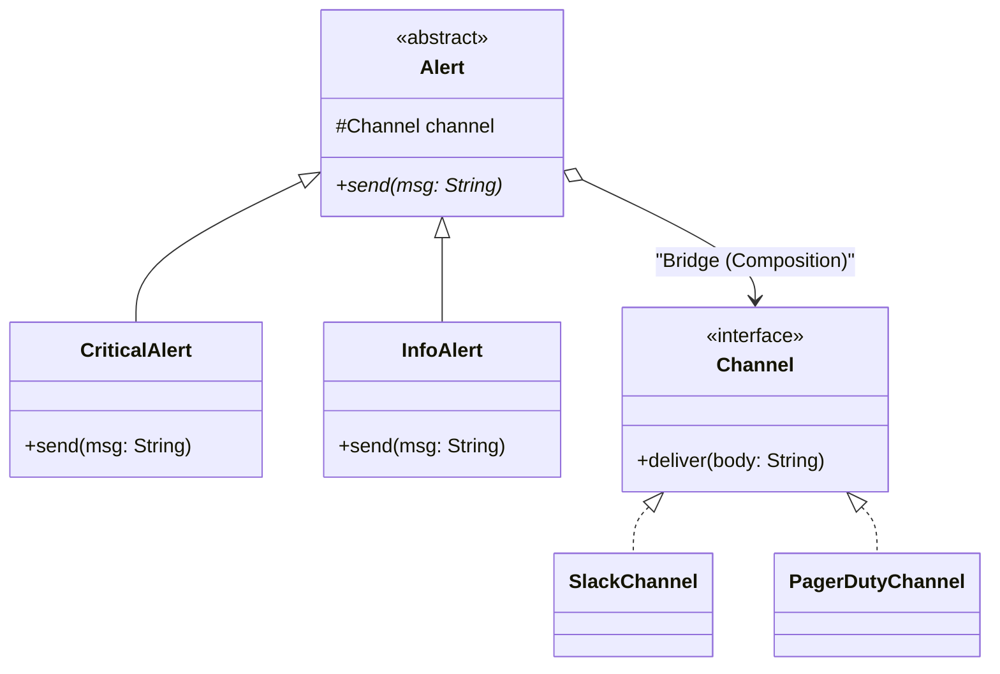

# Bridge Pattern

> **One-line summary:** Decouple an abstraction from its implementation so both can vary independently—replacing an $M \times N$ Cartesian subclass explosion with $M + N$ composable hierarchies.

| Attribute | Specification |
|---|---|
| **Level** | Intermediate / GoF Structural |
| **Prerequisites** | [02-composition-vs-inheritance.md](../01-foundations/02-composition-vs-inheritance.md), [11-orthogonality.md](../03-design-principles/11-orthogonality.md) |
| **Estimated Reading Time** | 30 minutes |
| **Status** | Complete |
| **Category** | Structural |
| **Origin** | GoF 1994 |
| **Also Known As** | Handle/Body Idiom, Pimpl (C++), Orthogonal Hierarchy Split |
| **Languages Tested** | Java 25 (LTS) / TypeScript 5.8 (Node 24 native) / Python 3.14 |

---

## Table of Contents
- [1 The Problem](#1-the-problem)
- [2 Why It Exists](#2-why-it-exists)
- [3 What It Is](#3-what-it-is)
- [4 The Problem Without It](#4-the-problem-without-it)
- [5 How It Solves It](#5-how-it-solves-it)
- [6 How It Works](#6-how-it-works)
- [7 Real-World Examples](#7-real-world-examples)
- [8 When to Use and When NOT to Use](#8-when-to-use-and-when-not-to-use)
- [9 Variations and Language Idioms](#9-variations-and-language-idioms)
- [10 Relationship to Other Principles and Patterns](#10-relationship-to-other-principles-and-patterns)
- [11 Common Mistakes and Anti-Patterns](#11-common-mistakes-and-anti-patterns)
- [12 Testing and Design Verification](#12-testing-and-design-verification)
- [13 Performance, Concurrency and Security Notes](#13-performance-concurrency-and-security-notes)
- [14 Interview Questions](#14-interview-questions)
- [15 Practice Exercises](#15-practice-exercises)
- [16 Summary / Cheat Sheet](#16-summary--cheat-sheet)
- [17 Further Reading](#17-further-reading)

---

## 1 The Problem

Imagine building a monitoring alert system with **3 alert urgencies** (`InfoAlert`, `WarningAlert`, `CriticalAlert`) and **4 delivery channels** (`Slack`, `PagerDuty`, `Email`, `SMS`).

Using pure inheritance, every combination becomes a concrete subclass: `CriticalSlackAlert`, `CriticalPagerDutyAlert`, `WarningEmailAlert`, ... totaling $3 \times 4 = 12$ subclasses! Adding 1 new channel (`Microsoft Teams`) forces writing 3 new alert classes; adding 1 new urgency (`EmergencyAlert`) forces writing 4 new channel classes!

---

## 2 Why It Exists

Formulated by the **Gang of Four (1994)** to stop **orthogonal inheritance explosion**—replacing inheritance across two independent dimensions with **composition** ("the Bridge" pointer from Abstraction to Implementation).

---

## 3 What It Is



---

## 4 The Problem Without It

```java
// Violation: M x N Subclass Explosion!
class CriticalSlackAlert {}
class CriticalEmailAlert {}
class WarningSlackAlert {}
class WarningEmailAlert {}
// Adding 1 channel = M new classes!
```

---

## 5 How It Solves It

### Java Implementation (Java 25 LTS)

```java
package com.design.patterns.structural.bridge;

// Implementation Hierarchy (Axis 2: Delivery Channel)
interface Channel {
    void deliver(String body);
}

class SlackChannel implements Channel {
    public void deliver(String body) {
        System.out.println("Java Bridge Slack: " + body);
    }
}

class PagerDutyChannel implements Channel {
    public void deliver(String body) {
        System.out.println("Java Bridge PagerDuty: " + body);
    }
}

// Abstraction Hierarchy (Axis 1: Alert Urgency) holding Bridge reference to Channel
abstract class Alert {
    protected final Channel channel;
    protected Alert(Channel channel) { this.channel = channel; }
    public abstract void send(String msg);
}

class CriticalAlert extends Alert {
    public CriticalAlert(Channel channel) { super(channel); }
    public void send(String msg) {
        channel.deliver("[CRITICAL] " + msg);
    }
}
```

### TypeScript Implementation (Node 24 Native)

```typescript
interface Channel { deliver(body: string): void; }

class SlackChannel implements Channel {
    deliver(body: string): void { console.log("TS Bridge Slack:", body); }
}

abstract class Alert {
    protected readonly channel: Channel;
    constructor(channel: Channel) { this.channel = channel; }
    abstract send(msg: string): void;
}

class CriticalAlert extends Alert {
    send(msg: string): void { this.channel.deliver(`[CRITICAL] ${msg}`); }
}

new CriticalAlert(new SlackChannel()).send("DB CPU 98%");
```

### Python Implementation (Python 3.14)

```python
from abc import ABC, abstractmethod
from typing import Protocol

class Channel(Protocol):
    def deliver(self, body: str) -> None: ...

class SlackChannel:
    def deliver(self, body: str) -> None:
        print(f"Python Bridge Slack: {body}")

class Alert(ABC):
    def __init__(self, channel: Channel) -> None:
        self._channel = channel

    @abstractmethod
    def send(self, msg: str) -> None: ...

class CriticalAlert(Alert):
    def send(self, msg: str) -> None:
        self._channel.deliver(f"[CRITICAL] {msg}")
```

### Real Execution Output
```text
Java Bridge Slack: [CRITICAL] DB CPU 98%
```

---

## 6 How It Works

Notice the difference between **Bridge** and **Adapter**:
- **Adapter** is applied *retroactively* to make two incompatible existing classes work together.
- **Bridge** is designed *upfront* when you recognize two independent axes (`Alert` $\times$ `Channel`, `Shape` $\times$ `Renderer`) that will evolve separately!

---

## 7 Real-World Examples

1. **JDBC Driver Architecture (`DriverManager` / `Connection` $\leftrightarrow$ Vendor Drivers)**: Java SQL API is the abstraction; PostgreSQL/Oracle drivers are the bridged implementations.
2. **SLF4J Logging API (`Logger` $\leftrightarrow$ Logback / Log4j2 backends)**.
3. **Cross-Platform GUI Frameworks (`Window` abstraction $\leftrightarrow$ `Win32Impl` / `CocoaImpl` / `X11Impl`)**.

---

## 8 When to Use and When NOT to Use

| Context | Use Bridge? | Rationale |
|---|---|---|
| **Two orthogonal hierarchies both needing independent extension** | **Yes** | Prevents $M \times N$ subclassing. |
| **Only 1 implementation exists** | **NO (YAGNI)** | Don't introduce a Bridge interface prematurely if there is only one channel. |

---

## 9 Variations and Language Idioms

In modern TypeScript/Python, if the Abstraction axis doesn't need deep inheritance, Bridge collapses cleanly into **Strategy** (passing a `Channel` callback/interface directly).

---

## 10 Relationship to Other Principles and Patterns

- **Orthogonality & Composition over Inheritance:** Bridge is the classic GoF pattern for orthogonal composition.
- **Abstract Factory:** Often paired with Bridge to instantiate the right `Channel` implementation for the target OS/cloud.

---

## 11 Common Mistakes and Anti-Patterns

| Anti-Pattern | Description | Production Consequence | Correct Remedy |
|---|---|---|---|
| **Applying Bridge for 1 Implementation** | Creating `BridgeImpl` when only one concrete backend will ever exist. | Speculative bloat (YAGNI). | Use concrete class directly until 2nd axis appears. |
| **Confusing Bridge with Adapter** | Thinking Bridge translates legacy incompatible APIs. | Misaligned abstractions. | Adapter retrofits incompatible APIs; Bridge separates orthogonal dimensions upfront. |
| **Leaky Implementation Details** | Exposing `SlackChannel` webhook headers on `Alert`. | Breaks abstraction independence. | Keep `Channel` interface generic (`deliver(body)`). |
| **Tight Coupling via `instanceof`** | `CriticalAlert` checking `if (channel instanceof SlackChannel)`. | Defeats Bridge (violates OCP). | Put channel-specific behavior inside `Channel` subclasses. |
| **Null Channel Field** | Allowing `new CriticalAlert(null)`. | `NullPointerException` at runtime. | Fail-Fast guard in constructor. |
| **Deep Inheritance on Both Sides** | Creating 5-level inheritance trees on both Abstraction and Implementation. | Hard to trace. | Keep hierarchies shallow (1–2 levels). |

---

## 12 Testing and Design Verification

Test `CriticalAlert` with a 1-line fake `Channel` (`body -> captured.add(body)`), verifying formatting independently of Slack/PagerDuty network APIs.

---

## 13 Performance, Concurrency and Security Notes

Keeping `Channel` implementations stateless lets multiple `Alert` objects share a single `SlackChannel` safely across threads.

---

## 14 Interview Questions

<details>
<summary><strong>1. What problem does the Bridge pattern solve?</strong></summary>

It prevents an $M \times N$ Cartesian subclass explosion when a class varies along two orthogonal dimensions (e.g. `AlertUrgency` $\times$ `DeliveryChannel`), replacing inheritance with composition ($M + N$ classes).
</details>

<details>
<summary><strong>2. Distinguish Bridge from Adapter.</strong></summary>

**Adapter** is a retroactive fix making two existing incompatible interfaces work together. **Bridge** is a proactive architectural design separating an abstraction hierarchy from its implementation hierarchy so both vary independently.
</details>

<details>
<summary><strong>3. Distinguish Bridge from Strategy.</strong></summary>

**Strategy** swaps a single behavioral algorithm inside a context (`Sorter` using `QuickSort`). **Bridge** links *two full hierarchies* (`Abstraction` subclasses like `CriticalAlert`, `DigestAlert` $\leftrightarrow$ `Implementation` subclasses like `SlackChannel`, `EmailChannel`).
</details>

<details>
<summary><strong>4. Give a real-world example of the Bridge pattern in Java/Enterprise ecosystems.</strong></summary>

**JDBC** (`java.sql.Connection` abstraction bridged to PostgreSQL/MySQL driver implementations) and **SLF4J** (`Logger` abstraction bridged to Logback/Log4j2).
</details>

<details>
<summary><strong>5. How does Bridge uphold the Open/Closed Principle (OCP)?</strong></summary>

You can add new `Alert` types without modifying any `Channel`, and add new `Channel`s without modifying any `Alert`.
</details>

<details>
<summary><strong>6. What is the "Pimpl" (Pointer to Implementation) idiom in C++ and how does it relate to Bridge?</strong></summary>

Pimpl hides a class's private fields behind an opaque pointer to an `Impl` struct—reducing compile-time header dependencies, a classic application of Bridge's abstraction/implementation split.
</details>

<details>
<summary><strong>7. When is Bridge overkill?</strong></summary>

When only one dimension actually varies, or when there is only 1 concrete implementation (violates YAGNI/KISS).
</details>

<details>
<summary><strong>8. How can you test the Abstraction hierarchy in isolation under Bridge?</strong></summary>

Inject a mock/fake `Channel` into the `Alert` constructor and verify the formatted payload without touching real external channels.
</details>

---

## 15 Practice Exercises

### Exercise 1: Calculate Class Reduction (Easy)
A system has 4 UI Shapes and 5 Rendering Engines (`OpenGL`, `Vulkan`, `DirectX`, `Metal`, `SVG`). How many classes are needed with Inheritance vs Bridge?

<details>
<summary><strong>Solution</strong></summary>

Inheritance: $4 \times 5 = 20$ classes. Bridge: $4 + 5 = 9$ classes.
</details>

---

### Exercise 2: Add `DigestAlert` and `EmailChannel` (Medium)
Extend the Java/TS/Python Bridge example with `DigestAlert` (batched prefix) and `EmailChannel` without editing `CriticalAlert` or `SlackChannel`.

<details>
<summary><strong>Solution</strong></summary>

Create `class DigestAlert extends Alert` and `class EmailChannel implements Channel`; compose `new DigestAlert(new EmailChannel())`.
</details>

---

### Exercise 3: Bridge Remote Control & Device in Python (Hard)
Implement `RemoteControl` (`BasicRemote`, `AdvancedRemote` with `mute()`) bridged to `Device` (`TvDevice`, `SoundbarDevice`) in Python.

<details>
<summary><strong>Solution</strong></summary>

`RemoteControl.__init__(self, device: Device)` delegates `volume_up()`/`set_volume(0)` to `self._device`.
</details>

---

## 16 Summary / Cheat Sheet

```
+--------------------------------------------------------------------------+
|                              BRIDGE PATTERN                              |
+--------------------------------------------------------------------------+
| INTENT     : Decouple Abstraction hierarchy from Implementation hierarchy|
| SOLVES     : M x N Cartesian subclass explosion -> M + N composition.    |
| VS ADAPTER : Bridge is designed upfront for 2 axes; Adapter retrofits!   |
+--------------------------------------------------------------------------+
```

---

## 17 Further Reading

- Erich Gamma et al., *Design Patterns*, Addison-Wesley, 1994.

### In Your Language
| Language Track | Deep Dive Reference |
|---|---|
| Java | [Java OOP & Design Patterns](file:///e:/Learning/engineering-notes/01-languages/java/24-design-patterns/README.md) |
| TypeScript | [TypeScript Design Patterns](file:///e:/Learning/engineering-notes/01-languages/typescript/17-design-patterns/README.md) |
| Python | [Python Design Patterns](file:///e:/Learning/engineering-notes/01-languages/python/23-design-patterns/README.md) |

---

[← Previous: 01 - Adapter Pattern](file:///e:/Learning/engineering-notes/08-solid-design-patterns/06-structural-patterns/01-adapter.md) | [Module 06 Index](file:///e:/Learning/engineering-notes/08-solid-design-patterns/06-structural-patterns/README.md) | [Next: 03 - Composite Pattern →](file:///e:/Learning/engineering-notes/08-solid-design-patterns/06-structural-patterns/03-composite.md)
