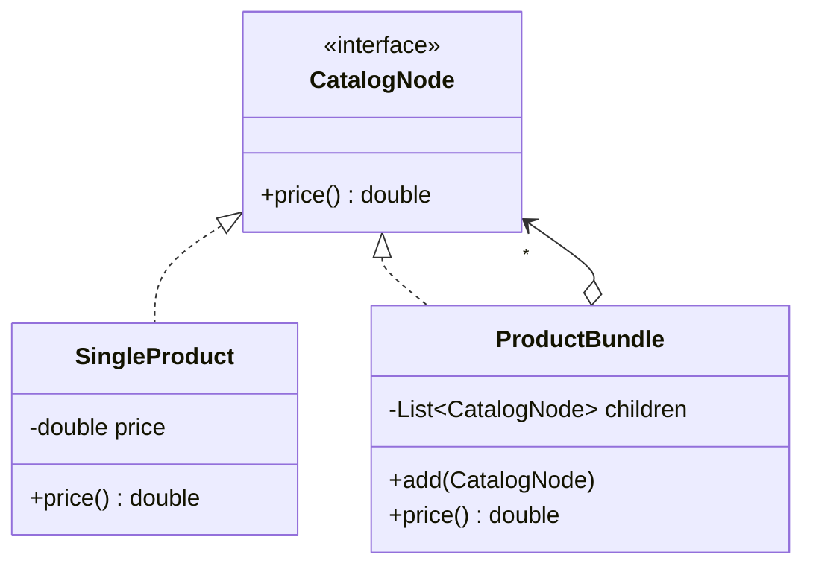

# Composite Pattern

> **One-line summary:** Compose objects into tree structures to represent part-whole hierarchies—allowing clients to treat individual leaf objects and nested composite containers uniformly through a single interface.

| Attribute | Specification |
|---|---|
| **Level** | Core / GoF Structural |
| **Prerequisites** | [01-oop-pillars.md](../01-foundations/01-oop-pillars.md), [03-liskov-substitution.md](../02-solid-principles/03-liskov-substitution.md) |
| **Estimated Reading Time** | 30 minutes |
| **Status** | Complete |
| **Category** | Structural |
| **Origin** | GoF 1994 |
| **Also Known As** | Part-Whole Tree Hierarchy |
| **Languages Tested** | Java 25 (LTS) / TypeScript 5.8 (Node 24 native) / Python 3.14 |

---

## Table of Contents
- [1 The Problem](#1-the-problem)
- [2 Why It Exists](#2-why-it-exists)
- [3 What It Is](#3-what-it-is)
- [4 The Problem Without It](#4-the-problem-without-it)
- [5 How It Solves It](#5-how-it-solves-it)
- [6 How It Works](#6-how-it-works)
- [7 Real-World Examples](#7-real-world-examples)
- [8 When to Use and When NOT to Use](#8-when-to-use-and-when-not-to-use)
- [9 Variations and Language Idioms](#9-variations-and-language-idioms)
- [10 Relationship to Other Principles and Patterns](#10-relationship-to-other-principles-and-patterns)
- [11 Common Mistakes and Anti-Patterns](#11-common-mistakes-and-anti-patterns)
- [12 Testing and Design Verification](#12-testing-and-design-verification)
- [13 Performance, Concurrency and Security Notes](#13-performance-concurrency-and-security-notes)
- [14 Interview Questions](#14-interview-questions)
- [15 Practice Exercises](#15-practice-exercises)
- [16 Summary / Cheat Sheet](#16-summary--cheat-sheet)
- [17 Further Reading](#17-further-reading)

---

## 1 The Problem

Imagine an e-commerce catalog selling individual products (`Keyboard` \$100, `Mouse` \$50) **and** nested product bundles (`Home Office Bundle` containing a Keyboard + `Accessories Sub-Bundle`).

Without Composite, every pricing calculator, tax engine, and discount service must manually check `if (item instanceof Product) ... else if (item instanceof Bundle)` and write recursive tree-walking loops everywhere. Adding a third container type (`SubscriptionBox`) breaks every `instanceof` check across the codebase!

---

## 2 Why It Exists

Formulated by the **Gang of Four (1994)** to eliminate type-checking conditionals over hierarchical trees: when both **Leaves** (single items) and **Composites** (containers of components) implement the exact same `Component` contract, callers invoke `node.price()` uniformly without caring whether `node` is a single item or a 5-level nested tree!

---

## 3 What It Is



---

## 4 The Problem Without It

```java
// Violation: Callers forced to inspect instanceof & manually recurse!
double computeTotalViolation(Object node) {
    if (node instanceof SingleProduct p) return p.price();
    if (node instanceof ProductBundle b) {
        double sum = 0;
        for (Object child : b.rawChildren()) sum += computeTotalViolation(child);
        return sum;
    }
    throw new IllegalArgumentException("Unknown node");
}
```

---

## 5 How It Solves It

### Java Implementation (Java 25 LTS — Safe Composite)

```java
package com.design.patterns.structural.composite;

import java.util.*;

interface CatalogNode {
    double price();
}

// Leaf
record SingleProduct(String name, double price) implements CatalogNode {}

// Composite
class ProductBundle implements CatalogNode {
    private final List<CatalogNode> children = new ArrayList<>();

    public void add(CatalogNode node) {
        if (node == this) throw new IllegalArgumentException("Cannot add bundle to itself!");
        children.add(node);
    }

    @Override
    public double price() {
        return children.stream().mapToDouble(CatalogNode::price).sum();
    }
}
```

### TypeScript Implementation (Node 24 Native)

```typescript
interface CatalogNode { price(): number; }

class SingleProduct implements CatalogNode {
    private readonly _price: number;
    constructor(price: number) { this._price = price; }
    price(): number { return this._price; }
}

class ProductBundle implements CatalogNode {
    private readonly children: CatalogNode[] = [];
    add(node: CatalogNode): void { this.children.push(node); }
    price(): number { return this.children.reduce((s, c) => s + c.price(), 0); }
}
```

### Python Implementation (Python 3.14)

```python
from typing import Protocol

class CatalogNode(Protocol):
    def price(self) -> float: ...

class SingleProduct:
    def __init__(self, price: float) -> None:
        self._price = price
    def price(self) -> float:
        return self._price

class ProductBundle:
    def __init__(self, items: list[CatalogNode]) -> None:
        self._items = items
    def price(self) -> float:
        return sum(i.price() for i in self._items)
```

### Real Execution Output
```text
Java Composite Bundle Total: $150.0
Python Composite Total: $150.0
```

---

## 6 How It Works: Safety vs. Transparency Trade-off (LSP!)

There are two classic ways to declare `add()` / `remove()` in Composite:
1. **Safety (Recommended — ISP + LSP compliant):** Put `add()`/`remove()` **only** on `ProductBundle` (the Composite), NOT on `CatalogNode`. Leaves stay clean and never throw `UnsupportedOperationException`.
2. **Transparency (GoF classic — violates LSP!):** Put `add()` on `CatalogNode`, forcing `SingleProduct.add()` to throw `UnsupportedOperationException`. Avoid unless callers must mutate arbitrary nodes uniformly.

---

## 7 Real-World Examples

1. **HTML DOM (`Node` / `Element` / `TextNode`)** and **React Virtual DOM Components**.
2. **File Systems (`File` vs `Directory` calculating total `sizeBytes()`)**.
3. **Boolean Query / Specification Trees (`AndSpec(PriceSpec, OrSpec(BrandA, BrandB))`)**.

---

## 8 When to Use and When NOT to Use

| Context | Use Composite? | Rationale |
|---|---|---|
| **Tree / Part-Whole recursive hierarchies** | **Yes** | Eliminates `instanceof` branching across callers. |
| **Flat lists of 1-level items** | **NO (YAGNI)** | A plain `List<Item>` is simpler than a recursive tree. |

---

## 9 Variations and Language Idioms

- **Composite + Visitor:** When you need many external operations (`toXml()`, `calculateTax()`, `renderHtml()`) over a stable tree structure without bloating `CatalogNode`.
- **Composite + Cycle Guard:** Always guard against `parent.add(ancestor)` cycles to prevent `StackOverflowError` on recursive `.price()`!

---

## 10 Relationship to Other Principles and Patterns

- **LSP & ISP:** Keeping `add()` off the Leaf/Component interface preserves both LSP and ISP.
- **Decorator:** Looks structurally similar (wraps Component), except Decorator wraps **one** child to add behavior, while Composite aggregates **many** children ($0..N$) to sum/combine them.

---

## 11 Common Mistakes and Anti-Patterns

| Anti-Pattern | Description | Production Consequence | Correct Remedy |
|---|---|---|---|
| **Putting `add()` on Leaf (Throwing Stub)** | `SingleProduct.add()` throwing `UnsupportedOperationException`. | Violates LSP & ISP! | Put `add()`/`remove()` only on `ProductBundle`. |
| **Allowing Tree Cycles** | `bundleA.add(bundleB); bundleB.add(bundleA);` | Infinite recursion (`StackOverflowError`) on `price()`! | Guard against self/ancestor cycles. |
| **Unbounded Recursion Depth** | Parsing user-supplied 50,000-deep JSON/AST trees recursively. | Stack overflow crash (DoS). | Enforce max depth limit or use iterative stack traversal. |
| **Overcomplicating Flat Data** | Wrapping a simple 1-level `Order -> List<OrderItem>` in Composite. | Unnecessary recursion. | Use Composite only for multi-level nested trees. |
| **Downcasting in Callers** | `if (node instanceof ProductBundle)` outside construction. | Defeats uniform polymorphism. | Move operation onto `CatalogNode` interface. |
| **Ignoring Caching on Huge Trees** | Recomputing `price()` over 100,000 nodes on every UI frame. | Latency spike. | Cache dirty/computed aggregates or invalidate bottom-up. |

---

## 12 Testing and Design Verification

Test 3 cases: (1) Single Leaf `price()`, (2) Empty Composite `price() == 0`, and (3) Multi-level nested Composite summing leaves + sub-bundles accurately.

---

## 13 Performance, Concurrency and Security Notes

- **Security:** For untrusted nested input (JSON, XML, Expression Trees), enforce a **maximum nesting depth** to prevent Stack-Overflow Denial-of-Service attacks!

---

## 14 Interview Questions

<details>
<summary><strong>1. What is the intent of the Composite pattern?</strong></summary>

To compose objects into tree structures so clients can treat individual objects (Leaves) and compositions of objects (Composites) uniformly through a shared interface.
</details>

<details>
<summary><strong>2. Explain the "Safety vs Transparency" design trade-off in Composite, and how it relates to LSP.</strong></summary>

Putting `add()/remove()` on the base `Component` interface gives **Transparency** (clients call `add()` on anything) but violates **LSP** because Leaves must throw `UnsupportedOperationException`. Putting `add()/remove()` only on `Composite` gives **Safety** (compile-time LSP/ISP compliance).
</details>

<details>
<summary><strong>3. How does Composite differ from Decorator?</strong></summary>

**Composite** aggregates $0..N$ children to represent a part-whole tree (e.g., Folder containing Files). **Decorator** wraps exactly **1** target component to dynamically add extra behavior around its calls.
</details>

<details>
<summary><strong>4. What happens if a cycle is introduced in a Composite tree, and how do you prevent it?</strong></summary>

Recursive operations like `price()` or `size()` enter infinite recursion and throw `StackOverflowError`. Prevent it by validating `node != this` and checking ancestor links (or keeping the tree immutable/constructed bottom-up).
</details>

<details>
<summary><strong>5. Give 3 real-world examples of Composite.</strong></summary>

1. OS File Systems (`File` vs `Directory`). 2. Browser HTML DOM (`TextNode` vs `Element`). 3. UI Component trees (React/Flutter widgets) and Boolean Specification trees (`And`/`Or` rules).
</details>

<details>
<summary><strong>6. When should you pair Composite with the Visitor pattern?</strong></summary>

When the tree node types are stable (`Leaf`, `Bundle`), but you frequently need to add *new external operations* (PDF export, tax audit, JSON serialization) without cluttering the node classes.
</details>

<details>
<summary><strong>7. Why is an empty `ProductBundle` returning `0` useful?</strong></summary>

Returning the identity value (`0` for sum, `true` for `AND` specs) avoids special-case `if (children.isEmpty())` checks in callers.
</details>

<details>
<summary><strong>8. What security vulnerability arises from untrusted deep Composite trees?</strong></summary>

Deeply nested user-supplied trees (e.g. 20,000 nested boolean filters) cause `StackOverflowError` during recursive traversal—mitigate with a max depth check or an explicit iterative stack.
</details>

---

## 15 Practice Exercises

### Exercise 1: Model File System Size (Easy)
Implement `FileSystemNode` (`sizeBytes()`) with `FileLeaf` and `DirectoryComposite` in Java/TS/Python.

<details>
<summary><strong>Solution</strong></summary>

`DirectoryComposite.sizeBytes()` sums `child.sizeBytes()` across all children.
</details>

---

### Exercise 2: Add Cycle Detection (Medium)
Prevent `a.add(b); b.add(a);` in `ProductBundle` by tracking `containsNode(CatalogNode target)`.

<details>
<summary><strong>Solution</strong></summary>

Check `if (node == this || (node instanceof ProductBundle b && b.contains(this))) throw new IllegalArgumentException("Cycle detected");`.
</details>

---

### Exercise 3: Composite Boolean Specification in Python (Hard)
Implement `AndRule` and `OrRule` Composite nodes over `Rule(Protocol): def matches(self, user: dict) -> bool` to evaluate `AndRule([AgeOver18(), OrRule([IsVip(), HasCoupon()])])`.

<details>
<summary><strong>Solution</strong></summary>

`AndRule.matches`: `all(r.matches(u) for r in self._rules)`; `OrRule.matches`: `any(r.matches(u) for r in self._rules)`.
</details>

---

## 16 Summary / Cheat Sheet

```
+--------------------------------------------------------------------------+
|                            COMPOSITE PATTERN                             |
+--------------------------------------------------------------------------+
| INTENT     : Uniform tree interface across single Leaves & Containers.   |
| PREFER     : Safety (put add/remove ONLY on Composite to preserve LSP!). |
| GUARD      : Prevent cycles & enforce max recursion depth on user trees. |
+--------------------------------------------------------------------------+
```

---

## 17 Further Reading

- Erich Gamma et al., *Design Patterns*, Addison-Wesley, 1994.

### In Your Language
| Language Track | Deep Dive Reference |
|---|---|
| Java | [Java OOP & Design Patterns](file:///e:/Learning/engineering-notes/01-languages/java/24-design-patterns/README.md) |
| TypeScript | [TypeScript Design Patterns](file:///e:/Learning/engineering-notes/01-languages/typescript/17-design-patterns/README.md) |
| Python | [Python Design Patterns](file:///e:/Learning/engineering-notes/01-languages/python/23-design-patterns/README.md) |

---

[← Previous: 02 - Bridge Pattern](file:///e:/Learning/engineering-notes/08-solid-design-patterns/06-structural-patterns/02-bridge.md) | [Module 06 Index](file:///e:/Learning/engineering-notes/08-solid-design-patterns/06-structural-patterns/README.md) | [Next: 04 - Decorator Pattern →](file:///e:/Learning/engineering-notes/08-solid-design-patterns/06-structural-patterns/04-decorator.md)
