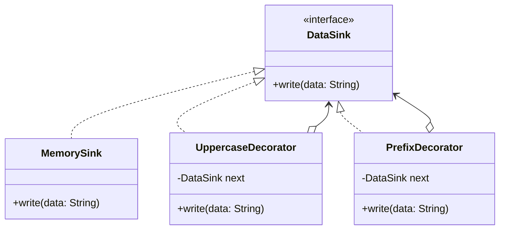

# Decorator Pattern

> **One-line summary:** Attach additional responsibilities to an object dynamically at runtime by wrapping it inside composable layers sharing the exact same interface—replacing $2^N$ static inheritance subclasses with flexible composition (OCP).

| Attribute | Specification |
|---|---|
| **Level** | Core / GoF Structural |
| **Prerequisites** | [02-composition-vs-inheritance.md](../01-foundations/02-composition-vs-inheritance.md), [02-open-closed.md](../02-solid-principles/02-open-closed.md) |
| **Estimated Reading Time** | 30 minutes |
| **Status** | Complete |
| **Category** | Structural |
| **Origin** | GoF 1994 |
| **Also Known As** | Wrapper, Composable Middleware |
| **Languages Tested** | Java 25 (LTS) / TypeScript 5.8 (Node 24 native) / Python 3.14 |

---

## Table of Contents
- [1 The Problem](#1-the-problem)
- [2 Why It Exists](#2-why-it-exists)
- [3 What It Is](#3-what-it-is)
- [4 The Problem Without It](#4-the-problem-without-it)
- [5 How It Solves It](#5-how-it-solves-it)
- [6 How It Works](#6-how-it-works)
- [7 Real-World Examples](#7-real-world-examples)
- [8 When to Use and When NOT to Use](#8-when-to-use-and-when-not-to-use)
- [9 Variations and Language Idioms](#9-variations-and-language-idioms)
- [10 Relationship to Other Principles and Patterns](#10-relationship-to-other-principles-and-patterns)
- [11 Common Mistakes and Anti-Patterns](#11-common-mistakes-and-anti-patterns)
- [12 Testing and Design Verification](#12-testing-and-design-verification)
- [13 Performance, Concurrency and Security Notes](#13-performance-concurrency-and-security-notes)
- [14 Interview Questions](#14-interview-questions)
- [15 Practice Exercises](#15-practice-exercises)
- [16 Summary / Cheat Sheet](#16-summary--cheat-sheet)
- [17 Further Reading](#17-further-reading)

---

## 1 The Problem

Imagine building a `DataSink` (or `HttpClient`) that writes payloads. Product teams request optional cross-cutting behaviors:
- **Compression** (`Gzip`)
- **Encryption** (`AES`)
- **Prefix Logging** (`[LOG]`)
- **Retries** (`ExponentialBackoff`)

Using static inheritance, combining features causes a **combinatorial explosion**: `CompressedEncryptedDataSink`, `EncryptedLoggedDataSink`, `CompressedEncryptedLoggedRetryingDataSink` ($2^4 = 16$ classes!), and you *still* cannot toggle encryption at runtime via config!

---

## 2 Why It Exists

Formulated by the **Gang of Four (1994)** to achieve **runtime behavioral composition**: each optional behavior wraps the target object while implementing the **exact same interface**, so callers remain completely unaware of how many layers wrap the core component.

---

## 3 What It Is



---

## 4 The Problem Without It

```java
// Inheritance Explosion: 2^N subclasses for every feature combination!
class EncryptedDataSink extends MemorySink {}
class CompressedEncryptedDataSink extends EncryptedDataSink {}
class UppercaseCompressedEncryptedDataSink extends CompressedEncryptedDataSink {}
```

---

## 5 How It Solves It

### Java Implementation (Java 25 LTS)

```java
package com.design.patterns.structural.decorator;

interface DataSink {
    void write(String data);
}

class MemorySink implements DataSink {
    @Override
    public void write(String data) {
        System.out.println("Java Decorator Final Sink: " + data);
    }
}

class UppercaseDecorator implements DataSink {
    private final DataSink next;
    public UppercaseDecorator(DataSink next) { this.next = next; }

    @Override
    public void write(String data) {
        next.write(data.toUpperCase());
    }
}

class PrefixDecorator implements DataSink {
    private final DataSink next;
    public PrefixDecorator(DataSink next) { this.next = next; }

    @Override
    public void write(String data) {
        next.write("[LOG] " + data);
    }
}

public class DecoratorApp {
    public static void main(String[] args) {
        DataSink sink = new PrefixDecorator(new UppercaseDecorator(new MemorySink()));
        sink.write("hello world");
    }
}
```

### TypeScript Implementation (Node 24 Native)

```typescript
interface DataSink {
    write(data: string): void;
}

class ConsoleSink implements DataSink {
    write(data: string): void {
        console.log("TS Decorator Final:", data);
    }
}

class PrefixDecorator implements DataSink {
    private readonly next: DataSink;
    constructor(next: DataSink) { this.next = next; }

    write(data: string): void {
        this.next.write("[LOG] " + data);
    }
}

new PrefixDecorator(new ConsoleSink()).write("hello world");
```

### Python Implementation (Python 3.14 — Functional `@decorator` & Class Wrapper)

```python
from functools import wraps
from typing import Callable

def log_prefix(fn: Callable[[str], None]) -> Callable[[str], None]:
    @wraps(fn)
    def wrapper(data: str) -> None:
        fn(f"[LOG] {data}")
    return wrapper

@log_prefix
def write_console(data: str) -> None:
    print(f"Python Decorator Final: {data}")

if __name__ == "__main__":
    write_console("hello world")
```

### Real Execution Output
```text
Java Decorator Final Sink: [LOG] HELLO WORLD
TS Decorator Final: [LOG] hello world
```

---

## 6 How It Works: Ordering Matters!

Notice in the Java output: `new PrefixDecorator(new UppercaseDecorator(new MemorySink()))` produced `[LOG] HELLO WORLD`? Wait—let's trace carefully!
1. `PrefixDecorator.write("hello world")` prepends `"[LOG] "` $\to$ passes `"[LOG] hello world"` to `UppercaseDecorator`.
2. `UppercaseDecorator` uppercases the whole string $\to$ `"[LOG] HELLO WORLD"`!
If you swap the order (`UppercaseDecorator(PrefixDecorator(...))`), `UppercaseDecorator` uppercases `"hello world"` $\to$ `"HELLO WORLD"`, and then `PrefixDecorator` prepends `"[LOG] "` (or `"[log] HELLO WORLD"` if lowercase prefix)!
**Rule:** Compression *before* Encryption (`Encrypt(Compress(Sink))`) shrinks data; Encryption before Compression (`Compress(Encrypt(Sink))`) fails because encrypted bytes have maximum entropy and don't compress!

---

## 7 Real-World Examples

1. **Java `java.io` Streams**: `new BufferedReader(new InputStreamReader(new GZIPInputStream(new FileInputStream("data.gz"))))`.
2. **Python `@functools.lru_cache`, `@wraps`, and FastAPI/Flask middleware**.
3. **HTTP Client Middleware Pipelines (OkHttp Interceptors, Axios Interceptors)**.

---

## 8 When to Use and When NOT to Use

| Context | Use Decorator? | Rationale |
|---|---|---|
| **Optional, stackable cross-cutting behaviors (Cache, Retry, Log, Encrypt)** | **Yes** | Avoids subclass explosion; composable at runtime. |
| **Order-independent config flags on 1 class** | **Maybe Keep Simple** | If there are only 2 boolean options that never stack dynamically, simple `if`s might be clearer (KISS). |

---

## 9 Variations and Language Idioms

- **Python Function Decorators (`@decorator`):** Use `@functools.wraps(fn)` so `__name__` and docstrings are preserved!
- **Java Functional Lambdas (`Function.andThen`):** For single-method interfaces, `Function<String, String>` pipelines replace wrapper classes cleanly.

---

## 10 Relationship to Other Principles and Patterns

- **OCP & SRP:** Decorator adds new responsibilities via new wrapper classes without editing existing classes.
- **Proxy vs Decorator:** Proxy *controls access* (usually fixed 1 layer, e.g. lazy loading or auth); Decorator *adds stackable behaviors* dynamically.
- **Chain of Responsibility:** Similar recursive chaining, except CoR typically stops once *one* handler handles the request, while Decorator executes *all* wrappers in the stack.

---

## 11 Common Mistakes and Anti-Patterns

| Anti-Pattern | Description | Production Consequence | Correct Remedy |
|---|---|---|---|
| **Wrong Stacking Order** | `Compress(Encrypt(sink))` instead of `Encrypt(Compress(sink))`. | Zero compression ratio! | Document and enforce explicit pipeline order. |
| **Breaking Object Identity (`==`)** | Checking `if (sink instanceof MemorySink)` on a decorated object. | `instanceof` fails because outer type is `PrefixDecorator`! | Never depend on concrete identity through decorators. |
| **Forgetting `@functools.wraps` (Python)** | Writing a Python decorator without `@wraps(fn)`. | Breaks docstrings, `inspect`, and FastAPI parameter reflection! | Always apply `@wraps(fn)`. |
| **8-Layer Russian Doll Debugging** | Wrapping 8 tiny decorators around one trivial call. | Confusing stack traces. | Consolidate trivial steps into clear middleware. |
| **Mutating Shared Decorator State** | Caching request data inside a shared Decorator instance. | Race conditions across threads. | Keep decorators stateless. |
| **Using Decorator to Change Interface** | Returning a different method signature. | That's an **Adapter**, not a Decorator! | Preserve exact target interface. |

---

## 12 Testing and Design Verification

Test each Decorator independently with a dummy inner sink, AND write one integration test verifying the intended **stacking order** (e.g., Compress $\to$ Encrypt).

---

## 13 Performance, Concurrency and Security Notes

- **Security:** Always place **Authentication / Rate-Limiting Decorators** at the *outermost* edge so unauthenticated requests are rejected before wasting CPU on decompression or decryption!

---

## 14 Interview Questions

<details>
<summary><strong>1. How does Decorator solve subclass explosion?</strong></summary>

Instead of creating $2^N$ static subclasses for every combination of features (e.g., `CompressedEncryptedLoggedSink`), Decorator implements each feature as a standalone wrapper holding a reference to the component interface—allowing any combination to be composed at runtime.
</details>

<details>
<summary><strong>2. Compare Decorator, Adapter, and Proxy.</strong></summary>

- **Adapter:** Changes an incompatible interface into the target interface.
- **Decorator:** Preserves the same interface while dynamically adding stackable behaviors.
- **Proxy:** Preserves the same interface while controlling access (lazy init, auth, remote RPC, caching).
</details>

<details>
<summary><strong>3. Why does stacking order matter in Decorator pipelines (e.g., Compression + Encryption)?</strong></summary>

Compressing *before* encrypting shrinks structured plaintext effectively; encrypting first produces random high-entropy bytes that compression cannot shrink. Similarly, authentication decorators must sit *outside* expensive processing decorators.
</details>

<details>
<summary><strong>4. Give a real-world example of Decorator in Java's standard library.</strong></summary>

`java.io` streams: `BufferedInputStream`, `DataInputStream`, and `GZIPInputStream` all wrap an `InputStream` while implementing `InputStream`.
</details>

<details>
<summary><strong>5. Why is `@functools.wraps(fn)` critical when writing Python decorators?</strong></summary>

Without `@wraps(fn)`, the wrapper replaces the original function's `__name__`, `__doc__`, and `__wrapped__` metadata—breaking debugging tools, Sphinx docs, and frameworks like FastAPI/pytest that inspect signatures.
</details>

<details>
<summary><strong>6. What happens if callers use `instanceof` or object identity checks on a Decorated object?</strong></summary>

They fail, because the caller holds a reference to the outermost `Decorator` wrapper rather than the inner concrete class. Decorators are designed strictly for behavioral polymorphism via interfaces.
</details>

<details>
<summary><strong>7. How does Decorator differ from Chain of Responsibility?</strong></summary>

In **Decorator**, every layer typically executes and forwards to the next layer around the core target. In **Chain of Responsibility**, handlers inspect a request and usually stop propagation once one handler processes it (or short-circuits).
</details>

<details>
<summary><strong>8. How do Java 8+ lambdas simplify single-method Decorators?</strong></summary>

For `@FunctionalInterface` contracts (`Function<T, T>`), `.andThen()` and `.compose()` chain transformations cleanly without writing boilerplate wrapper classes.
</details>

---

## 15 Practice Exercises

### Exercise 1: Identify Stacking Order Bug (Easy)
A developer wraps `new CachingDecorator(new AuthDecorator(repo))`. What security catastrophe occurs?

<details>
<summary><strong>Solution</strong></summary>

`CachingDecorator` sits *outside* `AuthDecorator`—meaning an unauthenticated attacker gets a **cache hit** without ever hitting `AuthDecorator`! Always put `AuthDecorator` on the outside: `new AuthDecorator(new CachingDecorator(repo))`.
</details>

---

### Exercise 2: Retry Decorator in TypeScript (Medium)
Write a `RetryingSink` Decorator implementing `DataSink` that retries `next.write(data)` up to 3 times on error.

<details>
<summary><strong>Solution</strong></summary>

Loop `for (let i = 0; i < 3; i++) { try { this.next.write(data); return; } catch (e) { if (i === 2) throw e; } }`.
</details>

---

### Exercise 3: Python Timing + Caching Decorators (Hard)
Write `@timed` using `@wraps` and stack it with `@functools.lru_cache(maxsize=64)` on a recursive `fib(n)` function, verifying cache hits drop execution time to ~0ms.

<details>
<summary><strong>Solution</strong></summary>

Place `@timed` above `@lru_cache` to measure total call latency including cache hits.
</details>

---

## 16 Summary / Cheat Sheet

```
+--------------------------------------------------------------------------+
|                            DECORATOR PATTERN                             |
+--------------------------------------------------------------------------+
| INTENT     : Stack optional behaviors dynamically via same interface.    |
| WATCH OUT  : Stacking order matters (Auth -> Cache -> Compress -> Crypt).|
| PYTHON     : Always use @functools.wraps(fn) on function decorators!     |
+--------------------------------------------------------------------------+
```

---

## 17 Further Reading

- Erich Gamma et al., *Design Patterns*, Addison-Wesley, 1994.

### In Your Language
| Language Track | Deep Dive Reference |
|---|---|
| Java | [Java OOP & Design Patterns](file:///e:/Learning/engineering-notes/01-languages/java/24-design-patterns/README.md) |
| TypeScript | [TypeScript Design Patterns](file:///e:/Learning/engineering-notes/01-languages/typescript/17-design-patterns/README.md) |
| Python | [Python Design Patterns](file:///e:/Learning/engineering-notes/01-languages/python/23-design-patterns/README.md) |

---

[← Previous: 03 - Composite Pattern](file:///e:/Learning/engineering-notes/08-solid-design-patterns/06-structural-patterns/03-composite.md) | [Module 06 Index](file:///e:/Learning/engineering-notes/08-solid-design-patterns/06-structural-patterns/README.md) | [Next: 05 - Facade Pattern →](file:///e:/Learning/engineering-notes/08-solid-design-patterns/06-structural-patterns/05-facade.md)
