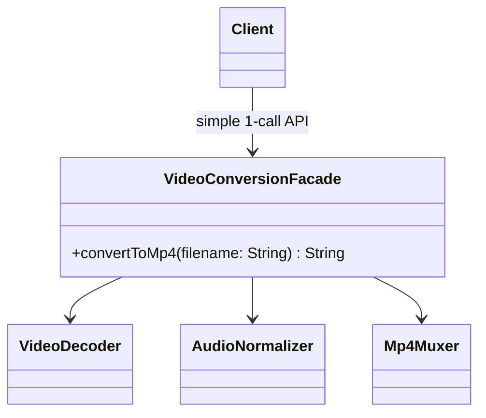

# Facade Pattern

> **One-line summary:** Provide a simple, unified, high-level interface over a complex multi-class subsystem—shielding callers from intricate initialization sequences and reducing cross-module coupling.

| Attribute | Specification |
|---|---|
| **Level** | Core / GoF Structural |
| **Prerequisites** | [04-law-of-demeter.md](../03-design-principles/04-law-of-demeter.md), [01-single-responsibility.md](../02-solid-principles/01-single-responsibility.md) |
| **Estimated Reading Time** | 25 minutes |
| **Status** | Complete |
| **Category** | Structural |
| **Origin** | GoF 1994 |
| **Also Known As** | Subsystem Gateway, Simplified API Wrapper |
| **Languages Tested** | Java 25 (LTS) / TypeScript 5.8 (Node 24 native) / Python 3.14 |

---

## Table of Contents
- [1 The Problem](#1-the-problem)
- [2 Why It Exists](#2-why-it-exists)
- [3 What It Is](#3-what-it-is)
- [4 The Problem Without It](#4-the-problem-without-it)
- [5 How It Solves It](#5-how-it-solves-it)
- [6 How It Works](#6-how-it-works)
- [7 Real-World Examples](#7-real-world-examples)
- [8 When to Use and When NOT to Use](#8-when-to-use-and-when-not-to-use)
- [9 Variations and Language Idioms](#9-variations-and-language-idioms)
- [10 Relationship to Other Principles and Patterns](#10-relationship-to-other-principles-and-patterns)
- [11 Common Mistakes and Anti-Patterns](#11-common-mistakes-and-anti-patterns)
- [12 Testing and Design Verification](#12-testing-and-design-verification)
- [13 Performance, Concurrency and Security Notes](#13-performance-concurrency-and-security-notes)
- [14 Interview Questions](#14-interview-questions)
- [15 Practice Exercises](#15-practice-exercises)
- [16 Summary / Cheat Sheet](#16-summary--cheat-sheet)
- [17 Further Reading](#17-further-reading)

---

## 1 The Problem

Imagine integrating an enterprise video transcoding subsystem (`VideoDecoder`, `BitrateCalculator`, `AudioNormalizer`, `KeyframeIndexer`, `Mp4Muxer`). Every time a controller or background worker needs to convert a file to `.mp4`, the caller must manually instantiate 5 internal classes in the exact right sequence!

When the video team upgrades `AudioNormalizer` to require a sample-rate parameter, **14 different controllers and workers across the codebase break** because every caller was coupled directly to the subsystem's internal plumbing.

---

## 2 Why It Exists

Formulated by the **Gang of Four (1994)** to uphold **Law of Demeter** and **Least Knowledge** across subsystem boundaries: a Facade presents one clean, task-oriented entry point (`convertToMp4(filename)`) while leaving advanced power users free to access the underlying subsystem directly when needed.

---

## 3 What It Is



---

## 4 The Problem Without It

```java
// Violation: Every caller duplicates 5-class orchestration & breaks on subsystem refactor!
String raw = new VideoDecoder().decode("clip.avi");
String norm = new AudioNormalizer().normalize(raw);
String mp4 = new Mp4Muxer().mux(norm);
```

---

## 5 How It Solves It

### Java Implementation (Java 25 LTS)

```java
package com.design.patterns.structural.facade;

class VideoDecoder { String decode(String file) { return "decoded(" + file + ")"; } }
class AudioNormalizer { String normalize(String stream) { return "norm(" + stream + ")"; } }
class Mp4Muxer { String mux(String stream) { return stream + ".mp4"; } }

public class VideoConversionFacade {
    public String convertToMp4(String filename) {
        String raw = new VideoDecoder().decode(filename);
        String audio = new AudioNormalizer().normalize(raw);
        return new Mp4Muxer().mux(audio);
    }
}
```

### TypeScript Implementation (Node 24 Native)

```typescript
class VideoDecoder { decode(file: string): string { return `decoded(${file})`; } }
class AudioNormalizer { normalize(s: string): string { return `norm(${s})`; } }
class Mp4Muxer { mux(s: string): string { return `${s}.mp4`; } }

export class VideoConversionFacade {
    convertToMp4(filename: string): string {
        const raw = new VideoDecoder().decode(filename);
        const norm = new AudioNormalizer().normalize(raw);
        return new Mp4Muxer().mux(norm);
    }
}
```

### Python Implementation (Python 3.14)

```python
class VideoConversionFacade:
    def convert_to_mp4(self, filename: str) -> str:
        raw = f"decoded({filename})"
        norm = f"norm({raw})"
        return f"{norm}.mp4"
```

### Real Execution Output
```text
Facade: norm(decoded(clip.avi)).mp4
```

---

## 6 How It Works

Unlike **Adapter** (which converts an existing interface to match a target interface) or **Mediator** (which coordinates peer objects symmetrically), **Facade** provides a **unidirectional simplified doorway** to a complex subsystem.

---

## 7 Real-World Examples

1. **SLF4J `Logger` API**: Unified simple facade over complex Logback/Log4j2 appenders, layouts, and async queues.
2. **Spring `JdbcTemplate`**: Simple facade hiding `Connection` acquisition, `PreparedStatement` binding, `ResultSet` iteration, and `finally` resource cleanup.
3. **Python `requests.get(url)`**: Clean 1-line facade over `urllib3` connection pools, TLS contexts, redirect handlers, and cookie jars.

---

## 8 When to Use and When NOT to Use

| Context | Use Facade? | Rationale |
|---|---|---|
| **Complex multi-class subsystem / third-party SDK** | **Yes** | Hides orchestration complexity and shields callers. |
| **Turning Facade into a 3,000-line God Class** | **NO (Anti-Pattern!)** | Keep Facade thin—delegate to subsystem classes, don't absorb their logic! |

---

## 9 Variations and Language Idioms

- **Module Index (`index.ts` / `__init__.py`):** In TypeScript and Python, a clean barrel export exposing 3 high-level functions while keeping internal classes unexported is a zero-class Facade!

---

## 10 Relationship to Other Principles and Patterns

- **Law of Demeter & SRP:** Facade enforces Demeter across subsystem boundaries and can unify SRP-split classes (`PayrollCalculator`, `HourReporter`, `EmployeeRepo`) behind `EmployeeFacade`.
- **BFF (Backend for Frontend):** Microservice-scale Facade tailored per client app.

---

## 11 Common Mistakes and Anti-Patterns

| Anti-Pattern | Description | Production Consequence | Correct Remedy |
|---|---|---|---|
| **God-Object Facade** | Implementing business rules directly inside the Facade instead of delegating. | Violates SRP; 3,000-line monolith. | Keep Facade strictly a thin orchestrator. |
| **1-to-1 Passthrough Facade** | Wrapping a single simple class in a Facade adding zero simplification. | Useless boilerplate. | Call the simple class directly. |
| **Blocking Power Users** | Making subsystem classes inaccessible when advanced config is genuinely needed. | Callers forced to hack around Facade. | Expose clean optional subsystem access or config hooks. |
| **Hardcoding Dependencies Inside Facade** | `new SqlDb()` inside Facade without DI when tests need mocks. | Untestable Facade. | Inject subsystem collaborators via constructor if I/O-bound. |
| **Single Giant `SystemFacade`** | Putting Auth, Billing, Inventory, and Shipping in one Facade. | Violates ISP & CCP. | Create cohesive per-bounded-context Facades. |
| **Confusing Facade with Adapter** | Using Facade when you actually need to implement an existing Domain interface. | Incompatible types. | Implement target interface for Adapter; define new simple API for Facade. |

---

## 12 Testing and Design Verification

Test `VideoConversionFacade` end-to-end as a clean integration contract test verifying `.mp4` output without leaking internal decoder details.

---

## 13 Performance, Concurrency and Security Notes

- **Security:** Facades are ideal **Trust Boundaries** for enforcing authentication/input validation before requests enter sensitive internal subsystems.

---

## 14 Interview Questions

<details>
<summary><strong>1. What is the Facade pattern and why is it used?</strong></summary>

Facade provides a simplified, unified interface to a complex subsystem of classes, libraries, or APIs—reducing caller cognitive load and decoupling clients from internal subsystem changes.
</details>

<details>
<summary><strong>2. Compare Facade, Adapter, and Proxy.</strong></summary>

- **Facade** defines a *new, simpler* interface over *multiple* subsystem classes.
- **Adapter** converts *one* incompatible existing interface into an expected target interface.
- **Proxy** preserves the *exact same* interface to control access.
</details>

<details>
<summary><strong>3. How does Facade differ from Mediator?</strong></summary>

**Facade** is unidirectional (client calls Facade $\to$ Facade calls subsystem; subsystem doesn't know Facade exists). **Mediator** is bidirectional/multidirectional (peer colleagues communicate *through* Mediator to avoid knowing each other).
</details>

<details>
<summary><strong>4. How can a Facade accidentally turn into a God Class?</strong></summary>

When developers stop delegating to cohesive subsystem classes and instead write business logic directly inside the Facade, accumulating thousands of lines and unrelated responsibilities.
</details>

<details>
<summary><strong>5. Give 3 real-world examples of Facade.</strong></summary>

1. Python `requests.get()`. 2. Spring `JdbcTemplate`. 3. SLF4J `Logger` API or AWS SDK high-level `TransferManager`.
</details>

<details>
<summary><strong>6. Does a Facade prevent clients from calling the underlying subsystem directly?</strong></summary>

No—unlike a strict encapsulation boundary, a good Facade simplifies the common 90% use case while still allowing advanced callers to drop down to underlying subsystem classes when necessary (unless intentionally hidden behind package visibility).
</details>

<details>
<summary><strong>7. How does Facade support the Law of Demeter?</strong></summary>

Instead of callers reaching deep into `decoder.getAudio().getMixer().normalize()`, they talk only to their immediate friend: `facade.convertToMp4(file)`.
</details>

<details>
<summary><strong>8. What is the microservice architectural equivalent of Facade?</strong></summary>

**API Gateway** and **Backend for Frontend (BFF)**—aggregating calls across multiple internal microservices behind one clean client-friendly endpoint.
</details>

---

## 15 Practice Exercises

### Exercise 1: Facade vs Adapter (Easy)
You have `SubA`, `SubB`, `SubC` and expose `runWorkflow()` calling all three in order. Is this Adapter or Facade?

<details>
<summary><strong>Solution</strong></summary>

**Facade** (simplifying a multi-class workflow behind one new method).
</details>

---

### Exercise 2: Order Checkout Facade in TypeScript (Medium)
Build `CheckoutFacade.placeOrder(cartId, cardToken)` orchestrating `InventoryChecker`, `PaymentCharger`, and `ReceiptMailer`.

<details>
<summary><strong>Solution</strong></summary>

Inject all 3 collaborators into `CheckoutFacade` constructor and orchestrate `reserve -> charge -> sendReceipt` in `placeOrder`.
</details>

---

### Exercise 3: Python Module-Level Facade (Hard)
Create a Python module exposing a single `export_report(rows)` function that internally coordinates `CsvSanitizer`, `Compressor`, and `S3Uploader`.

<details>
<summary><strong>Solution</strong></summary>

Define private `_CsvSanitizer`, `_Compressor` helpers and export only `export_report(rows)` in `__all__`.
</details>

---

## 16 Summary / Cheat Sheet

```
+--------------------------------------------------------------------------+
|                              FACADE PATTERN                              |
+--------------------------------------------------------------------------+
| INTENT     : Simple unified interface over a complex subsystem.          |
| KEEP THIN  : Delegate to subsystem classes; never become a God Class!    |
| MICRO-SCALE: VideoFacade | MACRO-SCALE: API Gateway / BFF.               |
+--------------------------------------------------------------------------+
```

---

## 17 Further Reading

- Erich Gamma et al., *Design Patterns*, Addison-Wesley, 1994.

### In Your Language
| Language Track | Deep Dive Reference |
|---|---|
| Java | [Java OOP & Design Patterns](file:///e:/Learning/engineering-notes/01-languages/java/24-design-patterns/README.md) |
| TypeScript | [TypeScript Design Patterns](file:///e:/Learning/engineering-notes/01-languages/typescript/17-design-patterns/README.md) |
| Python | [Python Design Patterns](file:///e:/Learning/engineering-notes/01-languages/python/23-design-patterns/README.md) |

---

[← Previous: 04 - Decorator Pattern](file:///e:/Learning/engineering-notes/08-solid-design-patterns/06-structural-patterns/04-decorator.md) | [Module 06 Index](file:///e:/Learning/engineering-notes/08-solid-design-patterns/06-structural-patterns/README.md) | [Next: 06 - Flyweight Pattern →](file:///e:/Learning/engineering-notes/08-solid-design-patterns/06-structural-patterns/06-flyweight.md)
