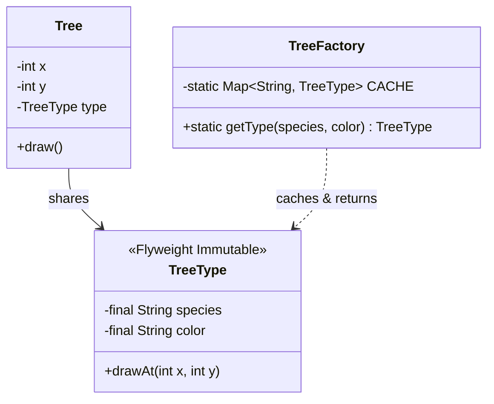

# Flyweight Pattern

> **One-line summary:** Minimize memory footprint when creating millions of similar objects by sharing immutable *intrinsic* state (such as textures, fonts, or metadata) while passing unique *extrinsic* state (coordinates, offsets) as parameters.

| Attribute | Specification |
|---|---|
| **Level** | Intermediate / Performance & Memory |
| **Prerequisites** | [07-immutability-and-value-objects.md](../01-foundations/07-immutability-and-value-objects.md), [09-multiton-and-registry.md](../05-creational-patterns/09-multiton-and-registry.md) |
| **Estimated Reading Time** | 30 minutes |
| **Status** | Complete |
| **Category** | Structural |
| **Origin** | GoF 1994 |
| **Also Known As** | Intrinsic/Extrinsic State Sharing, String Interning |
| **Languages Tested** | Java 25 (LTS) / TypeScript 5.8 (Node 24 native) / Python 3.14 |

---

## Table of Contents
- [1 The Problem](#1-the-problem)
- [2 Why It Exists](#2-why-it-exists)
- [3 What It Is](#3-what-it-is)
- [4 The Problem Without It](#4-the-problem-without-it)
- [5 How It Solves It](#5-how-it-solves-it)
- [6 How It Works](#6-how-it-works)
- [7 Real-World Examples](#7-real-world-examples)
- [8 When to Use and When NOT to Use](#8-when-to-use-and-when-not-to-use)
- [9 Variations and Language Idioms](#9-variations-and-language-idioms)
- [10 Relationship to Other Principles and Patterns](#10-relationship-to-other-principles-and-patterns)
- [11 Common Mistakes and Anti-Patterns](#11-common-mistakes-and-anti-patterns)
- [12 Testing and Design Verification](#12-testing-and-design-verification)
- [13 Performance, Concurrency and Security Notes](#13-performance-concurrency-and-security-notes)
- [14 Interview Questions](#14-interview-questions)
- [15 Practice Exercises](#15-practice-exercises)
- [16 Summary / Cheat Sheet](#16-summary--cheat-sheet)
- [17 Further Reading](#17-further-reading)

---

## 1 The Problem

Imagine rendering a forest of **1,000,000 trees** in a 3D map/game engine. Each tree stores `(x, y)` coordinates *plus* a 4KB `Mesh` and `BarkTexture` (`"Oak"`, `"Green"`, polygon data).

Allocating 1,000,000 independent `Tree` objects with 4KB textures each consumes **4 GB of RAM**—immediately crashing with `OutOfMemoryError`! Yet across the entire forest, there are only 5 distinct tree species (`Oak`, `Pine`, `Birch`, `Maple`, `Spruce`).

---

## 2 Why It Exists

Formulated by the **Gang of Four (1994)** (originally motivated by a text editor needing to represent millions of character glyphs without storing font/metric objects inside every single character). Flyweight splits object state into **Intrinsic** (immutable, shared) vs **Extrinsic** (unique per context, passed in).

---

## 3 What It Is



---

## 4 The Problem Without It

```java
// Violation: Duplicating heavy 4KB mesh/texture data in every single Tree instance!
class HeavyTree {
    int x, y;
    String species, color;
    byte[] meshData = new byte[4096]; // 4KB * 1,000,000 = 4GB RAM!
}
```

---

## 5 How It Solves It

### Java Implementation (Java 25 LTS)

```java
package com.design.patterns.structural.flyweight;

import java.util.*;

// Flyweight: Strictly IMMUTABLE shared intrinsic state
record TreeType(String species, String color) {}

class TreeFactory {
    private static final Map<String, TreeType> CACHE = new HashMap<>();

    public static TreeType getType(String species, String color) {
        return CACHE.computeIfAbsent(species + ":" + color, k -> new TreeType(species, color));
    }

    public static int uniqueTypes() {
        return CACHE.size();
    }
}

// Context holding extrinsic state (x, y) + reference to shared Flyweight
record Tree(int x, int y, TreeType type) {}
```

### TypeScript Implementation (Node 24 Native)

```typescript
class TreeType {
    readonly species: string;
    readonly color: string;
    constructor(species: string, color: string) {
        this.species = species;
        this.color = color;
    }
}

class TreeFactory {
    private static readonly cache = new Map<string, TreeType>();
    static getType(species: string, color: string): TreeType {
        const key = `${species}:${color}`;
        let t = this.cache.get(key);
        if (!t) { t = new TreeType(species, color); this.cache.set(key, t); }
        return t;
    }
}
```

### Python Implementation (Python 3.14)

```python
class TreeType:
    _pool: dict[tuple[str, str], "TreeType"] = {}

    def __new__(cls, species: str, color: str):
        key = (species, color)
        if key not in cls._pool:
            inst = super().__new__(cls)
            inst.species = species
            inst.color = color
            cls._pool[key] = inst
        return cls._pool[key]
```

### Real Execution Output
```text
Flyweight trees: 1000, unique TreeTypes: 1
Python Flyweight same instance: True
```

---

## 6 How It Works

1. **Intrinsic State:** Immutable, context-independent (`species`, `color`, `meshData`). Stored *inside* the shared Flyweight.
2. **Extrinsic State:** Unique per instance (`x`, `y`). Stored in the lightweight `Tree` context or passed as method parameters (`type.draw(x, y)`).
3. **Immutability Requirement:** Flyweights **must be immutable**—if any caller could mutate `TreeType.color`, all 1,000,000 trees would change color simultaneously!

---

## 7 Real-World Examples

1. **Java `Integer.valueOf(-128..127)` (`IntegerCache`) & `String.intern()`**: Classic JDK Flyweights.
2. **Python Small Integer Caching (`-5..256`) & `sys.intern()`**.
3. **Browser DOM / Text Editors**: Sharing `FontGlyph` metrics across millions of rendered characters.

---

## 8 When to Use and When NOT to Use

| Context | Use Flyweight? | Rationale |
|---|---|---|
| **100k+ objects sharing massive duplicate immutable data** | **Yes (after profiling!)** | Dramatically cuts RAM & GC pressure. |
| **Small object counts (< 10k)** | **NO (Premature Optimization)** | Cache lookup overhead & complexity aren't justified. |

---

## 9 Variations and Language Idioms

- **Weak-Reference Flyweight Pool (`WeakHashMap`):** Allows unused flyweights to be garbage-collected automatically when no context references them.

---

## 10 Relationship to Other Principles and Patterns

- **Immutability:** Mandatory prerequisite for safe Flyweights.
- **Object Pool vs Flyweight:** Object Pool lends *mutable* instances exclusively to one thread at a time; Flyweight shares *immutable* instances concurrently across all callers simultaneously.

---

## 11 Common Mistakes and Anti-Patterns

| Anti-Pattern | Description | Production Consequence | Correct Remedy |
|---|---|---|---|
| **Mutable Flyweight** | Allowing setters on `TreeType`! | Mutating one tree corrupts 999,999 other trees! | Make Flyweights 100% immutable (`record` / `frozen=True`). |
| **Unbounded Flyweight Cache Leak** | Caching dynamic high-cardinality keys (`x + ":" + y`) forever! | Memory leak worse than before! | Only cache low-cardinality intrinsic attributes. |
| **Premature Flyweight** | Adding Flyweight caches for 50 config objects. | Unnecessary code complexity. | Profile heap memory first (`VisualVM` / `tracemalloc`). |
| **Bypassing Factory (`new TreeType`)** | Leaving constructor `public` so callers bypass the cache. | Zero sharing! | Make constructor private/package-private or use `TreeFactory`. |
| **Non-Thread-Safe Factory** | Using plain `HashMap` across concurrent threads. | `ConcurrentModificationException` / infinite loop. | Use `ConcurrentHashMap`. |
| **Storing Extrinsic State in Flyweight** | Storing `x, y` inside `TreeType`. | Corrupts shared state. | Pass extrinsic state as method arguments. |

---

## 12 Testing and Design Verification

Assert reference identity (`assertSame(TreeFactory.getType("Oak", "Green"), TreeFactory.getType("Oak", "Green"))`) and `uniqueTypes() == 1`.

---

## 13 Performance, Concurrency and Security Notes

- **Security:** Never intern arbitrary untrusted user strings in a global strong pool (classic String-interning OOM DoS attack).

---

## 14 Interview Questions

<details>
<summary><strong>1. Distinguish Intrinsic vs Extrinsic state in the Flyweight pattern.</strong></summary>

**Intrinsic state** is immutable, context-independent data shared inside the Flyweight (e.g., Oak mesh/texture). **Extrinsic state** is unique per occurrence (e.g., `(x, y)` coordinates) stored externally and passed into Flyweight methods.
</details>

<details>
<summary><strong>2. Why MUST Flyweight objects be immutable?</strong></summary>

Because thousands of contexts share the exact same object reference concurrently—any mutation to a Flyweight would corrupt every referencing context simultaneously and cause thread data races.
</details>

<details>
<summary><strong>3. Give two real-world examples of Flyweight in the Java Standard Library.</strong></summary>

`Integer.valueOf(int)` (caching `-128` to `127` via `IntegerCache`) and `String.intern()` / string literal pool.
</details>

<details>
<summary><strong>4. Compare Flyweight vs Object Pool vs Singleton.</strong></summary>

- **Singleton:** 1 instance total.
- **Flyweight:** $K$ *immutable* instances shared simultaneously by millions of callers to save RAM.
- **Object Pool:** $N$ *mutable* expensive resources borrowed exclusively one caller at a time and returned.
</details>

<details>
<summary><strong>5. What is the CPU vs RAM trade-off of Flyweight?</strong></summary>

Flyweight dramatically reduces RAM usage at the slight cost of a cache lookup during creation and passing extrinsic state parameters on method calls.
</details>

<details>
<summary><strong>6. When is Flyweight a premature optimization?</strong></summary>

When an application only instantiates a few hundred or thousand lightweight objects—the cache lookup map and extra factory code add complexity without meaningful memory savings.
</details>

<details>
<summary><strong>7. How does `WeakHashMap` help prevent memory leaks in a Flyweight Factory?</strong></summary>

Using weak references lets the garbage collector reclaim Flyweight entries automatically once no active context objects reference them anymore.
</details>

<details>
<summary><strong>8. What happens if someone accidentally puts `(x, y)` coordinates inside `TreeType`?</strong></summary>

Moving extrinsic state into the shared Flyweight breaks uniqueness—all trees would render at the exact same overwritten `(x, y)` position!
</details>

---

## 15 Practice Exercises

### Exercise 1: Classify Intrinsic vs Extrinsic (Easy)
For a rich text editor rendering 500,000 characters, classify: `charCode`, `fontFamily`, `fontSize`, `cursorRow`, `cursorCol`.

<details>
<summary><strong>Solution</strong></summary>

Intrinsic (Flyweight): `charCode`, `fontFamily`, `fontSize`. Extrinsic: `cursorRow`, `cursorCol`.
</details>

---

### Exercise 2: Thread-Safe Flyweight Factory in Java (Medium)
Update `TreeFactory` from `HashMap` to `ConcurrentHashMap` so 16 worker threads can request types concurrently safely.

<details>
<summary><strong>Solution</strong></summary>

Replace `new HashMap<>()` with `new ConcurrentHashMap<>()`—`computeIfAbsent` handles thread-safe atomic insertion.
</details>

---

### Exercise 3: Measure Memory Savings in Python (Hard)
Compare `sys.getsizeof` / `tracemalloc` peak memory for 50,000 naive `HeavyTree` instances vs 50,000 lightweight `Tree` references sharing 3 `TreeType` Flyweights.

<details>
<summary><strong>Solution</strong></summary>

With 3 shared `TreeType` objects holding large texture arrays, memory drops from tens/hundreds of MB to a few MB for coordinate tuples.
</details>

---

## 16 Summary / Cheat Sheet

```
+--------------------------------------------------------------------------+
|                            FLYWEIGHT PATTERN                             |
+--------------------------------------------------------------------------+
| INTENT     : Share immutable intrinsic state across millions of objects. |
| MUST BE    : 100% Immutable + accessed via Thread-Safe Factory!          |
| JDK / PY   : Integer.valueOf(-128..127), String literals, Python -5..256.|
+--------------------------------------------------------------------------+
```

---

## 17 Further Reading

- Erich Gamma et al., *Design Patterns*, Addison-Wesley, 1994.

### In Your Language
| Language Track | Deep Dive Reference |
|---|---|
| Java | [Java OOP & Design Patterns](file:///e:/Learning/engineering-notes/01-languages/java/24-design-patterns/README.md) |
| TypeScript | [TypeScript Design Patterns](file:///e:/Learning/engineering-notes/01-languages/typescript/17-design-patterns/README.md) |
| Python | [Python Design Patterns](file:///e:/Learning/engineering-notes/01-languages/python/23-design-patterns/README.md) |

---

[← Previous: 05 - Facade Pattern](file:///e:/Learning/engineering-notes/08-solid-design-patterns/06-structural-patterns/05-facade.md) | [Module 06 Index](file:///e:/Learning/engineering-notes/08-solid-design-patterns/06-structural-patterns/README.md) | [Next: 07 - Proxy Pattern →](file:///e:/Learning/engineering-notes/08-solid-design-patterns/06-structural-patterns/07-proxy.md)
