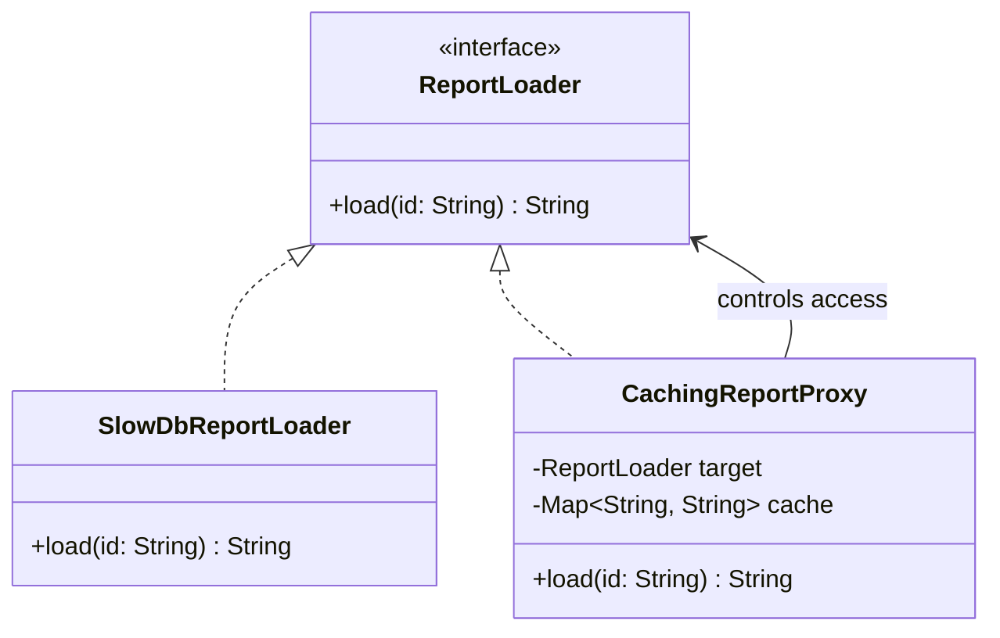

# Proxy Pattern

> **One-line summary:** Provide a surrogate or placeholder object controlling access to another object behind the exact same interface—enabling lazy loading, authorization checks, caching, or remote RPC calls transparently.

| Attribute | Specification |
|---|---|
| **Level** | Core / GoF Structural |
| **Prerequisites** | [04-programming-to-interfaces.md](../01-foundations/04-programming-to-interfaces.md), [04-decorator.md](04-decorator.md) |
| **Estimated Reading Time** | 30 minutes |
| **Status** | Complete |
| **Category** | Structural |
| **Origin** | GoF 1994 |
| **Also Known As** | Surrogate, Placeholder, Dynamic Proxy (`java.lang.reflect.Proxy` / JS `Proxy`) |
| **Languages Tested** | Java 25 (LTS) / TypeScript 5.8 (Node 24 native) / Python 3.14 |

---

## Table of Contents
- [1 The Problem](#1-the-problem)
- [2 Why It Exists](#2-why-it-exists)
- [3 What It Is](#3-what-it-is)
- [4 The Problem Without It](#4-the-problem-without-it)
- [5 How It Solves It](#5-how-it-solves-it)
- [6 How It Works](#6-how-it-works)
- [7 Real-World Examples](#7-real-world-examples)
- [8 When to Use and When NOT to Use](#8-when-to-use-and-when-not-to-use)
- [9 Variations and Language Idioms](#9-variations-and-language-idioms)
- [10 Relationship to Other Principles and Patterns](#10-relationship-to-other-principles-and-patterns)
- [11 Common Mistakes and Anti-Patterns](#11-common-mistakes-and-anti-patterns)
- [12 Testing and Design Verification](#12-testing-and-design-verification)
- [13 Performance, Concurrency and Security Notes](#13-performance-concurrency-and-security-notes)
- [14 Interview Questions](#14-interview-questions)
- [15 Practice Exercises](#15-practice-exercises)
- [16 Summary / Cheat Sheet](#16-summary--cheat-sheet)
- [17 Further Reading](#17-further-reading)

---

## 1 The Problem

Imagine a `ReportLoader` service that executes heavy 1.5-second SQL queries to load annual financial reports. Ten different dashboards call `reportLoader.load("2026-Q1")` repeatedly.

If you embed caching `HashMap`s and RBAC authorization checks directly inside `SlowDbReportLoader`:
1. You violate **SRP** (mixing raw SQL data access with caching eviction and security policy).
2. You violate **OCP** (modifying the tested database loader every time caching or access rules change).

---

## 2 Why It Exists

Formulated by the **Gang of Four (1994)** to intercept and **control access** to a `RealSubject` transparently—the client still calls `reportLoader.load("2026-Q1")` via the same `ReportLoader` interface without knowing a Proxy sits in front.

---

## 3 What It Is: The 4 Classic Proxy Types

| Proxy Variant | Access Control Intent |
|---|---|
| **Virtual Proxy** | Defers creating/loading an expensive `RealSubject` until first method call |
| **Protection Proxy** | Enforces authentication/authorization permissions before forwarding |
| **Caching Proxy** | Stores results of expensive idempotent calls and returns cached hits |
| **Remote Proxy** | Represents a local stub for a service living across the network (gRPC / RMI) |



---

## 4 The Problem Without It

```java
// Violation: Mixing SQL query execution, caching, and auth checks inside one class!
class MonolithReportLoader {
    private final java.util.Map<String, String> cache = new java.util.HashMap<>();
    public String load(String id, String role) {
        if (!"ADMIN".equals(role)) throw new SecurityException("Denied");
        if (cache.containsKey(id)) return cache.get(id);
        return "DB_DATA_" + id;
    }
}
```

---

## 5 How It Solves It

### Java Implementation (Java 25 LTS)

```java
package com.design.patterns.structural.proxy;

import java.util.*;

interface ReportLoader {
    String load(String id);
}

class SlowDbReportLoader implements ReportLoader {
    @Override
    public String load(String id) {
        return "DB_DATA_" + id;
    }
}

class CachingReportProxy implements ReportLoader {
    private final ReportLoader target;
    private final Map<String, String> cache = new HashMap<>();

    public CachingReportProxy(ReportLoader target) {
        this.target = target;
    }

    @Override
    public String load(String id) {
        return cache.computeIfAbsent(id, target::load);
    }
}
```

### TypeScript Implementation (Node 24 Native — Native JS `Proxy`)

```typescript
interface ReportLoader { load(id: string): string; }

class CachingReportProxy implements ReportLoader {
    private readonly cache = new Map<string, string>();
    private readonly target: ReportLoader;
    constructor(target: ReportLoader) { this.target = target; }

    load(id: string): string {
        if (!this.cache.has(id)) this.cache.set(id, this.target.load(id));
        return this.cache.get(id)!;
    }
}
```

### Python Implementation (Python 3.14)

```python
from typing import Protocol

class ReportLoader(Protocol):
    def load(self, report_id: str) -> str: ...

class CachingReportProxy:
    def __init__(self, target: ReportLoader) -> None:
        self._target = target
        self._cache: dict[str, str] = {}

    def load(self, report_id: str) -> str:
        if report_id not in self._cache:
            self._cache[report_id] = self._target.load(report_id)
        return self._cache[report_id]
```

### Real Execution Output
```text
Proxy: DB_DATA_R1
```

---

## 6 How It Works: Proxy vs. Decorator

Though structurally nearly identical (both wrap an object with the same interface):
- **Decorator** is assembled explicitly by the caller to *stack* additive behaviors (`new A(new B(core))`).
- **Proxy** usually manages the *lifecycle or access* to a single target (often instantiating a Virtual Proxy target lazily on its own, or injected transparently by an IoC container like Spring `@Transactional` / Vue 3 reactivity `new Proxy(...)`).

---

## 7 Real-World Examples

1. **Spring AOP (`@Transactional`, `@PreAuthorize`, `@Cacheable`)**: JDK Dynamic Proxies & CGLIB proxies.
2. **Vue 3 Reactivity (`new Proxy(target, handler)`)**: Native ES6 `Proxy` intercepting property reads/writes to trigger UI updates.
3. **Hibernate Lazy Entities & gRPC Client Stubs**: Virtual & Remote Proxies.

---

## 8 When to Use and When NOT to Use

| Context | Use Proxy? | Rationale |
|---|---|---|
| **Lazy instantiation, RBAC auth guard, caching, or RPC stub** | **Yes** | Controls access cleanly behind the target interface. |
| **Simple direct calls with no access control need** | **NO** | Unnecessary indirection. |

---

## 9 Variations and Language Idioms

- **Java Dynamic Proxy (`java.lang.reflect.Proxy`):** Generates a proxy for any interface at runtime without writing manual proxy classes.
- **JavaScript/TypeScript Native `Proxy`:** Built-in language primitive `new Proxy(obj, { get, set, apply })`.

---

## 10 Relationship to Other Principles and Patterns

- **SRP & OCP:** Isolates caching/security/lazy-loading from core domain/DB logic.
- **Adapter / Decorator:** Look-alike structural wrappers distinguished by intent.

---

## 11 Common Mistakes and Anti-Patterns

| Anti-Pattern | Description | Production Consequence | Correct Remedy |
|---|---|---|---|
| **Spring Self-Invocation Proxy Bypass** | Calling `this.transactionalMethod()` from inside the same class! | Bypasses the Spring Proxy completely—no transaction or auth check runs! | Call through the injected bean or split into a separate service. |
| **Unbounded Caching Proxy** | Caching every key forever in a `HashMap` without TTL/size limit. | `OutOfMemoryError`! | Use bounded LRU/TTL cache (Caffeine). |
| **Non-Thread-Safe Cache in Singleton Proxy** | Using plain `HashMap` in a shared Proxy. | Data corruption / infinite loop. | Use `ConcurrentHashMap` or Caffeine. |
| **Fail-Open Protection Proxy** | Letting call proceed if auth check throws an unexpected error. | Critical security bypass! | Always **fail closed** (deny on error). |
| **Transparent Remote Proxy Illusion** | Hiding slow unreliable network RPC calls behind a synchronous local-looking interface without timeouts. | Distributed Fallacies: callers loop over `remoteProxy.getUser()` 1,000 times! | Make network boundaries explicit (async/timeouts/batching). |
| **Swallowing Target Exceptions** | Proxy catching target errors and returning `null`. | Silent failure. | Propagate domain exceptions cleanly. |

---

## 12 Testing and Design Verification

Inject a spy `FakeReportLoader` counting calls into `CachingReportProxy`: call `proxy.load("R1")` twice and assert `spy.callCount == 1`.

---

## 13 Performance, Concurrency and Security Notes

- **Security (Protection Proxy):** Protection proxies must fail closed (`AccessDeniedException`) and validate permissions *before* delegating to `RealSubject`.

---

## 14 Interview Questions

<details>
<summary><strong>1. Name the 4 classic types of Proxy and their purposes.</strong></summary>

1. **Virtual Proxy:** Lazy-loads heavy objects on demand. 2. **Protection Proxy:** Enforces access/auth checks. 3. **Caching Proxy:** Caches expensive call results. 4. **Remote Proxy:** Local stub representing a remote service (RPC/gRPC).
</details>

<details>
<summary><strong>2. How does Proxy differ from Decorator?</strong></summary>

**Decorator** adds stackable, caller-composed behaviors around an existing object. **Proxy** controls access/lifecycle to a subject (and often creates/manages the subject itself or enforces security/caching transparently).
</details>

<details>
<summary><strong>3. Explain the Spring `@Transactional` / `@Async` self-invocation Proxy bug.</strong></summary>

Spring wraps beans in a Proxy. External callers go through the Proxy (activating transactions/caching). If a method inside the bean calls `this.otherMethod()`, it invokes the raw target directly via `this`, **bypassing the Proxy** so `@Transactional` never runs!
</details>

<details>
<summary><strong>4. Why are "Transparent Remote Proxies" (like old Java RMI) considered dangerous in distributed systems?</strong></summary>

They disguise unreliable, millisecond-latency network calls as nanosecond local method calls—tempting developers to call remote proxies inside tight loops without timeouts, retries, or circuit breakers.
</details>

<details>
<summary><strong>5. How does Java's `java.lang.reflect.Proxy` work?</strong></summary>

It dynamically generates a class implementing any list of interfaces at runtime, routing every method call through a single `InvocationHandler.invoke(proxy, method, args)`.
</details>

<details>
<summary><strong>6. How does JavaScript/TypeScript's built-in `Proxy` differ from a manual class wrapper?</strong></summary>

ES6 `new Proxy(target, trapHandler)` intercepts arbitrary property gets/sets/function calls dynamically at the VM level—powering frameworks like Vue 3 reactivity and MobX.
</details>

<details>
<summary><strong>7. Why must a Caching Proxy use bounded eviction (LRU/TTL)?</strong></summary>

An unbounded `HashMap` inside a long-lived Proxy grows indefinitely with distinct keys until the process crashes with `OutOfMemoryError`.
</details>

<details>
<summary><strong>8. What happens if a Protection Proxy sits *inside* a Caching Proxy?</strong></summary>

Unauthorized callers receive cached responses without hitting the Protection Proxy! Always place Protection Proxies on the **outermost** layer.
</details>

---

## 15 Practice Exercises

### Exercise 1: Identify Proxy Variant (Easy)
Classify: (a) Hibernate lazy collection wrapper, (b) `RoleCheckingPaymentProxy`, (c) `RedisCachingUserProxy`.

<details>
<summary><strong>Solution</strong></summary>

(a) Virtual Proxy, (b) Protection Proxy, (c) Caching Proxy.
</details>

---

### Exercise 2: Protection Proxy in TypeScript (Medium)
Write an `AdminReportProxy` wrapping `ReportLoader` that throws `ForbiddenError` unless `currentUser.role === "ADMIN"`.

<details>
<summary><strong>Solution</strong></summary>

Check `if (this.role !== "ADMIN") throw new Error("Forbidden"); return this.target.load(id);`.
</details>

---

### Exercise 3: Virtual Proxy in Python (Hard)
Implement `LazyImageProxy` implementing `Image(Protocol): def display(self)` so `HeavyDiskImage(path)` is instantiated *only* on the first `.display()` call, not during `LazyImageProxy(path)` construction.

<details>
<summary><strong>Solution</strong></summary>

Store `self._real: HeavyDiskImage | None = None`; inside `display()`, instantiate `if self._real is None: self._real = HeavyDiskImage(self._path)` and call `self._real.display()`.
</details>

---

## 16 Summary / Cheat Sheet

```
+--------------------------------------------------------------------------+
|                              PROXY PATTERN                               |
+--------------------------------------------------------------------------+
| INTENT     : Control access (Virtual, Protection, Caching, Remote)       |
|              transparently behind the exact same interface.              |
| WATCH OUT  : Spring `this.` self-invocation bypasses AOP proxies!        |
| CACHE RULE : Always bound Caching Proxy capacity (LRU/TTL) + thread-safe.|
+--------------------------------------------------------------------------+
```

---

## 17 Further Reading

- Erich Gamma et al., *Design Patterns*, Addison-Wesley, 1994.

### In Your Language
| Language Track | Deep Dive Reference |
|---|---|
| Java | [Java OOP & Design Patterns](file:///e:/Learning/engineering-notes/01-languages/java/24-design-patterns/README.md) |
| TypeScript | [TypeScript Design Patterns](file:///e:/Learning/engineering-notes/01-languages/typescript/17-design-patterns/README.md) |
| Python | [Python Design Patterns](file:///e:/Learning/engineering-notes/01-languages/python/23-design-patterns/README.md) |

---

[← Previous: 06 - Flyweight Pattern](file:///e:/Learning/engineering-notes/08-solid-design-patterns/06-structural-patterns/06-flyweight.md) | [Module 06 Index](file:///e:/Learning/engineering-notes/08-solid-design-patterns/06-structural-patterns/README.md) | [Next: 08 - Null Object Pattern →](file:///e:/Learning/engineering-notes/08-solid-design-patterns/06-structural-patterns/08-null-object.md)
