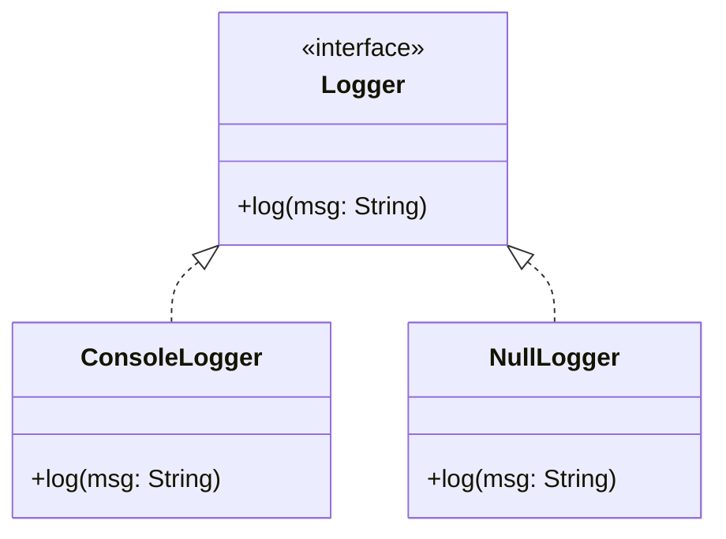

# Null Object Pattern

> **One-line summary:** Replace `null` references with a concrete polymorphic object implementing safe, predictable no-op or neutral behavior—eliminating repetitive `if (obj != null)` checks across callers.

| Attribute | Specification |
|---|---|
| **Level** | Core / Foundational |
| **Prerequisites** | [03-liskov-substitution.md](../02-solid-principles/03-liskov-substitution.md), [08-fail-fast-principle.md](../03-design-principles/08-fail-fast-principle.md) |
| **Estimated Reading Time** | 25 minutes |
| **Status** | Complete |
| **Category** | Structural / Behavioral |
| **Origin** | Bobby Woolf (*Pattern Languages of Program Design 3*, 1998) |
| **Also Known As** | Stub Object, Safe No-Op Implementation, Identity Object |
| **Languages Tested** | Java 25 (LTS) / TypeScript 5.8 (Node 24 native) / Python 3.14 |

---

## Table of Contents
- [1 The Problem](#1-the-problem)
- [2 Why It Exists](#2-why-it-exists)
- [3 What It Is](#3-what-it-is)
- [4 The Problem Without It](#4-the-problem-without-it)
- [5 How It Solves It](#5-how-it-solves-it)
- [6 How It Works](#6-how-it-works)
- [7 Real-World Examples](#7-real-world-examples)
- [8 When to Use and When NOT to Use](#8-when-to-use-and-when-not-to-use)
- [9 Variations and Language Idioms](#9-variations-and-language-idioms)
- [10 Relationship to Other Principles and Patterns](#10-relationship-to-other-principles-and-patterns)
- [11 Common Mistakes and Anti-Patterns](#11-common-mistakes-and-anti-patterns)
- [12 Testing and Design Verification](#12-testing-and-design-verification)
- [13 Performance, Concurrency and Security Notes](#13-performance-concurrency-and-security-notes)
- [14 Interview Questions](#14-interview-questions)
- [15 Practice Exercises](#15-practice-exercises)
- [16 Summary / Cheat Sheet](#16-summary--cheat-sheet)
- [17 Further Reading](#17-further-reading)

---

## 1 The Problem

Imagine an `OrderService` taking an optional `Logger` or `DiscountPolicy`. In tests or silent CLI runs, callers pass `null`:
```java
if (logger != null) logger.log("Order started");
// ... 40 lines later ...
if (logger != null) logger.log("Order finished"); // Forgot one check -> NullPointerException!
```
Forgetting a single `!= null` check anywhere in 25 files crashes production with `NullPointerException` (`TypeError: Cannot read properties of null`).

---

## 2 Why It Exists

Documented by **Bobby Woolf** (1998) and **Martin Fowler** (*Introduce Null Object* refactoring): Tony Hoare called the `null` reference his "Billion-Dollar Mistake." When absence simply means **"do nothing"** (a no-op logger, a 0% discount, an empty collection), a **Null Object** eliminates defensive null checks everywhere.

---

## 3 What It Is



---

## 4 The Problem Without It

```java
// Violation: Defensive null checks scattered across every method
class OrderServiceViolation {
    private final Logger logger;
    OrderServiceViolation(Logger logger) { this.logger = logger; }
    void placeOrder() {
        if (logger != null) logger.log("Placing order");
        logger.log("Forgot null check here -> NPE!");
    }
}
```

---

## 5 How It Solves It

### Java Implementation (Java 25 LTS)

```java
package com.design.patterns.structural.nullobject;

interface Logger {
    void log(String msg);
    Logger NO_OP = msg -> {}; // Built-in Null Object!
}

class OrderService {
    private final Logger logger;

    public OrderService(Logger logger) {
        this.logger = (logger != null) ? logger : Logger.NO_OP;
    }

    public void placeOrder() {
        logger.log("Order placed cleanly with zero null checks!");
    }
}
```

### TypeScript Implementation (Node 24 Native)

```typescript
interface Logger { log(msg: string): void; }

class NullLogger implements Logger {
    log(_msg: string): void { /* safe no-op */ }
}

const logger: Logger = new NullLogger();
logger.log("safe");
console.log("TS NullObject executed safely");
```

### Python Implementation (Python 3.14)

```python
from typing import Protocol

class DiscountPolicy(Protocol):
    def apply(self, subtotal: float) -> float: ...

class NoDiscount:
    def apply(self, subtotal: float) -> float:
        return subtotal  # Neutral identity!
```

### Real Execution Output
```text
NullObject executed safely
TS NullObject executed safely
```

---

## 6 How It Works: When Null Object Is WRONG (Fail-Fast Warning!)

Never use a Null Object to **mask a genuine error or missing required entity**!
- Good Null Object: `NullLogger`, `NoDiscount` (0%), `Collections.emptyList()` (empty search results).
- Dangerous Null Object: `NullUser` silently bypassing `findUserById("missing-id")` during payment or authentication! Missing required domain records must return `Optional.empty()` or **Fail-Fast** with an exception.

---

## 7 Real-World Examples

1. **Java `Collections.emptyList()` / `Collections.emptyMap()`**: Returning an immutable empty list instead of `null` from queries.
2. **Java `java.io.OutputStream.nullOutputStream()` & `Writer.nullWriter()`** (JDK 11+).
3. **SLF4J `NOPLogger`**: Built-in no-op logger when no logging backend is bound.

---

## 8 When to Use and When NOT to Use

| Context | Null Object vs `Optional` / Exception | Rationale |
|---|---|---|
| **Optional collaborators (Logger, Metrics, Discount, Empty List)** | **Null Object** | Neutral no-op behavior lets callers stay clean. |
| **Missing required lookup (`findUserById`) or failed I/O** | **NO (`Optional<T>` or Exception)** | Callers *must* know the record wasn't found! |

---

## 9 Variations and Language Idioms

- **Java:** `Logger.NO_OP` static lambda constant on the interface; `Collections.emptyList()`.
- **TypeScript:** `Optional` / union types `User | null` with `strictNullChecks` when absence *matters*; `NullLogger` when neutral no-op suffices.

---

## 10 Relationship to Other Principles and Patterns

- **LSP:** `NullLogger` must obey the exact contract of `Logger` without throwing `UnsupportedOperationException`.
- **Fail-Fast:** Balances Null Object—use Fail-Fast for broken invariants, Null Object for neutral optional behavior.

---

## 11 Common Mistakes and Anti-Patterns

| Anti-Pattern | Description | Production Consequence | Correct Remedy |
|---|---|---|---|
| **Masking Real Failures** | Returning `NullDatabaseConnection` when DB is unreachable! | Silent data loss! | Fail-Fast on infrastructure errors. |
| **Mutating Shared Empty Singleton** | Returning a shared mutable `new ArrayList<>()` instead of `List.of()`. | Caller `.add()` corrupts shared instance! | Always make Null Objects immutable. |
| **Null-Checking a Null Object** | Writing `if (!(logger instanceof NullLogger))` in callers. | Defeats the entire pattern. | Treat Null Object polymorphically. |
| **Using for Required Domain Entities** | `findAccount()` returning `NullAccount` with balance `0` on invalid ID. | Debits/credits silently lost! | Return `Optional<Account>` or throw `NotFoundException`. |
| **Stateful Null Object** | Recording mutable state on a shared `NullLogger`. | Memory leaks. | Keep Null Objects stateless/no-op. |
| **Excessive Null Classes** | Creating `NullFoo` when `Optional.empty()` is clearer. | Class bloat. | Use `Optional<T>` for return absence; Null Object for behavioral collaborators. |

---

## 12 Testing and Design Verification

`NullLogger` / `NoDiscount` double as zero-boilerplate **Dummy Test Doubles** in unit tests!

---

## 13 Performance, Concurrency and Security Notes

- **Security:** Never return a `NullUser` from authentication (`authenticate()`); unauthenticated calls must fail closed!

---

## 14 Interview Questions

<details>
<summary><strong>1. What is the Null Object pattern and what problem does it solve?</strong></summary>

It replaces `null` references with a concrete polymorphic object implementing safe no-op or identity behavior (e.g. `NullLogger`, `Collections.emptyList()`), eliminating repetitive `if (x != null)` checks and `NullPointerException` crashes.
</details>

<details>
<summary><strong>2. When is using a Null Object dangerous (conflicting with Fail-Fast)?</strong></summary>

When absence represents a real error or missing required record—such as a failed DB lookup (`findUserById`), failed authentication, or unreachable network socket. Silently returning a Null Object hides failures and causes silent data corruption.
</details>

<details>
<summary><strong>3. Distinguish Null Object from `Optional<T>`.</strong></summary>

`Optional<T>` forces callers to *explicitly handle* absence (`orElse`, `ifPresent`). Null Object hides absence completely behind neutral behavior so callers don't write any branching logic at all.
</details>

<details>
<summary><strong>4. Give two examples of Null Object in the Java Standard Library.</strong></summary>

`Collections.emptyList()` (instead of returning `null` lists) and `OutputStream.nullOutputStream()` / `Writer.nullWriter()`.
</details>

<details>
<summary><strong>5. Why must shared Null Objects (like `emptyList()`) be immutable?</strong></summary>

Because one singleton `NullObject` instance is shared across the application; if a caller mutates it (e.g., `list.add(...)`), every other caller receives corrupted data.
</details>

<details>
<summary><strong>6. How does Null Object relate to the Strategy pattern?</strong></summary>

A Null Object is often simply the neutral/identity Strategy (`NoDiscount` returning `subtotal * 1.0`, `NoOpRetryPolicy` executing once).
</details>

<details>
<summary><strong>7. Why is checking `if (obj instanceof NullObject)` an anti-pattern?</strong></summary>

If callers still branch on whether an object is the Null Object, you haven't eliminated conditional branching—you just replaced `!= null` with `instanceof`.
</details>

<details>
<summary><strong>8. How does Java's functional interface make `NullLogger` a 1-liner?</strong></summary>

`Logger NO_OP = msg -> {};` defines a stateless singleton Null Object directly on the interface.
</details>

---

## 15 Practice Exercises

### Exercise 1: Null Object vs `Optional` (Easy)
Which should use Null Object vs `Optional`? (a) `List<Order> findOrdersForUser()`, (b) `User findUserByEmail()`, (c) optional `MetricsRecorder`.

<details>
<summary><strong>Solution</strong></summary>

(a) Empty list (`List.of()`), (b) `Optional<User>`, (c) Null Object (`NullMetricsRecorder`).
</details>

---

### Exercise 2: Eliminate `if (discount != null)` in TypeScript (Medium)
Write a `NoDiscount` class implementing `DiscountPolicy` and remove the `null` check from `CheckoutService`.

<details>
<summary><strong>Solution</strong></summary>

`class NoDiscount implements DiscountPolicy { apply(total: number): number { return total; } }`
</details>

---

### Exercise 3: Null Event Bus in Python (Hard)
Implement `EventBus(Protocol)` with `NullEventBus` as the default parameter in `OrderProcessor.__init__(self, bus: EventBus = NullEventBus())`.

<details>
<summary><strong>Solution</strong></summary>

`class NullEventBus: def publish(self, event: object) -> None: pass`
</details>

---

## 16 Summary / Cheat Sheet

```
+--------------------------------------------------------------------------+
|                           NULL OBJECT PATTERN                            |
+--------------------------------------------------------------------------+
| INTENT     : Replace `null` with safe neutral/no-op polymorphic object.  |
| USE FOR    : Optional collaborators (Logger, Metrics, Empty List).       |
| NEVER FOR  : Missing required records or failed auth (use Optional/Throw)|
+--------------------------------------------------------------------------+
```

---

## 17 Further Reading

- Bobby Woolf, *Null Object* (*Pattern Languages of Program Design 3*), Addison-Wesley, 1998.
- Martin Fowler, *Refactoring* (Introduce Special Case / Null Object), 2018.

### In Your Language
| Language Track | Deep Dive Reference |
|---|---|
| Java | [Java OOP & Design Patterns](file:///e:/Learning/engineering-notes/01-languages/java/24-design-patterns/README.md) |
| TypeScript | [TypeScript Design Patterns](file:///e:/Learning/engineering-notes/01-languages/typescript/17-design-patterns/README.md) |
| Python | [Python Design Patterns](file:///e:/Learning/engineering-notes/01-languages/python/23-design-patterns/README.md) |

---

[← Previous: 07 - Proxy Pattern](file:///e:/Learning/engineering-notes/08-solid-design-patterns/06-structural-patterns/07-proxy.md) | [Module 06 Index](file:///e:/Learning/engineering-notes/08-solid-design-patterns/06-structural-patterns/README.md) | [Next: 09 - Private Class Data & Immutable Objects →](file:///e:/Learning/engineering-notes/08-solid-design-patterns/06-structural-patterns/09-private-class-data-and-immutable-objects.md)
