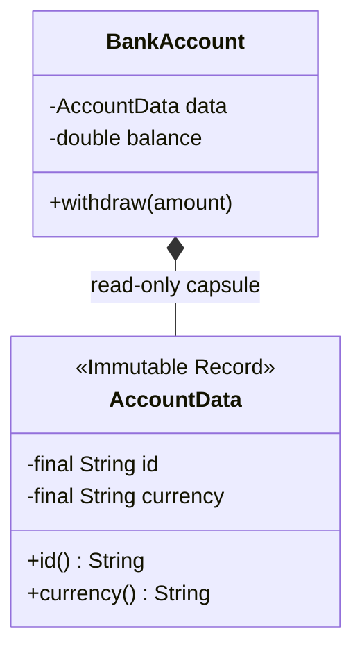

# Private Class Data & Immutable Objects

> **One-line summary:** Encapsulate construction-only attributes inside a dedicated read-only data holder (or immutable record) so methods *inside* the class itself cannot accidentally mutate invariants after initialization.

| Attribute | Specification |
|---|---|
| **Level** | Intermediate / Structural & Encapsulation |
| **Prerequisites** | [07-immutability-and-value-objects.md](../01-foundations/07-immutability-and-value-objects.md), [05-abstraction-and-information-hiding.md](../01-foundations/05-abstraction-and-information-hiding.md) |
| **Estimated Reading Time** | 25 minutes |
| **Status** | Complete |
| **Category** | Structural |
| **Origin** | Alan Shalloway / *Design Patterns Explained* |
| **Also Known As** | Immutable State Capsule, `final` Record Encapsulation |
| **Languages Tested** | Java 25 (LTS) / TypeScript 5.8 (Node 24 native) / Python 3.14 |

---

## Table of Contents
- [1 The Problem](#1-the-problem)
- [2 Why It Exists](#2-why-it-exists)
- [3 What It Is](#3-what-it-is)
- [4 The Problem Without It](#4-the-problem-without-it)
- [5 How It Solves It](#5-how-it-solves-it)
- [6 How It Works](#6-how-it-works)
- [7 Real-World Examples](#7-real-world-examples)
- [8 When to Use and When NOT to Use](#8-when-to-use-and-when-not-to-use)
- [9 Variations and Language Idioms](#9-variations-and-language-idioms)
- [10 Relationship to Other Principles and Patterns](#10-relationship-to-other-principles-and-patterns)
- [11 Common Mistakes and Anti-Patterns](#11-common-mistakes-and-anti-patterns)
- [12 Testing and Design Verification](#12-testing-and-design-verification)
- [13 Performance, Concurrency and Security Notes](#13-performance-concurrency-and-security-notes)
- [14 Interview Questions](#14-interview-questions)
- [15 Practice Exercises](#15-practice-exercises)
- [16 Summary / Cheat Sheet](#16-summary--cheat-sheet)
- [17 Further Reading](#17-further-reading)

---

## 1 The Problem

Even when fields are `private`, a large stateful entity (such as `Circle` with `radius`, `color`, `origin` or `BankAccount` with `accountId`, `currency`, `openedAt` alongside mutable `balance`) lets **every internal method** accidentally overwrite initialization-only attributes (`this.currency = "EUR"` inside a buggy fee method!).

In languages lacking `final`/`readonly` on every field—or when a class mixes immutable identity attributes with mutable operational state—internal methods accidentally corrupt construction-time invariants.

---

## 2 Why It Exists

Documented by **Alan Shalloway** (*Design Patterns Explained*): **Private Class Data** extracts construction-only attributes into a separate immutable data class (`AccountConfig` / `CircleData`) that exposes only getters—preventing even the owning class's own methods from mutating those attributes after construction!

---

## 3 What It Is



---

## 4 The Problem Without It

```java
// Violation: Mutable internal fields allow any method inside class to accidentally corrupt identity!
class MutableAccount {
    private String accountId;
    private String currency;
    private double balance;

    void applyFee() {
        this.currency = "EUR"; // Accidental internal bug! Compiler doesn't stop it!
    }
}
```

---

## 5 How It Solves It

### Java Implementation (Java 25 LTS — `record` Private Class Data)

```java
package com.design.patterns.structural.privatedata;

public class BankAccount {
    private record AccountIdentity(String id, String currency) {}

    private final AccountIdentity identity;
    private double balance;

    public BankAccount(String id, String currency, double initialBalance) {
        this.identity = new AccountIdentity(id, currency);
        this.balance = initialBalance;
    }

    public String getCurrency() { return identity.currency(); }
    public double getBalance() { return balance; }
}
```

### TypeScript Implementation (Node 24 Native)

```typescript
class AccountIdentity {
    readonly id: string;
    readonly currency: string;
    constructor(id: string, currency: string) {
        this.id = id;
        this.currency = currency;
        Object.freeze(this);
    }
}

export class BankAccount {
    private readonly identity: AccountIdentity;
    private balance: number;
    constructor(id: string, currency: string, balance: number) {
        this.identity = new AccountIdentity(id, currency);
        this.balance = balance;
    }
    getCurrency(): string { return this.identity.currency; }
}
```

### Python Implementation (Python 3.14 — `@dataclass(frozen=True)`)

```python
from dataclasses import dataclass

@dataclass(frozen=True)
class _AccountIdentity:
    account_id: str
    currency: str

class BankAccount:
    def __init__(self, account_id: str, currency: str, balance: float) -> None:
        self._identity = _AccountIdentity(account_id, currency)
        self._balance = balance

    @property
    def currency(self) -> str:
        return self._identity.currency
```

---

## 6 How It Works

In modern Java (`final` + `record`), TypeScript (`readonly` + `Object.freeze`), and Python (`@dataclass(frozen=True)`), language keywords enforce compile-time immutability natively—so **Private Class Data** is either a dedicated nested immutable capsule separating immutable identity from mutable state, or an entirely immutable class!

---

## 7 Real-World Examples

1. **Java `record` / `BigDecimal` / `LocalDate`**: Completely immutable value objects.
2. **Thread-Safe Config Capsules**: Separating immutable `ServerConfig` inside a stateful `HttpServer` managing mutable socket pools.
3. **Python `__slots__` + `@dataclass(frozen=True)`**: Seals attributes against dynamic monkey-patching.

---

## 8 When to Use and When NOT to Use

| Context | Guidance | Rationale |
|---|---|---|
| **Mixed immutable identity + mutable state** | **Extract nested `Identity` record** | Prevents accidental internal mutation and separates concerns cleanly. |
| **Pure value objects** | **Make the whole class immutable** | No need for a separate inner capsule when the whole object is `final`/`frozen=True`. |

---

## 9 Variations and Language Idioms

- **Defensive Copying:** Always `List.copyOf()` / `tuple()` mutable collections inside the capsule.

---

## 10 Relationship to Other Principles and Patterns

- **Immutability & Value Objects:** Direct structural realization.
- **SRP:** Separates unchanging identity data from lifecycle state transitions.

---

## 11 Common Mistakes and Anti-Patterns

| Anti-Pattern | Description | Production Consequence | Correct Remedy |
|---|---|---|---|
| **Shallow `final` on Mutable `List`** | `private final List<String> roles` without `List.copyOf()`. | Methods can still `.clear()` the list! | Use `List.copyOf()` / `tuple`. |
| **Unfrozen JS Object** | `readonly` in TS vanishes at runtime! | Runtime JS mutation still possible. | Use `Object.freeze()` at boundaries if untrusted JS callers exist. |
| **Redundant Inner Class for Pure Value** | Wrapping `PointData` inside `Point` when `Point` has no mutable state. | Unnecessary wrapper. | Make `Point` itself a `record` / `frozen=True`. |
| **Exposing Setters on Data Capsule** | Adding `setCurrency()` on `AccountData`. | Defeats Private Class Data completely. | Only expose read getters. |
| **Returning Internal Mutable Capsule** | `public AccountData getData()` if `AccountData` holds mutable fields. | Caller mutates internals. | Keep capsule deeply immutable. |
| **Ignoring Python Dynamic Attribute Assignment** | Assigning `obj.new_attr = 1` accidentally via typo. | Silent bugs. | Use `@dataclass(frozen=True, slots=True)`. |

---

## 12 Testing and Design Verification

Verify immutability in Python (`with pytest.raises(FrozenInstanceError): identity.currency = "EUR"`) and defensive collection copying in Java.

---

## 13 Performance, Concurrency and Security Notes

- **Concurrency:** Immutable data capsules (`AccountIdentity`) require zero synchronization across threads.

---

## 14 Interview Questions

<details>
<summary><strong>1. What is the Private Class Data pattern and what does it prevent?</strong></summary>

It encapsulates initialization-only attributes inside a read-only data class held privately by the main class—preventing even internal methods of the main class from accidentally mutating those attributes after construction.
</details>

<details>
<summary><strong>2. Why doesn't `private final List<String>` in Java make a list immutable?</strong></summary>

`final` only prevents reassigning the variable reference (`items = ...`); callers or internal methods can still call `items.add()` or `items.clear()`. Use `List.copyOf(items)` for true unmodifiability.
</details>

<details>
<summary><strong>3. Why does TypeScript's `readonly` keyword not protect against runtime mutation?</strong></summary>

TypeScript type annotations (including `readonly`) are erased completely during compilation to JavaScript. At runtime, `Object.freeze()` is needed to enforce immutability against dynamic JS mutations.
</details>

<details>
<summary><strong>4. When is a separate Private Class Data wrapper unnecessary?</strong></summary>

When the *entire* class has no mutable state—just make the entire class an immutable `record` (Java) or `@dataclass(frozen=True)` (Python).
</details>

<details>
<summary><strong>5. How does Python's `slots=True` + `frozen=True` strengthen Private Class Data?</strong></summary>

`frozen=True` blocks attribute reassignment (`FrozenInstanceError`), and `slots=True` blocks adding arbitrary new attributes dynamically while reducing memory per instance.
</details>

<details>
<summary><strong>6. How does Private Class Data improve thread safety?</strong></summary>

Any immutable identity/config capsule can be safely read by unlimited concurrent threads without locks or volatile barriers.
</details>

<details>
<summary><strong>7. Compare Private Class Data with Memento.</strong></summary>

**Private Class Data** protects immutable initialization attributes *permanently* during an object's life. **Memento** captures a *point-in-time snapshot* of mutable state for later undo/restore.
</details>

<details>
<summary><strong>8. What is "Defensive Copying" in constructors?</strong></summary>

Cloning caller-provided mutable lists/arrays (`new ArrayList<>(input)`) when storing them, so the caller cannot mutate the object's internal state through the original reference.
</details>

---

## 15 Practice Exercises

### Exercise 1: Fix `final List` Mutability Leak (Easy)
Fix `private final List<String> tags;` in a Java constructor so mutating the caller's list does not affect the object.

<details>
<summary><strong>Solution</strong></summary>

`this.tags = List.copyOf(tags);`
</details>

---

### Exercise 2: Extract Immutable Config Capsule in TypeScript (Medium)
Refactor a `DatabasePool` class holding `host`, `port`, `maxConnections` alongside mutable `activeCount` so config fields cannot be mutated internally.

<details>
<summary><strong>Solution</strong></summary>

Extract `PoolConfig` frozen with `Object.freeze({ host, port, maxConnections })` as a `private readonly config` field on `DatabasePool`.
</details>

---

### Exercise 3: Python Frozen+Slots Capsule (Hard)
Implement `_OrderHeader` with `@dataclass(frozen=True, slots=True)` inside `OrderAggregate` and verify attempting to mutate `header.order_id` raises `FrozenInstanceError`.

<details>
<summary><strong>Solution</strong></summary>

`from dataclasses import dataclass, FrozenInstanceError` — decorate `_OrderHeader` with `@dataclass(frozen=True, slots=True)`.
</details>

---

## 16 Summary / Cheat Sheet

```
+--------------------------------------------------------------------------+
|                  PRIVATE CLASS DATA & IMMUTABLE OBJECTS                  |
+--------------------------------------------------------------------------+
| INTENT     : Seal construction-time attributes against internal mutation.|
| JAVA       : `record` + `List.copyOf()`                                  |
| TS / PYTHON: `readonly` + `Object.freeze()` | `@dataclass(frozen=True)`  |
+--------------------------------------------------------------------------+
```

---

## 17 Further Reading

- Alan Shalloway & James Trott, *Design Patterns Explained*, Addison-Wesley, 2004.

### In Your Language
| Language Track | Deep Dive Reference |
|---|---|
| Java | [Java OOP & Design Patterns](file:///e:/Learning/engineering-notes/01-languages/java/24-design-patterns/README.md) |
| TypeScript | [TypeScript Design Patterns](file:///e:/Learning/engineering-notes/01-languages/typescript/17-design-patterns/README.md) |
| Python | [Python Design Patterns](file:///e:/Learning/engineering-notes/01-languages/python/23-design-patterns/README.md) |

---

[← Previous: 08 - Null Object Pattern](file:///e:/Learning/engineering-notes/08-solid-design-patterns/06-structural-patterns/08-null-object.md) | [Module 06 Index](file:///e:/Learning/engineering-notes/08-solid-design-patterns/06-structural-patterns/README.md) | [Next: 10 - Extension Object, Mixins & Traits →](file:///e:/Learning/engineering-notes/08-solid-design-patterns/06-structural-patterns/10-extension-object-and-mixins-and-traits.md)
