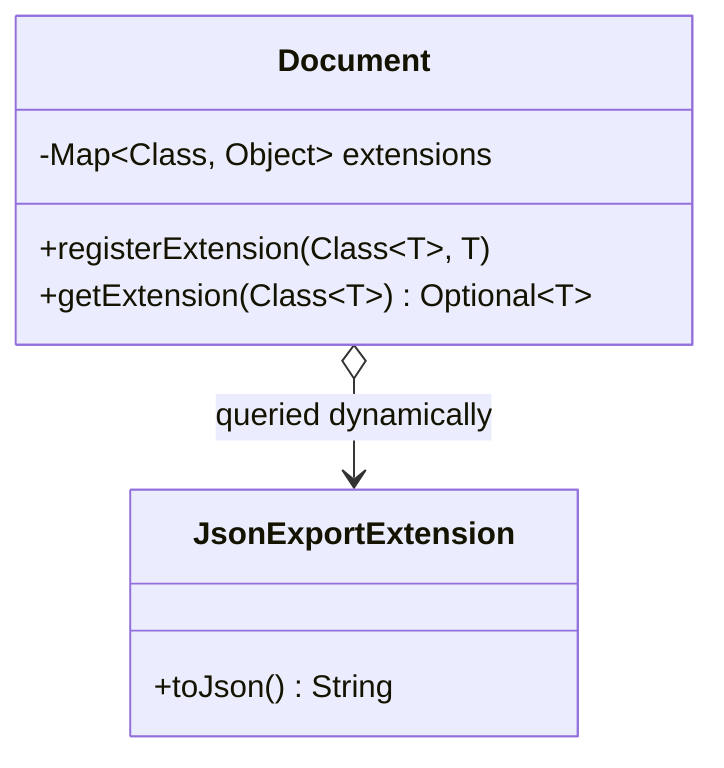

# Extension Object, Mixins & Traits

> **One-line summary:** Add optional capabilities to existing entities without bloating core interfaces (ISP) or locking into rigid single-inheritance hierarchies—using dynamic capability lookup (`Extension Object`) or horizontal behavior composition (`Mixins` / `Traits`).

| Attribute | Specification |
|---|---|
| **Level** | Intermediate / Structural |
| **Prerequisites** | [04-interface-segregation.md](../02-solid-principles/04-interface-segregation.md), [02-composition-vs-inheritance.md](../01-foundations/02-composition-vs-inheritance.md) |
| **Estimated Reading Time** | 25 minutes |
| **Status** | Complete |
| **Category** | Structural |
| **Origin** | Erich Gamma (*Pattern Languages of Program Design 3*, 1998) / Rust Traits & Java Default Interfaces |
| **Also Known As** | Capability Query (`getExtension`), Role Composition, Traits |
| **Languages Tested** | Java 25 (LTS) / TypeScript 5.8 (Node 24 native) / Python 3.14 |

---

## Table of Contents
- [1 The Problem](#1-the-problem)
- [2 Why It Exists](#2-why-it-exists)
- [3 What It Is](#3-what-it-is)
- [4 The Problem Without It](#4-the-problem-without-it)
- [5 How It Solves It](#5-how-it-solves-it)
- [6 How It Works](#6-how-it-works)
- [7 Real-World Examples](#7-real-world-examples)
- [8 When to Use and When NOT to Use](#8-when-to-use-and-when-not-to-use)
- [9 Variations and Language Idioms](#9-variations-and-language-idioms)
- [10 Relationship to Other Principles and Patterns](#10-relationship-to-other-principles-and-patterns)
- [11 Common Mistakes and Anti-Patterns](#11-common-mistakes-and-anti-patterns)
- [12 Testing and Design Verification](#12-testing-and-design-verification)
- [13 Performance, Concurrency and Security Notes](#13-performance-concurrency-and-security-notes)
- [14 Interview Questions](#14-interview-questions)
- [15 Practice Exercises](#15-practice-exercises)
- [16 Summary / Cheat Sheet](#16-summary--cheat-sheet)
- [17 Further Reading](#17-further-reading)

---

## 1 The Problem

Imagine a core `Document` or `PluginNode` model in an extensible IDE or CAD platform. Third-party plugins want to attach capabilities to documents: `JsonExportable`, `SpellCheckable`, `GitBlameable`.

If you add `toJson()`, `spellCheck()`, and `gitBlame()` directly onto the core `Document` interface:
1. You violate **ISP** and **OCP**—every minor plugin forces recompiling the core `Document` interface and stubbing unsupported methods on documents that don't support them.
2. Conversely, if you use classical inheritance (`SpellCheckableJsonDocument`), you hit multiple-inheritance diamond conflicts!

---

## 2 Why It Exists

Erich Gamma introduced **Extension Object** (1998) so core domain objects stay lean while exposing an optional `getExtension(Class<T>)` capability query. Modern languages also provide horizontal **Traits** (Rust, PHP, Scala) and **Interface Default Methods / Mixins** (Java, TypeScript, Python) to compose orthogonal behaviors cleanly.

---

## 3 What It Is



---

## 4 The Problem Without It

```java
// Violation: Bloating core Document interface with every plugin's optional methods!
interface BloatedDocument {
    String title();
    String exportToJson();   // Plugin A
    void runSpellCheck();    // Plugin B
    String getGitBlame();    // Plugin C
}
```

---

## 5 How It Solves It

### Java Implementation (Java 25 LTS — Extension Object + Interface Traits)

```java
package com.design.patterns.structural.extension;

import java.util.*;

// 1. Extension Object Pattern (Type-safe Optional Capability Query)
class Document {
    private final String content;
    private final Map<Class<?>, Object> extensions = new HashMap<>();

    public Document(String content) { this.content = content; }
    public String content() { return content; }

    public <T> void addExtension(Class<T> type, T impl) {
        extensions.put(type, impl);
    }

    public <T> Optional<T> getExtension(Class<T> type) {
        return Optional.ofNullable(type.cast(extensions.get(type)));
    }
}

// 2. Java Trait-like Interface with Default Methods (Stateless behavior reuse!)
interface Timestamped {
    long createdAtEpochMs();
    default boolean isOlderThan(long thresholdMs, long nowMs) {
        return (nowMs - createdAtEpochMs()) > thresholdMs;
    }
}
```

### TypeScript Implementation (Node 24 Native — TypeScript Mixin Function)

```typescript
type Constructor<T = {}> = new (...args: any[]) => T;

function Timestamped<TBase extends Constructor>(Base: TBase) {
    return class extends Base {
        readonly createdAt = Date.now();
    };
}

class Note {
    readonly title: string;
    constructor(title: string) { this.title = title; }
}

const TimestampedNote = Timestamped(Note);
const n = new TimestampedNote("Design Doc");
console.log("TS Mixin:", n.title, typeof n.createdAt);
```

### Python Implementation (Python 3.14 — Mixin Class & MRO)

```python
import json

class JsonSerializableMixin:
    def to_json(self) -> str:
        return json.dumps(self.__dict__)

class UserRecord(JsonSerializableMixin):
    def __init__(self, username: str) -> None:
        self.username = username

print("Python Mixin:", UserRecord("alice").to_json())
```

---

## 6 How It Works: Mixin Hazards (Diamond Problem / MRO)

- **Python Mixins:** Rely on **C3 Linearization (MRO)** (`ClassName.__mro__`). Mixins should **never** hold `__init__` state or call incompatible `super()` signatures unless cooperating explicitly.
- **Extension Object:** Completely avoids inheritance/MRO complexity via composition (`Map<Class<?>, Object>`), returning `Optional<T>` so callers handle missing extensions safely!

---

## 7 Real-World Examples

1. **Eclipse IDE `IAdaptable.getAdapter(Class<T>)`**: The canonical real-world Extension Object pattern!
2. **Rust `Traits` (`impl Serialize for User`) & Java `default` Interface Methods (`List.sort`, `Comparator.reversed`)**.
3. **Django Class-Based View Mixins (`LoginRequiredMixin`, `PermissionRequiredMixin`)**.

---

## 8 When to Use and When NOT to Use

| Context | Use Extension Object / Mixin? | Rationale |
|---|---|---|
| **Plugin architectures needing optional capabilities on core types** | **Extension Object** | Keeps core interface minimal (ISP). |
| **Small stateless behavior helpers across unrelated classes** | **Trait / Default Interface** | Clean horizontal reuse without deep base classes. |
| **Stateful multi-mixin inheritance trees** | **NO (Use Composition!)** | MRO/Diamond collisions make stateful mixins brittle. |

---

## 9 Variations and Language Idioms

- **Java:** `Optional<T> getExtension(Class<T>)` + stateless `default` interface methods.
- **TypeScript:** Mixin class factories (`Timestamped(Base)`) or structural intersection types (`Note & Timestamped`).
- **Python:** Stateless Mixin classes + `typing.Protocol`.

---

## 10 Relationship to Other Principles and Patterns

- **ISP & OCP:** Extension Object prevents fat interfaces while enabling unlimited plugin capabilities.
- **Visitor:** Another way to add external operations to a stable hierarchy without modifying core classes.

---

## 11 Common Mistakes and Anti-Patterns

| Anti-Pattern | Description | Production Consequence | Correct Remedy |
|---|---|---|---|
| **Stateful Mixin Diamond** | Two Python mixins both defining `__init__` and `self.state`. | Silent attribute overwriting / `TypeError` in MRO. | Keep mixins strictly stateless! |
| **Throwing on Missing Extension** | Returning `null` or throwing instead of `Optional<T>`. | `NullPointerException` when plugin isn't installed. | Return `Optional<T>`. |
| **Using Extension Object as a Service Locator** | Dumping unrelated global services inside `doc.getExtension()`. | Hidden coupling. | Only attach capabilities intrinsic to that entity. |
| **Mixin Order Fragility** | `class View(MixinA, MixinB)` working while `(MixinB, MixinA)` breaks silently. | Brittle inheritance. | Prefer explicit composition (`has-a`) over complex mixin stacks. |
| **Bloating Core Interfaces Instead** | Adding 20 optional methods onto `Document`. | Violates ISP. | Extract optional extensions. |
| **Mutating Extension Map Concurrently** | Using plain `HashMap` if extensions register dynamically across threads. | `ConcurrentModificationException`. | Use `ConcurrentHashMap`. |

---

## 12 Testing and Design Verification

Test Extension Object presence (`assertTrue(doc.getExtension(JsonExporter.class).isPresent())`) and absence (`assertTrue(doc.getExtension(PdfExporter.class).isEmpty())`).

---

## 13 Performance, Concurrency and Security Notes

- **Concurrency:** Use `ConcurrentHashMap` if extensions can be registered after construction across threads.

---

## 14 Interview Questions

<details>
<summary><strong>1. What is the Extension Object pattern and what SOLID principles does it protect?</strong></summary>

Extension Object allows a core class to expose optional capabilities via a type-safe `getExtension(Class<T>)` lookup rather than adding optional methods to the core class directly—protecting **ISP** (lean core interface) and **OCP** (plugins add capabilities without editing core classes).
</details>

<details>
<summary><strong>2. Compare Mixins/Traits vs Classical Inheritance vs Composition.</strong></summary>

**Classical inheritance** models "is-a" along a single vertical parent chain. **Mixins/Traits** inject horizontal capabilities into classes without a shared parent. **Composition** delegates to a held collaborator object (`has-a`)—usually safest when state is involved.
</details>

<details>
<summary><strong>3. Why should Python Mixins generally be stateless (avoiding `__init__`)?</strong></summary>

Because Python supports multiple inheritance via C3 Linearization (MRO), two mixins with conflicting `__init__` signatures or shared attribute names can collide or skip initialization unless every class uses cooperative `super().__init__(*args, **kwargs)`.
</details>

<details>
<summary><strong>4. How do Java `default` interface methods resemble Traits?</strong></summary>

Java interfaces with `default` methods provide reusable stateless behavior horizontally across any implementing class—without forcing single-class inheritance—as long as they only rely on the interface's abstract methods.
</details>

<details>
<summary><strong>5. Give a famous real-world example of the Extension Object pattern.</strong></summary>

Eclipse Platform's `IAdaptable.getAdapter(Class<T>)` and the Entity-Component-System (ECS) `entity.getComponent(PhysicsComponent.class)` architecture in game engines!
</details>

<details>
<summary><strong>6. How does Entity-Component-System (ECS) generalize Extension Object?</strong></summary>

In ECS, an `Entity` is just an ID holding a map of pure-data `Component` extensions (`Position`, `Velocity`, `Renderable`), completely eliminating deep inheritance hierarchies like `FlyingFireBreathingDragon`.
</details>

<details>
<summary><strong>7. Why should `getExtension(Class<T>)` return `Optional<T>` instead of `T` or throwing?</strong></summary>

Extensions are inherently optional capabilities—returning `Optional<T>` forces callers at compile time to handle the case where a specific extension is not registered.
</details>

<details>
<summary><strong>8. When should you prefer Composition (`has-a`) over Mixins?</strong></summary>

Whenever the added behavior owns mutable state, external dependencies (like a logger or DB client), or needs runtime swappability.
</details>

---

## 15 Practice Exercises

### Exercise 1: Identify Extension Object vs Bloated Interface (Easy)
A `Widget` class in a UI framework has `exportSvg()`, `bindTelemetry()`, and `enableAccessibility()`. Explain how Extension Object cleans this up.

<details>
<summary><strong>Solution</strong></summary>

Keep `Widget` focused strictly on rendering/layout, and query optional capabilities via `widget.getExtension(SvgExportable.class)`.
</details>

---

### Exercise 2: Stateless Java Trait Interface (Medium)
Write a Java interface `Auditable` with abstract `String auditId()` and a `default String formatAuditTag()` method.

<details>
<summary><strong>Solution</strong></summary>

`interface Auditable { String auditId(); default String formatAuditTag() { return "[AUDIT:" + auditId() + "]"; } }`
</details>

---

### Exercise 3: Python Safe Mixin + Protocol (Hard)
Implement `DictExportMixin` and combine it with a `User` class without defining `__init__` on the mixin.

<details>
<summary><strong>Solution</strong></summary>

`class DictExportMixin: def to_dict(self) -> dict: return dict(self.__dict__)`
</details>

---

## 16 Summary / Cheat Sheet

```
+--------------------------------------------------------------------------+
|                  EXTENSION OBJECT, MIXINS & TRAITS                       |
+--------------------------------------------------------------------------+
| EXTENSION OBJECT : Query optional capabilities via getExtension(Class<T>)|
| MIXINS / TRAITS  : Horizontal stateless behavior reuse (keep stateless!).|
| GOLDEN RULE      : Prefer Composition (`has-a`) for stateful features!   |
+--------------------------------------------------------------------------+
```

---

## 17 Further Reading

- Erich Gamma, *Extension Object* (*Pattern Languages of Program Design 3*), 1998.

### In Your Language
| Language Track | Deep Dive Reference |
|---|---|
| Java | [Java OOP & Design Patterns](file:///e:/Learning/engineering-notes/01-languages/java/24-design-patterns/README.md) |
| TypeScript | [TypeScript Design Patterns](file:///e:/Learning/engineering-notes/01-languages/typescript/17-design-patterns/README.md) |
| Python | [Python Design Patterns](file:///e:/Learning/engineering-notes/01-languages/python/23-design-patterns/README.md) |

---

[← Previous: 09 - Private Class Data](file:///e:/Learning/engineering-notes/08-solid-design-patterns/06-structural-patterns/09-private-class-data-and-immutable-objects.md) | [Module 06 Index](file:///e:/Learning/engineering-notes/08-solid-design-patterns/06-structural-patterns/README.md) | [Next: 11 - Structural Patterns Comparison →](file:///e:/Learning/engineering-notes/08-solid-design-patterns/06-structural-patterns/11-structural-patterns-comparison.md)
