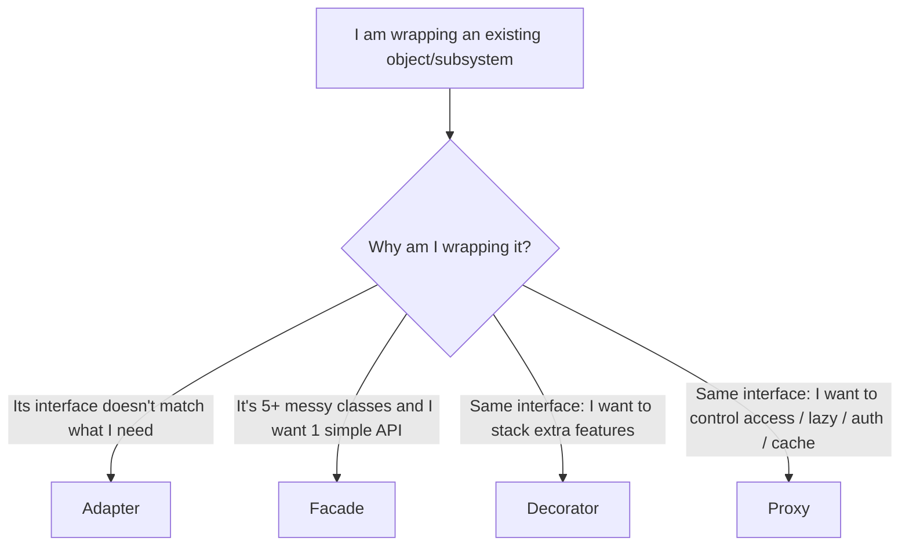

# Structural Patterns Comparison & Decision Matrix

> **One-line summary:** A rapid side-by-side comparison of all Structural Patterns—disambiguating look-alike wrappers (Adapter, Decorator, Proxy, Facade) and tree/memory patterns.

| Attribute | Specification |
|---|---|
| **Level** | Quick Reference / Synthesis |
| **Prerequisites** | [Module 06 Overview](00-overview.md) |
| **Estimated Reading Time** | 15 minutes |
| **Status** | Complete |
| **Category** | Structural Patterns |

---

## 1. Master Comparison Matrix

| Pattern | Interface Changed? | Core Architectural Intent | Classic Real-World Example |
|---|---|---|---|
| **Adapter** | **Yes** (A $\to$ B) | Make incompatible legacy/vendor class fit expected port | `InputStreamReader(InputStream)` |
| **Bridge** | Separates 2 hierarchies | Prevent $M \times N$ subclass explosion across 2 orthogonal axes | `JDBC` (`Connection` $\leftrightarrow$ Vendor Drivers) |
| **Composite** | Uniform across tree | Treat single Leaves & nested Containers identically | File System (`File` / `Directory`), HTML DOM |
| **Decorator** | **No** (Same interface) | Stack optional behaviors dynamically at runtime | `BufferedInputStream(GZIPInputStream(...))` |
| **Facade** | **Yes** (New simple API) | Hide complex multi-class subsystem behind 1 clean doorway | `requests.get()`, `JdbcTemplate` |
| **Flyweight** | Shared intrinsic state | Share immutable data across millions of objects to save RAM | `Integer.valueOf(-128..127)`, `String.intern()` |
| **Proxy** | **No** (Same interface) | Control access (Lazy, Auth, Cache, Remote RPC) | Spring `@Transactional` / ES6 `Proxy` |
| **Null Object** | **No** (Same interface) | Replace `null` with safe neutral no-op behavior | `Collections.emptyList()`, `NullLogger` |
| **Private Class Data** | Encapsulation capsule | Prevent internal class methods from mutating init attributes | Java `record` capsule / `frozen=True` |
| **Extension Object** | Optional query (`Optional<T>`) | Attach optional plugin capabilities without bloating core API | Eclipse `IAdaptable.getAdapter()` |

---

## 2. Wrapper Disambiguation Flowchart

---

[← Previous: 10 - Extension Object, Mixins & Traits](file:///e:/Learning/engineering-notes/08-solid-design-patterns/06-structural-patterns/10-extension-object-and-mixins-and-traits.md) | [Module 06 Index](file:///e:/Learning/engineering-notes/08-solid-design-patterns/06-structural-patterns/README.md) | [Next: Module 07 - Behavioral Patterns →](file:///e:/Learning/engineering-notes/08-solid-design-patterns/07-behavioral-patterns/README.md)
