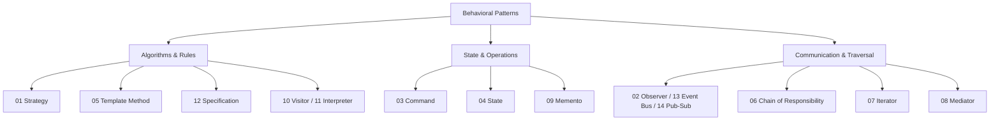

# Behavioral Design Patterns Overview

> **One-line summary:** Behavioral patterns assign dynamic communication and control-flow responsibilities—decoupling *who requests* an action from *who executes* it, *when* it runs, and *how* state evolves.

| Attribute | Specification |
|---|---|
| **Level** | Core / GoF Behavioral |
| **Prerequisites** | [Module 02: SOLID](file:///e:/Learning/engineering-notes/08-solid-design-patterns/02-solid-principles/README.md), [Module 06: Structural Patterns](file:///e:/Learning/engineering-notes/08-solid-design-patterns/06-structural-patterns/README.md) |
| **Estimated Reading Time** | 15 minutes |
| **Status** | Complete |
| **Category** | Behavioral Patterns |

---

## 1. Taxonomy of Behavioral Patterns

---

[← Module 07 Index](file:///e:/Learning/engineering-notes/08-solid-design-patterns/07-behavioral-patterns/README.md) | [Next: 01 - Strategy Pattern →](file:///e:/Learning/engineering-notes/08-solid-design-patterns/07-behavioral-patterns/01-strategy.md)
