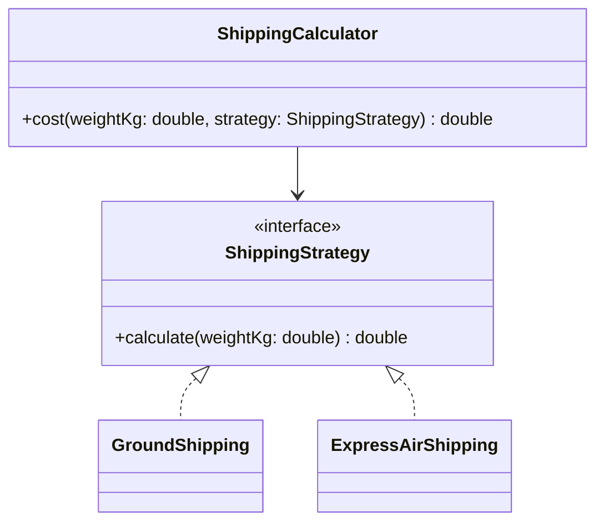

# Strategy Pattern

> **One-line summary:** Define a family of interchangeable algorithms, encapsulate each one, and make them swappable at runtime—eliminating brittle `switch` ladders (OCP) and subclassing bloat.

| Attribute | Specification |
|---|---|
| **Level** | Core / GoF Behavioral |
| **Prerequisites** | [02-open-closed.md](../02-solid-principles/02-open-closed.md), [06-encapsulate-what-varies.md](../01-foundations/06-encapsulate-what-varies.md) |
| **Estimated Reading Time** | 30 minutes |
| **Status** | Complete |
| **Category** | Behavioral |
| **Origin** | GoF 1994 |
| **Also Known As** | Policy Pattern, Interchangeable Algorithm |
| **Languages Tested** | Java 25 (LTS) / TypeScript 5.8 (Node 24 native) / Python 3.14 |

---

## Table of Contents
- [1 The Problem](#1-the-problem)
- [2 Why It Exists](#2-why-it-exists)
- [3 What It Is](#3-what-it-is)
- [4 The Problem Without It](#4-the-problem-without-it)
- [5 How It Solves It](#5-how-it-solves-it)
- [6 How It Works](#6-how-it-works)
- [7 Real-World Examples](#7-real-world-examples)
- [8 When to Use and When NOT to Use](#8-when-to-use-and-when-not-to-use)
- [9 Variations and Language Idioms](#9-variations-and-language-idioms)
- [10 Relationship to Other Principles and Patterns](#10-relationship-to-other-principles-and-patterns)
- [11 Common Mistakes and Anti-Patterns](#11-common-mistakes-and-anti-patterns)
- [12 Testing and Design Verification](#12-testing-and-design-verification)
- [13 Performance, Concurrency and Security Notes](#13-performance-concurrency-and-security-notes)
- [14 Interview Questions](#14-interview-questions)
- [15 Practice Exercises](#15-practice-exercises)
- [16 Summary / Cheat Sheet](#16-summary--cheat-sheet)
- [17 Further Reading](#17-further-reading)

---

## 1 The Problem

Imagine a logistics shipping calculator supporting Ground, Air Express, Same-Day Drone, and Freight shipping. Initially, `ShippingCalculator.cost(weight, type)` uses a `switch(type)` block.

Every quarter, new carriers and promotional shipping rules arrive. Modifying `ShippingCalculator` repeatedly introduces regressions into existing carriers, creates Git merge conflicts across teams, and bloats unit tests.

---

## 2 Why It Exists

Formulated by the **Gang of Four (1994)** to implement **Encapsulate What Varies** and **Open/Closed Principle**: extract varying algorithms behind a uniform `Strategy` interface so the host `Context` delegates execution without knowing concrete algorithm details.

---

## 3 What It Is



---

## 4 The Problem Without It

```java
// Violation: Cascading switch inside tested core calculator
class ShippingCalculatorViolation {
    public double cost(double weightKg, String mode) {
        if ("GROUND".equals(mode)) return weightKg * 1.5;
        if ("EXPRESS".equals(mode)) return weightKg * 4.5;
        throw new IllegalArgumentException("Unknown mode");
    }
}
```

---

## 5 How It Solves It

### Java Implementation (Java 25 LTS — Functional Interface Strategy)

```java
package com.design.patterns.behavioral.strategy;

@FunctionalInterface
interface ShippingStrategy {
    double calculate(double weightKg);
}

class ShippingCalculator {
    public double cost(double weightKg, ShippingStrategy strategy) {
        if (weightKg <= 0) throw new IllegalArgumentException("Weight must be positive");
        return strategy.calculate(weightKg);
    }
}

public class StrategyApp {
    public static void main(String[] args) {
        ShippingCalculator calc = new ShippingCalculator();
        ShippingStrategy ground = w -> w * 1.5;
        ShippingStrategy express = w -> w * 4.5;
        System.out.println("Strategy Express: $" + calc.cost(5.0, express));
    }
}
```

### TypeScript Implementation (Node 24 Native)

```typescript
type ShippingStrategy = (weightKg: number) => number;

const groundShipping: ShippingStrategy = w => w * 1.5;
const expressShipping: ShippingStrategy = w => w * 4.5;

function calculateCost(weightKg: number, strategy: ShippingStrategy): number {
    return strategy(weightKg);
}

console.log("TS Strategy Express: $" + calculateCost(5.0, expressShipping));
```

### Python Implementation (Python 3.14)

```python
from typing import Callable

ShippingStrategy = Callable[[float], float]

def calculate_cost(weight_kg: float, strategy: ShippingStrategy) -> float:
    return strategy(weight_kg)

print("Python Strategy Express: $" + str(calculate_cost(5.0, lambda w: w * 4.5)))
```

### Real Execution Output
```text
Strategy Express: $22.5
```

---

## 6 How It Works

In modern Java (`@FunctionalInterface`), TypeScript, and Python, a single-method Strategy does **not** even require separate concrete `.java`/`.ts` classes—pure lambdas/functions satisfy the Strategy contract directly! Use full classes only when a strategy carries configuration state or multiple helper methods.

---

## 7 Real-World Examples

1. **Java `Collections.sort(list, Comparator<T>)` & `Stream.sorted(Comparator)`**.
2. **Spring Security `AuthenticationProvider` / PasswordEncoder (`BCrypt`, `Argon2`)**.
3. **Python `sorted(items, key=...)` & `list.sort(key=...)`**.

---

## 8 When to Use and When NOT to Use

| Context | Use Strategy? | Rationale |
|---|---|---|
| **3+ varying algorithms/policies (Rule of Three)** | **Yes** | Eliminates `switch` bloat (OCP). |
| **2 fixed options that never change (`true`/`false`)** | **NO (KISS/YAGNI)** | Simple `if/else` is clearer. |

---

## 9 Variations and Language Idioms

- **Enum Strategy (Java):** Enum constants implementing an abstract method (`enum ShippingMode { GROUND { double calc(double w) { ... } } }`)—clean when variants are fixed and finite.

---

## 10 Relationship to Other Principles and Patterns

- **OCP & DIP:** Strategy is the primary GoF pattern implementing OCP.
- **State vs Strategy:** Strategy algorithms are independent and chosen by the *caller*; State objects transition *each other* automatically.

---

## 11 Common Mistakes and Anti-Patterns

| Anti-Pattern | Description | Production Consequence | Correct Remedy |
|---|---|---|---|
| **Strategy for 1 Implementation** | Creating `IPricingStrategy` when only one rule exists. | Speculative bloat (YAGNI). | Wait for Rule of Three. |
| **Bloated Strategy Classes in TS/Py** | Writing 30-line class wrappers when a 1-line lambda works. | Unnecessary boilerplate. | Pass `Callable` / arrow function. |
| **Strategy Inspecting Context Type** | `strategy.execute(context)` downcasting `context`. | Tight circular coupling. | Pass minimal required data parameters. |
| **Missing Strategy Registry** | Pushing the `switch(type)` out of `Calculator` into 5 controllers! | `switch` still duplicated! | Centralize selection in a `Map<String, Strategy>` Registry. |
| **Stateful Shared Strategy** | Mutating instance fields on a singleton Strategy across threads. | Race conditions. | Keep strategies stateless. |
| **Forgetting Null/Missing Guard** | `calc.cost(5, null)`. | `NullPointerException`. | Validate non-null or use Null Object. |

---

## 12 Testing and Design Verification

Test each concrete algorithm directly as a pure unit (`assertEquals(22.5, express.calculate(5.0))`) and test `ShippingCalculator` once with a dummy lambda.

---

## 13 Performance, Concurrency and Security Notes

Stateless lambda/singleton strategies avoid per-request allocations and are 100% thread-safe.

---

## 14 Interview Questions

<details>
<summary><strong>1. What is the Strategy pattern and how does it enable OCP?</strong></summary>

Strategy encapsulates a family of algorithms behind a common interface so the Context delegates execution without `switch` statements—allowing new algorithms to be plugged in without modifying the Context (OCP).
</details>

<details>
<summary><strong>2. Compare Strategy vs State pattern.</strong></summary>

They share identical UML diagrams, but differ in **intent and control**: in **Strategy**, the *caller* picks the algorithm and strategies don't know about one another; in **State**, states encapsulate lifecycle transitions and switch the Context's active state automatically.
</details>

<details>
<summary><strong>3. Compare Strategy vs Template Method.</strong></summary>

**Template Method** uses *inheritance* (subclasses override steps of a fixed skeleton). **Strategy** uses *composition* (swapping an entire algorithm at runtime). Favor Strategy for flexibility.
</details>

<details>
<summary><strong>4. How do lambdas simplify Strategy in modern Java, TypeScript, and Python?</strong></summary>

Any single-method Strategy (`@FunctionalInterface`, TS function type, Python `Callable`) can be satisfied directly by an inline lambda/function without creating boilerplate concrete classes.
</details>

<details>
<summary><strong>5. Give a real-world example of Strategy in Java's JDK.</strong></summary>

`java.util.Comparator<T>` passed to `Collections.sort()` or `TreeSet`, and `java.util.concurrent.RejectedExecutionHandler` in `ThreadPoolExecutor`.
</details>

<details>
<summary><strong>6. If you remove `switch` from `ShippingCalculator`, where does runtime selection move?</strong></summary>

Into a `Map<String, ShippingStrategy>` Registry wired in the Composition Root—so neither `Calculator` nor controllers contain `switch` ladders.
</details>

<details>
<summary><strong>7. When is Strategy overkill?</strong></summary>

When there are only 1–2 simple, unchanging branches (KISS/YAGNI).
</details>

<details>
<summary><strong>8. What is Java's "Enum Strategy" idiom?</strong></summary>

Declaring an abstract method inside a Java `enum` and overriding it per enum constant—combining type-safe finite variants with polymorphic dispatch.
</details>

---

## 15 Practice Exercises

### Exercise 1: Refactor `switch` Discount to Strategy (Easy)
Convert `if (type == "VIP") ... else if (type == "STUDENT") ...` into `DiscountStrategy` lambdas.

<details>
<summary><strong>Solution</strong></summary>

`DoubleUnaryOperator vip = p -> p * 0.8; DoubleUnaryOperator student = p -> p * 0.85;`
</details>

---

### Exercise 2: Strategy + Registry in TypeScript (Medium)
Build a `CompressionRegistry` mapping `"gzip"` and `"brotli"` to compression strategies without `switch`.

<details>
<summary><strong>Solution</strong></summary>

`const compressors = new Map<string, (s: string) => string>([["gzip", ...], ["brotli", ...]]);`
</details>

---

### Exercise 3: Enum Strategy in Java 25 (Hard)
Implement `enum TaxRegion { US, EU, UK }` with an abstract `double applyTax(double net)` method.

<details>
<summary><strong>Solution</strong></summary>

`US { public double applyTax(double net) { return net * 1.08; } }, EU { ... }`
</details>

---

## 16 Summary / Cheat Sheet

```
+--------------------------------------------------------------------------+
|                             STRATEGY PATTERN                             |
+--------------------------------------------------------------------------+
| INTENT     : Encapsulate interchangeable algorithms behind 1 interface.  |
| MODERN IDIOM: Use lambdas / functions when Strategy has 1 method!        |
| VS STATE   : Caller chooses Strategy; State transitions itself.          |
+--------------------------------------------------------------------------+
```

---

## 17 Further Reading

- Erich Gamma et al., *Design Patterns*, Addison-Wesley, 1994.

### In Your Language
| Language Track | Deep Dive Reference |
|---|---|
| Java | [Java OOP & Design Patterns](file:///e:/Learning/engineering-notes/01-languages/java/24-design-patterns/README.md) |
| TypeScript | [TypeScript Design Patterns](file:///e:/Learning/engineering-notes/01-languages/typescript/17-design-patterns/README.md) |
| Python | [Python Design Patterns](file:///e:/Learning/engineering-notes/01-languages/python/23-design-patterns/README.md) |

---

[← Previous: 00 - Behavioral Overview](file:///e:/Learning/engineering-notes/08-solid-design-patterns/07-behavioral-patterns/00-overview.md) | [Module 07 Index](file:///e:/Learning/engineering-notes/08-solid-design-patterns/07-behavioral-patterns/README.md) | [Next: 02 - Observer Pattern →](file:///e:/Learning/engineering-notes/08-solid-design-patterns/07-behavioral-patterns/02-observer.md)
