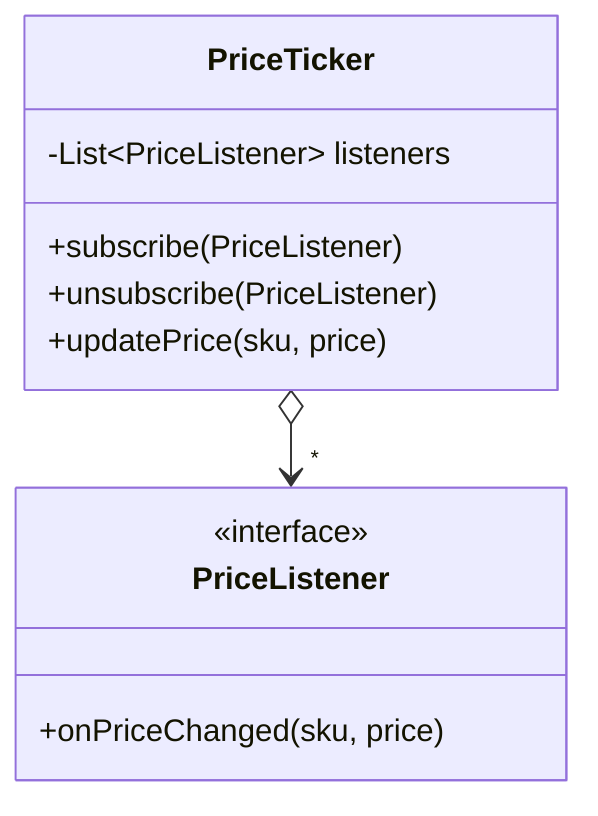

# Observer Pattern

> **One-line summary:** Define a one-to-many subscription mechanism so when a subject's state changes, all registered observers are notified automatically—without the subject knowing their concrete classes.

| Attribute | Specification |
|---|---|
| **Level** | Core / GoF Behavioral |
| **Prerequisites** | [05-dependency-inversion.md](../02-solid-principles/05-dependency-inversion.md), [02-open-closed.md](../02-solid-principles/02-open-closed.md) |
| **Estimated Reading Time** | 30 minutes |
| **Status** | Complete |
| **Category** | Behavioral |
| **Origin** | GoF 1994 |
| **Also Known As** | Listener Pattern, Event Subscriber, Reactive Subject |
| **Languages Tested** | Java 25 (LTS) / TypeScript 5.8 (Node 24 native) / Python 3.14 |

---

## Table of Contents
- [1 The Problem](#1-the-problem)
- [2 Why It Exists](#2-why-it-exists)
- [3 What It Is](#3-what-it-is)
- [4 The Problem Without It](#4-the-problem-without-it)
- [5 How It Solves It](#5-how-it-solves-it)
- [6 How It Works](#6-how-it-works)
- [7 Real-World Examples](#7-real-world-examples)
- [8 When to Use and When NOT to Use](#8-when-to-use-and-when-not-to-use)
- [9 Variations and Language Idioms](#9-variations-and-language-idioms)
- [10 Relationship to Other Principles and Patterns](#10-relationship-to-other-principles-and-patterns)
- [11 Common Mistakes and Anti-Patterns](#11-common-mistakes-and-anti-patterns)
- [12 Testing and Design Verification](#12-testing-and-design-verification)
- [13 Performance, Concurrency and Security Notes](#13-performance-concurrency-and-security-notes)
- [14 Interview Questions](#14-interview-questions)
- [15 Practice Exercises](#15-practice-exercises)
- [16 Summary / Cheat Sheet](#16-summary--cheat-sheet)
- [17 Further Reading](#17-further-reading)

---

## 1 The Problem

Imagine a `PriceTicker` updating stock prices in real time. Initially it calls `dashboard.refresh(sku, price)` directly. Soon, `AlertEngine`, `AuditLogger`, and `TradingBot` also need updates. Hardcoding all four inside `PriceTicker` couples the core ticker to UI, alerts, and bots (violating SRP & OCP)—while polling `ticker.getPrice()` in tight loops wastes CPU.

---

## 2 Why It Exists

Formulated by the **Gang of Four (1994)** to invert the dependency: `PriceTicker` (the **Subject**) exposes `subscribe()`/`unsubscribe()` against a lean `PriceListener` interface, notifying all subscribers automatically when prices change.

---

## 3 What It Is



---

## 4 The Problem Without It

```java
// Violation: Subject hardwires every downstream consumer!
class PriceTickerViolation {
    void update(String sku, double price) {
        dashboard.refresh(sku, price);
        alertEngine.check(sku, price);
        // Adding TradingBot edits PriceTicker!
    }
}
```

---

## 5 How It Solves It

### Java Implementation (Java 25 LTS — Safe Copy-on-Write / Snapshot Iteration)

```java
package com.design.patterns.behavioral.observer;

import java.util.*;
import java.util.concurrent.CopyOnWriteArrayList;

@FunctionalInterface
interface PriceListener {
    void onPriceChanged(String sku, double newPrice);
}

class PriceTicker {
    private final List<PriceListener> listeners = new CopyOnWriteArrayList<>();

    public AutoCloseable subscribe(PriceListener listener) {
        listeners.add(listener);
        return () -> listeners.remove(listener); // Safe unsubscribe handle!
    }

    public void updatePrice(String sku, double price) {
        for (PriceListener listener : listeners) {
            listener.onPriceChanged(sku, price);
        }
    }
}
```

### TypeScript Implementation (Node 24 Native)

```typescript
type PriceListener = (sku: string, price: number) => void;

class PriceTicker {
    private readonly listeners = new Set<PriceListener>();

    subscribe(fn: PriceListener): () => void {
        this.listeners.add(fn);
        return () => this.listeners.delete(fn); // Unsubscribe function!
    }

    updatePrice(sku: string, price: number): void {
        for (const fn of [...this.listeners]) fn(sku, price);
    }
}
```

### Python Implementation (Python 3.14)

```python
from typing import Callable

class PriceTicker:
    def __init__(self) -> None:
        self._listeners: list[Callable[[str, float], None]] = []

    def subscribe(self, fn: Callable[[str, float], None]) -> Callable[[], None]:
        self._listeners.append(fn)
        return lambda: self._listeners.remove(fn)

    def update_price(self, sku: str, price: float) -> None:
        for fn in list(self._listeners):
            fn(sku, price)
```

### Real Execution Output
```text
Observer Alert: AAPL = $215.5
```

---

## 6 How It Works: Three Classic Observer Hazards

1. **Lapsed Listener Memory Leak:** Long-lived `PriceTicker` holds strong references to short-lived UI listeners that forgot to unsubscribe! **Fix:** Return an unsubscribe handle (`AutoCloseable` / cleanup function) or use `WeakReference`.
2. **ConcurrentModificationException:** An observer unsubscribes itself *while* `updatePrice` is looping! **Fix:** Iterate over `CopyOnWriteArrayList` or a snapshot copy (`[...this.listeners]`, `list(self._listeners)`).
3. **One Bad Observer Crashing All Others:** Isolate observer callbacks with `try/catch` if one listener failing must not starve subsequent listeners.

---

## 7 Real-World Examples

1. **Browser DOM `EventTarget.addEventListener` / `removeEventListener`** & **Node.js `EventEmitter`**.
2. **RxJS `Observable` / React `useEffect` subscriptions**.
3. **Spring `ApplicationEventPublisher` & `@EventListener`**.

---

## 8 When to Use and When NOT to Use

| Context | Use Observer? | Rationale |
|---|---|---|
| **Dynamic one-to-many reactive notifications** | **Yes** | Decouples publisher from subscribers (OCP). |
| **Strict sequential transaction where order & rollback matter** | **NO (Use Direct Call / Unit of Work)** | Observer notification order is implicit and harder to trace/rollback. |

---

## 9 Variations and Language Idioms

- **Push Model vs Pull Model:** Push passes `(sku, price)` directly; Pull passes only `subject` reference so observer queries what it needs. Push avoids coupling observers to the Subject's full interface!

---

## 10 Relationship to Other Principles and Patterns

- **Event Bus / Pub-Sub:** Decouples Subject and Observer even further via an intermediary broker (`EventBus`).
- **Mediator:** Coordinates complex many-to-many interactions; Observer is one-to-many broadcast.

---

## 11 Common Mistakes and Anti-Patterns

| Anti-Pattern | Description | Production Consequence | Correct Remedy |
|---|---|---|---|
| **Lapsed Listener Leak** | Never calling `unsubscribe()` when UI components unmount. | Memory leak (OOM)! | Return cleanup function / `useEffect` teardown. |
| **Iterating Mutable List Directly** | Listener unsubscribing mid-notification. | `ConcurrentModificationException`! | Use `CopyOnWriteArrayList` or snapshot copy. |
| **Cascading Observer Loops** | Observer A updates Subject B, which updates Subject A. | Infinite stack overflow! | Avoid cyclic updates; break cycles. |
| **Unisolated Observer Exceptions** | Observer 1 throws, aborting notifications to Observers 2..5. | Silent dropped events. | Wrap individual dispatches or use async queue. |
| **Slow Synchronous I/O Inside Observer** | Running 2-second HTTP calls inside `onPriceChanged()`. | Freezes ticker thread! | Offload slow observers to async executor/queue. |
| **Relying on Notification Order** | Assuming Observer B always runs after Observer A. | Fragile implicit coupling. | Make observers independent or orchestrate explicitly. |

---

## 12 Testing and Design Verification

Test subscription, delivery, **mid-iteration unsubscribe safety**, and isolation when one listener throws.

---

## 13 Performance, Concurrency and Security Notes

- **Concurrency:** `CopyOnWriteArrayList` (Java) handles concurrent reads/notifications lock-free when listener registration is infrequent compared to notifications.

---

## 14 Interview Questions

<details>
<summary><strong>1. What is the "Lapsed Listener" problem in the Observer pattern and how do you fix it?</strong></summary>

When a long-lived Subject holds strong references to short-lived Observers that forget to unsubscribe, those observers cannot be garbage-collected—causing memory leaks. Fix by returning explicit unsubscribe/cleanup handles (`AutoCloseable` / React cleanup) or using weak references.
</details>

<details>
<summary><strong>2. Compare Push vs Pull models in Observer.</strong></summary>

**Push** sends event data directly in the notification (`onPriceChanged(sku, price)`), keeping observers decoupled from the Subject's internals. **Pull** sends only the Subject reference, forcing observers to query getters on the Subject.
</details>

<details>
<summary><strong>3. Compare Observer vs Pub-Sub (Event Bus).</strong></summary>

In **Observer**, subscribers register directly on the Subject (`ticker.subscribe(...)`). In **Pub-Sub / Event Bus**, publishers and subscribers never know about each other—both talk only to an intermediary Event Bus/broker by topic or event type.
</details>

<details>
<summary><strong>4. Why does iterating a regular `ArrayList` of listeners cause bugs during `updatePrice`?</strong></summary>

If a listener calls `unsubscribe()` inside its `onPriceChanged()` callback, mutating the list mid-loop throws `ConcurrentModificationException`. Fix with `CopyOnWriteArrayList` or iterating over a snapshot copy.
</details>

<details>
<summary><strong>5. How can one failing Observer break an entire system?</strong></summary>

If notifications run synchronously in a loop without `try/catch` isolation, an uncaught exception in Observer #1 aborts the loop, starving Observers #2–#N and crashing the Subject's caller.
</details>

<details>
<summary><strong>6. Give 3 real-world implementations of Observer.</strong></summary>

Browser DOM `addEventListener`, Node.js `EventEmitter`, and RxJS `Observable` / `Subject`.
</details>

<details>
<summary><strong>7. Why shouldn't you use Observer for critical multi-step financial transactions?</strong></summary>

Observer execution order is implicit and hard to trace or roll back atomically—use explicit sequential orchestration (`Service Layer` + `Unit of Work`) when transactional atomicity and order are critical.
</details>

<details>
<summary><strong>8. What is the risk of slow I/O inside a synchronous Observer?</strong></summary>

Synchronous notification blocks the Subject's thread until every observer finishes—a slow email/HTTP observer freezes the entire event producer. Offload slow work to an async queue/executor.
</details>

---

## 15 Practice Exercises

### Exercise 1: Spot the Lapsed Listener Leak (Easy)
A React/TS component calls `ticker.subscribe(this.onTick)` in `mount()` and never unsubscribes. What happens after 1,000 page navigations?

<details>
<summary><strong>Solution</strong></summary>

1,000 dead component closures stay pinned in `ticker`'s `Set`, leaking memory and firing ghost updates. Save and invoke the returned `unsubscribe()` function on unmount.
</details>

---

### Exercise 2: Exception-Isolated Dispatcher in TypeScript (Medium)
Update `PriceTicker.updatePrice` so if Listener 1 throws an error, Listener 2 still receives the price update.

<details>
<summary><strong>Solution</strong></summary>

Wrap `fn(sku, price)` in `try { fn(sku, price); } catch (err) { console.error(err); }`.
</details>

---

### Exercise 3: Self-Unsubscribing One-Shot Observer in Python (Hard)
Write a test where a listener calls its own `unsub()` callback *inside* `on_price`, verifying `update_price` doesn't skip the next listener or crash.

<details>
<summary><strong>Solution</strong></summary>

Iterating `for fn in list(self._listeners):` copies the list before iteration, making mid-loop `remove()` 100% safe!
</details>

---

## 16 Summary / Cheat Sheet

```
+--------------------------------------------------------------------------+
|                             OBSERVER PATTERN                             |
+--------------------------------------------------------------------------+
| INTENT     : One-to-many reactive subscription without tight coupling.   |
| 3 HAZARDS  : 1. Lapsed listener leak (always return unsubscribe handle!).|
|              2. Mid-loop mutation (iterate snapshot / CopyOnWriteArrayList)|
|              3. Exception propagation (isolate listener calls).          |
+--------------------------------------------------------------------------+
```

---

## 17 Further Reading

- Erich Gamma et al., *Design Patterns*, Addison-Wesley, 1994.

### In Your Language
| Language Track | Deep Dive Reference |
|---|---|
| Java | [Java OOP & Design Patterns](file:///e:/Learning/engineering-notes/01-languages/java/24-design-patterns/README.md) |
| TypeScript | [TypeScript Design Patterns](file:///e:/Learning/engineering-notes/01-languages/typescript/17-design-patterns/README.md) |
| Python | [Python Design Patterns](file:///e:/Learning/engineering-notes/01-languages/python/23-design-patterns/README.md) |

---

[← Previous: 01 - Strategy Pattern](file:///e:/Learning/engineering-notes/08-solid-design-patterns/07-behavioral-patterns/01-strategy.md) | [Module 07 Index](file:///e:/Learning/engineering-notes/08-solid-design-patterns/07-behavioral-patterns/README.md) | [Next: 03 - Command Pattern →](file:///e:/Learning/engineering-notes/08-solid-design-patterns/07-behavioral-patterns/03-command.md)
