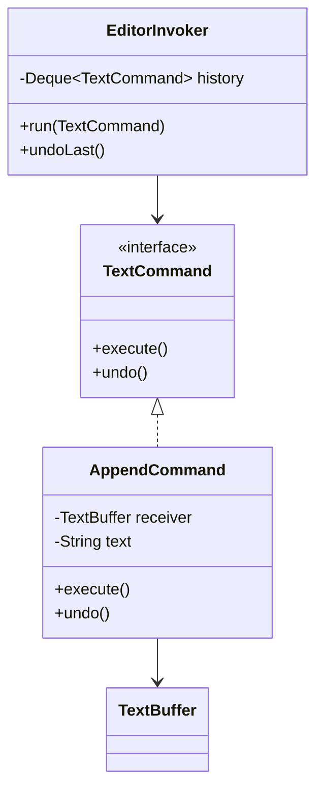

# Command Pattern

> **One-line summary:** Encapsulate a request as a standalone object—allowing operations to be parameterized, queued, logged, retried, and undone/redone cleanly without coupling the invoker to the receiver.

| Attribute | Specification |
|---|---|
| **Level** | Core / GoF Behavioral |
| **Prerequisites** | [04-programming-to-interfaces.md](../01-foundations/04-programming-to-interfaces.md), [09-memento.md](09-memento.md) |
| **Estimated Reading Time** | 30 minutes |
| **Status** | Complete |
| **Category** | Behavioral |
| **Origin** | GoF 1994 |
| **Also Known As** | Action, Transaction, Task Object |
| **Languages Tested** | Java 25 (LTS) / TypeScript 5.8 (Node 24 native) / Python 3.14 |

---

## Table of Contents
- [1 The Problem](#1-the-problem)
- [2 Why It Exists](#2-why-it-exists)
- [3 What It Is](#3-what-it-is)
- [4 The Problem Without It](#4-the-problem-without-it)
- [5 How It Solves It](#5-how-it-solves-it)
- [6 How It Works](#6-how-it-works)
- [7 Real-World Examples](#7-real-world-examples)
- [8 When to Use and When NOT to Use](#8-when-to-use-and-when-not-to-use)
- [9 Variations and Language Idioms](#9-variations-and-language-idioms)
- [10 Relationship to Other Principles and Patterns](#10-relationship-to-other-principles-and-patterns)
- [11 Common Mistakes and Anti-Patterns](#11-common-mistakes-and-anti-patterns)
- [12 Testing and Design Verification](#12-testing-and-design-verification)
- [13 Performance, Concurrency and Security Notes](#13-performance-concurrency-and-security-notes)
- [14 Interview Questions](#14-interview-questions)
- [15 Practice Exercises](#15-practice-exercises)
- [16 Summary / Cheat Sheet](#16-summary--cheat-sheet)
- [17 Further Reading](#17-further-reading)

---

## 1 The Problem

Imagine building a collaborative text editor or an asynchronous background job queue. If a UI toolbar button directly calls `editor.append("Hello")` as an immediate method invocation:
1. You cannot **Undo / Redo** the edit (there is no record of what was added or where).
2. You cannot **serialize, queue, or retry** the operation in a background worker queue.
3. You cannot **record an audit log** or combine multiple edits into a transactional **Macro**.

---

## 2 Why It Exists

Formulated by the **Gang of Four (1994)** to **reify** (turn into an object) a method call: turning an ephemeral function invocation into a first-class `Command` object with `execute()` (and optionally `undo()`).

---

## 3 What It Is



---

## 4 The Problem Without It

```java
// Direct coupled invocation: No history stack, no undo, no queuing!
button.onClick(() -> editor.append("Hello"));
```

---

## 5 How It Solves It

### Java Implementation (Java 25 LTS — Undoable Command + History Stack)

```java
package com.design.patterns.behavioral.command;

import java.util.*;

interface TextCommand {
    void execute();
    void undo();
}

class TextBuffer {
    String content = "";
}

class AppendCommand implements TextCommand {
    private final TextBuffer buf;
    private final String text;

    public AppendCommand(TextBuffer buf, String text) {
        this.buf = buf;
        this.text = text;
    }

    @Override
    public void execute() {
        buf.content += text;
    }

    @Override
    public void undo() {
        buf.content = buf.content.substring(0, buf.content.length() - text.length());
    }
}

class CommandHistory {
    private final Deque<TextCommand> stack = new ArrayDeque<>();

    public void run(TextCommand cmd) {
        cmd.execute();
        stack.push(cmd);
    }

    public void undoLast() {
        if (!stack.isEmpty()) stack.pop().undo();
    }
}
```

### TypeScript Implementation (Node 24 Native)

```typescript
class TextBuffer { content = ""; }

interface Command {
    execute(): void;
    undo(): void;
}

class AppendCmd implements Command {
    private readonly buf: TextBuffer;
    private readonly txt: string;
    constructor(buf: TextBuffer, txt: string) { this.buf = buf; this.txt = txt; }
    execute() { this.buf.content += this.txt; }
    undo() { this.buf.content = this.buf.content.slice(0, -this.txt.length); }
}

const b = new TextBuffer();
const c = new AppendCmd(b, "TS ");
c.execute();
c.undo();
console.log("TS Command undo len:", b.content.length);
```

### Python Implementation (Python 3.14)

```python
from typing import Protocol

class Command(Protocol):
    def execute(self) -> None: ...
    def undo(self) -> None: ...

class AppendCommand:
    def __init__(self, buf: list[str], text: str) -> None:
        self._buf = buf
        self._text = text

    def execute(self) -> None:
        self._buf.append(self._text)

    def undo(self) -> None:
        self._buf.pop()
```

### Real Execution Output
```text
Command after exec: 'Hello '
Command after undo: ''
TS Command undo len: 0
```

---

## 6 How It Works: Undo Redo & Macro Commands

1. **Undo/Redo Stacks:** Push executed commands onto `undoStack`; popping and calling `undo()` pushes onto `redoStack` (clearing `redoStack` when a brand-new command executes).
2. **Macro Command:** A Composite `MacroCommand` holding `List<Command>`, executing forward and undoing in **reverse order**.

---

## 7 Real-World Examples

1. **Java `Runnable` / `Callable<T>`**: Commands submitted to `ExecutorService` thread pools.
2. **Database Migrations (Flyway / Liquibase)**: Forward `up()` and rollback `down()` commands.
3. **CQRS Command Bus & Redux Actions**: Serializable command objects dispatched to handlers.

---

## 8 When to Use and When NOT to Use

| Context | Use Command? | Rationale |
|---|---|---|
| **Undo/Redo, Task Queues, Macro Recording, CQRS, Audit Logs** | **Yes** | Requires treating requests as first-class objects. |
| **Simple immediate button callback with no undo/queue** | **NO (Use plain lambda)** | Wrapping every trivial click in a Command class is bloat. |

---

## 9 Variations and Language Idioms

- **Command + Memento:** When `undo()` cannot easily invert a complex operation mathematically (e.g., sorting or deleting multiple rows), store a Memento snapshot before `execute()`.

---

## 10 Relationship to Other Principles and Patterns

- **Memento:** Restores pre-command state when inverse math isn't trivial.
- **Composite:** `MacroCommand` combines multiple commands into one atomic unit.
- **Strategy vs Command:** Strategy encapsulates *how* to do a task (algorithm); Command encapsulates *what* task to run + its arguments + receiver + undo state.

---

## 11 Common Mistakes and Anti-Patterns

| Anti-Pattern | Description | Production Consequence | Correct Remedy |
|---|---|---|---|
| **Undo Without Saving Pre-State** | `DeleteRangeCommand` forgetting to save deleted text before deleting! | `undo()` cannot restore deleted data! | Capture deleted data or Memento inside `execute()`. |
| **Forgetting to Clear Redo Stack** | Executing a new edit after Undo without clearing Redo. | Redo applies stale history, corrupting document! | Clear `redoStack` on any new `run()`. |
| **Putting Heavy Business Logic in Invoker** | `ToolbarButton` manipulating text buffer directly. | Tight coupling. | Invoker only calls `cmd.execute()`. |
| **Non-Serializable Commands in Distributed Queues** | Trying to push live object references (`TextBuffer` pointer) to Redis/Kafka. | Serialization crash! | Use pure data DTO Commands (CQRS) resolved by handler IDs. |
| **Unbounded Undo History** | Storing 1,000,000 full snapshots in memory. | `OutOfMemoryError`. | Cap history depth (e.g. last 100 steps). |
| **Ignoring Partial Macro Failure** | Macro runs 2 of 3 commands, #3 throws, leaving partial mutation. | Corrupted state. | Roll back executed commands in reverse order on failure. |

---

## 12 Testing and Design Verification

Test full round-trip: `execute()` $\to$ verify state $\to$ `undo()` $\to$ assert state equals exact original state!

---

## 13 Performance, Concurrency and Security Notes

- **Security (Audit Trail):** Command objects serialize cleanly into immutable audit logs (`who`, `when`, `commandName`, `params`) for compliance.

---

## 14 Interview Questions

<details>
<summary><strong>1. What is the Command pattern and what capabilities does it unlock?</strong></summary>

Command encapsulates a request and its parameters as an object—unlocking **Undo/Redo** stacks, **asynchronous task queuing**, **Macro composition**, **retries**, and **audit logging**.
</details>

<details>
<summary><strong>2. Compare Command vs Strategy.</strong></summary>

**Strategy** swaps *how* an algorithm runs (e.g. `QuickSort` vs `MergeSort`) without owning execution history. **Command** encapsulates *what* specific operation to invoke (receiver + arguments + `execute`/`undo`) as a data/task object that can be queued, logged, or reversed.
</details>

<details>
<summary><strong>3. How do you implement Undo/Redo cleanly using two stacks?</strong></summary>

Maintain `undoStack` and `redoStack`. `run(cmd)` executes, pushes to `undoStack`, and **clears `redoStack`**. `undo()` pops from `undoStack`, calls `cmd.undo()`, and pushes to `redoStack`. `redo()` pops from `redoStack`, calls `cmd.execute()`, and pushes back to `undoStack`.
</details>

<details>
<summary><strong>4. When should Command pair with Memento for Undo?</strong></summary>

When the forward operation is lossy or hard to invert algebraically (e.g., `FormatDocument` or `BatchDelete`), saving a Memento snapshot before `execute()` makes `undo()` trivial.
</details>

<details>
<summary><strong>5. How does a `MacroCommand` work?</strong></summary>

Using the **Composite** pattern, `MacroCommand` holds a list of `Command`s: `execute()` runs them forward `0..N-1`, and `undo()` reverses them `N-1..0`.
</details>

<details>
<summary><strong>6. Give a real-world example of Command in Java's JDK.</strong></summary>

`java.lang.Runnable` and `java.util.concurrent.Callable<V>` submitted to `ExecutorService` thread pools.
</details>

<details>
<summary><strong>7. Why must distributed job queue commands be pure data DTOs rather than closures?</strong></summary>

Closures capture in-memory pointers (`this`) that cannot be serialized over Kafka/Redis to another worker process. CQRS serializes command data (`{ type: "ChargeOrder", orderId: "123" }`) and routes to a handler on the worker.
</details>

<details>
<summary><strong>8. What happens if a Command class grows to 500 lines of domain logic?</strong></summary>

Commands should stay thin delegates invoking methods on the Receiver (or Handler)—putting heavy domain logic inside every command violates SRP and duplicates rules.
</details>

---

## 15 Practice Exercises

### Exercise 1: Identify Missing Pre-State in Undo (Easy)
`SetColorCommand(shape, newColor)` implements `execute() { shape.setColor(newColor); }`. Why can't it implement `undo()` yet?

<details>
<summary><strong>Solution</strong></summary>

It forgot to save `this.previousColor = shape.getColor()` inside `execute()` before overwriting!
</details>

---

### Exercise 2: Implement Undo/Redo Manager in TypeScript (Medium)
Extend `AppendCmd` with a `HistoryManager` supporting `run(cmd)`, `undo()`, and `redo()` (clearing `redoStack` on new `run()`).

<details>
<summary><strong>Solution</strong></summary>

Keep `undoStack: Command[] = []` and `redoStack: Command[] = []`; `run` clears `redoStack = []`.
</details>

---

### Exercise 3: Transactional MacroCommand with Rollback in Python (Hard)
Implement `MacroCommand(commands)` in Python where if command #3 raises an exception during `execute()`, commands #2 and #1 are automatically undone in reverse order.

<details>
<summary><strong>Solution</strong></summary>

Track `executed = []` in a loop; in `except:`, iterate `reversed(executed)` calling `cmd.undo()` before re-raising.
</details>

---

## 16 Summary / Cheat Sheet

```
+--------------------------------------------------------------------------+
|                             COMMAND PATTERN                              |
+--------------------------------------------------------------------------+
| INTENT     : Turn requests into objects for Undo/Redo, Queues, Macros.   |
| UNDO/REDO  : Two stacks (clear redoStack on new execute!).               |
| DISTRIBUTED: Serialize pure DTO Commands (CQRS), never live pointers!    |
+--------------------------------------------------------------------------+
```

---

## 17 Further Reading

- Erich Gamma et al., *Design Patterns*, Addison-Wesley, 1994.

### In Your Language
| Language Track | Deep Dive Reference |
|---|---|
| Java | [Java OOP & Design Patterns](file:///e:/Learning/engineering-notes/01-languages/java/24-design-patterns/README.md) |
| TypeScript | [TypeScript Design Patterns](file:///e:/Learning/engineering-notes/01-languages/typescript/17-design-patterns/README.md) |
| Python | [Python Design Patterns](file:///e:/Learning/engineering-notes/01-languages/python/23-design-patterns/README.md) |

---

[← Previous: 02 - Observer Pattern](file:///e:/Learning/engineering-notes/08-solid-design-patterns/07-behavioral-patterns/02-observer.md) | [Module 07 Index](file:///e:/Learning/engineering-notes/08-solid-design-patterns/07-behavioral-patterns/README.md) | [Next: 04 - State Pattern →](file:///e:/Learning/engineering-notes/08-solid-design-patterns/07-behavioral-patterns/04-state.md)
