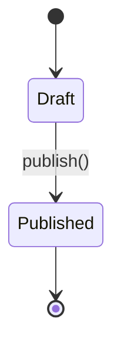
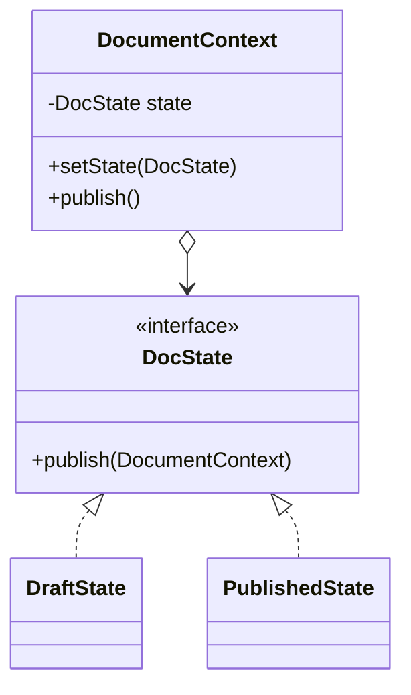

# State Pattern

> **One-line summary:** Allow an object to alter its behavior when its internal state changes—encapsulating each state's behavior and valid transitions in dedicated polymorphic state objects rather than sprawling `if/switch(status)` ladders.

| Attribute | Specification |
|---|---|
| **Level** | Core / GoF Behavioral |
| **Prerequisites** | [02-open-closed.md](../02-solid-principles/02-open-closed.md), [01-strategy.md](01-strategy.md) |
| **Estimated Reading Time** | 30 minutes |
| **Status** | Complete |
| **Category** | Behavioral |
| **Origin** | GoF 1994 |
| **Also Known As** | Finite State Machine (FSM) Objects |
| **Languages Tested** | Java 25 (LTS) / TypeScript 5.8 (Node 24 native) / Python 3.14 |

---

## Table of Contents
- [1 The Problem](#1-the-problem)
- [2 Why It Exists](#2-why-it-exists)
- [3 What It Is](#3-what-it-is)
- [4 The Problem Without It](#4-the-problem-without-it)
- [5 How It Solves It](#5-how-it-solves-it)
- [6 How It Works](#6-how-it-works)
- [7 Real-World Examples](#7-real-world-examples)
- [8 When to Use and When NOT to Use](#8-when-to-use-and-when-not-to-use)
- [9 Variations and Language Idioms](#9-variations-and-language-idioms)
- [10 Relationship to Other Principles and Patterns](#10-relationship-to-other-principles-and-patterns)
- [11 Common Mistakes and Anti-Patterns](#11-common-mistakes-and-anti-patterns)
- [12 Testing and Design Verification](#12-testing-and-design-verification)
- [13 Performance, Concurrency and Security Notes](#13-performance-concurrency-and-security-notes)
- [14 Interview Questions](#14-interview-questions)
- [15 Practice Exercises](#15-practice-exercises)
- [16 Summary / Cheat Sheet](#16-summary--cheat-sheet)
- [17 Further Reading](#17-further-reading)

---

## 1 The Problem

Imagine an e-commerce `Order` or publishing `Document` with 5 lifecycle states (`DRAFT`, `UNDER_REVIEW`, `APPROVED`, `PUBLISHED`, `ARCHIVED`) and 4 operations (`edit()`, `submit()`, `publish()`, `archive()`).

Without State, every single method repeats the exact same `switch (status)` ladder:
```java
void publish() {
    if (status == DRAFT) ... else if (status == UNDER_REVIEW) ... else if (status == PUBLISHED) ...
}
```
When a new state (`REJECTED`) is added, developers must hunt down and edit 6 separate `switch` blocks—missing one allows `REJECTED` documents to be published directly, causing a compliance incident!

---

## 2 Why It Exists

Formulated by the **Gang of Four (1994)** to implement **Finite State Machines** cleanly in OOP: each state becomes a class implementing a `DocState` interface, co-locating *what happens* in that state and *which next state* is valid.

---

## 3 What It Is





---

## 4 The Problem Without It

```java
// Violation: Duplicated switch(status) across every method!
class OrderViolation {
    String status = "DRAFT";
    void publish() {
        if ("DRAFT".equals(status)) status = "PUBLISHED";
        else throw new IllegalStateException("Invalid transition");
    }
    void edit() {
        if (!"DRAFT".equals(status)) throw new IllegalStateException("Cannot edit");
    }
}
```

---

## 5 How It Solves It

### Java Implementation (Java 25 LTS)

```java
package com.design.patterns.behavioral.state;

interface DocState {
    void publish(DocumentContext ctx);
    String name();
}

class DraftState implements DocState {
    @Override
    public void publish(DocumentContext ctx) {
        ctx.setState(new PublishedState());
    }
    @Override
    public String name() { return "DRAFT"; }
}

class PublishedState implements DocState {
    @Override
    public void publish(DocumentContext ctx) {
        throw new IllegalStateException("Already published!");
    }
    @Override
    public String name() { return "PUBLISHED"; }
}

class DocumentContext {
    private DocState state = new DraftState();
    void setState(DocState state) { this.state = state; }
    public void publish() { state.publish(this); }
    public String status() { return state.name(); }
}
```

### TypeScript Implementation (Node 24 Native)

```typescript
interface DocState {
    readonly name: string;
    publish(ctx: DocumentContext): void;
}

class PublishedState implements DocState {
    readonly name = "PUBLISHED";
    publish(): void { throw new Error("Already published"); }
}

class DraftState implements DocState {
    readonly name = "DRAFT";
    publish(ctx: DocumentContext): void { ctx.setState(new PublishedState()); }
}

class DocumentContext {
    private state: DocState = new DraftState();
    setState(s: DocState): void { this.state = s; }
    publish(): void { this.state.publish(this); }
    status(): string { return this.state.name; }
}
```

### Python Implementation (Python 3.14)

```python
class DraftState:
    name = "DRAFT"
    def publish(self, doc): doc.state = PublishedState()

class PublishedState:
    name = "PUBLISHED"
    def publish(self, doc): raise RuntimeError("Already published")

class Document:
    def __init__(self): self.state = DraftState()
    def publish(self): self.state.publish(self)
```

### Real Execution Output
```text
State initial: DRAFT
State after publish: PUBLISHED
Python State: PUBLISHED
```

---

## 6 How It Works

If State objects hold no per-document instance fields (stateless!), they can be **Singleton / Flyweight** instances (`DraftState.INSTANCE`)—eliminating heap allocations on state transitions!

---

## 7 Real-World Examples

1. **TCP Connection States (`LISTEN`, `SYN_SENT`, `ESTABLISHED`, `CLOSED`)**.
2. **Order Fulfillment (`PENDING` $\to$ `PAID` $\to$ `SHIPPED` $\to$ `DELIVERED`)**.
3. **Media Players / Vending Machines / Payment Checkout Sessions**.

---

## 8 When to Use and When NOT to Use

| Context | Use State Pattern? | Rationale |
|---|---|---|
| **3+ states with complex, different behavior per state** | **Yes** | Eliminates duplicated `switch(status)` across methods. |
| **Simple 2-state boolean toggle (`isActive`)** | **NO (KISS)** | A single boolean flag is simpler. |
| **Pure declarative transition table** | **Consider Transition Map** | `Map<(State, Event), State>` is even cleaner when states only differ by allowed transitions. |

---

## 9 Variations and Language Idioms

- **Immutable State Transitions (Functional / Rust / TypeScript Discriminated Unions):** Instead of mutating `ctx.setState()`, return a new typed state object (`DraftOrder` $\to$ `PaidOrder` $\to$ `ShippedOrder`) so invalid operations don't even *compile*!

---

## 10 Relationship to Other Principles and Patterns

- **Strategy vs State:** Strategy is chosen externally by callers; State transitions itself internally.
- **Flyweight:** Stateless state objects are classic Flyweights.

---

## 11 Common Mistakes and Anti-Patterns

| Anti-Pattern | Description | Production Consequence | Correct Remedy |
|---|---|---|---|
| **Leaking `setState` Publicly** | Letting external callers call `doc.setState(new PublishedState())` directly! | Bypasses validation rules! | Make `setState` package-private/internal; only states trigger transitions. |
| **State Pattern for 2 Booleans** | Creating `ActiveState` and `InactiveState` for a simple `boolean active`. | Over-engineering (KISS). | Use a simple boolean or enum. |
| **Storing Document Data on State Object** | Putting `docTitle` inside `DraftState` when shared as a Singleton. | Cross-document data corruption! | Keep state objects stateless; store data on `DocumentContext`. |
| **Missing Invalid-Transition Tests** | Only testing happy path `Draft -> Published`. | Accidental transitions (`Archived -> Draft`) slip into prod. | Test forbidden transitions explicitly. |
| **Duplicating Transition Logic in Context** | Checking `if (state instanceof DraftState)` inside `DocumentContext`. | Defeats polymorphism. | Delegate unconditionally to `state`. |
| **Ignoring Thread Safety During Transition** | Two threads calling `publish()` simultaneously. | Double transition or lost update. | Synchronize or use atomic `AtomicReference<DocState>` CAS. |

---

## 12 Testing and Design Verification

Test both **valid transitions** (`Draft -> Published`) and **forbidden transitions** (`Published.publish()` throws `IllegalStateException`).

---

## 13 Performance, Concurrency and Security Notes

- **Concurrency:** Use `AtomicReference.compareAndSet(expectedState, nextState)` if multiple threads can trigger transitions on the same Context!

---

## 14 Interview Questions

<details>
<summary><strong>1. Compare State vs Strategy—how do their intents differ?</strong></summary>

Both use composition and polymorphism, but in **Strategy**, the *caller* selects an algorithm and strategies are unaware of each other. In **State**, states encapsulate lifecycle rules and transition the Context from one state to the next automatically.
</details>

<details>
<summary><strong>2. Why should `context.setState(...)` NOT be part of the public client API?</strong></summary>

If external clients can call `doc.setState(PublishedState)` directly, they bypass the domain lifecycle rules inside `DraftState.publish()`. Keep `setState` package-private/internal so only State objects control transitions.
</details>

<details>
<summary><strong>3. When is a Transition Table (`Map<Pair<State, Event>, State>`) better than GoF State classes?</strong></summary>

When states don't have rich differing method behaviors and you only need to validate/advance transitions declaratively—a transition table is shorter and easier to visualize.
</details>

<details>
<summary><strong>4. How does Flyweight optimize the State pattern?</strong></summary>

If State classes store no per-context fields (receiving `DocumentContext` as a method parameter), each State can be a single shared stateless instance (`DraftState.INSTANCE`), eliminating allocations on transitions.
</details>

<details>
<summary><strong>5. How do TypeScript Discriminated Unions or Java `sealed` interfaces model State safely?</strong></summary>

`type Order = { kind: "Draft"; items: Item[] } | { kind: "Paid"; txId: string }`—making invalid fields (like `txId` on a `Draft` order) impossible at compile time!
</details>

<details>
<summary><strong>6. How do you make State transitions thread-safe in Java?</strong></summary>

Store `AtomicReference<DocState> state` and use `compareAndSet(currentState, nextState)` (or `synchronized` on Context) so two concurrent `publish()` calls cannot both transition from `Draft`.
</details>

<details>
<summary><strong>7. What is the main drawback of the GoF State pattern?</strong></summary>

It increases the number of classes (one per state), which is overkill if there are only 2 simple states or rare behavioral differences.
</details>

<details>
<summary><strong>8. Give a real-world protocol example of a State machine.</strong></summary>

TCP socket lifecycle (`CLOSED`, `LISTEN`, `SYN_RECEIVED`, `ESTABLISHED`, `TIME_WAIT`).
</details>

---

## 15 Practice Exercises

### Exercise 1: Identify State vs Strategy (Easy)
(a) Selecting `Zip` vs `Gzip` compression at checkout; (b) `VendingMachine` behaving differently in `NoCoin`, `HasCoin`, `SoldOut`.

<details>
<summary><strong>Solution</strong></summary>

(a) **Strategy**; (b) **State**.
</details>

---

### Exercise 2: Add `ArchivedState` to `DocumentContext` (Medium)
Add `archive()` to `DocState` allowing `PublishedState -> ArchivedState`, while `DraftState.archive()` throws `IllegalStateException`.

<details>
<summary><strong>Solution</strong></summary>

Add `void archive(DocumentContext ctx)` on `DocState`; implement transition in `PublishedState` and throw in `DraftState`/`ArchivedState`.
</details>

---

### Exercise 3: Thread-Safe `AtomicReference` State in Java (Hard)
Update `DocumentContext` to use `AtomicReference<DocState>` with `compareAndSet` so two threads calling `publish()` simultaneously only allow one to succeed.

<details>
<summary><strong>Solution</strong></summary>

Pass `expected` state into `state.compareAndSet(expected, next)` and throw `IllegalStateException("Concurrent state change")` if `false`.
</details>

---

## 16 Summary / Cheat Sheet

```
+--------------------------------------------------------------------------+
|                              STATE PATTERN                               |
+--------------------------------------------------------------------------+
| INTENT     : Encapsulate state-specific behavior & valid transitions.    |
| KEEP SAFE  : Hide `setState()` from public callers; test bad transitions.|
| OPTIMIZE   : Share stateless state objects as Singletons/Flyweights.     |
+--------------------------------------------------------------------------+
```

---

## 17 Further Reading

- Erich Gamma et al., *Design Patterns*, Addison-Wesley, 1994.

### In Your Language
| Language Track | Deep Dive Reference |
|---|---|
| Java | [Java OOP & Design Patterns](file:///e:/Learning/engineering-notes/01-languages/java/24-design-patterns/README.md) |
| TypeScript | [TypeScript Design Patterns](file:///e:/Learning/engineering-notes/01-languages/typescript/17-design-patterns/README.md) |
| Python | [Python Design Patterns](file:///e:/Learning/engineering-notes/01-languages/python/23-design-patterns/README.md) |

---

[← Previous: 03 - Command Pattern](file:///e:/Learning/engineering-notes/08-solid-design-patterns/07-behavioral-patterns/03-command.md) | [Module 07 Index](file:///e:/Learning/engineering-notes/08-solid-design-patterns/07-behavioral-patterns/README.md) | [Next: 05 - Template Method Pattern →](file:///e:/Learning/engineering-notes/08-solid-design-patterns/07-behavioral-patterns/05-template-method.md)
