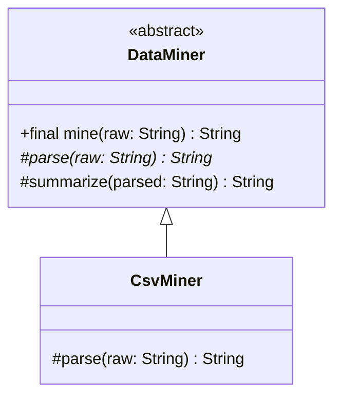

# Template Method Pattern

> **One-line summary:** Define the fixed invariant skeleton of an algorithm in a base class while deferring customizable steps to subclasses or callback hooks—enforcing the Hollywood Principle and eliminating duplicated workflow boilerplate.

| Attribute | Specification |
|---|---|
| **Level** | Core / GoF Behavioral |
| **Prerequisites** | [13-hollywood-principle-and-inversion-of-control.md](../03-design-principles/13-hollywood-principle-and-inversion-of-control.md), [01-strategy.md](01-strategy.md) |
| **Estimated Reading Time** | 25 minutes |
| **Status** | Complete |
| **Category** | Behavioral |
| **Origin** | GoF 1994 |
| **Also Known As** | Algorithm Skeleton, Inversion Hooks |
| **Languages Tested** | Java 25 (LTS) / TypeScript 5.8 (Node 24 native) / Python 3.14 |

---

## Table of Contents
- [1 The Problem](#1-the-problem)
- [2 Why It Exists](#2-why-it-exists)
- [3 What It Is](#3-what-it-is)
- [4 The Problem Without It](#4-the-problem-without-it)
- [5 How It Solves It](#5-how-it-solves-it)
- [6 How It Works](#6-how-it-works)
- [7 Real-World Examples](#7-real-world-examples)
- [8 When to Use and When NOT to Use](#8-when-to-use-and-when-not-to-use)
- [9 Variations and Language Idioms](#9-variations-and-language-idioms)
- [10 Relationship to Other Principles and Patterns](#10-relationship-to-other-principles-and-patterns)
- [11 Common Mistakes and Anti-Patterns](#11-common-mistakes-and-anti-patterns)
- [12 Testing and Design Verification](#12-testing-and-design-verification)
- [13 Performance, Concurrency and Security Notes](#13-performance-concurrency-and-security-notes)
- [14 Interview Questions](#14-interview-questions)
- [15 Practice Exercises](#15-practice-exercises)
- [16 Summary / Cheat Sheet](#16-summary--cheat-sheet)
- [17 Further Reading](#17-further-reading)

---

## 1 The Problem

Imagine building three data importers (`CsvMiner`, `JsonMiner`, `XmlMiner`). Every single miner executes the exact same 4-step workflow:
1. Open file & validate checksum.
2. **Parse raw text** *(varies by format!)*.
3. Summarize metrics & log audit timestamp.
4. Close file safely in `finally`.

Without Template Method, all three classes copy-paste steps 1, 3, and 4—meaning when security updates checksum validation, two of the three importers miss the patch!

---

## 2 Why It Exists

Formulated by the **Gang of Four (1994)** to centralize the invariant algorithm skeleton in a `final` template method (`mine()`) while letting subclasses override only the varying step (`parse()`).

---

## 3 What It Is



---

## 4 The Problem Without It

```java
// Violation: Duplicating invariant skeleton steps across every format class!
class CsvMinerViolation { public void mine() { /* open + parseCsv + log + close */ } }
class JsonMinerViolation { public void mine() { /* open + parseJson + log + close */ } }
```

---

## 5 How It Solves It

### Java Implementation (Java 25 LTS — `final` Skeleton)

```java
package com.design.patterns.behavioral.templatemethod;

abstract class DataMiner {
    // Marked final so subclasses CANNOT alter the invariant workflow order!
    public final String mine(String raw) {
        String parsed = parse(raw);
        return summarize(parsed);
    }

    protected abstract String parse(String raw);

    // Optional hook with default behavior
    protected String summarize(String parsed) {
        return "Summary[" + parsed + "]";
    }
}

class CsvMiner extends DataMiner {
    @Override
    protected String parse(String raw) {
        return raw.replace(",", "|");
    }
}
```

### TypeScript Implementation (Node 24 Native)

```typescript
abstract class DataMiner {
    mine(raw: string): string {
        const parsed = this.parse(raw);
        return this.summarize(parsed);
    }
    protected abstract parse(raw: string): string;
    protected summarize(parsed: string): string { return `Summary[${parsed}]`; }
}

class CsvMiner extends DataMiner {
    protected parse(raw: string): string { return raw.replaceAll(",", "|"); }
}
```

### Python Implementation (Python 3.14)

```python
from abc import ABC, abstractmethod

class DataMiner(ABC):
    def mine(self, raw: str) -> str:
        parsed = self.parse(raw)
        return self.summarize(parsed)

    @abstractmethod
    def parse(self, raw: str) -> str: ...

    def summarize(self, parsed: str) -> str:
        return f"Summary[{parsed}]"

class CsvMiner(DataMiner):
    def parse(self, raw: str) -> str:
        return raw.replace(",", "|")
```

### Real Execution Output
```text
TemplateMethod: Summary[a|b|c]
```

---

## 6 How It Works: Functional Alternative (Composition!)

Because Template Method relies on **inheritance**, it can suffer from rigid base-class coupling. In modern Java/TS/Python, you can often replace inheritance with a **Composition Template** passing a `Function<String, String> parser` into `mine(raw, parser)`! Use class inheritance only when subclasses share rich protected helper state across multiple hooks.

---

## 7 Real-World Examples

1. **Java `AbstractList` / `AbstractMap` / `HttpServlet` (`doGet`, `doPost`)**.
2. **Spring `JdbcTemplate` / `RestTemplate`** (callback-based composition Template Method).
3. **JUnit `@BeforeEach` $\to$ `@Test` $\to$ `@AfterEach`** test execution lifecycle.

---

## 8 When to Use and When NOT to Use

| Context | Template Method vs Strategy/Callback | Rationale |
|---|---|---|
| **Fixed multi-step workflow with 1–2 varying steps** | **Prefer Callback / Functional Composition** | Avoids rigid inheritance coupling. |
| **Framework lifecycle base classes (`HttpServlet`, `TestCase`)** | **Template Method** | Cleanly documents protected extension hooks. |

---

## 9 Variations and Language Idioms

- **Callback Template (`JdbcTemplate`):** Passes a lambda/strategy into a fixed `final` orchestrator method—getting all benefits of Template Method *without* inheritance!

---

## 10 Relationship to Other Principles and Patterns

- **Hollywood Principle:** Base class calls down into subclass hooks ("Don't call us, we'll call you").
- **Factory Method:** A specialization of Template Method where the varying hook creates an object.

---

## 11 Common Mistakes and Anti-Patterns

| Anti-Pattern | Description | Production Consequence | Correct Remedy |
|---|---|---|---|
| **Forgetting `final` on Template Method** | Subclass overrides `mine()` and skips security/cleanup steps! | Invariant bypass & resource leaks! | Mark `mine()` `final` (Java) / document non-overridable. |
| **Too Many Abstract Hooks** | 12 abstract `step1()..step12()` methods. | Subclasses become painful to implement. | Minimize abstract steps; use composition/Strategy. |
| **Violating LSP in Subclass Hook** | `CsvMiner.parse()` throwing `UnsupportedOperationException`. | Runtime crash in `mine()`. | Ensure every concrete subclass fulfills all abstract steps. |
| **Using Inheritance for 1 Hook** | Subclassing `DataMiner` just to customize 1 lambda. | Unnecessary class proliferation. | Pass a `Function` parameter instead. |
| **Calling `mine()` from Base Constructor** | Invoking overridable `parse()` inside `DataMiner()` constructor! | Subclass fields are still `null`/uninitialized during constructor call! | Never call overridable methods from constructors! |
| **Subclasses Calling `mine()` Recursively** | Hook calling back up into `mine()`. | Infinite recursion! | Hooks only perform their local step. |

---

## 12 Testing and Design Verification

Test `DataMiner` skeleton invariants once with a minimal test subclass, and test `CsvMiner.parse()` edge cases directly.

---

## 13 Performance, Concurrency and Security Notes

- **Security:** Always mark the outer template method `final` in Java when it enforces authentication, authorization, or resource cleanup before/after subclass hooks.

---

## 14 Interview Questions

<details>
<summary><strong>1. Why should the Template Method itself be marked `final` in Java?</strong></summary>

Marking `mine()` as `final` prevents subclasses from overriding the overarching invariant algorithm order or accidentally skipping critical setup/cleanup/security steps.
</details>

<details>
<summary><strong>2. Compare Template Method vs Strategy.</strong></summary>

**Template Method** uses **inheritance** to vary specific steps inside a fixed base skeleton. **Strategy** uses **composition** to swap an entire algorithm at runtime. Strategy is generally preferred unless a framework specifically benefits from inheritance hooks.
</details>

<details>
<summary><strong>3. Why is calling an overridable hook method inside a base class constructor a severe bug?</strong></summary>

In Java/C++/TS, the superclass constructor runs *before* the subclass constructor initializes subclass fields—so the overridden hook will execute against uninitialized `null` or `0` fields!
</details>

<details>
<summary><strong>4. How does Spring `JdbcTemplate` improve on classical GoF Template Method?</strong></summary>

`JdbcTemplate` keeps the fixed skeleton (open connection, run SQL, close resources, translate exceptions) in a concrete `final` class and accepts a `RowMapper` **lambda callback** instead of forcing subclasses—combining Template Method with Composition!
</details>

<details>
<summary><strong>5. What is a "Hook" method vs an "Abstract" step in Template Method?</strong></summary>

An **Abstract** step *must* be implemented by every subclass (`parse()`). A **Hook** has a default (often empty or standard) implementation (`summarize()`) that subclasses *may* optionally override.
</details>

<details>
<summary><strong>6. How does Template Method embody the Hollywood Principle?</strong></summary>

The high-level base class owns the execution flow and calls down into low-level subclass hooks (`parse()`), rather than subclasses orchestrating the flow themselves.
</details>

<details>
<summary><strong>7. Give a real-world example of Template Method in Java's JDK.</strong></summary>

`java.util.AbstractList` (`get()` abstract, `indexOf()`/`iterator()` implemented in base) and `jakarta.servlet.http.HttpServlet.service()`.
</details>

<details>
<summary><strong>8. When should you refactor a Template Method into Strategy?</strong></summary>

When the inheritance hierarchy grows deep, subclasses want to swap algorithms dynamically at runtime, or you have only 1 varying step that fits cleanly as a lambda.
</details>

---

## 15 Practice Exercises

### Exercise 1: Spot the Constructor Hook Bug (Easy)
`abstract class Base { Base() { init(); } abstract void init(); }` — why does `Child` crash with `NullPointerException` inside `init()`?

<details>
<summary><strong>Solution</strong></summary>

`Base()` executes before `Child`'s field initializers and constructor—so `Child`'s fields are still `null` when `init()` runs.
</details>

---

### Exercise 2: Convert Template Method to Callback Composition in TypeScript (Medium)
Rewrite `DataMiner` as a pure function `mineData(raw: string, parse: (s: string) => string): string`.

<details>
<summary><strong>Solution</strong></summary>

`function mineData(raw: string, parse: (s: string) => string): string { return \`Summary[${parse(raw)}]\`; }`
</details>

---

### Exercise 3: Python `TestRunner` Template Method (Hard)
Implement `BaseTestCase` with `setup()`, `run_test()` (abstract), and `teardown()` guaranteed to execute in `try/finally` inside `execute()`.

<details>
<summary><strong>Solution</strong></summary>

`def execute(self): self.setup(); try: self.run_test() finally: self.teardown()`.
</details>

---

## 16 Summary / Cheat Sheet

```
+--------------------------------------------------------------------------+
|                         TEMPLATE METHOD PATTERN                          |
+--------------------------------------------------------------------------+
| INTENT     : Fixed algorithm skeleton (`final`) + overridable steps.     |
| MODERN ALT : Pass a lambda/Strategy into a concrete runner (JdbcTemplate)|
| GOLDEN RULE: Never call overridable hooks from a constructor!            |
+--------------------------------------------------------------------------+
```

---

## 17 Further Reading

- Erich Gamma et al., *Design Patterns*, Addison-Wesley, 1994.

### In Your Language
| Language Track | Deep Dive Reference |
|---|---|
| Java | [Java OOP & Design Patterns](file:///e:/Learning/engineering-notes/01-languages/java/24-design-patterns/README.md) |
| TypeScript | [TypeScript Design Patterns](file:///e:/Learning/engineering-notes/01-languages/typescript/17-design-patterns/README.md) |
| Python | [Python Design Patterns](file:///e:/Learning/engineering-notes/01-languages/python/23-design-patterns/README.md) |

---

[← Previous: 04 - State Pattern](file:///e:/Learning/engineering-notes/08-solid-design-patterns/07-behavioral-patterns/04-state.md) | [Module 07 Index](file:///e:/Learning/engineering-notes/08-solid-design-patterns/07-behavioral-patterns/README.md) | [Next: 06 - Chain of Responsibility →](file:///e:/Learning/engineering-notes/08-solid-design-patterns/07-behavioral-patterns/06-chain-of-responsibility.md)
