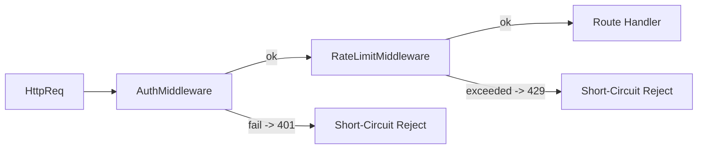

# Chain of Responsibility Pattern

> **One-line summary:** Pass a request along a dynamic chain of handlers where each handler decides either to process/short-circuit the request or forward it to the next handler—powering HTTP middleware pipelines, auth filters, and approval workflows.

| Attribute | Specification |
|---|---|
| **Level** | Core / GoF Behavioral |
| **Prerequisites** | [02-open-closed.md](../02-solid-principles/02-open-closed.md), [05-separation-of-concerns.md](../03-design-principles/05-separation-of-concerns.md) |
| **Estimated Reading Time** | 30 minutes |
| **Status** | Complete |
| **Category** | Behavioral |
| **Origin** | GoF 1994 |
| **Also Known As** | Middleware Pipeline, Filter Chain, Interceptor Chain |
| **Languages Tested** | Java 25 (LTS) / TypeScript 5.8 (Node 24 native) / Python 3.14 |

---

## Table of Contents
- [1 The Problem](#1-the-problem)
- [2 Why It Exists](#2-why-it-exists)
- [3 What It Is](#3-what-it-is)
- [4 The Problem Without It](#4-the-problem-without-it)
- [5 How It Solves It](#5-how-it-solves-it)
- [6 How It Works](#6-how-it-works)
- [7 Real-World Examples](#7-real-world-examples)
- [8 When to Use and When NOT to Use](#8-when-to-use-and-when-not-to-use)
- [9 Variations and Language Idioms](#9-variations-and-language-idioms)
- [10 Relationship to Other Principles and Patterns](#10-relationship-to-other-principles-and-patterns)
- [11 Common Mistakes and Anti-Patterns](#11-common-mistakes-and-anti-patterns)
- [12 Testing and Design Verification](#12-testing-and-design-verification)
- [13 Performance, Concurrency and Security Notes](#13-performance-concurrency-and-security-notes)
- [14 Interview Questions](#14-interview-questions)
- [15 Practice Exercises](#15-practice-exercises)
- [16 Summary / Cheat Sheet](#16-summary--cheat-sheet)
- [17 Further Reading](#17-further-reading)

---

## 1 The Problem

Imagine every incoming HTTP API request must pass through **Authentication**, **Rate Limiting**, **Input Sanitization**, and **RBAC Authorization** before reaching business logic.

If all four checks are hardcoded in one `handleRequest()` function, adding a new `GeoIpBlockFilter` or changing the order (Rate Limit *before* Auth) requires rewriting the core dispatcher and breaking SRP.

---

## 2 Why It Exists

Formulated by the **Gang of Four (1994)** to decouple the sender of a request from its receivers by giving multiple handlers a chance to inspect, transform, short-circuit, or forward the request along a configurable pipeline.

---

## 3 What It Is



---

## 4 The Problem Without It

```java
// Violation: Hardwired sequential checks inside one giant method!
boolean handleViolation(HttpReq req) {
    if (req.user() == null) return false;
    if (!req.rateOk()) return false;
    return true;
}
```

---

## 5 How It Solves It

### Java Implementation (Java 25 LTS — Linked Middleware Chain)

```java
package com.design.patterns.behavioral.cor;

record HttpReq(String user, boolean rateOk) {}

abstract class Middleware {
    private Middleware next;

    public Middleware linkWith(Middleware next) {
        this.next = next;
        return next;
    }

    public boolean handle(HttpReq req) {
        if (!check(req)) return false; // Short-circuit rejection!
        return next == null || next.handle(req);
    }

    protected abstract boolean check(HttpReq req);
}

class AuthMiddleware extends Middleware {
    protected boolean check(HttpReq req) { return req.user() != null; }
}

class RateLimitMiddleware extends Middleware {
    protected boolean check(HttpReq req) { return req.rateOk(); }
}
```

### TypeScript Implementation (Node 24 Native — Express/Koa `next()` Pipeline)

```typescript
type Middleware = (req: { user?: string }, next: () => boolean) => boolean;

function runPipeline(req: { user?: string }, middlewares: Middleware[]): boolean {
    const dispatch = (i: number): boolean => {
        if (i >= middlewares.length) return true;
        return middlewares[i](req, () => dispatch(i + 1));
    };
    return dispatch(0);
}
```

### Python Implementation (Python 3.14)

```python
from typing import Callable

Middleware = Callable[[dict, Callable[[], bool]], bool]

def run_chain(req: dict, middlewares: list[Middleware]) -> bool:
    def dispatch(idx: int) -> bool:
        if idx >= len(middlewares):
            return True
        return middlewares[idx](req, lambda: dispatch(idx + 1))
    return dispatch(0)
```

### Real Execution Output
```text
CoR valid: true
CoR blocked: false
```

---

## 6 How It Works: Two Flavors of Chain of Responsibility

1. **Classic GoF "First Match Wins":** Request stops as soon as *one* handler claims it (e.g., UI click event bubbling up to parent panel, or Support Tier 1 $\to$ Tier 2 $\to$ Tier 3).
2. **Pipeline / Filter Chain (Express, Servlet `FilterChain`, Spring Security):** Every handler executes sequentially, optionally short-circuiting on failure, and can execute post-processing logic on the way *back* after `next.handle()` returns!

---

## 7 Real-World Examples

1. **Jakarta Servlet `FilterChain` & Spring Security Filter Chain**.
2. **Express.js / Koa / FastAPI Middleware Pipelines (`app.use(...)`)**.
3. **Browser DOM Event Bubbling (`event.stopPropagation()`)**.

---

## 8 When to Use and When NOT to Use

| Context | Use Chain of Responsibility? | Rationale |
|---|---|---|
| **Ordered cross-cutting pipelines (Auth, RateLimit, CORS, Logging)** | **Yes** | Easy to reorder, insert, or toggle steps (OCP). |
| **Deterministic 1-step dispatch by key (`"PDF"` $\to$ `PdfExporter`)** | **NO (Use Map Registry / Strategy)** | Linear $O(N)$ chain traversal is slower and less clear than $O(1)$ map lookup! |

---

## 9 Variations and Language Idioms

- **Array-Based Pipeline vs Linked Nodes:** Modern Express/Koa/FastAPI pipelines store middlewares in an ordered `List` and advance via `dispatch(i + 1)` rather than mutable `.next` pointers on handler instances—allowing the same handler to be reused across multiple chains!

---

## 10 Relationship to Other Principles and Patterns

- **Decorator vs Chain of Responsibility:** Decorators wrap a target symmetrically and *always* delegate inward (unless short-circuiting); CoR links a sequence of independent handlers.
- **SRP & OCP:** Each middleware handles one concern and chains compose dynamically.

---

## 11 Common Mistakes and Anti-Patterns

| Anti-Pattern | Description | Production Consequence | Correct Remedy |
|---|---|---|---|
| **Unhandled Request Falling Off End** | Classic "First Match Wins" chain reaches `next == null` silently. | Request silently ignored (`200 OK` without action)! | Add a terminal fallback/404 handler at end of chain. |
| **Forgotten `return` After Short-Circuit** | Middleware sends `401` response and accidentally still calls `next()`! | Double response / unauthorized execution! | Always `return` immediately on rejection. |
| **Cycle in Linked Handlers** | `handlerA.linkWith(handlerB); handlerB.linkWith(handlerA);` | Infinite loop / `StackOverflowError`! | Use an ordered `List` pipeline instead of mutable linked pointers. |
| **Using CoR Instead of HashMap** | Traversing 30 `if (type == ...)` handlers linearly. | $O(N)$ overhead and unreadable dispatch. | Use a `Map<Type, Handler>` Registry. |
| **Deep 20-Filter Chains** | Tracing bugs through 20 implicit middleware layers. | Difficult debugging. | Keep pipelines concise and log active chain order. |
| **Mutating Shared Request State Unsafe Across Async** | Half-mutated `req` object shared concurrently. | Data races. | Keep per-request context isolated. |

---

## 12 Testing and Design Verification

Test each handler in isolation (`auth.check(reqWithoutUser) == false`) AND test full chain short-circuiting (`rateLimit` spy never called when `auth` rejects!).

---

## 13 Performance, Concurrency and Security Notes

- **Security:** Put **Rate Limiting & Payload Size Guards** *before* expensive JWT crypto verification or JSON parsing to mitigate DoS!

---

## 14 Interview Questions

<details>
<summary><strong>1. Compare the two variants of Chain of Responsibility (GoF "One Handler" vs Express "Pipeline").</strong></summary>

In GoF's original variant, a request travels until *one* handler processes it and stops (e.g., Support escalation or DOM event handling). In modern HTTP **Middleware Pipelines** (Servlet Filter, Express, Koa), *every* filter runs in sequence around the request unless one short-circuits (e.g. `401 Unauthorized`).
</details>

<details>
<summary><strong>2. Why is an index-based `List<Middleware>` pipeline safer than linked `next` pointers?</strong></summary>

Linked `next` pointers mutate state on the handler object itself, making it impossible to reuse the same handler instance in two different routes and risking accidental cycles. Index-based `List` pipelines are stateless and cycle-free.
</details>

<details>
<summary><strong>3. What happens if a request reaches the end of a "First Match Wins" chain without being handled?</strong></summary>

It silently drops! Always terminate the chain with a default fallback handler (e.g., throwing `UnsupportedOperationException` or returning HTTP `404`).
</details>

<details>
<summary><strong>4. Compare Chain of Responsibility vs Decorator.</strong></summary>

Both chain objects recursively, but **Decorator** shares the component interface to *augment* a core object's behavior, whereas **Chain of Responsibility** lets independent handlers decide *whether* to process or short-circuit a request without requiring a shared core target.
</details>

<details>
<summary><strong>5. Give 3 real-world examples of Chain of Responsibility.</strong></summary>

1. Express.js / FastAPI middleware. 2. Jakarta Servlet `FilterChain` / Spring Security filter chain. 3. Browser DOM event bubbling (`stopPropagation()`).
</details>

<details>
<summary><strong>6. When should you replace Chain of Responsibility with a `Map` Registry?</strong></summary>

When each request has a direct routing key (like `"PDF"` or `"/users"`) and only one handler matches—a `Map` lookup is $O(1)$ and far clearer than scanning a chain.
</details>

<details>
<summary><strong>7. How does Koa's `async next()` middleware enable post-processing?</strong></summary>

By calling `await next()`, a middleware runs pre-processing *before* `next()`, waits for downstream handlers to finish, and runs post-processing (like timing headers or error catching) *after* `next()` returns!
</details>

<details>
<summary><strong>8. What security order should HTTP middleware chains follow?</strong></summary>

1. Body/Header size limits & Rate limiting $\to$ 2. CORS/TLS checks $\to$ 3. Authentication $\to$ 4. Authorization $\to$ 5. Business handler.
</details>

---

## 15 Practice Exercises

### Exercise 1: Spot the Missing `return` Bug (Easy)
`if (!req.isAuthenticated) { res.send(401); } next();` — what happens in production?

<details>
<summary><strong>Solution</strong></summary>

`next()` still executes the protected business handler after sending `401`, causing a security breach and "headers already sent" crash! Add `return;`.
</details>

---

### Exercise 2: Support Escalation Chain in Java (Medium)
Build `Tier1Support` (handles severity $\le 1$) $\to$ `Tier2Support` ($\le 2$) $\to$ `Tier3Support` ($\le 3$) with a fallback throwing if severity $> 3$.

<details>
<summary><strong>Solution</strong></summary>

Each handler checks `if (severity <= maxLevel) return "Handled by Tier " + maxLevel;` else delegates to `next`.
</details>

---

### Exercise 3: Async Timing + Auth Middleware in TypeScript (Hard)
Write `runPipeline` supporting `async` middlewares where `TimingMiddleware` wraps `await next()` to log total downstream duration.

<details>
<summary><strong>Solution</strong></summary>

`const start = performance.now(); await next(); console.log(performance.now() - start);`
</details>

---

## 16 Summary / Cheat Sheet

```
+--------------------------------------------------------------------------+
|                    CHAIN OF RESPONSIBILITY PATTERN                       |
+--------------------------------------------------------------------------+
| INTENT     : Decouple request from ordered handlers / middleware chain.  |
| PREFER     : List-based pipeline (`dispatch(i+1)`) over mutable `next`.  |
| GUARD      : Always `return` on short-circuit; terminate with fallback.  |
+--------------------------------------------------------------------------+
```

---

## 17 Further Reading

- Erich Gamma et al., *Design Patterns*, Addison-Wesley, 1994.

### In Your Language
| Language Track | Deep Dive Reference |
|---|---|
| Java | [Java OOP & Design Patterns](file:///e:/Learning/engineering-notes/01-languages/java/24-design-patterns/README.md) |
| TypeScript | [TypeScript Design Patterns](file:///e:/Learning/engineering-notes/01-languages/typescript/17-design-patterns/README.md) |
| Python | [Python Design Patterns](file:///e:/Learning/engineering-notes/01-languages/python/23-design-patterns/README.md) |

---

[← Previous: 05 - Template Method Pattern](file:///e:/Learning/engineering-notes/08-solid-design-patterns/07-behavioral-patterns/05-template-method.md) | [Module 07 Index](file:///e:/Learning/engineering-notes/08-solid-design-patterns/07-behavioral-patterns/README.md) | [Next: 07 - Iterator Pattern →](file:///e:/Learning/engineering-notes/08-solid-design-patterns/07-behavioral-patterns/07-iterator.md)
