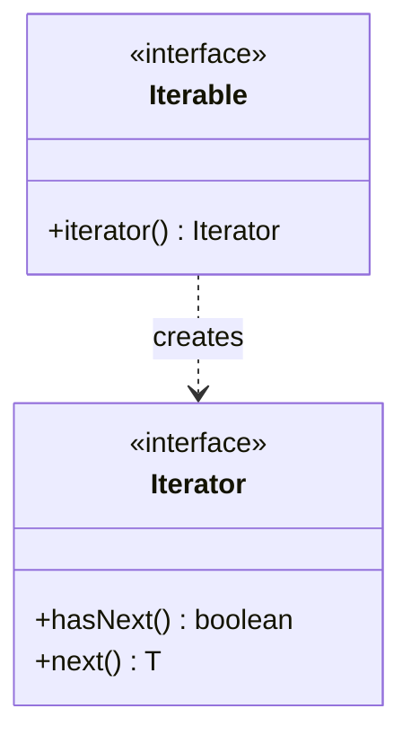

# Iterator Pattern

> **One-line summary:** Provide a uniform sequential traversal mechanism over a collection or lazy data stream (API pages, trees, DB cursors) without exposing its internal representation or loading everything into memory at once.

| Attribute | Specification |
|---|---|
| **Level** | Core / GoF Behavioral |
| **Prerequisites** | [04-programming-to-interfaces.md](../01-foundations/04-programming-to-interfaces.md), [05-abstraction-and-information-hiding.md](../01-foundations/05-abstraction-and-information-hiding.md) |
| **Estimated Reading Time** | 25 minutes |
| **Status** | Complete |
| **Category** | Behavioral |
| **Origin** | GoF 1994 |
| **Also Known As** | Cursor Pattern, Generator / Lazy Sequence (`yield`) |
| **Languages Tested** | Java 25 (LTS) / TypeScript 5.8 (Node 24 native) / Python 3.14 |

---

## Table of Contents
- [1 The Problem](#1-the-problem)
- [2 Why It Exists](#2-why-it-exists)
- [3 What It Is](#3-what-it-is)
- [4 The Problem Without It](#4-the-problem-without-it)
- [5 How It Solves It](#5-how-it-solves-it)
- [6 How It Works](#6-how-it-works)
- [7 Real-World Examples](#7-real-world-examples)
- [8 When to Use and When NOT to Use](#8-when-to-use-and-when-not-to-use)
- [9 Variations and Language Idioms](#9-variations-and-language-idioms)
- [10 Relationship to Other Principles and Patterns](#10-relationship-to-other-principles-and-patterns)
- [11 Common Mistakes and Anti-Patterns](#11-common-mistakes-and-anti-patterns)
- [12 Testing and Design Verification](#12-testing-and-design-verification)
- [13 Performance, Concurrency and Security Notes](#13-performance-concurrency-and-security-notes)
- [14 Interview Questions](#14-interview-questions)
- [15 Practice Exercises](#15-practice-exercises)
- [16 Summary / Cheat Sheet](#16-summary--cheat-sheet)
- [17 Further Reading](#17-further-reading)

---

## 1 The Problem

Imagine fetching 5,000,000 customer records from a paginated REST API or a 10GB log file. If a helper loads every page into a `List<Customer>` before returning it to callers:
1. The service crashes with `OutOfMemoryError`!
2. Even if the caller only wants the **first 10 matching records**, the system wastes minutes fetching all 5,000,000 records upfront!
3. Callers must learn whether the underlying storage is a B-Tree, linked list, or paginated HTTP cursor.

---

## 2 Why It Exists

Formulated by the **Gang of Four (1994)**—and now built directly into every modern language's `for` loop (`Iterable`, `Symbol.iterator`, Python `__iter__` / `yield` generators)—Iterator decouples **traversal algorithm & lazy fetching** from the underlying storage structure.

---

## 3 What It Is



---

## 4 The Problem Without It

```java
// Violation: Eagerly materializing 5M items in memory & exposing internal array!
List<String> fetchAllPagesEagerly() {
    List<String> all = new ArrayList<>();
    // Loads 5,000,000 rows -> OutOfMemoryError!
    return all;
}
```

---

## 5 How It Solves It

### Java Implementation (Java 25 LTS — Custom `Iterable<T>`)

```java
package com.design.patterns.behavioral.iterator;

import java.util.*;

class RangeIterable implements Iterable<Integer> {
    private final int end;

    public RangeIterable(int end) {
        this.end = end;
    }

    @Override
    public Iterator<Integer> iterator() {
        return new Iterator<>() {
            private int cur = 0;

            @Override
            public boolean hasNext() {
                return cur < end;
            }

            @Override
            public Integer next() {
                if (!hasNext()) throw new NoSuchElementException();
                return cur++;
            }
        };
    }
}
```

### TypeScript Implementation (Node 24 Native — Generator `function*`)

```typescript
function* paginate(totalPages: number): Generator<string> {
    for (let p = 1; p <= totalPages; p++) {
        yield `page-${p}`;
    }
}

console.log("TS Iterator:", [...paginate(3)].join(","));
```

### Python Implementation (Python 3.14 — Generator `yield`)

```python
def paginate(total_pages: int):
    for p in range(1, total_pages + 1):
        yield f"page-{p}"

print("Python Iterator:", list(paginate(3)))
```

### Real Execution Output
```text
Iterator: [0, 1, 2]
TS Iterator: page-1,page-2,page-3
Python Iterator: ['page-1', 'page-2', 'page-3']
```

---

## 6 How It Works: External vs. Internal Iteration

1. **External Iterator (`Iterator`, `for-each`, `yield`):** The *caller* pulls elements one-by-one (`hasNext()`/`next()`), allowing early `break` at any point without fetching remaining pages!
2. **Internal Iterator (`list.forEach(...)`, `Stream.map(...)`):** The *collection* controls the loop and invokes your lambda on each element.

---

## 7 Real-World Examples

1. **Java `Iterable<T>` / `Stream<T>` / JDBC `ResultSet`**.
2. **Python Generators (`yield`), `itertools`, and `async for` (`__aiter__`)**.
3. **TypeScript `Symbol.iterator` and `AsyncGenerator` (`for await (const page of fetchPages())`)**.

---

## 8 When to Use and When NOT to Use

- **Always use built-in language iterators/generators** (`Iterable`, `function*`, `yield`) for custom collections, trees, and paginated APIs—never write manual `MyCustomIterator` boilerplate in Python/TS when `yield` exists!

---

## 9 Variations and Language Idioms

- **Async Iterators (`for await...of` in TS, `async for` in Python):** Traverse paginated network APIs lazily without blocking event loops!

---

## 10 Relationship to Other Principles and Patterns

- **Factory Method:** `collection.iterator()` is a classic Factory Method returning the right `Iterator` implementation.
- **Composite:** Iterators frequently traverse Composite trees (BFS / DFS) cleanly.

---

## 11 Common Mistakes and Anti-Patterns

| Anti-Pattern | Description | Production Consequence | Correct Remedy |
|---|---|---|---|
| **Eagerly Calling `.toList()` on Generators** | Materializing a 10GB stream into a list before filtering. | `OutOfMemoryError`! | Keep streaming lazily with `yield` / `Stream`. |
| **Reusing Single-Use Generator Twice** | Iterating a Python/TS generator a second time without recreating it. | Second loop silently sees 0 items! | Return a fresh generator per `__iter__()` call. |
| **Mutating Collection During Iteration** | Calling `list.remove(x)` inside `for (var x : list)`. | `ConcurrentModificationException` (Fail-Fast)! | Use `iterator.remove()` or `removeIf()`. |
| **Putting Traversal State on the Collection** | Storing `int currentIndex` directly on `MyList` instead of the `Iterator`. | Two nested `for` loops over the same list corrupt each other! | Keep cursor state inside each `Iterator` instance. |
| **Forgetting `NoSuchElementException`** | `next()` returning `null` past the end. | Violates Java `Iterator` contract. | Throw `NoSuchElementException`. |
| **Manual Boilerplate in Python/TS** | Writing `__iter__`/`__next__` classes when a 3-line `yield` generator suffices. | Unnecessary code. | Use `yield` / `function*`. |

---

## 12 Testing and Design Verification

Verify **lazy evaluation** (e.g., breaking after 2 items only triggers 1–2 page fetches, never all 100) and **independent concurrent iterators** (two nested loops over the same `Iterable` do not interfere).

---

## 13 Performance, Concurrency and Security Notes

- **Performance:** Generators run in **$O(1)$ auxiliary memory**, enabling infinite streams and multi-gigabyte file processing cleanly.

---

## 14 Interview Questions

<details>
<summary><strong>1. Why must traversal cursor state live inside the `Iterator` object rather than the `Collection`?</strong></summary>

Because multiple callers (or nested loops) can traverse the exact same collection simultaneously—putting cursor state on the collection itself would cause concurrent loops to overwrite each other's index.
</details>

<details>
<summary><strong>2. Compare External Iteration (`for-each`, `yield`) vs Internal Iteration (`forEach`, `Stream`).</strong></summary>

In **External Iteration**, the caller pulls items step-by-step and can `break` early or zip two iterators together easily. In **Internal Iteration**, the collection drives the loop and can parallelize work internally (`parallelStream()`).
</details>

<details>
<summary><strong>3. How do Python/TypeScript `yield` generators simplify the GoF Iterator pattern?</strong></summary>

The compiler/runtime automatically generates the state machine, `next()`, and exhaustion handling (`StopIteration` / `done: true`) behind a simple `yield` keyword—turning 40 lines of Iterator class boilerplate into 3 lines.
</details>

<details>
<summary><strong>4. Why does `for (var x : list) { list.remove(x); }` throw `ConcurrentModificationException` in Java?</strong></summary>

Java's fail-fast iterators track `modCount`; modifying the underlying list directly invalidates the iterator's structural snapshot, so it fails immediately instead of skipping elements. Use `iterator.remove()` or `list.removeIf(...)`.
</details>

<details>
<summary><strong>5. What is a common bug when exposing a Python generator directly as an attribute vs `__iter__`?</strong></summary>

A generator function is a **single-use** iterator—once exhausted, a second `for` loop yields nothing! Wrapping it in a class whose `__iter__` calls the generator creates a reusable `Iterable`.
</details>

<details>
<summary><strong>6. How does Iterator enable $O(1)$ memory processing of paginated REST APIs?</strong></summary>

Using an `AsyncGenerator` / `Iterator` that fetches page $k$ only when the consumer pulls past item $k \times \text{pageSize}$, avoiding buffering all pages in RAM.
</details>

<details>
<summary><strong>7. How does Iterator relate to Factory Method?</strong></summary>

`Iterable.iterator()` is a Factory Method—subclasses (`ArrayList`, `TreeSet`) override it to instantiate their own specialized `Iterator` implementation behind the uniform `Iterator<T>` interface.
</details>

<details>
<summary><strong>8. What happens if `Iterator.next()` is called when `hasNext()` is `false` in Java?</strong></summary>

Per the `java.util.Iterator` contract, it must throw `NoSuchElementException`.
</details>

---

## 15 Practice Exercises

### Exercise 1: Spot the Exhausted Generator Bug (Easy)
`pages = paginate(3); print(list(pages)); print(list(pages));` — why does the second print output `[]`?

<details>
<summary><strong>Solution</strong></summary>

A generator is single-use and exhausted after the first `list(pages)`. Call `paginate(3)` again or wrap in a reusable `Iterable` class.
</details>

---

### Exercise 2: Paginated API Async Generator in TypeScript (Medium)
Write an `async function* fetchAllUsers(fetchPage: (cursor?: string) => Promise<{ items: string[]; next?: string }>)` yielding users lazily across pages.

<details>
<summary><strong>Solution</strong></summary>

Loop `do { const res = await fetchPage(cursor); yield* res.items; cursor = res.next; } while (cursor);`.
</details>

---

### Exercise 3: Reusable Binary Tree In-Order Iterator in Python (Hard)
Implement `BinaryTree` with `__iter__` using `yield from` so two nested `for` loops can traverse the same tree independently.

<details>
<summary><strong>Solution</strong></summary>

`def __iter__(self): if self.left: yield from self.left; yield self.val; if self.right: yield from self.right`.
</details>

---

## 16 Summary / Cheat Sheet

```
+--------------------------------------------------------------------------+
|                             ITERATOR PATTERN                             |
+--------------------------------------------------------------------------+
| INTENT     : Uniform lazy traversal hiding internal storage details.     |
| MODERN IDIOM: Use `yield` / `function*` generators (`O(1)` memory!).     |
| GOLDEN RULE: Keep cursor state inside Iterator, NEVER on the Collection. |
+--------------------------------------------------------------------------+
```

---

## 17 Further Reading

- Erich Gamma et al., *Design Patterns*, Addison-Wesley, 1994.

### In Your Language
| Language Track | Deep Dive Reference |
|---|---|
| Java | [Java OOP & Design Patterns](file:///e:/Learning/engineering-notes/01-languages/java/24-design-patterns/README.md) |
| TypeScript | [TypeScript Design Patterns](file:///e:/Learning/engineering-notes/01-languages/typescript/17-design-patterns/README.md) |
| Python | [Python Design Patterns](file:///e:/Learning/engineering-notes/01-languages/python/23-design-patterns/README.md) |

---

[← Previous: 06 - Chain of Responsibility](file:///e:/Learning/engineering-notes/08-solid-design-patterns/07-behavioral-patterns/06-chain-of-responsibility.md) | [Module 07 Index](file:///e:/Learning/engineering-notes/08-solid-design-patterns/07-behavioral-patterns/README.md) | [Next: 08 - Mediator Pattern →](file:///e:/Learning/engineering-notes/08-solid-design-patterns/07-behavioral-patterns/08-mediator.md)
