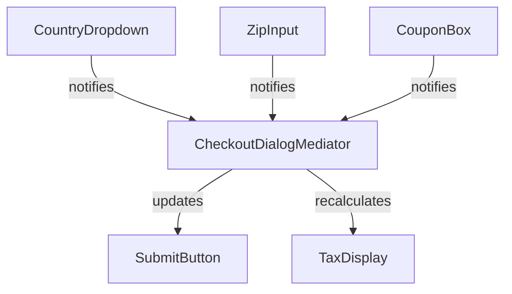

# Mediator Pattern

> **One-line summary:** Reduce chaotic many-to-many ($N^2$) dependencies between peer components by routing all cross-component interactions through a central Mediator coordinator.

| Attribute | Specification |
|---|---|
| **Level** | Intermediate / GoF Behavioral |
| **Prerequisites** | [04-law-of-demeter.md](../03-design-principles/04-law-of-demeter.md), [02-observer.md](02-observer.md) |
| **Estimated Reading Time** | 25 minutes |
| **Status** | Complete |
| **Category** | Behavioral |
| **Origin** | GoF 1994 |
| **Also Known As** | Air Traffic Controller, Coordinator, MediatR (CQRS) |
| **Languages Tested** | Java 25 (LTS) / TypeScript 5.8 (Node 24 native) / Python 3.14 |

---

## Table of Contents
- [1 The Problem](#1-the-problem)
- [2 Why It Exists](#2-why-it-exists)
- [3 What It Is](#3-what-it-is)
- [4 The Problem Without It](#4-the-problem-without-it)
- [5 How It Solves It](#5-how-it-solves-it)
- [6 How It Works](#6-how-it-works)
- [7 Real-World Examples](#7-real-world-examples)
- [8 When to Use and When NOT to Use](#8-when-to-use-and-when-not-to-use)
- [9 Variations and Language Idioms](#9-variations-and-language-idioms)
- [10 Relationship to Other Principles and Patterns](#10-relationship-to-other-principles-and-patterns)
- [11 Common Mistakes and Anti-Patterns](#11-common-mistakes-and-anti-patterns)
- [12 Testing and Design Verification](#12-testing-and-design-verification)
- [13 Performance, Concurrency and Security Notes](#13-performance-concurrency-and-security-notes)
- [14 Interview Questions](#14-interview-questions)
- [15 Practice Exercises](#15-practice-exercises)
- [16 Summary / Cheat Sheet](#16-summary--cheat-sheet)
- [17 Further Reading](#17-further-reading)

---

## 1 The Problem

Imagine building a complex Checkout Form UI (or Air Traffic Control / Chat Room / Microservice Orchestrator) with 6 interacting components: `CountryDropdown`, `ZipInput`, `TaxCalculator`, `ShippingSelector`, `CouponBox`, and `SubmitButton`.

If every component holds direct references to the other 5 components (`CountryDropdown` calls `ZipInput.reset()`, `TaxCalculator.recalc()`, `ShippingSelector.reload()`), you get a **$N \times (N-1)$ spiderweb of cyclic dependencies**! Reusing `CountryDropdown` in another screen is impossible because it drags in `ZipInput` and `ShippingSelector`.

---

## 2 Why It Exists

Formulated by the **Gang of Four (1994)** to convert a $O(N^2)$ mesh of peer-to-peer references into a clean **$O(N)$ star topology**: peers notify only the `Mediator`, and the `Mediator` coordinates the cross-component rules.

---

## 3 What It Is



---

## 4 The Problem Without It

```java
// Violation: N^2 Cyclic Spiderweb between peers!
class CountryDropdown {
    ZipInput zip; ShippingSelector shipping; SubmitButton btn;
    void onChange() { zip.clear(); shipping.reload(); btn.disable(); }
}
```

---

## 5 How It Solves It

### Java Implementation (Java 25 LTS)

```java
package com.design.patterns.behavioral.mediator;

import java.util.*;

interface ChatMediator {
    void sendMessage(String fromUser, String message);
}

class ChatUser {
    private final String name;
    private final ChatMediator mediator;

    public ChatUser(String name, ChatMediator mediator) {
        this.name = name;
        this.mediator = mediator;
    }

    public void send(String msg) { mediator.sendMessage(name, msg); }
    public void receive(String from, String msg) {
        System.out.println("[" + name + " received from " + from + "]: " + msg);
    }
    public String name() { return name; }
}

class ChatRoomMediator implements ChatMediator {
    private final List<ChatUser> users = new ArrayList<>();
    public void join(ChatUser user) { users.add(user); }

    @Override
    public void sendMessage(String fromUser, String message) {
        for (ChatUser u : users) {
            if (!u.name().equals(fromUser)) u.receive(fromUser, message);
        }
    }
}
```

### TypeScript Implementation (Node 24 Native)

```typescript
interface Mediator { notify(sender: string, event: string): void; }

class CheckoutMediator implements Mediator {
    private taxValid = false;
    private addressValid = false;
    submitEnabled = false;

    notify(sender: string, event: string): void {
        if (sender === "address" && event === "valid") this.addressValid = true;
        if (sender === "tax" && event === "ready") this.taxValid = true;
        this.submitEnabled = this.addressValid && this.taxValid;
    }
}
```

### Python Implementation (Python 3.14)

```python
class ChatRoomMediator:
    def __init__(self) -> None:
        self._users: list[str] = []

    def join(self, username: str) -> None:
        self._users.append(username)

    def broadcast(self, sender: str, msg: str) -> list[str]:
        return [f"{u} <- {sender}: {msg}" for u in self._users if u != sender]
```

### Real Execution Output
```text
Java Mediator -> Alice: Hi team
```

---

## 6 How It Works: The "God Mediator" Risk

Because Mediator centralizes coordination across $N$ peers, it can easily bloat into a **God Object** if you dump domain math, UI formatting, and DB logic inside it. Keep Mediators focused strictly on **routing & coordination** between peers.

---

## 7 Real-World Examples

1. **MediatR (.NET) / CQRS Command-Query Mediator**: Controllers send commands/queries to `IMediator.send(...)` without coupling to 40 handler classes.
2. **Air Traffic Control Tower**: Planes talk only to ATC, never directly to 50 other planes.
3. **Frontend Form / State Orchestrators & Redux Store**.

---

## 8 When to Use and When NOT to Use

| Context | Use Mediator? | Rationale |
|---|---|---|
| **Complex many-to-many peer interactions (UI dialogs, chat, CQRS dispatch)** | **Yes** | Cuts $N^2$ peer links to $N$. |
| **Simple 2-object parent/child call** | **NO (KISS)** | Direct method call is simpler. |

---

## 9 Variations and Language Idioms

- **Mediator + Observer:** Peers emit events to an `EventBus` (an automated generic Mediator).

---

## 10 Relationship to Other Principles and Patterns

- **Facade vs Mediator:** Facade provides a *one-way simplified API* over a subsystem whose classes don't know the Facade exists. Mediator sits in the middle of *peer colleagues* who explicitly communicate *through* it.
- **Observer:** Often used internally by Mediator to decouple colleagues further.

---

## 11 Common Mistakes and Anti-Patterns

| Anti-Pattern | Description | Production Consequence | Correct Remedy |
|---|---|---|---|
| **God-Object Mediator** | Putting all business logic of 10 colleagues inside one 2,000-line Mediator. | Unmaintainable monolith! | Keep colleagues owning their own logic; Mediator only coordinates transitions. |
| **Bypassing Mediator** | Colleagues still holding direct references to each other alongside Mediator. | Cyclic coupling returns! | Route all cross-peer communication strictly via Mediator. |
| **Using Mediator for 2 Objects** | Adding a Mediator between `OrderService` and `OrderRepo`. | Pointless indirection. | Inject directly via DI. |
| **Giant `if (sender == ...)` Ladder** | Massive string-matching `if` chains inside Mediator. | Violates OCP as peers grow. | Use typed event/command handlers (MediatR style). |
| **Hidden Infinite Loops** | Peer A notifies Mediator $\to$ updates Peer B $\to$ notifies Mediator $\to$ updates Peer A. | `StackOverflowError`! | Guard against re-entrant notifications. |
| **Confusing Mediator with Facade** | Calling a one-way subsystem wrapper a Mediator. | Terminology confusion. | Facade is unidirectional; Mediator is peer-to-peer hub. |

---

## 12 Testing and Design Verification

Test `CheckoutMediator` by firing simulated colleague events (`mediator.notify("address", "valid")`) and asserting resulting coordinated states (`submitEnabled`).

---

## 13 Performance, Concurrency and Security Notes

- **Concurrency:** In chat rooms or concurrent orchestrators, protect the colleague list (`CopyOnWriteArrayList`) and guard against re-entrant deadlock.

---

## 14 Interview Questions

<details>
<summary><strong>1. What problem does the Mediator pattern solve?</strong></summary>

It eliminates chaotic $O(N^2)$ many-to-many cyclic dependencies between peer objects by routing all inter-peer communication through a single central Mediator coordinator ($O(N)$ star topology).
</details>

<details>
<summary><strong>2. Compare Mediator vs Facade.</strong></summary>

**Facade** is unidirectional: clients call the Facade, and underlying subsystem classes are unaware of the Facade. **Mediator** is multidirectional: peer colleagues know about and communicate *through* the Mediator to avoid knowing each other.
</details>

<details>
<summary><strong>3. Compare Mediator vs Observer.</strong></summary>

**Observer** broadcasts one-to-many updates from a Subject to arbitrary listeners. **Mediator** actively orchestrates complex multi-peer rules and workflows among a known group of colleagues.
</details>

<details>
<summary><strong>4. What is the main danger of the Mediator pattern?</strong></summary>

The Mediator can easily become a **God Class** accumulating all business logic from every colleague. Keep business logic inside colleagues and use Mediator strictly for routing/coordination.
</details>

<details>
<summary><strong>5. How does the CQRS MediatR pattern work?</strong></summary>

Controllers inject a single `Mediator` and call `mediator.send(new CreateOrderCommand(...))`, decoupling controllers from dozens of individual command/query handler dependencies.
</details>

<details>
<summary><strong>6. How can you prevent infinite feedback loops in a UI Mediator?</strong></summary>

Guard programmatic updates (e.g., updating a slider value programmatically shouldn't re-trigger the `onChange` notification back into the Mediator) or use unidirectional data flow.
</details>

<details>
<summary><strong>7. Why does Mediator make individual peer components more reusable?</strong></summary>

Because `CountryDropdown` only depends on a minimal `Mediator` interface (rather than `ZipInput` and `TaxCalculator`), you can drop `CountryDropdown` into any other screen with a different Mediator!
</details>

<details>
<summary><strong>8. When should you NOT use Mediator?</strong></summary>

When components have simple, linear, one-way dependencies (e.g. Controller $\to$ Service $\to$ Repo)—direct Dependency Injection is cleaner and avoids a central bottleneck.
</details>

---

## 15 Practice Exercises

### Exercise 1: Identify $N^2$ Coupling (Easy)
4 components (`A, B, C, D`) all call methods on each other directly. How many directed dependency edges exist vs with a Mediator?

<details>
<summary><strong>Solution</strong></summary>

$4 \times 3 = 12$ edges without Mediator vs $4$ edges (plus outbound updates) through 1 central Mediator.
</details>

---

### Exercise 2: Form Validation Mediator in TypeScript (Medium)
Extend `CheckoutMediator` to also require `termsAccepted` before enabling `submitEnabled`.

<details>
<summary><strong>Solution</strong></summary>

Track `private termsAccepted = false;` and update `this.submitEnabled = this.addressValid && this.taxValid && this.termsAccepted;`.
</details>

---

### Exercise 3: Typed CQRS Command Mediator in Python (Hard)
Implement `CommandMediator` with `register(cmd_type, handler)` and `send(cmd)` routing typed dataclass commands to handlers without `if/elif`.

<details>
<summary><strong>Solution</strong></summary>

`self._handlers[type(cmd)](cmd)`.
</details>

---

## 16 Summary / Cheat Sheet

```
+--------------------------------------------------------------------------+
|                             MEDIATOR PATTERN                             |
+--------------------------------------------------------------------------+
| INTENT     : Replace O(N^2) peer-to-peer mesh with O(N) central hub.     |
| DANGER     : Mediator bloating into a God Class—keep it a thin router!   |
| VS FACADE  : Facade is 1-way doorway; Mediator coordinates peer-to-peer. |
+--------------------------------------------------------------------------+
```

---

## 17 Further Reading

- Erich Gamma et al., *Design Patterns*, Addison-Wesley, 1994.

### In Your Language
| Language Track | Deep Dive Reference |
|---|---|
| Java | [Java OOP & Design Patterns](file:///e:/Learning/engineering-notes/01-languages/java/24-design-patterns/README.md) |
| TypeScript | [TypeScript Design Patterns](file:///e:/Learning/engineering-notes/01-languages/typescript/17-design-patterns/README.md) |
| Python | [Python Design Patterns](file:///e:/Learning/engineering-notes/01-languages/python/23-design-patterns/README.md) |

---

[← Previous: 07 - Iterator Pattern](file:///e:/Learning/engineering-notes/08-solid-design-patterns/07-behavioral-patterns/07-iterator.md) | [Module 07 Index](file:///e:/Learning/engineering-notes/08-solid-design-patterns/07-behavioral-patterns/README.md) | [Next: 09 - Memento Pattern →](file:///e:/Learning/engineering-notes/08-solid-design-patterns/07-behavioral-patterns/09-memento.md)
