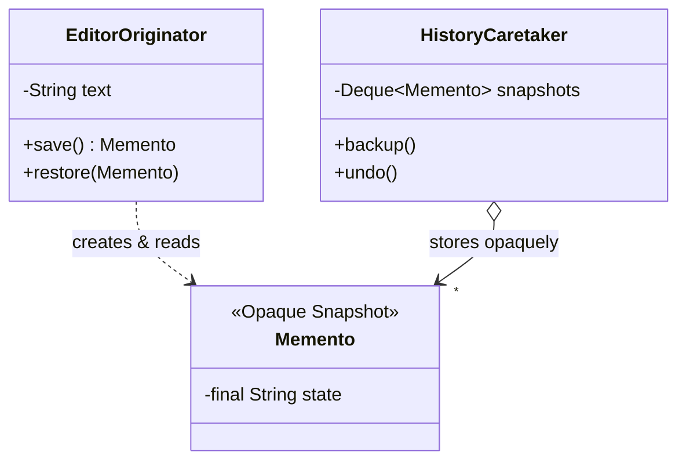

# Memento Pattern

> **One-line summary:** Capture and externalize an object's internal state as an opaque snapshot so the object can be restored to that state later—without violating encapsulation by exposing private fields to external history managers.

| Attribute | Specification |
|---|---|
| **Level** | Core / GoF Behavioral |
| **Prerequisites** | [03-command.md](03-command.md), [05-abstraction-and-information-hiding.md](../01-foundations/05-abstraction-and-information-hiding.md) |
| **Estimated Reading Time** | 25 minutes |
| **Status** | Complete |
| **Category** | Behavioral |
| **Origin** | GoF 1994 |
| **Also Known As** | Snapshot Pattern, Token / Checkpoint |
| **Languages Tested** | Java 25 (LTS) / TypeScript 5.8 (Node 24 native) / Python 3.14 |

---

## Table of Contents
- [1 The Problem](#1-the-problem)
- [2 Why It Exists](#2-why-it-exists)
- [3 What It Is](#3-what-it-is)
- [4 The Problem Without It](#4-the-problem-without-it)
- [5 How It Solves It](#5-how-it-solves-it)
- [6 How It Works](#6-how-it-works)
- [7 Real-World Examples](#7-real-world-examples)
- [8 When to Use and When NOT to Use](#8-when-to-use-and-when-not-to-use)
- [9 Variations and Language Idioms](#9-variations-and-language-idioms)
- [10 Relationship to Other Principles and Patterns](#10-relationship-to-other-principles-and-patterns)
- [11 Common Mistakes and Anti-Patterns](#11-common-mistakes-and-anti-patterns)
- [12 Testing and Design Verification](#12-testing-and-design-verification)
- [13 Performance, Concurrency and Security Notes](#13-performance-concurrency-and-security-notes)
- [14 Interview Questions](#14-interview-questions)
- [15 Practice Exercises](#15-practice-exercises)
- [16 Summary / Cheat Sheet](#16-summary--cheat-sheet)
- [17 Further Reading](#17-further-reading)

---

## 1 The Problem

Imagine building a rich diagramming editor or transactional workflow needing **Undo / Checkpoints**. To let a `HistoryCaretaker` save and restore `Editor`'s internal state (cursor coordinates, selection range, private buffer, undo metadata), naive code exposes public getters and setters for every private field on `Editor`!

Two disasters follow:
1. **Broken Encapsulation:** Every caller in the app can now read and mutate `Editor`'s private cursor and buffer directly.
2. **Tight Coupling:** Whenever `Editor` refactors its internal text storage from `String` to a `Rope` data structure, `HistoryCaretaker` breaks!

---

## 2 Why It Exists

Formulated by the **Gang of Four (1994)** to separate **who stores history** (`Caretaker`) from **who owns and reads the snapshot** (`Originator`). The `Memento` object is an **opaque black box** to the `Caretaker`—only the `Originator` can construct and read it.

---

## 3 What It Is



---

## 4 The Problem Without It

```java
// Violation: Exposing internal private fields to Caretaker breaks encapsulation!
class ExposedEditor {
    public String internalText;
    public int internalCursor;
}
```

---

## 5 How It Solves It

### Java Implementation (Java 25 LTS — Opaque Interface + Private Record)

```java
package com.design.patterns.behavioral.memento;

import java.util.*;

// Opaque marker interface exposed to Caretaker (zero getters!)
interface Snapshot {}

class Editor {
    private String text = "";

    // Private implementation hidden from Caretaker!
    private record EditorMemento(String savedText) implements Snapshot {}

    public void type(String words) {
        text += words;
    }

    public Snapshot save() {
        return new EditorMemento(text);
    }

    public void restore(Snapshot s) {
        if (!(s instanceof EditorMemento m)) {
            throw new IllegalArgumentException("Invalid snapshot");
        }
        this.text = m.savedText();
    }

    public String text() { return text; }
}
```

### TypeScript Implementation (Node 24 Native — Opaque Branded Type / Symbol)

```typescript
export interface Snapshot { readonly __brand: unique symbol; }

export class Editor {
    private text = "";
    type(words: string): void { this.text += words; }
    save(): Snapshot { return { savedText: this.text } as unknown as Snapshot; }
    restore(s: Snapshot): void { this.text = (s as unknown as { savedText: string }).savedText; }
    getText(): string { return this.text; }
}
```

### Python Implementation (Python 3.14)

```python
from dataclasses import dataclass

@dataclass(frozen=True)
class _EditorMemento:
    _text: str

class Editor:
    def __init__(self) -> None:
        self._text = ""

    def type_text(self, words: str) -> None:
        self._text += words

    def save(self) -> _EditorMemento:
        return _EditorMemento(self._text)

    def restore(self, memento: _EditorMemento) -> None:
        self._text = memento._text
```

### Real Execution Output
```text
Memento restored: 'v1 '
```

---

## 6 How It Works: Memory & Deep-Copy Discipline

1. **Deep Snapshot:** If `Originator` holds mutable lists/maps, `save()` **must** copy them (`List.copyOf(...)`) so future edits don't mutate past Mementos!
2. **Bounded History:** Storing full snapshots of huge objects on every keystroke eats RAM fast. Pair Memento with a bounded ring buffer (`maxHistory = 50`) or combine with **Command** (storing small incremental deltas for common edits, full Mementos for complex batch edits).

---

## 7 Real-World Examples

1. **Redux Time-Travel Debugging / React Immutable State Snapshots**.
2. **Database Savepoints (`SAVEPOINT sp1; ... ROLLBACK TO sp1;`)**.
3. **Browser `history.pushState(stateObj, ...)`**.

---

## 8 When to Use and When NOT to Use

| Context | Memento vs Command Undo | Rationale |
|---|---|---|
| **Complex multi-field rollback where inverse math is hard** | **Memento** | Restoring a snapshot is 100% exact and bug-free. |
| **Huge multi-megabyte documents with tiny edits** | **Command (Delta Undo)** | Full-document snapshots waste gigabytes of RAM. |

---

## 9 Variations and Language Idioms

- **Immutable Functional State:** If your entire state is already an immutable tree with structural sharing (like Redux or Clojure persistent vectors), every state *is* already a cheap Memento!

---

## 10 Relationship to Other Principles and Patterns

- **Command:** Memento complements Command when operations aren't trivially invertible.
- **Prototype:** `save()` essentially creates an immutable deep-copied Prototype snapshot.

---

## 11 Common Mistakes and Anti-Patterns

| Anti-Pattern | Description | Production Consequence | Correct Remedy |
|---|---|---|---|
| **Shallow Memento Aliasing** | Storing a reference to a mutable `List` inside Memento. | Future edits corrupt old snapshots! | Deep copy or `List.copyOf()`. |
| **Exposing Public Getters on Memento** | Letting Caretaker inspect `memento.getInternalCursor()`. | Breaks encapsulation; defeats Memento! | Expose opaque marker interface (`Snapshot`). |
| **Unbounded Snapshot Stack** | Pushing 100MB snapshots onto `Deque` forever. | `OutOfMemoryError`. | Bound stack depth or use delta Commands. |
| **Missing Originator Validation on `restore()`** | Accepting a Memento created by a *different* class or corrupted state. | `ClassCastException` / corrupt restore. | Validate type (`instanceof EditorMemento`). |
| **Using Memento for Simple Value Objects** | Wrapping a 1-field immutable `int` counter in Memento. | Over-engineering. | Store the `int` directly. |
| **Mutable Memento** | Adding setters on the Memento class. | History can be tampered with! | Make Mementos 100% immutable. |

---

## 12 Testing and Design Verification

Test: `type("A") -> snap = save() -> type("B") -> restore(snap) -> assertEquals("A", editor.text())`, plus verify mutating lists after `save()` does not alter `snap`.

---

## 13 Performance, Concurrency and Security Notes

- **Memory:** Cap snapshot history size or store structural-sharing immutable trees for large documents.

---

## 14 Interview Questions

<details>
<summary><strong>1. What is the Memento pattern and how does it preserve encapsulation?</strong></summary>

Memento captures an Originator's internal state in an **opaque** snapshot object held by a Caretaker. Because the Caretaker only sees an empty/opaque `Snapshot` interface, internal fields remain hidden while full rollback is still possible.
</details>

<details>
<summary><strong>2. Name the 3 participants in the Memento pattern.</strong></summary>

1. **Originator** (`Editor` — creates and restores Mementos). 2. **Memento** (`EditorMemento` — immutable opaque state snapshot). 3. **Caretaker** (`History` — stores/orders snapshots without inspecting them).
</details>

<details>
<summary><strong>3. Compare Memento vs Command for implementing Undo/Redo.</strong></summary>

**Command** stores *what action happened* and reverses it mathematically (`+5` $\leftrightarrow$ `-5`)—very memory efficient for large documents. **Memento** stores a *full state snapshot*—simpler and safer for complex multi-field changes where inverse math is error-prone.
</details>

<details>
<summary><strong>4. How do you make a Memento truly opaque to the Caretaker in Java?</strong></summary>

Return a public empty marker interface `public interface Snapshot {}` from `save()`, while implementing it via a `private record EditorMemento(...)` nested inside `Editor`.
</details>

<details>
<summary><strong>5. What happens if a Memento stores a mutable collection without copying?</strong></summary>

Subsequent mutations on the Originator's collection also mutate the stored Memento, making `restore()` fail to revert changes. Always deep-copy or use `List.copyOf()`.
</details>

<details>
<summary><strong>6. What is the main memory risk of Memento and how do you mitigate it?</strong></summary>

Storing full snapshots on every action can exhaust memory (`OOM`). Mitigate by capping history length (ring buffer), using **structural sharing** (persistent immutable data structures), or combining Memento checkpoints with incremental Command deltas.
</details>

<details>
<summary><strong>7. How does Redux time-travel debugging use Memento?</strong></summary>

Because Redux stores application state as an immutable tree with structural sharing, keeping an array of past state objects acts as an effortless Memento history stack.
</details>

<details>
<summary><strong>8. Can Memento be serialized to disk for crash recovery?</strong></summary>

Yes—if the Memento record contains pure serializable data (JSON/Protobuf), it doubles as a persistent checkpoint!
</details>

---

## 15 Practice Exercises

### Exercise 1: Spot the Encapsulation Leak (Easy)
`public class GameMemento { public int hp; public List<String> inventory; }` — identify two flaws.

<details>
<summary><strong>Solution</strong></summary>

1. Public mutable fields break encapsulation and immutability. 2. Mutable `inventory` list causes aliasing if not copied.
</details>

---

### Exercise 2: Bounded History Caretaker in TypeScript (Medium)
Write a `HistoryCaretaker` keeping at most `maxSnapshots = 10` (dropping oldest when exceeded) with `push(s)` and `pop()`.

<details>
<summary><strong>Solution</strong></summary>

If `this.stack.length >= this.max`, call `this.stack.shift()` before `this.stack.push(s)`.
</details>

---

### Exercise 3: Deep Snapshot of Mutable Map in Python (Hard)
Implement `ConfigEditor` holding a mutable `dict[str, list[str]]` with `save()` and `restore()` using `copy.deepcopy` so post-save edits never corrupt snapshots.

<details>
<summary><strong>Solution</strong></summary>

`save()` returns `_Snapshot(copy.deepcopy(self._data))`; `restore()` sets `self._data = copy.deepcopy(snap._data)`.
</details>

---

## 16 Summary / Cheat Sheet

```
+--------------------------------------------------------------------------+
|                             MEMENTO PATTERN                              |
+--------------------------------------------------------------------------+
| INTENT     : Opaque state snapshots for Undo/Checkpoints without leaking |
|              private internals to Caretaker.                             |
| MUST DO    : Deep-copy mutable collections & bound snapshot stack depth! |
+--------------------------------------------------------------------------+
```

---

## 17 Further Reading

- Erich Gamma et al., *Design Patterns*, Addison-Wesley, 1994.

### In Your Language
| Language Track | Deep Dive Reference |
|---|---|
| Java | [Java OOP & Design Patterns](file:///e:/Learning/engineering-notes/01-languages/java/24-design-patterns/README.md) |
| TypeScript | [TypeScript Design Patterns](file:///e:/Learning/engineering-notes/01-languages/typescript/17-design-patterns/README.md) |
| Python | [Python Design Patterns](file:///e:/Learning/engineering-notes/01-languages/python/23-design-patterns/README.md) |

---

[← Previous: 08 - Mediator Pattern](file:///e:/Learning/engineering-notes/08-solid-design-patterns/07-behavioral-patterns/08-mediator.md) | [Module 07 Index](file:///e:/Learning/engineering-notes/08-solid-design-patterns/07-behavioral-patterns/README.md) | [Next: 10 - Visitor Pattern →](file:///e:/Learning/engineering-notes/08-solid-design-patterns/07-behavioral-patterns/10-visitor.md)
