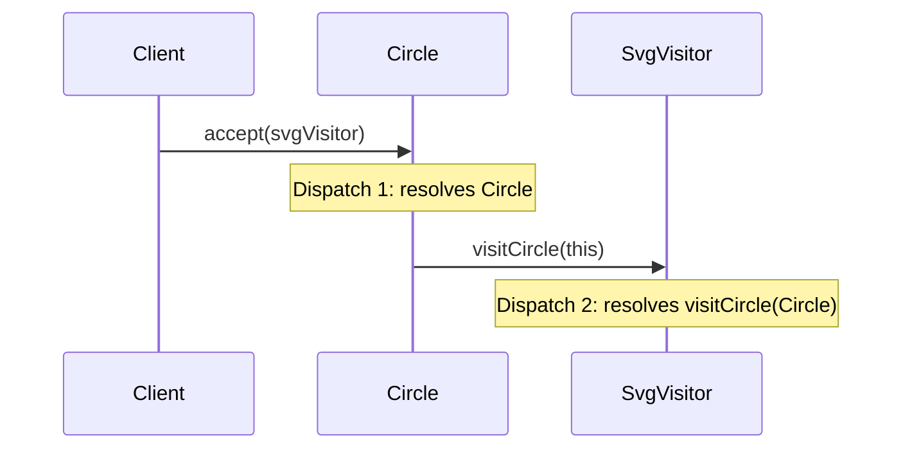

# Visitor Pattern

> **One-line summary:** Separate external operations (such as XML export, tax audit, or AST optimization) from a stable object hierarchy using Double Dispatch—or modern exhaustive `sealed` `switch` pattern matching.

| Attribute | Specification |
|---|---|
| **Level** | Intermediate / Advanced GoF |
| **Prerequisites** | [03-composite.md](../06-structural-patterns/03-composite.md), [02-open-closed.md](../02-solid-principles/02-open-closed.md) |
| **Estimated Reading Time** | 30 minutes |
| **Status** | Complete |
| **Category** | Behavioral |
| **Origin** | GoF 1994 |
| **Also Known As** | Double Dispatch, Algebraic Pattern Matching Emulation |
| **Languages Tested** | Java 25 (LTS) / TypeScript 5.8 (Node 24 native) / Python 3.14 |

---

## Table of Contents
- [1 The Problem](#1-the-problem)
- [2 Why It Exists](#2-why-it-exists)
- [3 What It Is](#3-what-it-is)
- [4 The Problem Without It](#4-the-problem-without-it)
- [5 How It Solves It](#5-how-it-solves-it)
- [6 How It Works](#6-how-it-works)
- [7 Real-World Examples](#7-real-world-examples)
- [8 When to Use and When NOT to Use](#8-when-to-use-and-when-not-to-use)
- [9 Variations and Language Idioms](#9-variations-and-language-idioms)
- [10 Relationship to Other Principles and Patterns](#10-relationship-to-other-principles-and-patterns)
- [11 Common Mistakes and Anti-Patterns](#11-common-mistakes-and-anti-patterns)
- [12 Testing and Design Verification](#12-testing-and-design-verification)
- [13 Performance, Concurrency and Security Notes](#13-performance-concurrency-and-security-notes)
- [14 Interview Questions](#14-interview-questions)
- [15 Practice Exercises](#15-practice-exercises)
- [16 Summary / Cheat Sheet](#16-summary--cheat-sheet)
- [17 Further Reading](#17-further-reading)

---

## 1 The Problem

Imagine maintaining an Abstract Syntax Tree (AST) or stable geometric/insurance hierarchy (`Circle`, `Rect`). The hierarchy's node classes rarely change—but every quarter, teams need **new external operations** over those nodes: `calculateArea`, `exportToSvg`, `exportToJson`, `computeBoundingBox`.

If you put `exportToSvg()` and `exportToJson()` directly onto `Shape`, `Shape` bloats into a God interface violating SRP! Yet writing `if (s instanceof Circle) ... else if (s instanceof Rect) ...` in old Java lacks exhaustiveness checks if someone forgets a shape!

---

## 2 Why It Exists

Formulated by the **Gang of Four (1994)** to solve the **Expression Problem** in single-dispatch OOP languages:
- Normal polymorphism makes adding *new types* easy, but adding *new operations* across all types hard.
- **Visitor** flips this: adding *new operations* (`SvgVisitor`, `JsonVisitor`) is trivial without editing node classes, using **Double Dispatch** (`shape.accept(visitor)` $\to$ `visitor.visitCircle(this)`).

---

## 3 What It Is



---

## 4 The Problem Without It

```java
// Violation: Bloating pure domain Circle/Rect with SVG, XML, JSON, and Tax methods!
interface BloatedShape {
    double area();
    String toSvg();
    String toXml();
    String toJson();
}
```

---

## 5 How It Solves It

### Java Implementation (Java 25 LTS — Classic Double Dispatch + Modern `sealed` `switch`!)

In **Java 25**, `sealed interface` + exhaustive `switch` pattern matching solves the Visitor problem cleanly *without* `accept()`/`visit()` boilerplate! Here are both side-by-side:

```java
package com.design.patterns.behavioral.visitor;

// Modern Java 25 Idiom (Preferred when you own the closed hierarchy!):
sealed interface Shape permits Circle, Rect {}
record Circle(double r) implements Shape {}
record Rect(double w, double h) implements Shape {}

public class VisitorApp {
    // Compiler guarantees EVERY permitted Shape is handled (exhaustive!)
    static double areaModern(Shape s) {
        return switch (s) {
            case Circle c -> Math.PI * c.r() * c.r();
            case Rect r -> r.w() * r.h();
        };
    }

    // Classic GoF Double Dispatch (used when library/AST already exposes accept(Visitor)):
    interface ShapeVisitor<R> {
        R visitCircle(double r);
        R visitRect(double w, double h);
    }

    public static void main(String[] args) {
        System.out.println("Sealed Visitor Rect area: " + areaModern(new Rect(4, 5)));
    }
}
```

### TypeScript Implementation (Node 24 Native — Exhaustive Discriminated Union)

```typescript
type Shape =
    | { kind: "circle"; r: number }
    | { kind: "rect"; w: number; h: number };

function area(s: Shape): number {
    switch (s.kind) {
        case "circle": return Math.PI * s.r * s.r;
        case "rect": return s.w * s.h;
    }
}
```

### Python Implementation (Python 3.14 — Structural Pattern Matching `match/case`)

```python
from dataclasses import dataclass
import math

@dataclass(frozen=True)
class Circle:
    r: float

@dataclass(frozen=True)
class Rect:
    w: float
    h: float

def area(shape: Circle | Rect) -> float:
    match shape:
        case Circle(r):
            return math.pi * r * r
        case Rect(w, h):
            return w * h
```

### Real Execution Output
```text
Sealed Visitor Rect area: 20.0
```

---

## 6 How It Works: The Visitor Trade-off

- **Easy:** Adding new operations (`XmlExport`, `AreaCalc`)—just write a new Visitor or `switch` function.
- **Hard:** Adding a new element type (`Triangle`)—requires updating `ShapeVisitor` and *every* existing Visitor!
- **Modern Rule:** In Java 21+, TypeScript, and Python 3.10+, **prefer `sealed` / Discriminated Unions + `match`/`switch` pattern matching** over classic GoF `accept(Visitor)` unless traversing an external AST library (like ASM or JavaParser) that already uses `accept()`.

---

## 7 Real-World Examples

1. **Java `java.nio.file.Files.walkFileTree(path, FileVisitor)`**: Standard JDK directory tree traversal Visitor.
2. **Compilers & Linters (Babel, ESLint, TypeScript Compiler AST Visitors, Python `ast.NodeVisitor`)**.
3. **ASM Bytecode Manipulation (`ClassVisitor`, `MethodVisitor`)**.

---

## 8 When to Use and When NOT to Use

| Context | Use Classic Visitor vs Pattern Matching? | Rationale |
|---|---|---|
| **Traversing external/existing AST libraries (`ast.NodeVisitor`, `FileVisitor`)** | **Classic Visitor** | Matches library contract. |
| **New code in Java 21+, TS, Python 3.10+** | **Use `sealed` / Unions + `switch`/`match`** | Zero `accept()` boilerplate with compile-time exhaustiveness! |
| **Hierarchy adds new node classes every sprint** | **NO (Use normal Polymorphism!)** | Frequent new types break every Visitor. |

---

## 9 Variations and Language Idioms

- **Acyclic Visitor (Robert C. Martin):** Uses marker interfaces + `instanceof` per node type to break the cyclic dependency between Visitor and all Element classes.

---

## 10 Relationship to Other Principles and Patterns

- **Composite:** Visitor frequently operates over Composite trees.
- **Interpreter:** Visitors evaluate, optimize, or compile Interpreter AST nodes.

---

## 11 Common Mistakes and Anti-Patterns

| Anti-Pattern | Description | Production Consequence | Correct Remedy |
|---|---|---|---|
| **Classic `accept/visit` in Modern TS/Java 25** | Writing 100 lines of `accept(Visitor)` when `sealed` `switch` works in 8 lines. | Unnecessary boilerplate. | Use `sealed` / Discriminated Unions + `switch`. |
| **Using Visitor on Unstable Hierarchies** | Adding 2 new `Shape` subclasses every month. | Breaks every Visitor class constantly! | Use regular OOP virtual methods (`shape.area()`). |
| **Forgetting Exhaustiveness Check (`never`)** | Missing a `default: assertNever(s)` in TS `switch`. | Silent `undefined` return when a new variant is added! | Add `assertNever(s)` check. |
| **Mutating AST Inside Read-Only Visitor** | Unexpected side effects during traversal. | Corrupts tree for later passes. | Return new transformed nodes or accumulate results cleanly. |
| **Breaking Encapsulation via Visitor** | Exposing private internal fields just so Visitor can read them. | Leaky domain state. | Expose only read-only views/records. |
| **Confusing Single Dispatch with Double Dispatch** | Overloading `visit(Shape)` and `visit(Circle)` in Java and expecting runtime dispatch! | Java resolves method *overloads* at compile time, calling `visit(Shape)`! | `accept(v)` is required for classic double dispatch. |

---

## 12 Testing and Design Verification

Test each operation (`areaModern`, `toSvg`) across all permitted variants (`Circle`, `Rect`), plus null/edge dimensions.

---

## 13 Performance, Concurrency and Security Notes

- **Performance:** Modern `sealed` `switch` pattern matching avoids double virtual-call indirection and enables JIT jump tables.

---

## 14 Interview Questions

<details>
<summary><strong>1. What is "Double Dispatch" and why did classic Java/C++ need it for Visitor?</strong></summary>

Java/C++ are **single-dispatch** languages: runtime polymorphism resolves based on the *receiver* (`shape.accept()`), while overloaded method parameters (`visit(Circle)` vs `visit(Rect)`) are bound statically at **compile time**. Calling `shape.accept(visitor)` dispatches to `Circle`, which then calls `visitor.visitCircle(this)`—resolving both runtime types!
</details>

<details>
<summary><strong>2. What is the "Expression Problem" and which side does Visitor optimize?</strong></summary>

The Expression Problem is the tension between adding new *data types* vs adding new *operations* without modifying existing code. Standard OOP makes new *types* easy; **Visitor** (and pattern matching) makes new *operations* easy while making new *types* hard.
</details>

<details>
<summary><strong>3. Why do Java 21+ `sealed` interfaces and TypeScript Discriminated Unions largely replace GoF Visitor?</strong></summary>

Exhaustive `switch` / `match` over a `sealed` hierarchy or union type gives compile-time safety that every variant is handled—eliminating `accept()`/`visit()` boilerplate completely!
</details>

<details>
<summary><strong>4. Give a real-world example of Visitor in the JDK and Python stdlib.</strong></summary>

Java: `java.nio.file.Files.walkFileTree` (`FileVisitor`). Python: `ast.NodeVisitor` for traversing Python ASTs.
</details>

<details>
<summary><strong>5. When should you NOT use the Visitor pattern?</strong></summary>

When new concrete node types are added frequently (because every new node forces updating all Visitors), or when operations naturally belong on the objects themselves via standard polymorphism.
</details>

<details>
<summary><strong>6. What is the "Acyclic Visitor" pattern?</strong></summary>

A variation by Robert C. Martin where each `Element` has its own tiny visitor interface (`CircleVisitor`) and `accept()` checks `if (v instanceof CircleVisitor cv)`—breaking the cyclic compile dependency between the base `Visitor` and all `Element` subclasses.
</details>

<details>
<summary><strong>7. How does TypeScript's `never` type guarantee exhaustiveness in Visitor-style switches?</strong></summary>

In the `default:` branch of `switch (shape.kind)`, assigning `const _exhaustive: never = shape;` causes a **compile-time error** if a new shape variant is ever added and forgotten!
</details>

<details>
<summary><strong>8. Why does `visitor.visit(shape)` NOT dispatch to `visit(Circle)` in Java?</strong></summary>

Because Java only dispatches dynamically on the *receiver* (`visitor`), not on method parameter runtime types—method overload resolution happens strictly at compile time using the declared variable type `Shape`.
</details>

---

## 15 Practice Exercises

### Exercise 1: Identify Single-Dispatch Overload Bug (Easy)
`Shape s = new Circle(5); printer.print(s);` calls `print(Shape)` instead of `print(Circle)`. Why?

<details>
<summary><strong>Solution</strong></summary>

Java resolves overloaded parameter types at compile time based on the variable's declared type (`Shape`), not runtime type (`Circle`).
</details>

---

### Exercise 2: Add `Triangle` to Java 25 Sealed `switch` (Medium)
Add `record Triangle(double base, double height) implements Shape {}` and observe the compiler forcing you to update `areaModern`.

<details>
<summary><strong>Solution</strong></summary>

Add `case Triangle t -> 0.5 * t.base() * t.height();` to `switch (s)`.
</details>

---

### Exercise 3: Python `ast.NodeVisitor` Function Counter (Hard)
Use Python's built-in `ast.NodeVisitor` to count all `ast.FunctionDef` nodes in a Python source string.

<details>
<summary><strong>Solution</strong></summary>

Subclass `ast.NodeVisitor`, increment `self.count += 1` inside `visit_FunctionDef(self, node)` and call `self.generic_visit(node)`.
</details>

---

## 16 Summary / Cheat Sheet

```
+--------------------------------------------------------------------------+
|                             VISITOR PATTERN                              |
+--------------------------------------------------------------------------+
| INTENT     : Add external operations over a stable hierarchy (ASTs).     |
| MODERN ALT : Java 25 `sealed` + `switch` | TS Unions | Python `match`.   |
| TRADE-OFF  : Easy to add new operations; hard to add new node types!     |
+--------------------------------------------------------------------------+
```

---

## 17 Further Reading

- Erich Gamma et al., *Design Patterns*, Addison-Wesley, 1994.

### In Your Language
| Language Track | Deep Dive Reference |
|---|---|
| Java | [Java OOP & Design Patterns](file:///e:/Learning/engineering-notes/01-languages/java/24-design-patterns/README.md) |
| TypeScript | [TypeScript Design Patterns](file:///e:/Learning/engineering-notes/01-languages/typescript/17-design-patterns/README.md) |
| Python | [Python Design Patterns](file:///e:/Learning/engineering-notes/01-languages/python/23-design-patterns/README.md) |

---

[← Previous: 09 - Memento Pattern](file:///e:/Learning/engineering-notes/08-solid-design-patterns/07-behavioral-patterns/09-memento.md) | [Module 07 Index](file:///e:/Learning/engineering-notes/08-solid-design-patterns/07-behavioral-patterns/README.md) | [Next: 11 - Interpreter Pattern →](file:///e:/Learning/engineering-notes/08-solid-design-patterns/07-behavioral-patterns/11-interpreter.md)
