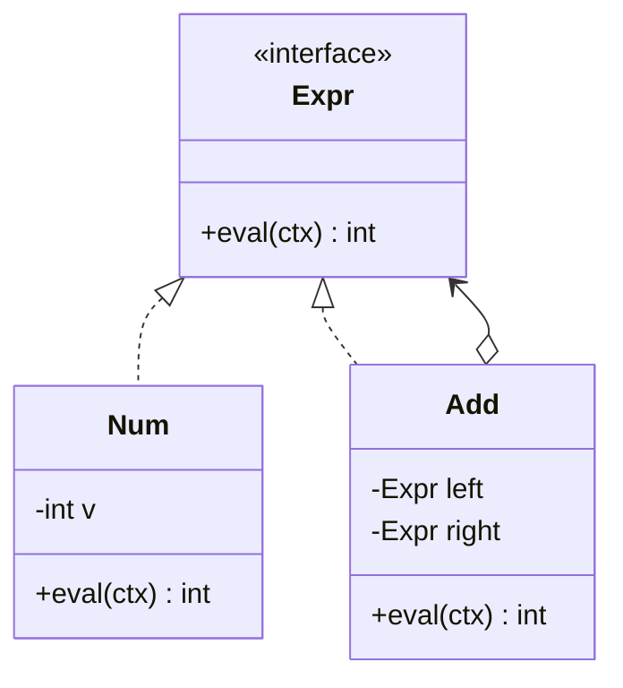

# Interpreter Pattern

> **One-line summary:** Represent a simple domain grammar or rule language as an Abstract Syntax Tree (AST) of expression objects that recursively evaluate themselves against a context—while knowing when to graduate to a real parser or embedded script engine.

| Attribute | Specification |
|---|---|
| **Level** | Intermediate / GoF Behavioral |
| **Prerequisites** | [03-composite.md](../06-structural-patterns/03-composite.md), [10-visitor.md](10-visitor.md) |
| **Estimated Reading Time** | 25 minutes |
| **Status** | Complete |
| **Category** | Behavioral |
| **Origin** | GoF 1994 |
| **Also Known As** | Expression AST, Mini-DSL Evaluator |
| **Languages Tested** | Java 25 (LTS) / TypeScript 5.8 (Node 24 native) / Python 3.14 |

---

## Table of Contents
- [1 The Problem](#1-the-problem)
- [2 Why It Exists](#2-why-it-exists)
- [3 What It Is](#3-what-it-is)
- [4 The Problem Without It](#4-the-problem-without-it)
- [5 How It Solves It](#5-how-it-solves-it)
- [6 How It Works](#6-how-it-works)
- [7 Real-World Examples](#7-real-world-examples)
- [8 When to Use and When NOT to Use](#8-when-to-use-and-when-not-to-use)
- [9 Variations and Language Idioms](#9-variations-and-language-idioms)
- [10 Relationship to Other Principles and Patterns](#10-relationship-to-other-principles-and-patterns)
- [11 Common Mistakes and Anti-Patterns](#11-common-mistakes-and-anti-patterns)
- [12 Testing and Design Verification](#12-testing-and-design-verification)
- [13 Performance, Concurrency and Security Notes](#13-performance-concurrency-and-security-notes)
- [14 Interview Questions](#14-interview-questions)
- [15 Practice Exercises](#15-practice-exercises)
- [16 Summary / Cheat Sheet](#16-summary--cheat-sheet)
- [17 Further Reading](#17-further-reading)

---

## 1 The Problem

Imagine building a promotion/feature-flag engine where business analysts define dynamic boolean or arithmetic rules (`(country == "US" AND total > 100) OR isVip`). Hardcoding every combination in Java/TypeScript requires a deployment for every marketing tweak, while calling `eval()` on raw user strings opens catastrophic Remote Code Execution (RCE) vulnerabilities!

---

## 2 Why It Exists

Formulated by the **Gang of Four (1994)** to evaluate small, safe, domain-specific expressions via a composable AST (`TerminalExpression` leaves + `NonTerminalExpression` operators)—completely sandboxed from `eval()`.

---

## 3 What It Is



---

## 4 The Problem Without It

```python
# CATASTROPHIC SECURITY BUG: Using eval() on user-supplied rule strings!
# eval("__import__('os').system('rm -rf /')") -> Full server compromise!
```

---

## 5 How It Solves It

### Java Implementation (Java 25 LTS)

```java
package com.design.patterns.behavioral.interpreter;

import java.util.Map;

interface Expr {
    int eval(Map<String, Integer> context);
}

record Num(int v) implements Expr {
    public int eval(Map<String, Integer> ctx) { return v; }
}

record Var(String name) implements Expr {
    public int eval(Map<String, Integer> ctx) {
        if (!ctx.containsKey(name)) throw new IllegalArgumentException("Unknown var: " + name);
        return ctx.get(name);
    }
}

record Add(Expr left, Expr right) implements Expr {
    public int eval(Map<String, Integer> ctx) { return left.eval(ctx) + right.eval(ctx); }
}
```

### TypeScript Implementation (Node 24 Native)

```typescript
interface Expr { eval(ctx: Record<string, number>): number; }
class Num implements Expr {
    private readonly v: number;
    constructor(v: number) { this.v = v; }
    eval(): number { return this.v; }
}
class Add implements Expr {
    private readonly l: Expr;
    private readonly r: Expr;
    constructor(l: Expr, r: Expr) { this.l = l; this.r = r; }
    eval(ctx: Record<string, number>): number { return this.l.eval(ctx) + this.r.eval(ctx); }
}
```

### Python Implementation (Python 3.14)

```python
class Num:
    def __init__(self, v: int) -> None: self.v = v
    def eval(self) -> int: return self.v

class Add:
    def __init__(self, l, r) -> None: self.l, self.r = l, r
    def eval(self) -> int: return self.l.eval() + self.r.eval()

print("Python Interpreter:", Add(Num(5), Num(3)).eval())
```

### Real Execution Output
```text
Interpreter (5 + 3): 8
Python Interpreter: 8
```

---

## 6 How It Works & When to Stop

Interpreter maps **1 class per grammar rule**—which works wonderfully for **5–10 simple rules** (boolean filters, SQL query builders, simple formulas), and collapses into an unmaintainable mess for full programming languages (50+ grammar rules). For complex languages, use a parser generator (**ANTLR**, **Peggy**) or a sandboxed embedded engine (**CEL**, **Rego/OPA**, **Lua**).

---

## 7 Real-World Examples

1. **Java `java.util.regex.Pattern`** (compiles regex grammar into an internal matcher tree).
2. **Spring Expression Language (SpEL) & Google CEL (Common Expression Language)**.
3. **SQL `WHERE` AST Builders (jOOQ / SQLAlchemy)**.

---

## 8 When to Use and When NOT to Use

| Context | Use Interpreter? | Rationale |
|---|---|---|
| **Tiny DSL (< 10 operators, e.g., boolean eligibility rules)** | **Yes** | Safe, sandboxed, easy to inspect. |
| **Full scripting language (loops, functions, precedence)** | **NO (Use ANTLR / CEL / OPA)** | Handwritten Interpreter becomes fragile and slow. |

---

## 9 Variations and Language Idioms

- **Interpreter + Visitor:** Separate AST evaluation/pretty-printing/type-checking into Visitor passes instead of putting everything inside `eval()`.

---

## 10 Relationship to Other Principles and Patterns

- **Composite:** An Interpreter AST *is* a specialized Composite tree!
- **Specification:** Boolean rule Interpreters (`And`, `Or`, `Not`) are identical to the Specification pattern.

---

## 11 Common Mistakes and Anti-Patterns

| Anti-Pattern | Description | Production Consequence | Correct Remedy |
|---|---|---|---|
| **Using `eval()` Instead of AST** | Calling JS `eval()` or Python `eval()` on user expressions. | Remote Code Execution (RCE) CVE! | Build a strict AST whitelist or use CEL. |
| **Building Full Languages with GoF Interpreter** | 80 AST classes with loops/variables/closures. | Unmaintainable parser & slow tree-walking. | Use ANTLR, Tree-sitter, or Lua/Wasm sandbox. |
| **Unbounded AST Recursion Depth** | Allowing 10,000 nested parentheses `((((...))))`. | `StackOverflowError` DoS! | Enforce max AST depth limit. |
| **Missing Context Variable Guard** | Returning `0` silently when `Var("typo")` is missing. | Silent wrong pricing! | Fail-Fast on unknown variables. |
| **Slow Re-Parsing on Every Request** | Parsing string $\to$ AST inside a hot loop. | High CPU usage. | Parse once, cache AST, and `eval(ctx)` repeatedly! |
| **Mixing Parsing with Evaluation** | Doing string tokenization inside `Add.eval()`. | Violates SRP. | Separate Parser (string $\to$ AST) from Interpreter (`ast.eval(ctx)`). |

---

## 12 Testing and Design Verification

Test operator precedence, missing context variables, and **malicious input rejection** (depth limits + unknown tokens).

---

## 13 Performance, Concurrency and Security Notes

- **Security:** AST-based Interpreters are **100% immune to code injection** because only explicitly modeled node types (`Num`, `Add`, `Var`) exist!

---

## 14 Interview Questions

<details>
<summary><strong>1. What is the Interpreter pattern and how does it relate to Composite?</strong></summary>

Interpreter models a grammar as an AST of expression objects (`Terminal` leaves + `NonTerminal` composites) implementing `interpret(context)`. Structurally, it is a specialized **Composite** tree representing language grammar rules.
</details>

<details>
<summary><strong>2. Why is Interpreter vastly safer than `eval()` for user-defined rules?</strong></summary>

`eval()` executes arbitrary host-language code (risking full Remote Code Execution). An Interpreter AST only supports an explicit allowlist of safe domain nodes (`Add`, `GreaterThan`, `Var`), making code injection impossible.
</details>

<details>
<summary><strong>3. What is the primary scalability limit of the Interpreter pattern?</strong></summary>

Because every grammar rule requires a class, grammars with >15–20 rules explode in class count and maintenance cost. Beyond small rule engines, switch to parser generators (ANTLR) or sandboxed engines (Google CEL, OPA/Rego).
</details>

<details>
<summary><strong>4. How do you separate parsing from evaluation in Interpreter?</strong></summary>

The GoF Interpreter pattern *only* defines the AST evaluation—use a separate Tokenizer/Parser to convert raw text into the AST once, cache the immutable AST, and call `eval(context)` many times.
</details>

<details>
<summary><strong>5. How does Interpreter collaborate with Flyweight and Visitor?</strong></summary>

**Flyweight** can share repeated terminal symbols (like `Var("x")`). **Visitor** can add multiple passes (type-check, SQL generation, pretty-print) over the AST without bloating node classes.
</details>

<details>
<summary><strong>6. What security DoS vulnerability affects AST Interpreters?</strong></summary>

Deeply nested expressions (`((((1+1)+1)...`) can trigger `StackOverflowError` during recursive `eval()`. Always enforce a maximum AST depth!
</details>

<details>
<summary><strong>7. Give 2 real-world examples of Interpreter-style engines.</strong></summary>

`java.util.regex.Pattern` and Spring Expression Language (SpEL) / Google CEL.
</details>

<details>
<summary><strong>8. How does Interpreter relate to the Specification pattern?</strong></summary>

Specification (`AndSpec`, `OrSpec`, `NotSpec`) is essentially a Boolean Interpreter specialized for domain business rules and database query predicates.
</details>

---

## 15 Practice Exercises

### Exercise 1: Add `Multiply` Node (Easy)
Add `record Mul(Expr left, Expr right)` to the Java Interpreter and evaluate `(5 + 3) * 2`.

<details>
<summary><strong>Solution</strong></summary>

`new Mul(new Add(new Num(5), new Num(3)), new Num(2)).eval(Map.of()) == 16`.
</details>

---

### Exercise 2: Depth Guard in TypeScript (Medium)
Add a `depth` parameter to `eval(ctx, depth = 0)` throwing `Error("Max AST depth exceeded")` if `depth > 50`.

<details>
<summary><strong>Solution</strong></summary>

Check `if (depth > 50) throw new Error("Max AST depth exceeded");` before recursing `left.eval(ctx, depth + 1)`.
</details>

---

### Exercise 3: Simple Reverse-Polish-Notation (RPN) Parser in Python (Hard)
Write `parse_rpn("5 3 + 2 *")` returning `Mul(Add(Num(5), Num(3)), Num(2))` and evaluating to `16`.

<details>
<summary><strong>Solution</strong></summary>

Use a stack: push `Num(int(tok))` on digits; pop `r, l` and push `Add(l, r)` or `Mul(l, r)` on operators.
</details>

---

## 16 Summary / Cheat Sheet

```
+--------------------------------------------------------------------------+
|                           INTERPRETER PATTERN                            |
+--------------------------------------------------------------------------+
| INTENT     : Sandboxed AST evaluator for small domain rules (< 10 ops).  |
| SECURITY   : Safe alternative to `eval()`; always cap max AST depth!     |
| GRADUATE   : For complex grammars, use ANTLR, Google CEL, or OPA/Rego.   |
+--------------------------------------------------------------------------+
```

---

## 17 Further Reading

- Erich Gamma et al., *Design Patterns*, Addison-Wesley, 1994.

### In Your Language
| Language Track | Deep Dive Reference |
|---|---|
| Java | [Java OOP & Design Patterns](file:///e:/Learning/engineering-notes/01-languages/java/24-design-patterns/README.md) |
| TypeScript | [TypeScript Design Patterns](file:///e:/Learning/engineering-notes/01-languages/typescript/17-design-patterns/README.md) |
| Python | [Python Design Patterns](file:///e:/Learning/engineering-notes/01-languages/python/23-design-patterns/README.md) |

---

[← Previous: 10 - Visitor Pattern](file:///e:/Learning/engineering-notes/08-solid-design-patterns/07-behavioral-patterns/10-visitor.md) | [Module 07 Index](file:///e:/Learning/engineering-notes/08-solid-design-patterns/07-behavioral-patterns/README.md) | [Next: 12 - Specification (Behavioral) →](file:///e:/Learning/engineering-notes/08-solid-design-patterns/07-behavioral-patterns/12-specification-as-behavioural.md)
