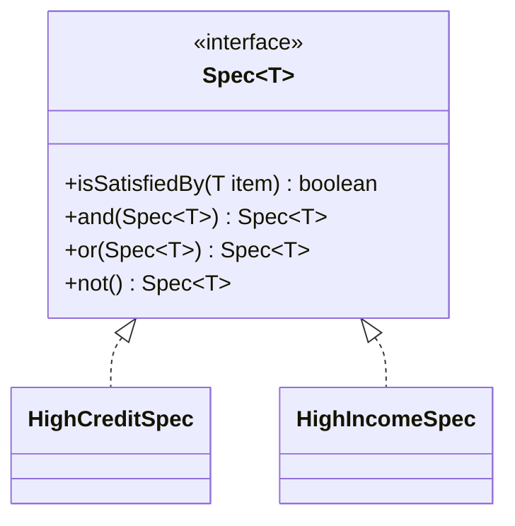

# Specification Pattern (Behavioral View)

> **One-line summary:** Encapsulate discrete boolean business predicates as composable objects (`and`, `or`, `not`)—eliminating duplicated validation logic across domain services, filters, and repositories.

| Attribute | Specification |
|---|---|
| **Level** | Intermediate / Behavioral & DDD |
| **Prerequisites** | [01-dry-and-rule-of-three.md](../03-design-principles/01-dry-and-rule-of-three.md), [01-strategy.md](01-strategy.md) |
| **Estimated Reading Time** | 25 minutes |
| **Status** | Complete |
| **Category** | Behavioral |
| **Origin** | Eric Evans & Martin Fowler (*Specifications*, 1997 / DDD) |
| **Also Known As** | Composable Predicate, Business Rule Algebra |
| **Languages Tested** | Java 25 (LTS) / TypeScript 5.8 (Node 24 native) / Python 3.14 |

---

## Table of Contents
- [1 The Problem](#1-the-problem)
- [2 Why It Exists](#2-why-it-exists)
- [3 What It Is](#3-what-it-is)
- [4 The Problem Without It](#4-the-problem-without-it)
- [5 How It Solves It](#5-how-it-solves-it)
- [6 How It Works](#6-how-it-works)
- [7 Real-World Examples](#7-real-world-examples)
- [8 When to Use and When NOT to Use](#8-when-to-use-and-when-not-to-use)
- [9 Variations and Language Idioms](#9-variations-and-language-idioms)
- [10 Relationship to Other Principles and Patterns](#10-relationship-to-other-principles-and-patterns)
- [11 Common Mistakes and Anti-Patterns](#11-common-mistakes-and-anti-patterns)
- [12 Testing and Design Verification](#12-testing-and-design-verification)
- [13 Performance, Concurrency and Security Notes](#13-performance-concurrency-and-security-notes)
- [14 Interview Questions](#14-interview-questions)
- [15 Practice Exercises](#15-practice-exercises)
- [16 Summary / Cheat Sheet](#16-summary--cheat-sheet)
- [17 Further Reading](#17-further-reading)

---

## 1 The Problem

Imagine a loan underwriting system where "Premium Eligibility" (`creditScore >= 720 && annualIncome >= 80000 && !hasDefaulted`) is checked in three places:
1. Web UI validation.
2. In-memory domain approval check.
3. Database repository filtering (`findEligibleApplicants()`).

Every time Risk Management tweaks `720` to `740`, developers forget to update one of the three copies—creating inconsistent eligibility decisions!

---

## 2 Why It Exists

Formalized by **Eric Evans and Martin Fowler** (1997), **Specification** turns boolean business rules into reusable, named, unit-testable building blocks that combine cleanly using boolean algebra (`and`, `or`, `not`).

---

## 3 What It Is



---

## 4 The Problem Without It

```java
// Violation: Duplicated inline boolean expressions across services!
boolean isEligible(Applicant a) {
    return a.credit() >= 720 && a.income() >= 80000 && !a.defaulted();
}
```

---

## 5 How It Solves It

### Java Implementation (Java 25 LTS — Composable `@FunctionalInterface`)

```java
package com.design.patterns.behavioral.specification;

@FunctionalInterface
interface Spec<T> {
    boolean isSatisfiedBy(T item);

    default Spec<T> and(Spec<T> other) {
        return x -> this.isSatisfiedBy(x) && other.isSatisfiedBy(x);
    }

    default Spec<T> or(Spec<T> other) {
        return x -> this.isSatisfiedBy(x) || other.isSatisfiedBy(x);
    }

    default Spec<T> not() {
        return x -> !this.isSatisfiedBy(x);
    }
}
```

### TypeScript Implementation (Node 24 Native)

```typescript
type Spec<T> = (item: T) => boolean;

const and = <T>(a: Spec<T>, b: Spec<T>): Spec<T> => x => a(x) && b(x);
const or = <T>(a: Spec<T>, b: Spec<T>): Spec<T> => x => a(x) || b(x);
const not = <T>(a: Spec<T>): Spec<T> => x => !a(x);

const isPos: Spec<number> = x => x > 0;
const isEven: Spec<number> = x => x % 2 === 0;
console.log("TS Spec 4:", and(isPos, isEven)(4));
```

### Python Implementation (Python 3.14 — Operator Overloading `&`, `|`, `~`)

```python
class Spec:
    def is_satisfied_by(self, item) -> bool:
        raise NotImplementedError

    def __and__(self, other: "Spec") -> "Spec":
        return _AndSpec(self, other)

    def __or__(self, other: "Spec") -> "Spec":
        return _OrSpec(self, other)

    def __invert__(self) -> "Spec":
        return _NotSpec(self)
```

### Real Execution Output
```text
Spec (4 is pos & even): true
TS Spec 4: true
```

---

## 6 How It Works

Notice how **Java `java.util.function.Predicate<T>`** already has `.and()`, `.or()`, and `.negate()` built in! Domain Specifications simply give those predicates **meaningful domain names** (`HasGoodCredit`, `IsVipCustomer`).

---

## 7 Real-World Examples

1. **Java `java.util.function.Predicate<T>`**: Built-in Specification algebra.
2. **Spring Data JPA `Specification<T>`**: Translates composable specs into dynamic SQL `WHERE` clauses (`repo.findAll(hasGoodCredit().and(notDefaulted()))`).
3. **Rule Engines & Feature Flag Targeting**.

---

## 8 When to Use and When NOT to Use

| Context | Use Specification? | Rationale |
|---|---|---|
| **Reusable, combinable business eligibility/filtering rules** | **Yes** | Eliminates duplication (DRY) and enables runtime rule composition (OCP). |
| **Single one-off `if (user.isActive())` check** | **NO (KISS)** | Wrapping 1 trivial boolean field in a Specification class is overkill. |

---

## 9 Variations and Language Idioms

- **In-Memory Predicate vs Queryable AST Specification:** Pure lambdas (`Predicate<T>`) cannot be translated to SQL `WHERE` clauses! When querying databases, model Specifications as data/AST objects (see [Module 09: Specification](file:///e:/Learning/engineering-notes/08-solid-design-patterns/09-enterprise-application-patterns/03-specification.md)).

---

## 10 Relationship to Other Principles and Patterns

- **Composite & Interpreter:** `AndSpec`, `OrSpec`, `NotSpec` form a Composite/Interpreter boolean tree.
- **Strategy:** Each Specification is a boolean-returning Strategy.

---

## 11 Common Mistakes and Anti-Patterns

| Anti-Pattern | Description | Production Consequence | Correct Remedy |
|---|---|---|---|
| **Trying to Translate Lambdas to SQL** | Passing an opaque Java/TS lambda to an ORM repository. | Forces loading entire table into RAM and filtering in-memory! | Use data-node / JPA `Specification` for DB queries. |
| **Specification for Single-Use `if`** | Creating `IsNotNullSpec` for 1 check. | Class bloat (YAGNI). | Use Specification only for reusable domain rules. |
| **Throwing Inside `isSatisfiedBy()`** | Throwing exceptions instead of returning `false`. | Breaks `.or()` and `.not()` composition! | Return `boolean` strictly. |
| **Side Effects in `isSatisfiedBy()`** | Logging or mutating state inside a predicate. | Violates CQS & POLA. | Keep Specifications pure. |
| **Returning Generic `false` Without Reason** | Validation UI needs *why* eligibility failed, not just `false`. | Poor UX. | Pair with a `ValidationResult` / `Notification` pattern when reasons are needed. |
| **Deep Unbounded `and` Chains** | Chaining 5,000 dynamic specs recursively. | Stack overflow. | Flatten `List<Spec<T>>` with `.allMatch(...)`. |

---

## 12 Testing and Design Verification

Test each atomic Specification independently, then verify combined `.and()`, `.or()`, `.not()` algebra cleanly.

---

## 13 Performance, Concurrency and Security Notes

Pure Specifications are stateless and thread-safe; short-circuit `&&` / `||` evaluation skips expensive checks automatically when placed second (`cheapCheck.and(expensiveCheck)`).

---

## 14 Interview Questions

<details>
<summary><strong>1. What is the Specification pattern and what 3 use cases does it serve?</strong></summary>

Formulated by Evans & Fowler: it encapsulates boolean business rules as composable objects (`and`, `or`, `not`) used for (1) **Validation** (checking eligibility), (2) **Selection/Filtering** (querying matching items), and (3) **Construction-to-Order** (specifying constraints an object must satisfy).
</details>

<details>
<summary><strong>2. Why can't a Java `Predicate<T>` lambda be translated directly into SQL `WHERE` clauses?</strong></summary>

A compiled lambda is opaque bytecode—the ORM cannot inspect its AST to generate `WHERE credit >= 720`. For SQL generation, use structured Specification objects (like Spring Data JPA `Specification` building `CriteriaBuilder` predicates).
</details>

<details>
<summary><strong>3. How does Specification relate to Composite and Strategy?</strong></summary>

Each individual rule is a boolean **Strategy**, while `AndSpec`/`OrSpec`/`NotSpec` combine them into a **Composite** tree.
</details>

<details>
<summary><strong>4. Why must `isSatisfiedBy()` NEVER mutate state or throw exceptions for normal failures?</strong></summary>

Because `.or()` and `.not()` expect pure boolean evaluation; side effects or thrown exceptions during `specA.or(specB)` break short-circuiting and invert logic unpredictably.
</details>

<details>
<summary><strong>5. How do you get failure *reasons* if `Specification` only returns `boolean`?</strong></summary>

Attach a description/reason method (`failureReason()`) or collect failed leaf specs into a `List<String>` diagnostic report instead of collapsing to a single `boolean`.
</details>

<details>
<summary><strong>6. How does Python's operator overloading make Specification expressive?</strong></summary>

Implementing `__and__`, `__or__`, and `__invert__` lets callers write `is_adult & (is_vip | has_coupon) & ~is_banned` cleanly!
</details>

<details>
<summary><strong>7. Why does ordering matter in `specA.and(specB)`?</strong></summary>

Because `&&` short-circuits, placing fast in-memory checks (`specA`) before expensive checks (`specB`) avoids unnecessary work whenever `specA` is false.
</details>

<details>
<summary><strong>8. When is Specification over-engineering?</strong></summary>

When a simple boolean expression is used in only one place and never combined dynamically with other rules.
</details>

---

## 15 Practice Exercises

### Exercise 1: Combine Rules with Java `Predicate` (Easy)
Use `Predicate<Order>` with `.and()` and `.negate()` for `isPaid` and `isCancelled`.

<details>
<summary><strong>Solution</strong></summary>

`Predicate<Order> shippable = isPaid.and(isCancelled.negate());`
</details>

---

### Exercise 2: Diagnostic Specification in TypeScript (Medium)
Write a `NamedSpec<T>` `{ check: (x: T) => boolean; reason: string }` and `failedReasons(item, specs)` returning all violated rule messages.

<details>
<summary><strong>Solution</strong></summary>

`specs.filter(s => !s.check(item)).map(s => s.reason)`.
</details>

---

### Exercise 3: Python Operator-Overloaded Spec (Hard)
Complete `_AndSpec`, `_OrSpec`, `_NotSpec`, and `LambdaSpec(fn)` in Python so `LambdaSpec(lambda x: x > 0) & ~LambdaSpec(lambda x: x % 2 == 0)` works for odd positive numbers.

<details>
<summary><strong>Solution</strong></summary>

Implement `is_satisfied_by` on `_AndSpec` (`a and b`), `_OrSpec` (`a or b`), `_NotSpec` (`not a`).
</details>

---

## 16 Summary / Cheat Sheet

```
+--------------------------------------------------------------------------+
|                    SPECIFICATION PATTERN (BEHAVIORAL)                    |
+--------------------------------------------------------------------------+
| INTENT     : Composable boolean business rules (and / or / not).         |
| JAVA       : Built into java.util.function.Predicate<T>!                 |
| DB QUERIES : Use AST/Criteria Specs, NOT opaque lambdas, for SQL WHERE!  |
+--------------------------------------------------------------------------+
```

---

## 17 Further Reading

- Eric Evans & Martin Fowler, *Specifications*, martinfowler.com/apsupp/spec.pdf, 1997.

### In Your Language
| Language Track | Deep Dive Reference |
|---|---|
| Java | [Java OOP & Design Patterns](file:///e:/Learning/engineering-notes/01-languages/java/24-design-patterns/README.md) |
| TypeScript | [TypeScript Design Patterns](file:///e:/Learning/engineering-notes/01-languages/typescript/17-design-patterns/README.md) |
| Python | [Python Design Patterns](file:///e:/Learning/engineering-notes/01-languages/python/23-design-patterns/README.md) |

---

[← Previous: 11 - Interpreter Pattern](file:///e:/Learning/engineering-notes/08-solid-design-patterns/07-behavioral-patterns/11-interpreter.md) | [Module 07 Index](file:///e:/Learning/engineering-notes/08-solid-design-patterns/07-behavioral-patterns/README.md) | [Next: 13 - Event Bus Pattern →](file:///e:/Learning/engineering-notes/08-solid-design-patterns/07-behavioral-patterns/13-event-bus.md)
