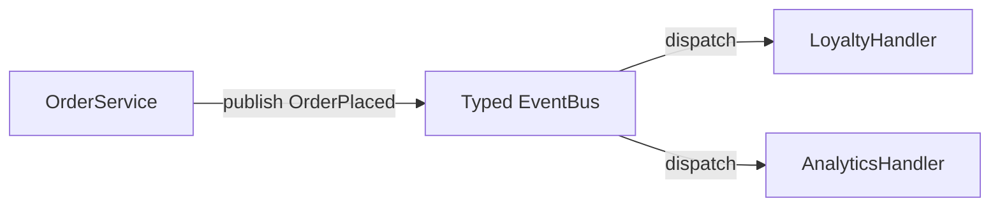

# Event Bus Pattern

> **One-line summary:** Route strongly-typed domain events from publishers to zero or more subscribers through a central in-process Event Bus—eliminating direct publisher-to-subscriber dependencies while avoiding distributed broker overhead inside a modular monolith.

| Attribute | Specification |
|---|---|
| **Level** | Intermediate / Behavioral & Modular Monolith |
| **Prerequisites** | [02-observer.md](02-observer.md), [08-mediator.md](08-mediator.md) |
| **Estimated Reading Time** | 25 minutes |
| **Status** | Complete |
| **Category** | Behavioral |
| **Origin** | Event-Driven / Guava EventBus / Spring ApplicationEventPublisher |
| **Also Known As** | In-Process Pub-Sub, Domain Event Dispatcher |
| **Languages Tested** | Java 25 (LTS) / TypeScript 5.8 (Node 24 native) / Python 3.14 |

---

## Table of Contents
- [1 The Problem](#1-the-problem)
- [2 Why It Exists](#2-why-it-exists)
- [3 What It Is](#3-what-it-is)
- [4 The Problem Without It](#4-the-problem-without-it)
- [5 How It Solves It](#5-how-it-solves-it)
- [6 How It Works](#6-how-it-works)
- [7 Real-World Examples](#7-real-world-examples)
- [8 When to Use and When NOT to Use](#8-when-to-use-and-when-not-to-use)
- [9 Variations and Language Idioms](#9-variations-and-language-idioms)
- [10 Relationship to Other Principles and Patterns](#10-relationship-to-other-principles-and-patterns)
- [11 Common Mistakes and Anti-Patterns](#11-common-mistakes-and-anti-patterns)
- [12 Testing and Design Verification](#12-testing-and-design-verification)
- [13 Performance, Concurrency and Security Notes](#13-performance-concurrency-and-security-notes)
- [14 Interview Questions](#14-interview-questions)
- [15 Practice Exercises](#15-practice-exercises)
- [16 Summary / Cheat Sheet](#16-summary--cheat-sheet)
- [17 Further Reading](#17-further-reading)

---

## 1 The Problem

In a Modular Monolith (`Orders`, `Billing`, `Loyalty`, `Analytics`), `OrderService` finishes checkout and needs to notify `LoyaltyService` and `AnalyticsService`.
- Calling them directly couples `Orders` to `Loyalty` and `Analytics` (violating SRP & Modular Monolith boundaries).
- Using raw Observer means `Loyalty` must know about and inject `OrderService` directly to subscribe—creating reverse coupling!

---

## 2 Why It Exists

An **Event Bus** inserts a typed central channel (`publish(OrderPlacedEvent)`) between modules so neither publishers nor subscribers hold references to each other.

---

## 3 What It Is



---

## 4 The Problem Without It

```java
// Violation: OrderService coupled to every downstream reaction!
class OrderServiceViolation {
    void completeOrder(String id) {
        loyaltyService.awardPoints(id);
        analyticsService.track(id);
        emailService.sendReceipt(id);
    }
}
```

---

## 5 How It Solves It

### Java Implementation (Java 25 LTS — Typed `EventBus`)

```java
package com.design.patterns.behavioral.eventbus;

import java.util.*;
import java.util.concurrent.*;
import java.util.function.Consumer;

record OrderPlaced(String orderId, double total) {}

class EventBus {
    private final Map<Class<?>, List<Consumer<?>>> handlers = new ConcurrentHashMap<>();

    public <T> void subscribe(Class<T> eventType, Consumer<T> handler) {
        handlers.computeIfAbsent(eventType, k -> new CopyOnWriteArrayList<>()).add(handler);
    }

    @SuppressWarnings("unchecked")
    public <T> void publish(T event) {
        List<Consumer<?>> list = handlers.getOrDefault(event.getClass(), List.of());
        for (Consumer<?> h : list) {
            ((Consumer<T>) h).accept(event);
        }
    }
}
```

### TypeScript Implementation (Node 24 Native)

```typescript
type Handler<T> = (event: T) => void;

export class EventBus {
    private readonly map = new Map<string, Handler<any>[]>();

    subscribe<T>(eventName: string, fn: Handler<T>): () => void {
        const list = this.map.get(eventName) ?? [];
        list.push(fn);
        this.map.set(eventName, list);
        return () => this.map.set(eventName, (this.map.get(eventName) ?? []).filter(x => x !== fn));
    }

    publish<T>(eventName: string, event: T): void {
        for (const fn of [...(this.map.get(eventName) ?? [])]) fn(event);
    }
}
```

### Python Implementation (Python 3.14)

```python
from collections import defaultdict
from typing import Callable, Any

class EventBus:
    def __init__(self) -> None:
        self._handlers: dict[type, list[Callable[[Any], None]]] = defaultdict(list)

    def subscribe(self, event_type: type, fn: Callable[[Any], None]) -> None:
        self._handlers[event_type].append(fn)

    def publish(self, event: object) -> None:
        for fn in list(self._handlers[type(event)]):
            fn(event)
```

---

## 6 How It Works: In-Memory Event Bus vs. Durable Broker

An **in-process Event Bus** runs in RAM: if the server crashes *after* `publish()` or an async listener fails, the event is **lost**! For critical cross-service side effects (like sending emails or billing), pair with a **Transactional Outbox** or durable broker (Kafka/RabbitMQ).

---

## 7 Real-World Examples

1. **Spring `ApplicationEventPublisher` & `@TransactionalEventListener(phase = AFTER_COMMIT)`**.
2. **Domain Events in Modular Monoliths (Spring Modulith)**.
3. **Node.js `EventEmitter` / Browser `BroadcastChannel`**.

---

## 8 When to Use and When NOT to Use

| Context | Use In-Process Event Bus? | Rationale |
|---|---|---|
| **Decoupling non-critical or modular-monolith domain events** | **Yes** | Clean module boundaries without network broker overhead. |
| **Must survive process crashes / cross-microservice delivery** | **NO (Use Transactional Outbox + Kafka/RabbitMQ)** | In-memory buses lose events on crash. |

---

## 9 Variations and Language Idioms

- **After-Commit Dispatch:** Never fire external notifications *before* the DB transaction commits—if the DB rolls back, subscribers already sent emails for a non-existent order!

---

## 10 Relationship to Other Principles and Patterns

- **Observer & Mediator:** Event Bus combines Observer's pub-sub broadcast with Mediator's central hub.
- **Modular Monolith & Outbox:** Core architectural building block.

---

## 11 Common Mistakes and Anti-Patterns

| Anti-Pattern | Description | Production Consequence | Correct Remedy |
|---|---|---|---|
| **Publishing Before DB Commit** | Calling `bus.publish(OrderPaid)` inside a DB tx that later rolls back! | Ghost emails/shipments for rolled-back orders! | Publish *after* commit (`AFTER_COMMIT`) or use Outbox. |
| **Pinball Architecture** | Event A triggers Handler B $\to$ emits Event C $\to$ triggers Handler D across 10 hops. | Impossible to trace control flow! | Keep event chains shallow (1–2 hops); use explicit orchestration for complex flows. |
| **Mutable Event Objects** | Handler 1 mutates `event.total = 0`, breaking Handler 2! | Subtle cross-handler bugs. | Make all Event classes 100% immutable (`record` / `frozen=True`). |
| **Unisolated Handler Exceptions** | Handler 1 crashes synchronously, blocking Handler 2. | Dropped handlers. | Isolate per-handler `try/catch` or async queue. |
| **Using In-Memory Bus for Critical Cross-Service Guarantees** | Assuming in-memory `EventBus` never drops events on `SIGKILL`. | Lost financial events! | Use durable Outbox + Kafka. |
| **String-Typed Event Names Without Schema** | Typos like `bus.publish("OrdrPlaced", ...)` failing silently. | Dead handlers! | Use strongly typed event classes/records. |

---

## 12 Testing and Design Verification

Inject a fake/spy `EventBus` into `OrderService` and assert `OrderPlaced` was published with the exact expected `orderId` and `total`.

---

## 13 Performance, Concurrency and Security Notes

- **Concurrency:** Use `ConcurrentHashMap` + `CopyOnWriteArrayList` and immutable event records so parallel dispatch is thread-safe.

---

## 14 Interview Questions

<details>
<summary><strong>1. Compare Event Bus vs Observer.</strong></summary>

In **Observer**, subscribers register directly on the publisher object (`orderService.addListener(...)`). In **Event Bus**, publishers and subscribers have zero direct references to each other—both interact only with a central `EventBus` keyed by event type.
</details>

<details>
<summary><strong>2. Why is publishing a domain event *before* a database transaction commits a critical bug?</strong></summary>

If the DB transaction later fails and rolls back (e.g., constraint violation), subscribers have already acted on an event for a transaction that never persisted (or async subscribers query the DB before commit and get `404 Not Found`). Use `AFTER_COMMIT` hooks or Transactional Outbox.
</details>

<details>
<summary><strong>3. Why must Event objects published on an Event Bus be strictly immutable?</strong></summary>

Because multiple independent subscribers receive the same event instance—if Subscriber A mutates a field, Subscriber B receives corrupted data.
</details>

<details>
<summary><strong>4. What is "Pinball Architecture" in event-driven codebases?</strong></summary>

Overusing events for every step so a simple business flow bounces unpredictably across 8 decoupled event handlers, making debugging and tracing control flow agonizing.
</details>

<details>
<summary><strong>5. When must you upgrade from an in-process Event Bus to Kafka/RabbitMQ + Outbox?</strong></summary>

When events cross physical service/process boundaries or when losing an in-flight event during a server crash/restart is unacceptable.
</details>

<details>
<summary><strong>6. How does Spring's `@TransactionalEventListener(phase = AFTER_COMMIT)` solve the commit-order hazard?</strong></summary>

Spring buffers published events during the transaction and only dispatches them to listeners *after* the database commit succeeds.
</details>

<details>
<summary><strong>7. How do you prevent one failing Event Bus subscriber from starving others?</strong></summary>

Wrap each subscriber invocation in `try/catch` (logging/metrics + DLQ) or dispatch each subscriber onto an independent worker task.
</details>

<details>
<summary><strong>8. How do you unit test a service that publishes to an Event Bus?</strong></summary>

Inject a recording test-double `EventBus` (or subscribe a test listener) and assert the exact immutable event object was emitted.
</details>

---

## 15 Practice Exercises

### Exercise 1: Fix Mutable Event Bug (Easy)
`class OrderEvent { public double total; }` — explain why this breaks multi-subscriber Event Buses and fix in Java/TS/Python.

<details>
<summary><strong>Solution</strong></summary>

Convert to immutable `record OrderEvent(double total) {}` (Java), `readonly` (TS), `@dataclass(frozen=True)` (Python).
</details>

---

### Exercise 2: Exception-Safe `publish()` in TypeScript (Medium)
Update `EventBus.publish` so a throwing subscriber logs the error without preventing remaining subscribers from running.

<details>
<summary><strong>Solution</strong></summary>

Wrap `fn(event)` in `try { fn(event); } catch (e) { console.error(e); }`.
</details>

---

### Exercise 3: Deferred Post-Commit Event Buffer in Python (Hard)
Build a `UnitOfWorkEventBuffer` that queues `record(event)` calls during a transaction and flushes them to `bus.publish(event)` *only* when `commit()` succeeds (discarding them on `rollback()`).

<details>
<summary><strong>Solution</strong></summary>

Maintain `self._pending = []`; `commit()` drains and publishes; `rollback()` executes `self._pending.clear()`.
</details>

---

## 16 Summary / Cheat Sheet

```
+--------------------------------------------------------------------------+
|                            EVENT BUS PATTERN                             |
+--------------------------------------------------------------------------+
| INTENT     : Typed in-process pub-sub decoupling modular boundaries.     |
| MUST DO    : Immutable Events + Publish AFTER DB Commit + Isolate Errors.|
| UPGRADE    : Use Transactional Outbox + Kafka when durability is needed. |
+--------------------------------------------------------------------------+
```

---

## 17 Further Reading

- Spring Modulith Documentation, *Working with Application Events*, spring.io/projects/spring-modulith.

### In Your Language
| Language Track | Deep Dive Reference |
|---|---|
| Java | [Java OOP & Design Patterns](file:///e:/Learning/engineering-notes/01-languages/java/24-design-patterns/README.md) |
| TypeScript | [TypeScript Design Patterns](file:///e:/Learning/engineering-notes/01-languages/typescript/17-design-patterns/README.md) |
| Python | [Python Design Patterns](file:///e:/Learning/engineering-notes/01-languages/python/23-design-patterns/README.md) |

---

[← Previous: 12 - Specification (Behavioral)](file:///e:/Learning/engineering-notes/08-solid-design-patterns/07-behavioral-patterns/12-specification-as-behavioural.md) | [Module 07 Index](file:///e:/Learning/engineering-notes/08-solid-design-patterns/07-behavioral-patterns/README.md) | [Next: 14 - Blackboard & Pub-Sub Variants →](file:///e:/Learning/engineering-notes/08-solid-design-patterns/07-behavioral-patterns/14-blackboard-and-publish-subscribe-variants.md)
