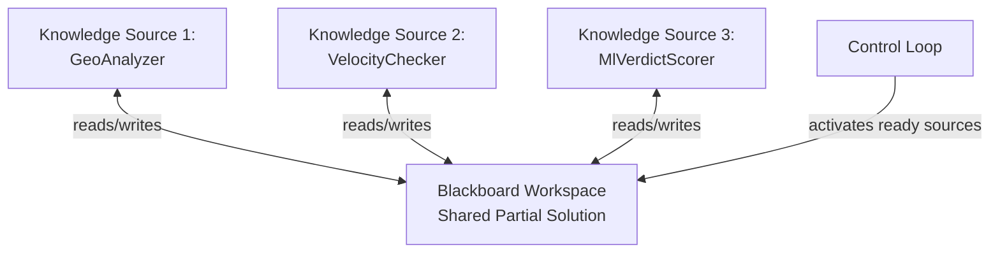

# Blackboard & Publish-Subscribe Variants

> **One-line summary:** Understand how Blackboard architectures coordinate independent specialist knowledge sources over a shared evolving workspace, and how Pub-Sub variants scale beyond direct in-memory Observer.

| Attribute | Specification |
|---|---|
| **Level** | Intermediate / Architectural |
| **Prerequisites** | [02-observer.md](02-observer.md), [13-event-bus.md](13-event-bus.md) |
| **Estimated Reading Time** | 25 minutes |
| **Status** | Complete |
| **Category** | Behavioral / Architectural |
| **Origin** | POSA (Buschmann et al., 1996) & Enterprise Integration Patterns |
| **Also Known As** | Shared Workspace Pattern, Brokered Pub-Sub |
| **Languages Tested** | Java 25 (LTS) / TypeScript 5.8 (Node 24 native) / Python 3.14 |

---

## Table of Contents
- [1 The Problem](#1-the-problem)
- [2 Why It Exists](#2-why-it-exists)
- [3 What It Is](#3-what-it-is)
- [4 The Problem Without It](#4-the-problem-without-it)
- [5 How It Solves It](#5-how-it-solves-it)
- [6 How It Works](#6-how-it-works)
- [7 Real-World Examples](#7-real-world-examples)
- [8 When to Use and When NOT to Use](#8-when-to-use-and-when-not-to-use)
- [9 Variations and Language Idioms](#9-variations-and-language-idioms)
- [10 Relationship to Other Principles and Patterns](#10-relationship-to-other-principles-and-patterns)
- [11 Common Mistakes and Anti-Patterns](#11-common-mistakes-and-anti-patterns)
- [12 Testing and Design Verification](#12-testing-and-design-verification)
- [13 Performance, Concurrency and Security Notes](#13-performance-concurrency-and-security-notes)
- [14 Interview Questions](#14-interview-questions)
- [15 Practice Exercises](#15-practice-exercises)
- [16 Summary / Cheat Sheet](#16-summary--cheat-sheet)
- [17 Further Reading](#17-further-reading)

---

## 1 The Problem

Imagine building a multi-stage **Fraud Detection / Medical Diagnosis / Speech Recognition** system where no single deterministic pipeline knows the exact order in which specialists contribute:
- A `GeoAnalyzer` writes a risk score when IP data arrives.
- A `VelocityChecker` inspects recent transactions and adds a velocity flag.
- An `MlScorer` waits until *both* Geo and Velocity features exist on the case before computing a final verdict.

Meanwhile, in distributed eventing, teams confuse **Observer**, **Event Bus**, and **Brokered Pub-Sub** (Kafka/Redis/SNS).

---

## 2 Why It Exists

Documented in **POSA Vol. 1 (Buschmann et al., 1996)**, the **Blackboard** pattern solves problems with *no deterministic pre-planned algorithm* by letting independent specialist modules (**Knowledge Sources**) read and contribute partial solutions onto a central **Blackboard** workspace controlled by an orchestrator.

---

## 3 What It Is: Blackboard + Pub-Sub Spectrum

| Variant | Coupling | Delivery / Storage | Best Use Case |
|---|---|---|---|
| **Observer** | Subject knows Observer interface | Synchronous in-memory | UI widgets, local callbacks |
| **Event Bus** | Zero direct coupling (typed bus) | In-memory topic/class map | Modular monolith domain events |
| **Brokered Pub-Sub** | Zero coupling across network | Durable queue/log (Kafka, SNS/SQS) | Distributed microservices |
| **Blackboard** | Shared mutable problem workspace | Iterative state accumulation | AI, fraud scoring, compilers, rule engines |



---

## 4 The Problem Without It

Hardcoding rigid `if/else` orchestration between 6 heuristic analyzers forces rewriting the orchestrator whenever a new heuristic specialist is added.

---

## 5 How It Solves It

### Java Implementation (Java 25 LTS — Blackboard Workspace)

```java
package com.design.patterns.behavioral.blackboard;

import java.util.*;

class FraudBlackboard {
    private final Map<String, Object> facts = new HashMap<>();
    public void put(String key, Object val) { facts.put(key, val); }
    public boolean has(String key) { return facts.containsKey(key); }
    public Object get(String key) { return facts.get(key); }
}

interface KnowledgeSource {
    boolean canContribute(FraudBlackboard bb);
    void contribute(FraudBlackboard bb);
}

class RiskVerdictSource implements KnowledgeSource {
    public boolean canContribute(FraudBlackboard bb) {
        return bb.has("geoRisk") && bb.has("velocityRisk") && !bb.has("verdict");
    }
    public void contribute(FraudBlackboard bb) {
        int total = (int) bb.get("geoRisk") + (int) bb.get("velocityRisk");
        bb.put("verdict", total > 70 ? "BLOCK" : "ALLOW");
    }
}
```

### TypeScript Implementation (Node 24 Native)

```typescript
type Blackboard = Record<string, unknown>;
interface KnowledgeSource {
    canContribute(bb: Blackboard): boolean;
    contribute(bb: Blackboard): void;
}

function runBlackboard(bb: Blackboard, sources: KnowledgeSource[]): Blackboard {
    let progressed = true;
    while (progressed) {
        progressed = false;
        for (const ks of sources) {
            if (ks.canContribute(bb)) {
                ks.contribute(bb);
                progressed = true;
            }
        }
    }
    return bb;
}
```

### Python Implementation (Python 3.14)

```python
def run_blackboard(board: dict, sources: list) -> dict:
    progressed = True
    while progressed:
        progressed = False
        for src in sources:
            if src.can_contribute(board):
                src.contribute(board)
                progressed = True
    return board
```

---

## 6 How It Works

Notice the termination guard (`while (progressed)` + `!bb.has("verdict")` and a max-iteration cap): Knowledge Sources must check `!bb.has(outputKey)` in `canContribute` so the Blackboard converges cleanly and never enters an infinite loop!

---

## 7 Real-World Examples

1. **Hearsay-II Speech Recognition System** (the classic AI Blackboard origin).
2. **Compiler Optimization Passes** (reading/annotating a shared IR / Symbol Table).
3. **Kafka / Redis Streams / AWS SNS+SQS** (Brokered Distributed Pub-Sub).

---

## 8 When to Use and When NOT to Use

| Context | Use Blackboard? | Rationale |
|---|---|---|
| **Non-deterministic heuristic / AI / multi-signal scoring** | **Yes** | Specialists contribute as soon as prerequisite facts appear. |
| **Simple linear A $\to$ B $\to$ C workflow** | **NO (Use Pipeline / CoR)** | Deterministic sequential calls are much easier to trace and debug. |

---

## 9 Variations and Language Idioms

- **Topic-Based vs Content-Based Pub-Sub:** Topic-based routes by channel string (`"orders.paid"`); Content-based filters on event payload fields (`total > 1000`).

---

## 10 Relationship to Other Principles and Patterns

- **Observer & Event Bus:** Pub-Sub generalizes Observer across network brokers.
- **Chain of Responsibility:** Sequential deterministic alternative when order is fixed.

---

## 11 Common Mistakes and Anti-Patterns

| Anti-Pattern | Description | Production Consequence | Correct Remedy |
|---|---|---|---|
| **Infinite Blackboard Loop** | Knowledge Source always returns `canContribute() == true`. | CPU 100% hang! | Check `!bb.has(myOutput)` and enforce `maxIterations`. |
| **Using Blackboard for Linear CRUD** | Replacing a 3-step `validate -> save -> email` service with a Blackboard. | Impossible to trace execution order. | Use sequential orchestration. |
| **Race Conditions on Shared Blackboard** | Multi-threaded Knowledge Sources mutating `HashMap` unsafely. | Data corruption. | Synchronize or run single-threaded control loop. |
| **Confusing Observer with Distributed Pub-Sub** | Assuming Node `EventEmitter` persists messages like Kafka. | Lost events on crash. | Use Kafka/SQS for durable pub-sub. |
| **Wildcard Topic Abuse** | Subscribing every service to `#` (all topics). | Network storm & tight coupling. | Subscribe to narrow, explicit domain topics. |
| **Missing Dead-Letter Queue in Brokered Pub-Sub** | Retrying poison-pill messages infinitely. | Blocks entire consumer partition! | Route failed messages to DLQ after $N$ retries. |

---

## 12 Testing and Design Verification

Test each `KnowledgeSource` individually against a dummy `Map` Blackboard, then test full convergence with a `maxIterations` assertion.

---

## 13 Performance, Concurrency and Security Notes

- **Security:** In Brokered Pub-Sub, enforce topic-level ACLs so unauthorized services cannot publish forged `PaymentSucceeded` events!

---

## 14 Interview Questions

<details>
<summary><strong>1. What is the Blackboard pattern and when is it appropriate?</strong></summary>

A POSA architectural pattern where independent specialist modules (**Knowledge Sources**) iteratively read and contribute partial results to a shared central workspace (**Blackboard**) under a Control loop. It shines in heuristic/AI/diagnostic problems without a fixed deterministic algorithm (like fraud scoring or speech recognition).
</details>

<details>
<summary><strong>2. Compare Observer, Event Bus, and Brokered Pub-Sub.</strong></summary>

**Observer** couples Subject and Observer in-memory. **Event Bus** decouples them via an in-memory typed bus. **Brokered Pub-Sub** (Kafka, RabbitMQ, SNS) adds durability, network distribution, and backpressure across processes.
</details>

<details>
<summary><strong>3. How do you prevent infinite loops in a Blackboard control loop?</strong></summary>

Every `KnowledgeSource.canContribute()` must guard against re-running once its own output fact exists (`!bb.has("verdict")`), and the control loop must enforce a `maxIterations` safety cap.
</details>

<details>
<summary><strong>4. Why shouldn't you use Blackboard for standard e-commerce checkout?</strong></summary>

Checkout is a deterministic, transactional workflow (`validate -> reserve -> charge -> save`). Blackboard's opportunistic execution makes debugging and transactional rollback unnecessarily hard.
</details>

<details>
<summary><strong>5. Distinguish Topic-Based vs Content-Based Pub-Sub.</strong></summary>

Topic-based routes messages to named channels (`"orders.created"`). Content-based filters messages using predicates on message attributes (`amount > 1000`).
</details>

<details>
<summary><strong>6. What is a "Dead-Letter Queue" (DLQ) in Pub-Sub systems?</strong></summary>

A separate queue where poison-pill messages that fail processing after $N$ retries are moved—preventing a single malformed message from blocking all subsequent valid messages.
</details>

<details>
<summary><strong>7. How does Blackboard relate to modern AI Agent Multi-Tool Loops?</strong></summary>

Modern multi-agent systems often use a shared Blackboard state/scratchpad where specialized agents contribute observations until a termination condition is met.
</details>

<details>
<summary><strong>8. What happens if two Knowledge Sources write conflicting facts to the same Blackboard key?</strong></summary>

Without explicit priority/conflict resolution in the Control component, the last writer wins non-deterministically—requiring either distinct keys per source or priority-ordered activation.
</details>

---

## 15 Practice Exercises

### Exercise 1: Spot the Infinite Loop (Easy)
`canContribute(bb)` returns `bb.has("a")` and `contribute(bb)` writes `bb.put("b", 1)`. Why does `runBlackboard` loop forever?

<details>
<summary><strong>Solution</strong></summary>

It never checks `&& !bb.has("b")`!
</details>

---

### Exercise 2: Add `maxIterations` Guard in TypeScript (Medium)
Add a `maxIterations = 100` cap to `runBlackboard` throwing if exceeded.

<details>
<summary><strong>Solution</strong></summary>

Track `let steps = 0; while (progressed && steps++ < maxIterations) ...`.
</details>

---

### Exercise 3: Multi-Source Fraud Blackboard in Python (Hard)
Implement `GeoSource` (adds `geo_risk = 40` from `ip`), `VelocitySource` (adds `vel_risk = 50` from `tx_count`), and `VerdictSource` (`BLOCK` if sum $> 70$) and run `run_blackboard`.

<details>
<summary><strong>Solution</strong></summary>

Run `run_blackboard({"ip": "1.2.3.4", "tx_count": 12}, [GeoSource(), VelocitySource(), VerdictSource()])` $\to$ `verdict == "BLOCK"`.
</details>

---

## 16 Summary / Cheat Sheet

```
+--------------------------------------------------------------------------+
|                 BLACKBOARD & PUB-SUB VARIANTS                            |
+--------------------------------------------------------------------------+
| BLACKBOARD : Shared workspace + Knowledge Sources for heuristic problems.|
| PUB-SUB    : Observer (in-mem) -> Event Bus (typed) -> Kafka/SNS (durable)|
| GUARD      : Always check `!bb.has(output)` + `maxIterations`!           |
+--------------------------------------------------------------------------+
```

---

## 17 Further Reading

- Frank Buschmann et al., *Pattern-Oriented Software Architecture (POSA Vol. 1)*, Wiley, 1996.

### In Your Language
| Language Track | Deep Dive Reference |
|---|---|
| Java | [Java OOP & Design Patterns](file:///e:/Learning/engineering-notes/01-languages/java/24-design-patterns/README.md) |
| TypeScript | [TypeScript Design Patterns](file:///e:/Learning/engineering-notes/01-languages/typescript/17-design-patterns/README.md) |
| Python | [Python Design Patterns](file:///e:/Learning/engineering-notes/01-languages/python/23-design-patterns/README.md) |

---

[← Previous: 13 - Event Bus Pattern](file:///e:/Learning/engineering-notes/08-solid-design-patterns/07-behavioral-patterns/13-event-bus.md) | [Module 07 Index](file:///e:/Learning/engineering-notes/08-solid-design-patterns/07-behavioral-patterns/README.md) | [Next: 15 - Behavioral Patterns Comparison →](file:///e:/Learning/engineering-notes/08-solid-design-patterns/07-behavioral-patterns/15-behavioural-patterns-comparison.md)
