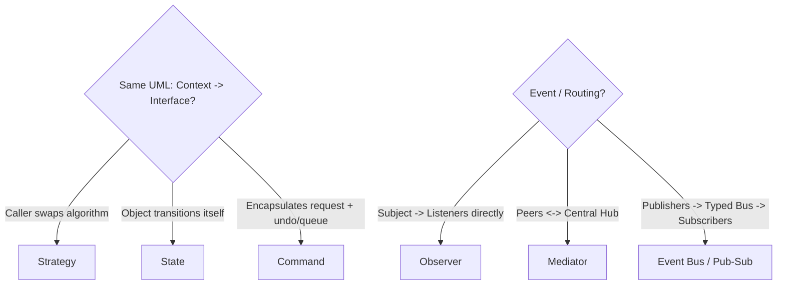

# Behavioral Patterns Comparison & Decision Matrix

> **One-line summary:** A rapid side-by-side comparison of all Behavioral Patterns—disambiguating Strategy vs State vs Command, Observer vs Mediator vs Event Bus, and Visitor vs Pattern Matching.

| Attribute | Specification |
|---|---|
| **Level** | Quick Reference / Synthesis |
| **Prerequisites** | [Module 07 Overview](00-overview.md) |
| **Estimated Reading Time** | 15 minutes |
| **Status** | Complete |
| **Category** | Behavioral Patterns |

---

## 1. Master Comparison Matrix

| Pattern | Core Intent | Key Mechanism | Modern Language Shortcut |
|---|---|---|---|
| **Strategy** | Swap interchangeable algorithms | Composition (`Context` $\to$ `Strategy`) | Lambda / `Function` / `Callable` |
| **State** | Alter behavior & transitions across lifecycle states | Polymorphic `State` switching `context.setState` | `sealed` / Discriminated Unions |
| **Command** | Reify requests for Undo/Redo, Queues, Macros | `execute()` + `undo()` object | Pure DTO Command + Handler (CQRS) |
| **Observer** | One-to-many reactive subscription | `subscribe()` returning cleanup handle | `EventTarget`, RxJS, `CopyOnWriteArrayList` |
| **Template Method** | Fixed `final` algorithm skeleton + subclass hooks | Inheritance overriding step methods | Callback/lambda injection (`JdbcTemplate`) |
| **Chain of Responsibility** | Ordered pipeline with short-circuiting | `List<Middleware>` + `dispatch(i + 1)` | Express/FastAPI middleware |
| **Iterator** | Uniform lazy sequential traversal | `hasNext()` / `next()` cursor | `yield` / `function*` generators |
| **Mediator** | Replace $N^2$ peer mesh with central hub | Star topology `colleague -> mediator` | MediatR / Redux |
| **Memento** | Opaque state snapshots for rollback | Private record behind marker interface | Immutable structural sharing |
| **Visitor** | External operations over stable ASTs | Double dispatch `accept(visitor)` | Java 25 `sealed` `switch`, Python `match` |
| **Interpreter** | Sandboxed AST evaluator for tiny DSLs | Recursive `eval(ctx)` tree | ANTLR / Google CEL for >10 rules |
| **Specification** | Composable boolean predicates | `.and()`, `.or()`, `.not()` | `java.util.function.Predicate` |
| **Event Bus** | Decoupled in-process typed domain events | `Map<Class, List<Handler>>` | Spring `ApplicationEventPublisher` |
| **Blackboard** | Non-deterministic heuristic convergence | Shared workspace + Knowledge Sources | Iterative fixed-point loop |

---

## 2. Look-Alike Disambiguation

---

[← Previous: 14 - Blackboard & Pub-Sub Variants](file:///e:/Learning/engineering-notes/08-solid-design-patterns/07-behavioral-patterns/14-blackboard-and-publish-subscribe-variants.md) | [Module 07 Index](file:///e:/Learning/engineering-notes/08-solid-design-patterns/07-behavioral-patterns/README.md) | [Next: Module 08 - Concurrency Patterns →](file:///e:/Learning/engineering-notes/08-solid-design-patterns/08-concurrency-patterns/README.md)
