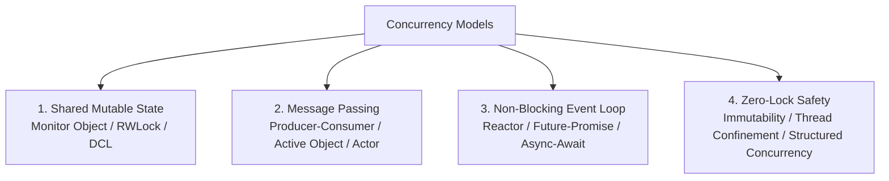

# Concurrency Design Patterns Overview

> **One-line summary:** Choose the safest concurrency model that fits your workload—eliminating shared mutable state via Immutability or Actors first, bounding queues and thread pools second, and enforcing Structured Concurrency lifetimes.

| Attribute | Specification |
|---|---|
| **Level** | Intermediate / Concurrency |
| **Prerequisites** | [07-immutability-and-value-objects.md](../01-foundations/07-immutability-and-value-objects.md), [07-object-pool.md](../05-creational-patterns/07-object-pool.md) |
| **Estimated Reading Time** | 15 minutes |
| **Status** | Complete |
| **Category** | Concurrency Patterns |

---

## 1. The Four Concurrency Paradigms

**Golden Rule:** *"Do not communicate by sharing memory; instead, share memory by communicating"* (and when you *do* share memory, prefer **Immutability** over locks!).

---

[← Module 08 Index](file:///e:/Learning/engineering-notes/08-solid-design-patterns/08-concurrency-patterns/README.md) | [Next: 01 - Thread Pool & Executor →](file:///e:/Learning/engineering-notes/08-solid-design-patterns/08-concurrency-patterns/01-thread-pool-and-executor.md)
