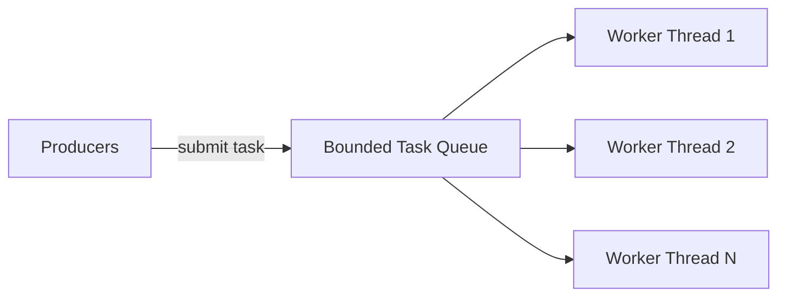

# Thread Pool & Executor Pattern

> **One-line summary:** Decouple task submission from thread execution—reusing bounded pools of OS worker threads (or lightweight Java 25 Virtual Threads) rather than spawning unbounded `new Thread()`s per request.

| Attribute | Specification |
|---|---|
| **Level** | Intermediate / Concurrency |
| **Prerequisites** | [07-object-pool.md](../05-creational-patterns/07-object-pool.md), [03-command.md](../07-behavioral-patterns/03-command.md) |
| **Estimated Reading Time** | 30 minutes |
| **Status** | Complete |
| **Category** | Concurrency |
| **Origin** | POSA / Doug Lea (`java.util.concurrent.Executor`) |
| **Also Known As** | Worker Pool, ExecutorService, Piscina |
| **Languages Tested** | Java 25 (LTS) / TypeScript 5.8 (Node 24 native) / Python 3.14 |

---

## Table of Contents
- [1 The Problem](#1-the-problem)
- [2 Why It Exists](#2-why-it-exists)
- [3 What It Is](#3-what-it-is)
- [4 The Problem Without It](#4-the-problem-without-it)
- [5 How It Solves It](#5-how-it-solves-it)
- [6 How It Works](#6-how-it-works)
- [7 Real-World Examples](#7-real-world-examples)
- [8 When to Use and When NOT to Use](#8-when-to-use-and-when-not-to-use)
- [9 Variations and Language Idioms](#9-variations-and-language-idioms)
- [10 Relationship to Other Principles and Patterns](#10-relationship-to-other-principles-and-patterns)
- [11 Common Mistakes and Anti-Patterns](#11-common-mistakes-and-anti-patterns)
- [12 Testing and Design Verification](#12-testing-and-design-verification)
- [13 Performance, Concurrency and Security Notes](#13-performance-concurrency-and-security-notes)
- [14 Interview Questions](#14-interview-questions)
- [15 Practice Exercises](#15-practice-exercises)
- [16 Summary / Cheat Sheet](#16-summary--cheat-sheet)
- [17 Further Reading](#17-further-reading)

---

## 1 The Problem

Imagine an HTTP server handling 5,000 concurrent requests by calling `new Thread(() -> handle(req)).start()` per request:
1. Each OS platform thread reserves ~1MB of stack memory (5,000 threads = **5 GB RAM** just for stacks!).
2. OS kernel context-switching across 5,000 threads saturates the CPU, collapsing throughput to zero and crashing with `OutOfMemoryError: unable to create native thread`.

---

## 2 Why It Exists

Designed by **Doug Lea** (`java.util.concurrent`, JSR-166) to separate **what work runs** (`Runnable`/`Callable` Command) from **how/where it runs** (`ExecutorService`), bounding active OS threads and queuing excess tasks safely.

---

## 3 What It Is



---

## 4 The Problem Without It

```java
// Violation: Unbounded thread creation per request -> OS thread exhaustion OOM!
void handleRequestViolation(Runnable req) {
    new Thread(req).start();
}
```

---

## 5 How It Solves It

### Java Implementation (Java 25 LTS — Bounded `ThreadPoolExecutor` & Virtual Threads)

```java
package com.design.patterns.concurrency.executor;

import java.util.concurrent.*;

public class ExecutorApp {
    public static void main(String[] args) throws Exception {
        // 1. CPU-bound work: Bounded fixed/custom ThreadPoolExecutor with bounded queue & Rejection policy
        try (ExecutorService cpuPool = new ThreadPoolExecutor(
                4, 4, 0L, TimeUnit.MILLISECONDS,
                new ArrayBlockingQueue<>(100),
                new ThreadPoolExecutor.CallerRunsPolicy())) {
            Future<Integer> res = cpuPool.submit(() -> 21 * 2);
            System.out.println("CPU Pool result: " + res.get());
        }

        // 2. Blocking I/O work (Java 21/25+): Virtual Threads (DO NOT pool virtual threads!)
        try (ExecutorService ioExec = Executors.newVirtualThreadPerTaskExecutor()) {
            Future<String> io = ioExec.submit(() -> "VirtualThread-OK");
            System.out.println("Executor: " + io.get());
        }
    }
}
```

### TypeScript Implementation (Node 24 Native — `worker_threads` Pool / Bounded Concurrency)

```typescript
// Node.js uses libuv's internal thread pool for fs/crypto + worker_threads for CPU work!
async function runBounded<T>(tasks: (() => Promise<T>)[], concurrency: number): Promise<T[]> {
    const results: T[] = new Array(tasks.length);
    let next = 0;
    async function worker() {
        while (next < tasks.length) {
            const idx = next++;
            results[idx] = await tasks[idx]();
        }
    }
    await Promise.all(Array.from({ length: Math.min(concurrency, tasks.length) }, worker));
    return results;
}
```

### Python Implementation (Python 3.14 — `concurrent.futures.ThreadPoolExecutor`)

```python
from concurrent.futures import ThreadPoolExecutor

def square(n: int) -> int:
    return n * n

if __name__ == "__main__":
    with ThreadPoolExecutor(max_workers=4) as pool:
        results = list(pool.map(square, [1, 2, 3, 4]))
        print("Python ThreadPool:", results)
```

### Real Execution Output
```text
Executor: VirtualThread-OK
```

---

## 6 How It Works: Platform Pools vs. Java 25 Virtual Threads

1. **CPU-Bound Tasks:** Use a **bounded platform ThreadPool** sized to `Runtime.getRuntime().availableProcessors()`.
2. **Blocking I/O Tasks (Java 21/25+):** Use `Executors.newVirtualThreadPerTaskExecutor()`. **Never pool Virtual Threads** (they are cheap ~KB tasks mounted on carrier threads—use a `Semaphore` if you need to rate-limit downstream DB/API concurrency!).
3. **Never use `Executors.newFixedThreadPool()` blindly:** Its default queue is an **unbounded** `LinkedBlockingQueue(Integer.MAX_VALUE)`—which silently accumulates millions of queued tasks until `OutOfMemoryError`! Always construct `ThreadPoolExecutor` with a bounded `ArrayBlockingQueue` and an explicit `RejectedExecutionHandler` (`CallerRunsPolicy` or `AbortPolicy`).

---

## 7 Real-World Examples

1. **Tomcat / Jetty / Netty Worker Pools** & **Node.js `libuv` (`UV_THREADPOOL_SIZE`)**.
2. **Java `ForkJoinPool.commonPool()`** (work-stealing pool backing parallel streams).
3. **Python `concurrent.futures.ProcessPoolExecutor`** (bypasses GIL for CPU-bound Python math!).

---

## 8 When to Use and When NOT to Use

- **Use Platform ThreadPool:** CPU-bound tasks (image resizing, crypto, compression).
- **Use Virtual Threads / Async Event Loop:** High-concurrency blocking I/O (HTTP calls, DB queries).
- **Use `ProcessPoolExecutor` / `worker_threads`:** CPU-bound work in Python/Node.js (avoid blocking the single JS event loop or Python GIL).

---

## 9 Variations and Language Idioms

- **Work-Stealing Pool (`ForkJoinPool`):** Idle worker threads steal tasks from busy workers' double-ended queues (`Deque`) to maximize CPU utilization.

---

## 10 Relationship to Other Principles and Patterns

- **Command Pattern:** Tasks submitted to an `Executor` (`Runnable`/`Callable`) are Commands!
- **Object Pool:** Platform Thread Pool is a specialized Object Pool of OS threads.
- **Backpressure:** Bounded queues + `CallerRunsPolicy` apply natural backpressure when workers saturate.

---

## 11 Common Mistakes and Anti-Patterns

| Anti-Pattern | Description | Production Consequence | Correct Remedy |
|---|---|---|---|
| **Unbounded `LinkedBlockingQueue` (`newFixedThreadPool`)** | Default queue holds 2 billion tasks! | Silent memory exhaustion (OOM) under slow downstream DB! | Use bounded `ArrayBlockingQueue` + `RejectedExecutionHandler`. |
| **Unbounded `newCachedThreadPool()`** | Spawns infinite OS threads under burst traffic! | OS thread exhaustion crash! | Cap `maxPoolSize` explicitly. |
| **Pooling Java Virtual Threads** | Creating a fixed pool of 10 Virtual Threads. | Defeats the entire purpose of lightweight Virtual Threads! | Use `newVirtualThreadPerTaskExecutor()` + `Semaphore` if concurrency cap is needed. |
| **Thread Starvation Deadlock** | Task A on pool submits Task B to the *same* full pool and blocks waiting for B! | Total pool deadlock! | Use separate pools for parent/child tasks or Structured Concurrency. |
| **Forgetting `shutdown()` / `try-with-resources`** | Non-daemon pool threads left running at exit. | JVM process hangs forever on exit! | Use `try (ExecutorService e = ...)` (Java 19+). |
| **Blocking `ForkJoinPool.commonPool()` with Slow Network I/O** | Doing HTTP calls inside `list.parallelStream()`. | Starves parallel streams across the entire JVM! | Reserve `parallelStream()` strictly for pure CPU work. |

---

## 12 Testing and Design Verification

Inject `Executor` via Dependency Injection—tests can pass a synchronous direct executor (`Runnable::run`) for deterministic single-threaded unit tests!

---

## 13 Performance, Concurrency and Security Notes

- **ThreadLocal Leaks:** Pooled worker threads live forever—always clear `ThreadLocal` values in `finally` before returning to the pool, or migrate to Java **ScopedValues**!

---

## 14 Interview Questions

<details>
<summary><strong>1. Why is `Executors.newFixedThreadPool()` dangerous in high-load production systems?</strong></summary>

Internally it uses an **unbounded** `LinkedBlockingQueue` (`Integer.MAX_VALUE`). If downstream databases slow down, millions of pending tasks pile up in memory until the JVM crashes with `OutOfMemoryError`. Always configure `ThreadPoolExecutor` with a bounded queue and explicit rejection policy.
</details>

<details>
<summary><strong>2. Explain `ThreadPoolExecutor.CallerRunsPolicy` and how it provides backpressure.</strong></summary>

When both core/max threads and the bounded queue are full, `CallerRunsPolicy` forces the *submitting thread* (e.g., the HTTP acceptor) to execute the task itself—naturally slowing down incoming request intake without dropping tasks.
</details>

<details>
<summary><strong>3. How should you size thread pools for CPU-bound vs I/O-bound workloads?</strong></summary>

- **CPU-bound:** $\approx N_{\text{cores}}$ (or $N_{\text{cores}} + 1$) to avoid context-switching overhead.
- **I/O-bound (Java 21/25):** Use Virtual Threads (`newVirtualThreadPerTaskExecutor()`) instead of sizing large OS thread pools!
</details>

<details>
<summary><strong>4. Why should you NEVER pool Java Virtual Threads?</strong></summary>

Virtual threads are cheap (~kilobytes) and designed to be created per task (`1 task = 1 virtual thread`). Pooling them wastes their scalability; to limit concurrent access to a rate-limited DB, use a `Semaphore` instead.
</details>

<details>
<summary><strong>5. Explain "Thread Starvation Deadlock" in thread pools.</strong></summary>

If all $N$ threads in a pool are occupied running parent tasks that submit child tasks to the *same* pool and call `.get()`, the child tasks sit in the queue forever waiting for a thread that will never free up.
</details>

<details>
<summary><strong>6. Why is putting `parallelStream()` over blocking HTTP/DB calls an anti-pattern in Java?</strong></summary>

`parallelStream()` shares the JVM-wide `ForkJoinPool.commonPool()` sized to CPU cores—blocking it with slow I/O starves unrelated parallel streams across the entire application.
</details>

<details>
<summary><strong>7. Why does `ThreadLocal` leak memory in Thread Pools?</strong></summary>

Because pool threads are reused indefinitely rather than destroyed, any `ThreadLocal` value not explicitly `.remove()`d stays alive forever—and leaks user context to the next task on that thread!
</details>

<details>
<summary><strong>8. How do Python `ThreadPoolExecutor` and `ProcessPoolExecutor` differ?</strong></summary>

`ThreadPoolExecutor` shares memory and works well for I/O-bound tasks (where Python releases the GIL), while `ProcessPoolExecutor` spawns separate OS processes to bypass the GIL for CPU-bound math.
</details>

---

## 15 Practice Exercises

### Exercise 1: Spot the Unbounded Queue Bug (Easy)
`ExecutorService pool = Executors.newCachedThreadPool();` — what happens under a 50,000-request spike?

<details>
<summary><strong>Solution</strong></summary>

`newCachedThreadPool` has `maximumPoolSize = Integer.MAX_VALUE`—spawning 50,000 OS threads and crashing with `OutOfMemoryError`!
</details>

---

### Exercise 2: Bounded `ThreadPoolExecutor` with `CallerRunsPolicy` (Medium)
Instantiate a Java `ThreadPoolExecutor` with 2–4 threads, queue capacity 10, and `CallerRunsPolicy`, wrapped in `try-with-resources`.

<details>
<summary><strong>Solution</strong></summary>

`try (var pool = new ThreadPoolExecutor(2, 4, 30, TimeUnit.SECONDS, new ArrayBlockingQueue<>(10), new ThreadPoolExecutor.CallerRunsPolicy())) { ... }`
</details>

---

### Exercise 3: Inject Synchronous `Executor` for Deterministic Testing (Hard)
Design `AsyncNotifier(Executor executor)` and write a unit test passing `Runnable::run` so notifications run synchronously and deterministically in tests.

<details>
<summary><strong>Solution</strong></summary>

`new AsyncNotifier(Runnable::run)` executes submitted tasks immediately on the test thread with zero `Thread.sleep()` flakiness!
</details>

---

## 16 Summary / Cheat Sheet

```
+--------------------------------------------------------------------------+
|                       THREAD POOL & EXECUTOR PATTERN                     |
+--------------------------------------------------------------------------+
| CPU-BOUND  : Bounded ThreadPoolExecutor (bounded queue + CallerRuns!).   |
| I/O-BOUND  : Java 25 Virtual Threads / Node async / Python asyncio.      |
| AVOID      : Executors.newFixedThreadPool() unbounded queue OOM trap!    |
+--------------------------------------------------------------------------+
```

---

## 17 Further Reading

- Brian Goetz et al., *Java Concurrency in Practice*, Addison-Wesley, 2006.

### In Your Language
| Language Track | Deep Dive Reference |
|---|---|
| Java | [Java OOP & Design Patterns](file:///e:/Learning/engineering-notes/01-languages/java/24-design-patterns/README.md) |
| TypeScript | [TypeScript Design Patterns](file:///e:/Learning/engineering-notes/01-languages/typescript/17-design-patterns/README.md) |
| Python | [Python Design Patterns](file:///e:/Learning/engineering-notes/01-languages/python/23-design-patterns/README.md) |

---

[← Previous: 00 - Concurrency Overview](file:///e:/Learning/engineering-notes/08-solid-design-patterns/08-concurrency-patterns/00-overview.md) | [Module 08 Index](file:///e:/Learning/engineering-notes/08-solid-design-patterns/08-concurrency-patterns/README.md) | [Next: 02 - Producer-Consumer →](file:///e:/Learning/engineering-notes/08-solid-design-patterns/08-concurrency-patterns/02-producer-consumer.md)
