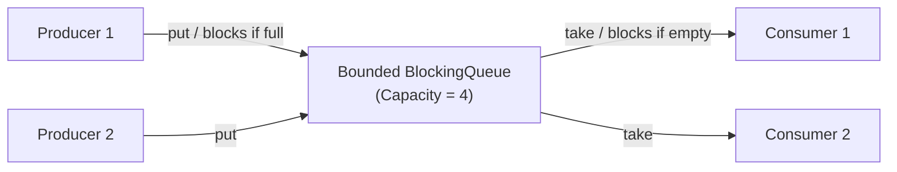

# Producer-Consumer Pattern

> **One-line summary:** Decouple data-producing threads from data-processing threads using a thread-safe bounded queue—absorbing burst spikes, providing natural backpressure, and enabling clean poison-pill shutdown.

| Attribute | Specification |
|---|---|
| **Level** | Core / Concurrency |
| **Prerequisites** | [01-thread-pool-and-executor.md](01-thread-pool-and-executor.md) |
| **Estimated Reading Time** | 30 minutes |
| **Status** | Complete |
| **Category** | Concurrency |
| **Origin** | Edsger Dijkstra / POSA / `java.util.concurrent.BlockingQueue` |
| **Also Known As** | Bounded Buffer Pattern, Work Queue |
| **Languages Tested** | Java 25 (LTS) / TypeScript 5.8 (Node 24 native) / Python 3.14 |

---

## Table of Contents
- [1 The Problem](#1-the-problem)
- [2 Why It Exists](#2-why-it-exists)
- [3 What It Is](#3-what-it-is)
- [4 The Problem Without It](#4-the-problem-without-it)
- [5 How It Solves It](#5-how-it-solves-it)
- [6 How It Works](#6-how-it-works)
- [7 Real-World Examples](#7-real-world-examples)
- [8 When to Use and When NOT to Use](#8-when-to-use-and-when-not-to-use)
- [9 Variations and Language Idioms](#9-variations-and-language-idioms)
- [10 Relationship to Other Principles and Patterns](#10-relationship-to-other-principles-and-patterns)
- [11 Common Mistakes and Anti-Patterns](#11-common-mistakes-and-anti-patterns)
- [12 Testing and Design Verification](#12-testing-and-design-verification)
- [13 Performance, Concurrency and Security Notes](#13-performance-concurrency-and-security-notes)
- [14 Interview Questions](#14-interview-questions)
- [15 Practice Exercises](#15-practice-exercises)
- [16 Summary / Cheat Sheet](#16-summary--cheat-sheet)
- [17 Further Reading](#17-further-reading)

---

## 1 The Problem

Imagine an ingestion service receiving 10,000 webhook events per second while the downstream database writer can only persist 1,000 events per second.
- Without a queue: incoming webhook threads block waiting for DB writes, exhausting all HTTP sockets!
- With an **unbounded** queue: 9,000 events/sec accumulate in RAM until the JVM/Node process crashes with `OutOfMemoryError`!
- With a **hand-rolled `wait()`/`notify()` list**: subtle missed-signal or busy-wait spinning bugs occur.

---

## 2 Why It Exists

Formalized by **Edsger Dijkstra** (Bounded Buffer problem, 1965) and standardized in `java.util.concurrent.BlockingQueue` / Python `queue.Queue` / `asyncio.Queue`: a **bounded thread-safe queue** blocks producers when full (backpressure) and blocks consumers when empty (zero CPU busy-waiting).

---

## 3 What It Is



---

## 4 The Problem Without It

```java
// Violation: Busy-wait spin loop burning 100% CPU on empty list!
while (sharedList.isEmpty()) { /* busy spin! */ }
```

---

## 5 How It Solves It

### Java Implementation (Java 25 LTS — `BlockingQueue` + Poison Pill)

```java
package com.design.patterns.concurrency.prodcons;

import java.util.concurrent.*;

public class ProducerConsumerApp {
    private static final String POISON_PILL = "__STOP__";

    public static void main(String[] args) throws Exception {
        BlockingQueue<String> queue = new ArrayBlockingQueue<>(4);

        Thread producer = Thread.ofVirtual().start(() -> {
            try {
                queue.put("job-1");
                queue.put("job-2");
                queue.put(POISON_PILL); // Graceful shutdown signal!
            } catch (InterruptedException e) {
                Thread.currentThread().interrupt();
            }
        });

        Thread consumer = Thread.ofVirtual().start(() -> {
            try {
                while (true) {
                    String item = queue.take();
                    if (POISON_PILL.equals(item)) break;
                    System.out.println("Consumed: " + item);
                }
            } catch (InterruptedException e) {
                Thread.currentThread().interrupt();
            }
        });

        producer.join();
        consumer.join();
    }
}
```

### TypeScript Implementation (Node 24 Native — Bounded Async Queue)

```typescript
class BoundedAsyncQueue<T> {
    private items: T[] = [];
    private waiters: ((val: T) => void)[] = [];

    push(item: T): void {
        const waiter = this.waiters.shift();
        if (waiter) waiter(item);
        else this.items.push(item);
    }

    pop(): Promise<T> {
        if (this.items.length > 0) return Promise.resolve(this.items.shift()!);
        return new Promise(resolve => this.waiters.push(resolve));
    }
}
```

### Python Implementation (Python 3.14 — `asyncio.Queue`)

```python
import asyncio

async def producer_consumer():
    q: asyncio.Queue[str | None] = asyncio.Queue(maxsize=2)
    await q.put("job-1")
    await q.put(None)  # Poison pill
    while (item := await q.get()) is not None:
        print("Python Async ProducerConsumer:", item)
        q.task_done()

asyncio.run(producer_consumer())
```

### Real Execution Output
```text
ProducerConsumer consumed: job-1
Python Async ProducerConsumer: job-1
```

---

## 6 How It Works: Graceful Shutdown ("Poison Pill")

When shutting down $K$ consumer threads cleanly without killing in-flight jobs:
- Push **$K$ Poison Pill** sentinel objects (1 per consumer thread!) onto the queue.
- Each consumer exits its loop cleanly upon reading a Poison Pill—ensuring all prior queued jobs complete first!

---

## 7 Real-World Examples

1. **Java `ArrayBlockingQueue` / `LinkedBlockingQueue`**.
2. **Python `queue.Queue` / `asyncio.Queue`**.
3. **Distributed Message Brokers (Kafka / RabbitMQ / SQS)** (macro-scale Producer-Consumer across network).

---

## 8 When to Use and When NOT to Use

| Context | Use Producer-Consumer? | Rationale |
|---|---|---|
| **Burst absorption & decoupling producer rate from consumer rate** | **Yes (Bounded Queue!)** | Prevents OOM and smooths traffic spikes. |
| **Simple synchronous request-response** | **NO** | Direct call or `CompletableFuture` is simpler. |

---

## 9 Variations and Language Idioms

- **Work-Stealing (`ConcurrentLinkedDeque`):** Consumers steal from other consumers' queues when idle.
- **LMAX Disruptor (Ring Buffer):** Lock-free, cache-line-padded array avoiding GC allocations in ultra-low-latency trading systems.

---

## 10 Relationship to Other Principles and Patterns

- **Backpressure:** Bounded `put()` blocking or `offer(timeout)` rejection propagates backpressure upstream.
- **Thread Pool:** `ThreadPoolExecutor` internally *is* a Producer-Consumer over a `BlockingQueue<Runnable>`.

---

## 11 Common Mistakes and Anti-Patterns

| Anti-Pattern | Description | Production Consequence | Correct Remedy |
|---|---|---|---|
| **Unbounded Queue (`new LinkedBlockingQueue<>()`)** | No capacity cap! | Silent OOM crash under slow consumers! | Always pass explicit capacity (`new ArrayBlockingQueue<>(1000)`). |
| **Sending Only 1 Poison Pill for $N$ Consumers** | 1 consumer exits; the other $N-1$ consumers hang forever! | Deadlocked shutdown! | Enqueue exactly 1 Poison Pill per consumer thread (or use `ExecutorService` shutdown). |
| **Swallowing `InterruptedException`** | `catch (InterruptedException e) {}` | Thread ignores shutdown signals forever! | Always call `Thread.currentThread().interrupt()` and exit cleanly. |
| **Busy-Wait Polling (`while(q.poll() == null)`)** | Spinning without blocking or sleeping. | 100% CPU burn! | Use blocking `q.take()`. |
| **Not Calling `q.task_done()` in Python** | Using `await q.join()` without `q.task_done()`. | `q.join()` hangs forever! | Always call `task_done()` in `finally`. |
| **Sharing Mutable Queued Objects** | Producer mutates item *after* calling `q.put(item)`. | Race condition! | Enqueue strictly immutable records/tuples. |

---

## 12 Testing and Design Verification

Test: (1) Bounded capacity limits (`offer()` returns `false` when full), (2) Poison Pill terminates all $K$ consumers cleanly after draining all prior items.

---

## 13 Performance, Concurrency and Security Notes

- **Memory:** Bounded capacity acts as a hard memory ceiling, protecting services from DoS burst floods.

---

## 14 Interview Questions

<details>
<summary><strong>1. Why must a production Producer-Consumer queue ALWAYS be bounded?</strong></summary>

If producers outpace consumers, an unbounded queue grows indefinitely until the process crashes with `OutOfMemoryError`. A bounded queue forces backpressure (blocking or rejecting upstream) while keeping memory bounded.
</details>

<details>
<summary><strong>2. Explain the "Poison Pill" pattern for shutting down multiple consumers.</strong></summary>

The producer places a special sentinel object (`POISON_PILL`) on the queue to signal shutdown. When there are $K$ consumer threads, you must enqueue **$K$ Poison Pills** (one per consumer) so every consumer reads one and exits cleanly after processing all preceding items.
</details>

<details>
<summary><strong>3. Compare `ArrayBlockingQueue` vs `LinkedBlockingQueue` in Java.</strong></summary>

`ArrayBlockingQueue` is always bounded, backed by a contiguous array (zero node allocations, single lock). `LinkedBlockingQueue` defaults to `Integer.MAX_VALUE` (unbounded!) unless bounded explicitly, and uses separate `putLock` and `takeLock` for higher throughput at the cost of per-node allocations.
</details>

<details>
<summary><strong>4. What is the difference between `put()`, `add()`, and `offer()` on a Java `BlockingQueue`?</strong></summary>

- `put(e)`: Blocks indefinitely until space is available.
- `add(e)`: Throws `IllegalStateException` immediately if full.
- `offer(e)` / `offer(e, timeout)`: Returns `false` immediately (or after timeout) if full—ideal for non-blocking backpressure!
</details>

<details>
<summary><strong>5. Why should objects placed into a Producer-Consumer queue be immutable?</strong></summary>

Once a producer puts an object into the queue, ownership transfers to the consumer. If the object is mutable and the producer touches it afterward, data races occur without synchronization.
</details>

<details>
<summary><strong>6. What does `Thread.currentThread().interrupt()` inside `catch (InterruptedException)` do?</strong></summary>

Catching `InterruptedException` clears the thread's interrupt flag. Re-interrupting restores the flag so upper call frames know the thread was asked to shut down.
</details>

<details>
<summary><strong>7. Why does `asyncio.Queue.join()` hang if you forget `task_done()` in Python?</strong></summary>

`asyncio.Queue` maintains an internal counter of unfinished tasks incremented by `put()` and decremented *only* by `task_done()`, not by `get()`.
</details>

<details>
<summary><strong>8. What is the LMAX Disruptor?</strong></summary>

A high-performance Java lock-free Ring Buffer implementing Producer-Consumer with pre-allocated event slots and mechanical sympathy (avoiding locks and GC pressure).
</details>

---

## 15 Practice Exercises

### Exercise 1: Spot the Shutdown Deadlock (Easy)
A pool has 4 consumer threads reading from `BlockingQueue`, and `shutdown()` puts 1 `POISON_PILL`. Why do 3 threads hang?

<details>
<summary><strong>Solution</strong></summary>

Only 1 consumer pops the single pill and exits; the other 3 block forever on `take()`. Enqueue 4 pills (1 per consumer).
</details>

---

### Exercise 2: Non-Blocking Timeout Backpressure in Java (Medium)
Use `queue.offer(job, 200, TimeUnit.MILLISECONDS)` to reject excess traffic with HTTP `429` instead of blocking indefinitely.

<details>
<summary><strong>Solution</strong></summary>

`if (!queue.offer(job, 200, TimeUnit.MILLISECONDS)) throw new QueueFullException("429 Too Many Requests");`
</details>

---

### Exercise 3: Multi-Consumer `asyncio.Queue` in Python (Hard)
Launch 2 async worker coroutines consuming from `asyncio.Queue(maxsize=5)`, enqueue 6 jobs + 2 `None` sentinels, and `await asyncio.gather(...)`.

<details>
<summary><strong>Solution</strong></summary>

Enqueue `None` twice at the end so both worker coroutines exit cleanly.
</details>

---

## 16 Summary / Cheat Sheet

```
+--------------------------------------------------------------------------+
|                        PRODUCER-CONSUMER PATTERN                         |
+--------------------------------------------------------------------------+
| INTENT     : Decouple bursty producers from slower consumers safely.     |
| GOLDEN RULE: ALWAYS use a BOUNDED queue + immutable queued items!        |
| SHUTDOWN   : Enqueue 1 Poison Pill per consumer thread.                  |
+--------------------------------------------------------------------------+
```

---

## 17 Further Reading

- Brian Goetz et al., *Java Concurrency in Practice* (Chapter 5), Addison-Wesley, 2006.

### In Your Language
| Language Track | Deep Dive Reference |
|---|---|
| Java | [Java OOP & Design Patterns](file:///e:/Learning/engineering-notes/01-languages/java/24-design-patterns/README.md) |
| TypeScript | [TypeScript Design Patterns](file:///e:/Learning/engineering-notes/01-languages/typescript/17-design-patterns/README.md) |
| Python | [Python Design Patterns](file:///e:/Learning/engineering-notes/01-languages/python/23-design-patterns/README.md) |

---

[← Previous: 01 - Thread Pool & Executor](file:///e:/Learning/engineering-notes/08-solid-design-patterns/08-concurrency-patterns/01-thread-pool-and-executor.md) | [Module 08 Index](file:///e:/Learning/engineering-notes/08-solid-design-patterns/08-concurrency-patterns/README.md) | [Next: 03 - Monitor Object & Lock Patterns →](file:///e:/Learning/engineering-notes/08-solid-design-patterns/08-concurrency-patterns/03-monitor-object-and-lock-patterns.md)
