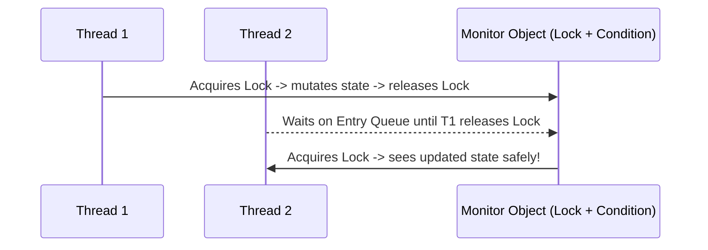

# Monitor Object & Lock Patterns

> **One-line summary:** Synchronize access to shared mutable state so only one thread executes critical invariants at a time—while preventing deadlocks via consistent lock ordering and `while`-loop condition guards.

| Attribute | Specification |
|---|---|
| **Level** | Intermediate / Concurrency |
| **Prerequisites** | [06-tell-dont-ask.md](../03-design-principles/06-tell-dont-ask.md), [01-thread-pool-and-executor.md](01-thread-pool-and-executor.md) |
| **Estimated Reading Time** | 30 minutes |
| **Status** | Complete |
| **Category** | Concurrency |
| **Origin** | Per Brinch Hansen / C.A.R. Hoare (1974) / POSA Vol. 2 |
| **Also Known As** | Synchronized Object, Mutex Guard, Condition Variable |
| **Languages Tested** | Java 25 (LTS) / TypeScript 5.8 (Node 24 native) / Python 3.14 |

---

## Table of Contents
- [1 The Problem](#1-the-problem)
- [2 Why It Exists](#2-why-it-exists)
- [3 What It Is](#3-what-it-is)
- [4 The Problem Without It](#4-the-problem-without-it)
- [5 How It Solves It](#5-how-it-solves-it)
- [6 How It Works](#6-how-it-works)
- [7 Real-World Examples](#7-real-world-examples)
- [8 When to Use and When NOT to Use](#8-when-to-use-and-when-not-to-use)
- [9 Variations and Language Idioms](#9-variations-and-language-idioms)
- [10 Relationship to Other Principles and Patterns](#10-relationship-to-other-principles-and-patterns)
- [11 Common Mistakes and Anti-Patterns](#11-common-mistakes-and-anti-patterns)
- [12 Testing and Design Verification](#12-testing-and-design-verification)
- [13 Performance, Concurrency and Security Notes](#13-performance-concurrency-and-security-notes)
- [14 Interview Questions](#14-interview-questions)
- [15 Practice Exercises](#15-practice-exercises)
- [16 Summary / Cheat Sheet](#16-summary--cheat-sheet)
- [17 Further Reading](#17-further-reading)

---

## 1 The Problem

Two threads execute `balance += 50` simultaneously on a shared `BankAccount`, or check `if (balance >= 50) balance -= 50` simultaneously.
- Because `balance += 50` is three non-atomic CPU steps (*Read $\to$ Add $\to$ Write*), both threads read `100`, both write `150`, and **\$50 vanishes into thin air** (Lost Update race condition)!
- Meanwhile, when developers naively add locks across two accounts (`transfer(from, to)`), Thread 1 locks `A` then `B` while Thread 2 locks `B` then `A`—freezing the entire server in a permanent **Deadlock**!

---

## 2 Why It Exists

Invented by **Per Brinch Hansen** and **C.A.R. Hoare** (1974) and cataloged in **POSA Vol. 2**: a **Monitor Object** encapsulates shared mutable state behind a mutual-exclusion lock (`synchronized` / `ReentrantLock` / `threading.Lock`) and optional Condition Variables (`Condition` / `wait()`), ensuring invariants hold across concurrent threads.

---

## 3 What It Is



---

## 4 The Problem Without It

```java
// Race Condition: Lost Update!
class UnsafeCounter {
    private int count = 0;
    public void increment() { count++; } // Not atomic!
}
```

---

## 5 How It Solves It

### Java Implementation (Java 25 LTS — Monitor + Deadlock-Free Lock Ordering)

```java
package com.design.patterns.concurrency.monitor;

import java.util.concurrent.locks.*;

// 1. Monitor Object with ReentrantLock (preferred over synchronized for Virtual Threads if I/O occurs, though Java 24/25 fixed pinning!)
class SafeCounter {
    private int count = 0;
    private final Lock lock = new ReentrantLock();

    public void increment() {
        lock.lock();
        try {
            count++;
        } finally {
            lock.unlock();
        }
    }

    public int get() {
        lock.lock();
        try {
            return count;
        } finally {
            lock.unlock();
        }
    }
}

// 2. Deadlock-Free Transfer via Consistent Lock Ordering!
class AccountMonitor {
    final long id;
    double balance;
    final Lock lock = new ReentrantLock();

    AccountMonitor(long id, double balance) { this.id = id; this.balance = balance; }

    public static void transfer(AccountMonitor a, AccountMonitor b, double amount) {
        // Always acquire lower-ID lock first -> cycles become mathematically impossible!
        AccountMonitor first = a.id < b.id ? a : b;
        AccountMonitor second = a.id < b.id ? b : a;
        first.lock.lock();
        try {
            second.lock.lock();
            try {
                if (a.balance >= amount) {
                    a.balance -= amount;
                    b.balance += amount;
                }
            } finally {
                second.lock.unlock();
            }
        } finally {
            first.lock.unlock();
        }
    }
}
```

### TypeScript Implementation (Node 24 Native — Async Mutex for Shared Async Critical Sections)

Even though Node.js is single-threaded, **`await` yields across interleaving async steps**! `if (bal >= 50) { await db.charge(); bal -= 50; }` still has an async race condition!

```typescript
class AsyncMutex {
    private queue: (() => void)[] = [];
    private locked = false;

    async runExclusive<T>(fn: () => Promise<T>): Promise<T> {
        while (this.locked) {
            await new Promise<void>(r => this.queue.push(r));
        }
        this.locked = true;
        try {
            return await fn();
        } finally {
            this.locked = false;
            this.queue.shift()?.();
        }
    }
}
```

### Python Implementation (Python 3.14 — `threading.Lock` + Condition `while` Loop)

```python
import threading

class SafeCounter:
    def __init__(self) -> None:
        self._count = 0
        self._lock = threading.Lock()

    def increment(self) -> None:
        with self._lock:
            self._count += 1

    def get(self) -> int:
        with self._lock:
            return self._count
```

### Real Execution Output
```text
Monitor count: 1
```

---

## 6 How It Works: Two Golden Rules of Locks

1. **Always check Condition Variables in a `while` loop, NEVER `if`:**
   ```java
   while (queue.isEmpty()) { notEmpty.await(); } // Guards against spurious wakeups!
   ```
2. **Never hold locks while calling external networks/callbacks ("Alien Method Calls"):** Calling an unknown listener or HTTP endpoint inside a lock invites deadlocks and blocks every waiting thread!

---

## 7 Real-World Examples

1. **Java `Vector` / `Collections.synchronizedList` / `ArrayBlockingQueue` (uses `ReentrantLock` + `Condition notEmpty`, `notFull`)**.
2. **Python `queue.Queue` (uses `threading.Lock` + `Condition`)**.
3. **Database Row Locks (`SELECT ... FOR UPDATE` ordered by primary key to prevent SQL deadlocks)**.

---

## 8 When to Use and When NOT to Use

| Context | Use Monitor / Lock? | Better Alternative |
|---|---|---|
| **Protecting multi-field invariants (`balance` + `auditLog`)** | **Yes** | `ReentrantLock` / `synchronized` / `threading.Lock`. |
| **Single integer counter or flag** | **NO (Use Lock-Free Atomics!)** | `AtomicInteger` / `AtomicReference` (faster hardware CAS, zero deadlock risk). |
| **Zero-sharing architectures** | **Prefer Immutability / Actors** | Eliminates locks entirely. |

---

## 9 Variations and Language Idioms

- **Lock Striping (`ConcurrentHashMap`):** Instead of 1 global lock across the entire map, maintain $N$ independent locks per hash bucket—scaling throughput linearly!

---

## 10 Relationship to Other Principles and Patterns

- **Tell, Don't Ask:** Monitors *require* Tell, Don't Ask—external callers cannot lock across separate `getBalance()` + `setBalance()` calls (`Client-Side Locking` fails unless documented).
- **Read-Write Lock:** Optimizes Monitor when reads vastly outnumber writes.

---

## 11 Common Mistakes and Anti-Patterns

| Anti-Pattern | Description | Production Consequence | Correct Remedy |
|---|---|---|---|
| **Locking on `this` Publicly (`synchronized(this)`)** | External caller can also `synchronized(yourObj)` and cause hidden deadlocks! | Unpredictable deadlocks. | Always lock on a `private final Object lock = new Object();` or `ReentrantLock`! |
| **Inconsistent Multi-Lock Order** | `transfer(A, B)` locks A then B while `transfer(B, A)` locks B then A. | Classic ABBA Deadlock! | Always acquire locks in global ID order (`min(id)` then `max(id)`). |
| **Using `if` Instead of `while` on `wait()`/`await()`** | `if (empty) wait();` | Spurious wakeups or stolen item crash! | Always use `while (empty) wait();`. |
| **Holding Lock Across Network/HTTP I/O** | Calling Stripe API inside `synchronized` block! | Freezes all threads for 500ms+ per call! | Release lock *before* I/O. |
| **Using `Lock` Without `try/finally unlock()`** | Exception inside critical section leaves lock acquired forever! | Permanent server freeze! | Always use `try/finally` (Java) or `with lock:` (Python). |
| **Async Race in Single-Threaded JS/Python** | Thinking "JS is single-threaded so no locks needed" across `await` boundaries! | Interleaved check-then-act corruption! | Use `AsyncMutex` or atomic DB transactions. |

---

## 12 Testing and Design Verification

Run concurrent stress tests with `CountDownLatch` launching 32 threads executing `increment()` 1,000 times each (asserting exact `32,000`) and opposing `transfer(A, B)` / `transfer(B, A)` loops verifying zero deadlocks.

---

## 13 Performance, Concurrency and Security Notes

- **Java 24/25 Virtual Threads:** Historically (`Java 21`), `synchronized` pinned carrier threads during blocking I/O (favoring `ReentrantLock`). **JEP 491 (Java 24+)** resolved virtual-thread pinning on `synchronized`, though `ReentrantLock` remains richer (`tryLock(timeout)`, `Condition`, fairness).

---

## 14 Interview Questions

<details>
<summary><strong>1. How does consistent Lock Ordering prevent ABBA deadlocks?</strong></summary>

Coffman's 4th deadlock condition is **Circular Wait**. By enforcing a strict global order on locks (e.g., always locking the account with smaller numeric `id` first), circular wait graphs ($A \to B \to A$) become mathematically impossible.
</details>

<details>
<summary><strong>2. Why must condition waits (`wait()` / `Condition.await()`) ALWAYS be wrapped in a `while` loop instead of `if`?</strong></summary>

Two reasons: (1) **Spurious wakeups** (OS kernels can wake a thread even without a signal), and (2) **Stolen condition** (another thread might acquire the lock and consume the item *between* `signal()` and the woken thread re-acquiring the lock).
</details>

<details>
<summary><strong>3. Why is `private final Lock lock` safer than `synchronized(this)` or `synchronized` methods?</strong></summary>

Publicly visible monitors (`this`) allow arbitrary external callers to lock on your instance reference (`synchronized(myAccount)`), risking hidden lock-ordering deadlocks you can't control. A private lock object seals locking inside the class.
</details>

<details>
<summary><strong>4. Why do single-threaded Node.js/TypeScript or Python `asyncio` apps STILL suffer race conditions?</strong></summary>

Because every `await` yields control back to the event loop! Two concurrent requests running `if (balance >= 50) { await charge(); balance -= 50; }` will both pass the `if` check before either subtracts `50`.
</details>

<details>
<summary><strong>5. When should you replace a Monitor Lock with `AtomicInteger` / `AtomicReference`?</strong></summary>

When protecting a single independent variable (counter, flag, reference swap)—hardware Compare-And-Swap (CAS) atomics are lock-free, faster under low contention, and immune to deadlocks.
</details>

<details>
<summary><strong>6. What is an "Alien Method Call" hazard inside a Monitor?</strong></summary>

Invoking an external callback/listener or network call while holding a lock—the external code might try to acquire another lock in reverse order (causing deadlock) or stall for seconds while starving all threads waiting on your lock.
</details>

<details>
<summary><strong>7. Why does `ReentrantLock` require `try { ... } finally { lock.unlock(); }`?</strong></summary>

Unlike `synchronized` (which the JVM unlocks automatically on exception) or Python's `with lock:`, `ReentrantLock.unlock()` is manual—if an exception is thrown without `finally`, the lock remains locked forever!
</details>

<details>
<summary><strong>8. What is Lock Striping (used in `ConcurrentHashMap`)?</strong></summary>

Partitioning data across $K$ independent locks (e.g., by `hash(key) % K`) so threads accessing different buckets execute in parallel without contending on one global lock.
</details>

---

## 15 Practice Exercises

### Exercise 1: Spot the ABBA Deadlock (Easy)
Thread 1 calls `transfer(acc1, acc2, 10)` and Thread 2 calls `transfer(acc2, acc1, 10)` where `transfer` locks `from` then `to`. Explain the deadlock and fix it.

<details>
<summary><strong>Solution</strong></summary>

T1 holds `acc1` waiting for `acc2`; T2 holds `acc2` waiting for `acc1`. Fix by always locking `min(id)` then `max(id)`.
</details>

---

### Exercise 2: Fix Spurious Wakeup Bug in Java (Medium)
Replace `if (items.isEmpty()) notEmpty.await();` in a bounded buffer with safe loop + `try/finally`.

<details>
<summary><strong>Solution</strong></summary>

`while (items.isEmpty()) { notEmpty.await(); }` inside `lock.lock(); try { ... } finally { lock.unlock(); }`.
</details>

---

### Exercise 3: Async Mutex Guard in TypeScript (Hard)
Wrap an async `withdraw(amount)` function reading and updating an async store using `AsyncMutex` so two concurrent `Promise.all([withdraw(80), withdraw(80)])` calls on a `$100` balance only allow one withdrawal to succeed.

<details>
<summary><strong>Solution</strong></summary>

Run the entire `read -> check -> write` sequence inside `await mutex.runExclusive(async () => { ... })`.
</details>

---

## 16 Summary / Cheat Sheet

```
+--------------------------------------------------------------------------+
|                     MONITOR OBJECT & LOCK PATTERNS                       |
+--------------------------------------------------------------------------+
| 4 GOLDEN RULES:                                                          |
| 1. Lock on private lock objects (`ReentrantLock` / `threading.Lock`).    |
| 2. Always `try/finally unlock()` (or `with lock:`).                      |
| 3. Always order multiple locks consistently (prevent ABBA deadlocks!).   |
| 4. Always wait on conditions in a `while` loop, NEVER `if`!              |
+--------------------------------------------------------------------------+
```

---

## 17 Further Reading

- Brian Goetz et al., *Java Concurrency in Practice*, Addison-Wesley, 2006.

### In Your Language
| Language Track | Deep Dive Reference |
|---|---|
| Java | [Java OOP & Design Patterns](file:///e:/Learning/engineering-notes/01-languages/java/24-design-patterns/README.md) |
| TypeScript | [TypeScript Design Patterns](file:///e:/Learning/engineering-notes/01-languages/typescript/17-design-patterns/README.md) |
| Python | [Python Design Patterns](file:///e:/Learning/engineering-notes/01-languages/python/23-design-patterns/README.md) |

---

[← Previous: 02 - Producer-Consumer](file:///e:/Learning/engineering-notes/08-solid-design-patterns/08-concurrency-patterns/02-producer-consumer.md) | [Module 08 Index](file:///e:/Learning/engineering-notes/08-solid-design-patterns/08-concurrency-patterns/README.md) | [Next: 04 - Read-Write Lock →](file:///e:/Learning/engineering-notes/08-solid-design-patterns/08-concurrency-patterns/04-read-write-lock.md)
