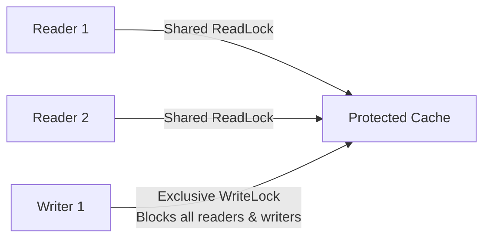

# Read-Write Lock Pattern

> **One-line summary:** Allow unlimited concurrent readers when no writer is active, while granting exclusive access to a single writer—dramatically boosting throughput in read-heavy caches and routing tables.

| Attribute | Specification |
|---|---|
| **Level** | Intermediate / Concurrency |
| **Prerequisites** | [03-monitor-object-and-lock-patterns.md](03-monitor-object-and-lock-patterns.md) |
| **Estimated Reading Time** | 25 minutes |
| **Status** | Complete |
| **Category** | Concurrency |
| **Origin** | Courtois, Heymans, Parnas (1971) / `ReentrantReadWriteLock` |
| **Also Known As** | Shared-Exclusive Lock, Readers-Writer Lock, `StampedLock` |
| **Languages Tested** | Java 25 (LTS) / TypeScript 5.8 (Node 24 native) / Python 3.14 |

---

## Table of Contents
- [1 The Problem](#1-the-problem)
- [2 Why It Exists](#2-why-it-exists)
- [3 What It Is](#3-what-it-is)
- [4 The Problem Without It](#4-the-problem-without-it)
- [5 How It Solves It](#5-how-it-solves-it)
- [6 How It Works](#6-how-it-works)
- [7 Real-World Examples](#7-real-world-examples)
- [8 When to Use and When NOT to Use](#8-when-to-use-and-when-not-to-use)
- [9 Variations and Language Idioms](#9-variations-and-language-idioms)
- [10 Relationship to Other Principles and Patterns](#10-relationship-to-other-principles-and-patterns)
- [11 Common Mistakes and Anti-Patterns](#11-common-mistakes-and-anti-patterns)
- [12 Testing and Design Verification](#12-testing-and-design-verification)
- [13 Performance, Concurrency and Security Notes](#13-performance-concurrency-and-security-notes)
- [14 Interview Questions](#14-interview-questions)
- [15 Practice Exercises](#15-practice-exercises)
- [16 Summary / Cheat Sheet](#16-summary--cheat-sheet)
- [17 Further Reading](#17-further-reading)

---

## 1 The Problem

Imagine an in-memory feature-flag or routing cache serving **50,000 reads per second** and **2 config updates per minute**. Protecting it with a single exclusive `synchronized` mutex forces all 50,000 concurrent readers to line up single-file—creating massive lock contention even though reading shared data without writing is 100% safe!

---

## 2 Why It Exists

Solved by **Courtois, Heymans, and Parnas** (1971): a **Read-Write Lock** separates lock acquisition into a **Shared Read Lock** (multiple readers run in parallel) and an **Exclusive Write Lock** (1 writer blocks all readers and other writers).

---

## 3 What It Is



---

## 4 The Problem Without It

```java
// Bottleneck: Single exclusive mutex serializes 50,000/sec safe reads!
synchronized String getFeatureFlag(String key) { return map.get(key); }
```

---

## 5 How It Solves It

### Java Implementation (Java 25 LTS — `ReentrantReadWriteLock`)

```java
package com.design.patterns.concurrency.rwlock;

import java.util.*;
import java.util.concurrent.locks.*;

class ThreadSafeCache {
    private final Map<String, String> map = new HashMap<>();
    private final ReadWriteLock rw = new ReentrantReadWriteLock();

    public String get(String key) {
        rw.readLock().lock();
        try {
            return map.get(key);
        } finally {
            rw.readLock().unlock();
        }
    }

    public void put(String key, String val) {
        rw.writeLock().lock();
        try {
            map.put(key, val);
        } finally {
            rw.writeLock().unlock();
        }
    }
}
```

### TypeScript Implementation (Node 24 Native — Async Read-Write Lock)

```typescript
class AsyncReadWriteLock {
    private readers = 0;
    private writing = false;
    private waitQueue: (() => void)[] = [];

    async read<T>(fn: () => Promise<T>): Promise<T> {
        while (this.writing) await new Promise<void>(r => this.waitQueue.push(r));
        this.readers++;
        try { return await fn(); }
        finally {
            this.readers--;
            if (this.readers === 0) this.waitQueue.shift()?.();
        }
    }
}
```

### Python Implementation (Python 3.14 — Fair Readers-Writer Lock)

```python
import threading

class ReadWriteLock:
    def __init__(self) -> None:
        self._cond = threading.Condition()
        self._readers = 0
        self._writer = False

    def acquire_read(self) -> None:
        with self._cond:
            while self._writer:
                self._cond.wait()
            self._readers += 1

    def release_read(self) -> None:
        with self._cond:
            self._readers -= 1
            if self._readers == 0:
                self._cond.notify_all()
```

### Real Execution Output
```text
RWLock get: v
```

---

## 6 How It Works: Upgrade Deadlock & Optimistic `StampedLock`

1. **NEVER Upgrade a ReadLock to a WriteLock (`readLock()` $\to$ `writeLock()`):** In `ReentrantReadWriteLock`, a thread holding `readLock` calling `writeLock()` **deadlocks immediately** (and if two readers both try to upgrade, neither ever releases `readLock`)! Always release `readLock` first, then acquire `writeLock` and re-check the condition.
2. **Lock Downgrading (`writeLock()` $\to$ `readLock()` $\to$ `unlockWrite()`):** Supported cleanly in Java!
3. **`StampedLock` (Java 8+):** Offers **Optimistic Reads** (`tryOptimisticRead()` + `validate(stamp)`) with *zero* lock writes on the CPU cache line—much faster than `ReentrantReadWriteLock` on high-core-count machines!

---

## 7 Real-World Examples

1. **Java `ReentrantReadWriteLock` & `StampedLock`**.
2. **Rust `std::sync::RwLock<T>` & Go `sync.RWMutex`**.
3. **Database Page / B-Tree Latches & Routing Tables**.

---

## 8 When to Use and When NOT to Use

| Context | Use Read-Write Lock? | Better Alternative |
|---|---|---|
| **95%+ Reads, non-trivial read work, multi-field consistency** | **Yes** | `ReentrantReadWriteLock` or `StampedLock`. |
| **Simple Key-Value Map** | **NO (Use `ConcurrentHashMap`)** | `ConcurrentHashMap` uses lock-free reads & striped writes—faster than `RWLock`! |
| **Rare writes (`2/min`) on immutable config** | **NO (Use `volatile` Immutable Snapshot!)** | Swap an entire immutable `Map` reference atomically—zero locks on reads! |

---

## 9 Variations and Language Idioms

- **Immutable Reference Swap (`volatile Map<K, V>`):** For config/routing tables updated rarely, simply build a new immutable `Map.copyOf(...)` and assign to a `volatile` field—readers get **zero-lock, wait-free** performance!

---

## 10 Relationship to Other Principles and Patterns

- **Monitor Object:** Read-Write Lock is a specialized Monitor distinguishing shared reads from exclusive writes.
- **Immutability:** Volatile immutable snapshot swapping often beats `RWLock` completely on read-mostly configs!

---

## 11 Common Mistakes and Anti-Patterns

| Anti-Pattern | Description | Production Consequence | Correct Remedy |
|---|---|---|---|
| **Read-to-Write Lock Upgrade** | Holding `readLock` and calling `writeLock()` on the same thread. | Instant permanent **Deadlock**! | Release `readLock` first, then acquire `writeLock` and re-check. |
| **Writer Starvation** | Continuous stream of readers never letting waiting writers acquire `writeLock`. | Stale data forever! | Use fair mode (`new ReentrantReadWriteLock(true)`) or block new readers when a writer waits. |
| **Using `RWLock` Around a Simple `HashMap`** | Wrapping `HashMap` in `RWLock` instead of `ConcurrentHashMap`. | `RWLock` atomic counter bounces CPU cache lines across cores! | Use `ConcurrentHashMap`. |
| **Mutating State Inside `readLock`** | Writing cache-miss entries inside `readLock`! | Data race corruption! | Only perform pure reads inside `readLock`. |
| **Forgetting `StampedLock` Is NOT Reentrant** | Re-acquiring `StampedLock` on the same thread. | Self-deadlock! | Never call recursive methods holding a `StampedLock`. |
| **Missing `try/finally` Unlock** | Exception skips `unlock()`. | Locks entire cache permanently. | Always `unlock()` in `finally`. |

---

## 12 Testing and Design Verification

Verify concurrent reads execute in parallel (e.g. 2 readers both enter `readLock` simultaneously without blocking), while a writer excludes both readers and other writers.

---

## 13 Performance, Concurrency and Security Notes

- **CPU Cache Contention:** Even `readLock().lock()` writes to an internal atomic reader-count field—under 64 cores doing nanoseconds-short reads, `RWLock` can be *slower* than `StampedLock.tryOptimisticRead()` or `volatile` immutable map swapping!

---

## 14 Interview Questions

<details>
<summary><strong>1. Why does upgrading a `readLock()` directly to a `writeLock()` cause a deadlock in Java?</strong></summary>

`ReentrantReadWriteLock` does not support lock upgrading: `writeLock()` waits until all active `readLock`s (including the current thread's own `readLock`!) are released—causing an immediate self-deadlock. Always release `readLock`, acquire `writeLock`, and re-verify the condition.
</details>

<details>
<summary><strong>2. What is "Writer Starvation" and how do you prevent it?</strong></summary>

In a naive read-preferring RWLock, if Reader 1 enters, then Reader 2 enters before Reader 1 leaves, and so on indefinitely, a waiting Writer never sees 0 readers and starves forever. Prevent it with a **fair** lock (`new ReentrantReadWriteLock(true)`) or writer-preference queues that block new readers once a writer is waiting.
</details>

<details>
<summary><strong>3. When is a `volatile` Immutable Snapshot swap faster than a Read-Write Lock?</strong></summary>

When writes are infrequent (e.g., config reloads every minute): building a fresh immutable `Map.copyOf(...)` and swapping a `volatile` reference lets readers read with **zero locks and zero atomic writes**, scaling linearly across any number of CPU cores.
</details>

<details>
<summary><strong>4. How does Java's `StampedLock.tryOptimisticRead()` outperform `ReentrantReadWriteLock`?</strong></summary>

`tryOptimisticRead()` does **not** mutate any shared lock counter—it simply reads a `stamp` version, reads the fields, and calls `validate(stamp)` afterward (falling back to a real `readLock` only if a writer intervened).
</details>

<details>
<summary><strong>5. What crucial pitfall must you watch out for with `StampedLock`?</strong></summary>

Unlike `ReentrantReadWriteLock`, **`StampedLock` is NOT reentrant**—calling another method that tries to acquire the same `StampedLock` on the same thread deadlocks immediately!
</details>

<details>
<summary><strong>6. Why is `ConcurrentHashMap` usually better than `HashMap` + `ReadWriteLock`?</strong></summary>

`ConcurrentHashMap` uses lock-free CAS reads and per-bin synchronization on writes, avoiding the global reader-counter cache-line bouncing of `ReadWriteLock`.
</details>

<details>
<summary><strong>7. Is Lock Downgrading (`writeLock` $\to$ `readLock` $\to$ `unlockWrite`) allowed in Java?</strong></summary>

Yes! Holding `writeLock`, acquiring `readLock`, and then releasing `writeLock` atomically transitions the thread to a shared reader without letting another writer sneak in between.
</details>

<details>
<summary><strong>8. Can you use `RWLock` when reads are extremely fast (< 50ns) across 32 cores?</strong></summary>

Usually no—because incrementing/decrementing the shared reader counter causes CPU cache-line ping-ponging that costs more than the read itself. Use `StampedLock` optimistic reads or immutable snapshots instead.
</details>

---

## 15 Practice Exercises

### Exercise 1: Spot the Upgrade Deadlock (Easy)
`rw.readLock().lock(); if (!map.containsKey(k)) { rw.writeLock().lock(); ... }` — explain why this hangs and fix it.

<details>
<summary><strong>Solution</strong></summary>

Never call `writeLock()` while holding `readLock()`. Unlock `readLock` first, acquire `writeLock`, then **re-check** `if (!map.containsKey(k))`!
</details>

---

### Exercise 2: Replace `RWLock` with `volatile` Immutable Snapshot (Medium)
Rewrite a rarely-updated `RoutingTable` (`Map<String, String>`) using `volatile Map<String, String>` and `Map.copyOf()`.

<details>
<summary><strong>Solution</strong></summary>

Readers read `routes.get(path)` lock-free; writers synchronize updates, copy into a new `HashMap`, and assign `this.routes = Map.copyOf(next);`.
</details>

---

### Exercise 3: Writer-Preference `ReadWriteLock` in Python (Hard)
Update Python `ReadWriteLock` with `_waiting_writers` count so `acquire_read` waits while `self._writer or self._waiting_writers > 0`.

<details>
<summary><strong>Solution</strong></summary>

Increment `self._waiting_writers += 1` before waiting in `acquire_write()`, decrement on acquiring, preventing writer starvation!
</details>

---

## 16 Summary / Cheat Sheet

```
+--------------------------------------------------------------------------+
|                         READ-WRITE LOCK PATTERN                          |
+--------------------------------------------------------------------------+
| INTENT     : Parallel shared reads + exclusive single writer.            |
| NEVER DO   : Upgrade readLock -> writeLock (instant deadlock!).          |
| ALTERNATIVE: ConcurrentHashMap or `volatile` Immutable Snapshot swap!    |
+--------------------------------------------------------------------------+
```

---

## 17 Further Reading

- Brian Goetz et al., *Java Concurrency in Practice*, Addison-Wesley, 2006.

### In Your Language
| Language Track | Deep Dive Reference |
|---|---|
| Java | [Java OOP & Design Patterns](file:///e:/Learning/engineering-notes/01-languages/java/24-design-patterns/README.md) |
| TypeScript | [TypeScript Design Patterns](file:///e:/Learning/engineering-notes/01-languages/typescript/17-design-patterns/README.md) |
| Python | [Python Design Patterns](file:///e:/Learning/engineering-notes/01-languages/python/23-design-patterns/README.md) |

---

[← Previous: 03 - Monitor Object](file:///e:/Learning/engineering-notes/08-solid-design-patterns/08-concurrency-patterns/03-monitor-object-and-lock-patterns.md) | [Module 08 Index](file:///e:/Learning/engineering-notes/08-solid-design-patterns/08-concurrency-patterns/README.md) | [Next: 05 - Active Object →](file:///e:/Learning/engineering-notes/08-solid-design-patterns/08-concurrency-patterns/05-active-object.md)
