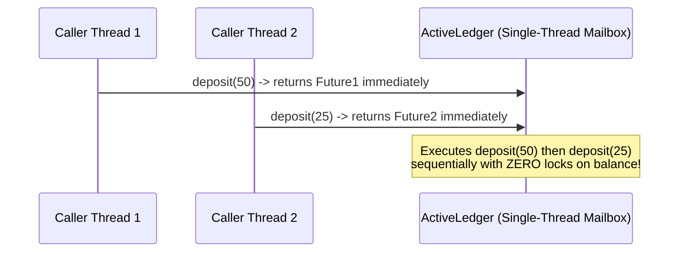

# Active Object Pattern

> **One-line summary:** Decouple method invocation from method execution by giving an object its own private single-threaded execution queue (mailbox) and returning a `Future`—achieving lock-free thread safety for callers.

| Attribute | Specification |
|---|---|
| **Level** | Intermediate / POSA Concurrency |
| **Prerequisites** | [01-thread-pool-and-executor.md](01-thread-pool-and-executor.md), [06-future-and-promise.md](06-future-and-promise.md) |
| **Estimated Reading Time** | 25 minutes |
| **Status** | Complete |
| **Category** | Concurrency |
| **Origin** | Lavender & Schmidt (POSA Vol. 2, 1995) |
| **Also Known As** | Asynchronous Method Invocation Object, Single-Writer Mailbox |
| **Languages Tested** | Java 25 (LTS) / TypeScript 5.8 (Node 24 native) / Python 3.14 |

---

## Table of Contents
- [1 The Problem](#1-the-problem)
- [2 Why It Exists](#2-why-it-exists)
- [3 What It Is](#3-what-it-is)
- [4 The Problem Without It](#4-the-problem-without-it)
- [5 How It Solves It](#5-how-it-solves-it)
- [6 How It Works](#6-how-it-works)
- [7 Real-World Examples](#7-real-world-examples)
- [8 When to Use and When NOT to Use](#8-when-to-use-and-when-not-to-use)
- [9 Variations and Language Idioms](#9-variations-and-language-idioms)
- [10 Relationship to Other Principles and Patterns](#10-relationship-to-other-principles-and-patterns)
- [11 Common Mistakes and Anti-Patterns](#11-common-mistakes-and-anti-patterns)
- [12 Testing and Design Verification](#12-testing-and-design-verification)
- [13 Performance, Concurrency and Security Notes](#13-performance-concurrency-and-security-notes)
- [14 Interview Questions](#14-interview-questions)
- [15 Practice Exercises](#15-practice-exercises)
- [16 Summary / Cheat Sheet](#16-summary--cheat-sheet)
- [17 Further Reading](#17-further-reading)

---

## 1 The Problem

Imagine a stateful `AccountLedger` or `GameWorldEngine` accessed concurrently by 32 worker threads. Protecting every method with locks (`synchronized` / `ReentrantLock`) forces caller threads to block waiting on mutexes and risks ABBA deadlocks whenever two objects interact.

---

## 2 Why It Exists

Formulated by **Lavender & Schmidt** (1995, POSA Vol. 2): instead of sharing mutable state behind locks, an **Active Object** owns a private thread (or single-threaded sequential queue) and executes incoming method requests one-by-one asynchronously, returning a `Future`/`Promise` to callers immediately.

---

## 3 What It Is



---

## 4 The Problem Without It

Caller threads block on locks or risk ABBA deadlocks across multiple interacting stateful objects.

---

## 5 How It Solves It

### Java Implementation (Java 25 LTS — `CompletableFuture` + Single-Thread Executor)

```java
package com.design.patterns.concurrency.activeobject;

import java.util.concurrent.*;

public class ActiveLedger implements AutoCloseable {
    private double balance = 0; // Accessed ONLY by mailbox thread — zero locks needed!
    private final ExecutorService mailbox = Executors.newSingleThreadExecutor();

    public CompletableFuture<Double> deposit(double amount) {
        return CompletableFuture.supplyAsync(() -> {
            balance += amount;
            return balance;
        }, mailbox);
    }

    @Override
    public void close() {
        mailbox.shutdown();
    }
}
```

### TypeScript Implementation (Node 24 Native — Serialized Promise Queue)

```typescript
export class ActiveLedger {
    private balance = 0;
    private tail: Promise<unknown> = Promise.resolve();

    deposit(amount: number): Promise<number> {
        const next = this.tail.then(() => {
            this.balance += amount;
            return this.balance;
        });
        this.tail = next.catch(() => {}); // Prevent unhandled rejection from poisoning queue!
        return next;
    }
}
```

### Python Implementation (Python 3.14 — `asyncio.Queue` Active Loop)

```python
import asyncio

class ActiveLedger:
    def __init__(self) -> None:
        self._balance = 0.0
        self._q: asyncio.Queue[tuple[float, asyncio.Future]] = asyncio.Queue()

    async def start(self) -> None:
        while True:
            amt, fut = await self._q.get()
            self._balance += amt
            fut.set_result(self._balance)

    def deposit(self, amount: float) -> asyncio.Future:
        fut = asyncio.get_running_loop().create_future()
        self._q.put_nowait((amount, fut))
        return fut
```

### Real Execution Output
```text
ActiveObject final balance: $75.0
```

---

## 6 How It Works

Because `balance` is touched **only** by the Active Object's single mailbox thread (**Thread Confinement**), there is zero lock contention on `balance` and zero possibility of data races!

---

## 7 Real-World Examples

1. **Swift `actor` & Kotlin `Coroutine` Actors (`CompletableDeferred`)**.
2. **Android `Handler` / `Looper` & Swing `EventQueue.invokeLater`**.
3. **Database Single-Writer WAL Threads (SQLite WAL writer, Redis single-threaded command loop)**.

---

## 8 When to Use and When NOT to Use

| Context | Use Active Object? | Rationale |
|---|---|---|
| **Complex stateful entity accessed asynchronously by many threads** | **Yes** | Eliminates explicit locking and deadlocks. |
| **Simple synchronous counter / shared read-heavy cache** | **NO** | `AtomicInteger` or `ConcurrentHashMap` is much simpler and faster. |

---

## 9 Variations and Language Idioms

- **Active Object vs Actor:** An Active Object exposes a typed OOP method interface returning `Future`s; an **Actor** receives untyped/message payloads without necessarily returning Futures (fire-and-forget + supervision).

---

## 10 Relationship to Other Principles and Patterns

- **Command & Future:** Every queued method call inside the Active Object's mailbox is a Command paired with a Future result!
- **Thread Confinement:** Active Object achieves safety by confining its mutable state to one dedicated thread.

---

## 11 Common Mistakes and Anti-Patterns

| Anti-Pattern | Description | Production Consequence | Correct Remedy |
|---|---|---|---|
| **Unbounded Mailbox Queue** | Using `newSingleThreadExecutor()` under massive burst load. | OOM if producer rate exceeds Active Object processing! | Bound the queue (`ArrayBlockingQueue`) with backpressure. |
| **Poisoning Promise Chain (TS)** | Not catching errors on `this.tail` in JS Promise chaining! | One error breaks all future queued calls permanently! | `this.tail = next.catch(() => {});`. |
| **Forgetting Shutdown (`close()`)** | Single-thread executor never shut down. | JVM hangs on exit! | Implement `AutoCloseable` / graceful stop. |
| **Blocking on `future.get()` Inside Own Mailbox** | Active Object method calling `.get()` on another task submitted to *itself*! | Instant self-deadlock! | Never block the mailbox thread waiting on itself. |
| **Exposing Raw Mutable State** | Returning `List` reference from inside Active Object. | Caller mutates it outside the mailbox thread! | Return immutable copies (`List.copyOf`). |
| **Using Active Object for CPU-Bound Parallelism** | Putting 100 heavy parallel tasks into 1 single-threaded Active Object. | Serializes onto 1 CPU core! | Use a multi-thread `ExecutorService` for parallel CPU work. |

---

## 12 Testing and Design Verification

Submit 100 concurrent `deposit(1.0)` calls from multiple threads, wait for `CompletableFuture.allOf(...)`, and assert `balance == 100.0`.

---

## 13 Performance, Concurrency and Security Notes

- **Concurrency:** In TypeScript `ActiveLedger`, `this.tail = next.catch(() => {})` ensures one failing operation rejects only its own returned `Promise` while keeping the queue alive for subsequent callers.

---

## 14 Interview Questions

<details>
<summary><strong>1. What is the Active Object pattern and how does it avoid locks?</strong></summary>

Active Object gives an object its own private execution queue/thread (mailbox). Callers invoke methods asynchronously and immediately receive a `Future`, while the Active Object executes requests sequentially on its single thread (**Thread Confinement**), eliminating mutexes and deadlocks.
</details>

<details>
<summary><strong>2. Compare Active Object vs Monitor Object.</strong></summary>

A **Monitor Object** executes synchronously on the *caller's thread* protected by a lock. An **Active Object** decouples invocation from execution, running requests asynchronously on *its own* private thread and returning a `Future`.
</details>

<details>
<summary><strong>3. Compare Active Object vs the Actor Model.</strong></summary>

Active Object presents a strongly-typed OOP method interface returning `Future`s. Actors communicate purely via asynchronous message passing (`tell`/`ask`) and add hierarchical fault-tolerance supervision ("Let It Crash").
</details>

<details>
<summary><strong>4. Why does Swift's `actor` keyword essentially implement the Active Object pattern?</strong></summary>

Swift `actor`s confine mutable properties to an isolated serial executor, requiring callers to `await` method calls from outside—preventing data races at compile time.
</details>

<details>
<summary><strong>5. What happens if an Active Object method blocks waiting on a `Future` submitted to its own mailbox?</strong></summary>

Instant **self-deadlock**: the single mailbox thread blocks waiting for a queued task that cannot start until the current method finishes!
</details>

<details>
<summary><strong>6. Why must a Promise-chained Active Object in TypeScript attach `.catch(() => {})` to `this.tail`?</strong></summary>

If `next` rejects and `this.tail` equals `next`, every subsequent `.then()` chained onto `this.tail` would be skipped/rejected forever. Catching on `tail` isolates failures per caller.
</details>

<details>
<summary><strong>7. Why should values returned by an Active Object be immutable?</strong></summary>

Returning a mutable `List` reference lets the caller thread mutate data owned by the Active Object's thread outside the mailbox—reintroducing data races.
</details>

<details>
<summary><strong>8. Give a real-world GUI example of Active Object.</strong></summary>

Android's Main UI `Looper`/`Handler` and Java Swing's Event Dispatch Thread (`SwingUtilities.invokeLater`), where background threads enqueue UI updates onto a single dedicated UI thread.
</details>

---

## 15 Practice Exercises

### Exercise 1: Spot the Self-Deadlock (Easy)
Inside `ActiveLedger.transferToSelf()`, it calls `deposit(10).get()`. Why does it freeze forever?

<details>
<summary><strong>Solution</strong></summary>

The single mailbox thread is currently executing `transferToSelf()` and blocks on `.get()` waiting for `deposit(10)`—which is stuck behind it in the same mailbox!
</details>

---

### Exercise 2: Bounded Queue Active Object in Java (Medium)
Replace `Executors.newSingleThreadExecutor()` with a bounded `ThreadPoolExecutor(1, 1, ..., new ArrayBlockingQueue<>(50))` to prevent OOM.

<details>
<summary><strong>Solution</strong></summary>

Use `new ThreadPoolExecutor(1, 1, 0L, TimeUnit.MILLISECONDS, new ArrayBlockingQueue<>(50))`.
</details>

---

### Exercise 3: Shutdown-Safe Python `ActiveLedger` (Hard)
Add a `close()` method to Python `ActiveLedger` using a `None` sentinel in `self._q` so `start()` exits cleanly without `CancelledError` leaks.

<details>
<summary><strong>Solution</strong></summary>

Send `(None, fut)` sentinel and `break` in `start()` when `amt is None`.
</details>

---

## 16 Summary / Cheat Sheet

```
+--------------------------------------------------------------------------+
|                          ACTIVE OBJECT PATTERN                           |
+--------------------------------------------------------------------------+
| INTENT     : Decouple invocation from execution via private mailbox.     |
| BENEFIT    : Lock-free state via Thread Confinement + returns Future.    |
| GUARD      : Bound mailbox queue + never block mailbox waiting on itself!|
+--------------------------------------------------------------------------+
```

---

## 17 Further Reading

- Lavender & Schmidt, *Active Object* (POSA Vol. 2), Wiley, 2000.

### In Your Language
| Language Track | Deep Dive Reference |
|---|---|
| Java | [Java OOP & Design Patterns](file:///e:/Learning/engineering-notes/01-languages/java/24-design-patterns/README.md) |
| TypeScript | [TypeScript Design Patterns](file:///e:/Learning/engineering-notes/01-languages/typescript/17-design-patterns/README.md) |
| Python | [Python Design Patterns](file:///e:/Learning/engineering-notes/01-languages/python/23-design-patterns/README.md) |

---

[← Previous: 04 - Read-Write Lock](file:///e:/Learning/engineering-notes/08-solid-design-patterns/08-concurrency-patterns/04-read-write-lock.md) | [Module 08 Index](file:///e:/Learning/engineering-notes/08-solid-design-patterns/08-concurrency-patterns/README.md) | [Next: 06 - Future & Promise →](file:///e:/Learning/engineering-notes/08-solid-design-patterns/08-concurrency-patterns/06-future-and-promise.md)
