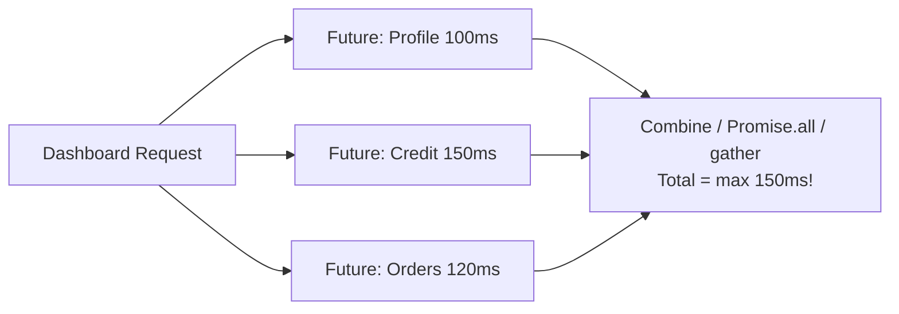

# Future & Promise Pattern

> **One-line summary:** Represent the eventual result of an asynchronous computation as a composable placeholder (`CompletableFuture`, `Promise`, `asyncio.Future`)—enabling parallel fan-out, non-blocking chaining, and clean timeout/error propagation.

| Attribute | Specification |
|---|---|
| **Level** | Core / Concurrency |
| **Prerequisites** | [01-thread-pool-and-executor.md](01-thread-pool-and-executor.md) |
| **Estimated Reading Time** | 30 minutes |
| **Status** | Complete |
| **Category** | Concurrency |
| **Origin** | Daniel Friedman & David Wise (1976) / Baker & Hewitt (1977) |
| **Also Known As** | `CompletableFuture`, `Promise`, Deferred, `Task<T>` |
| **Languages Tested** | Java 25 (LTS) / TypeScript 5.8 (Node 24 native) / Python 3.14 |

---

## Table of Contents
- [1 The Problem](#1-the-problem)
- [2 Why It Exists](#2-why-it-exists)
- [3 What It Is](#3-what-it-is)
- [4 The Problem Without It](#4-the-problem-without-it)
- [5 How It Solves It](#5-how-it-solves-it)
- [6 How It Works](#6-how-it-works)
- [7 Real-World Examples](#7-real-world-examples)
- [8 When to Use and When NOT to Use](#8-when-to-use-and-when-not-to-use)
- [9 Variations and Language Idioms](#9-variations-and-language-idioms)
- [10 Relationship to Other Principles and Patterns](#10-relationship-to-other-principles-and-patterns)
- [11 Common Mistakes and Anti-Patterns](#11-common-mistakes-and-anti-patterns)
- [12 Testing and Design Verification](#12-testing-and-design-verification)
- [13 Performance, Concurrency and Security Notes](#13-performance-concurrency-and-security-notes)
- [14 Interview Questions](#14-interview-questions)
- [15 Practice Exercises](#15-practice-exercises)
- [16 Summary / Cheat Sheet](#16-summary--cheat-sheet)
- [17 Further Reading](#17-further-reading)

---

## 1 The Problem

Imagine a dashboard endpoint that fetches a User's Profile (100ms), Credit Score (150ms), and Order History (120ms) from three independent microservices.
- Calling them **sequentially** takes $100 + 150 + 120 = 370\text{ms}$.
- Calling them with nested callbacks ("Callback Hell") makes error handling, timeouts, and combining all 3 results unreadable!

---

## 2 Why It Exists

Coined in the 1970s (Friedman/Wise, Baker/Hewitt):
- **Future:** The read-only handle a *consumer* uses to attach transformations (`.thenApply` / `.then`) or await completion.
- **Promise:** The writable handle a *producer* uses once to resolve a value or reject with an error.

---

## 3 What It Is



---

## 4 The Problem Without It

```typescript
// Callback Hell: Nested callbacks, fragmented error handling, impossible to compose!
getProfile(id, (err, profile) => {
    if (err) return fail(err);
    getScore(id, (err2, score) => { /* ... */ });
});
```

---

## 5 How It Solves It

### Java Implementation (Java 25 LTS — `CompletableFuture`)

```java
package com.design.patterns.concurrency.future;

import java.util.concurrent.*;

public class FutureApp {
    public static void main(String[] args) throws Exception {
        var userFuture = CompletableFuture.supplyAsync(() -> "Alice");
        var scoreFuture = CompletableFuture.supplyAsync(() -> 750);

        String combined = userFuture
                .thenCombine(scoreFuture, (u, s) -> u + ":" + s)
                .orTimeout(2, TimeUnit.SECONDS) // Always bound timeouts!
                .exceptionally(ex -> "Fallback:0")
                .get();

        System.out.println("CompletableFuture combined: " + combined);
    }
}
```

### TypeScript Implementation (Node 24 Native — `Promise.all` / `Promise.allSettled`)

```typescript
async function fetchProfile() {
    const [user, score] = await Promise.all([
        Promise.resolve("Alice"),
        Promise.resolve(750)
    ]);
    console.log("TS Promise.all:", user + ":" + score);
}
fetchProfile();
```

### Python Implementation (Python 3.14 — `asyncio.gather`)

```python
import asyncio

async def fetch_profile():
    user, score = await asyncio.gather(
        asyncio.sleep(0, result="Alice"),
        asyncio.sleep(0, result=750)
    )
    print(f"Python asyncio.gather: {user}:{score}")

asyncio.run(fetch_profile())
```

### Real Execution Output
```text
CompletableFuture combined: Alice:750
TS Promise.all: Alice:750
Python asyncio.gather: Alice:750
```

---

## 6 How It Works: `Promise.all` vs `Promise.allSettled`

- **`Promise.all` / `CompletableFuture.allOf`:** Fail-fast—if *one* task rejects, the combined future rejects immediately (note: in JS/Python `gather`, the *other* still-running tasks are NOT automatically cancelled unless you use **Structured Concurrency**!).
- **`Promise.allSettled` / `return_exceptions=True`:** Waits for *all* tasks to settle, returning per-task `{ status: "fulfilled" | "rejected" }` results—ideal for graceful degradation!

---

## 7 Real-World Examples

1. **Java `CompletableFuture<T>`** (supporting `.thenApply`, `.thenCompose` flatMap, `.orTimeout`, `.completeOnTimeout`).
2. **JavaScript/TypeScript `Promise<T>`** (`Promise.all`, `Promise.allSettled`, `Promise.race` with `AbortSignal`).
3. **Python `asyncio.Future` / `concurrent.futures.Future`**.

---

## 8 When to Use and When NOT to Use

- **Use `CompletableFuture` / `Promise`:** Parallel fan-out, non-blocking I/O composition, timeouts (`orTimeout`).
- **Prefer Java 25 Virtual Threads + `StructuredTaskScope`:** For multi-step business logic in Java, sequential code on Virtual Threads + `StructuredTaskScope` is vastly easier to read and debug than 10-stage `.thenCompose()` chains!

---

## 9 Variations and Language Idioms

- **`thenApply` vs `thenCompose` (Java):** `thenApply` is `map` (`T -> U`); `thenCompose` is `flatMap` (`T -> CompletableFuture<U>`), preventing `CompletableFuture<CompletableFuture<U>>` nesting!

---

## 10 Relationship to Other Principles and Patterns

- **Async/Await & Structured Concurrency:** Built directly atop Futures/Promises (`async/await` is syntactic sugar over Promise chaining; Structured Concurrency adds automatic child cancellation!).

---

## 11 Common Mistakes and Anti-Patterns

| Anti-Pattern | Description | Production Consequence | Correct Remedy |
|---|---|---|---|
| **Blocking `.get()` Inside `ForkJoinPool` Async Call** | Calling `future.get()` inside `supplyAsync` without custom executor. | Thread starvation deadlock! | Use `.thenCompose()` or Virtual Threads. |
| **Missing Timeouts on `CompletableFuture`** | Calling `.get()` without timeout. | Thread hangs forever on stalled network! | Always use `.orTimeout(...)` / `AbortSignal.timeout(...)`. |
| **Unhandled Promise Rejections** | Firing an async `Promise` without `await` or `.catch()`. | Process crash in Node.js (`unhandledRejection`)! | Always `await` or attach `.catch()`. |
| **Using `supplyAsync(fn)` Without Custom Executor for Blocking I/O** | Uses `ForkJoinPool.commonPool()` (CPU-sized!). | Starves JVM parallel streams! | Pass `Executors.newVirtualThreadPerTaskExecutor()` as 2nd arg! |
| **Sequential `await` Waterfall** | `const a = await f1(); const b = await f2();` when `f1` and `f2` are independent. | Doubles latency! | Use `Promise.all([f1(), f2()])`. |
| **Confusing `thenApply` with `thenCompose`** | Returning a `CompletableFuture` inside `thenApply`. | Awkward nested `CompletableFuture<CompletableFuture<T>>`. | Use `thenCompose`. |

---

## 12 Testing and Design Verification

Test both **happy parallel aggregation** and **partial failure / timeout fallback** (`completeOnTimeout` / `Promise.allSettled`).

---

## 13 Performance, Concurrency and Security Notes

Always pass a dedicated I/O executor (or Virtual Threads) to `CompletableFuture.supplyAsync(task, executor)` for blocking network/DB calls—never starve `ForkJoinPool.commonPool()`.

---

## 14 Interview Questions

<details>
<summary><strong>1. Distinguish a Future from a Promise.</strong></summary>

A **Future** is the read-only consumer handle used to observe completion, attach `.then` transformations, or retrieve the result. A **Promise** is the writable producer handle used once to fulfill (resolve) or fail (reject) that Future. (In JS, `Promise` combines both roles).
</details>

<details>
<summary><strong>2. In Java `CompletableFuture`, what is the difference between `thenApply` and `thenCompose`?</strong></summary>

`thenApply` transforms a synchronous value (`T -> U`, like `Stream.map`). `thenCompose` chains another asynchronous `CompletableFuture` (`T -> CompletableFuture<U>`, like `Stream.flatMap`), flattening nested futures.
</details>

<details>
<summary><strong>3. Compare `Promise.all` vs `Promise.allSettled` vs `Promise.race`.</strong></summary>

- `Promise.all`: Resolves when all succeed; rejects immediately if *any* rejects.
- `Promise.allSettled`: Waits for all to finish and returns an array of individual `{ status, value | reason }` outcomes.
- `Promise.race`: Settles as soon as the *first* promise resolves or rejects (often used for timeouts).
</details>

<details>
<summary><strong>4. Why is calling `CompletableFuture.supplyAsync(() -> blockingHttpCall())` without a second `Executor` argument dangerous?</strong></summary>

By default, `supplyAsync` runs on `ForkJoinPool.commonPool()`, which only has `CPU_CORES - 1` threads. Blocking them on network I/O starves the entire JVM's parallel streams and async tasks. Pass a Virtual Thread executor (`Executors.newVirtualThreadPerTaskExecutor()`).
</details>

<details>
<summary><strong>5. What happens to sibling Promises if one Promise rejects inside `Promise.all`?</strong></summary>

`Promise.all` rejects immediately for the caller, **but the remaining background Promises keep running to completion** unless explicitly cancelled via an `AbortController`/`AbortSignal` (which Structured Concurrency handles automatically).
</details>

<details>
<summary><strong>6. How do `.orTimeout()` and `.completeOnTimeout()` differ in Java?</strong></summary>

`.orTimeout()` completes the future exceptionally with `TimeoutException` if time expires; `.completeOnTimeout(fallback, ...)` completes normally with a safe default value (Graceful Degradation).
</details>

<details>
<summary><strong>7. When are Java 25 Virtual Threads cleaner than `CompletableFuture` chains?</strong></summary>

When business logic involves `try/catch`, loops, and conditional branches—writing straightforward imperative code on Virtual Threads (inside `StructuredTaskScope`) avoids complex `.thenCompose`/`.handle` nesting while keeping full stack traces!
</details>

<details>
<summary><strong>8. What is `asyncio.gather(..., return_exceptions=True)` in Python?</strong></summary>

Python's equivalent of `Promise.allSettled`—returning exception objects inside the result list instead of aborting on the first failure.
</details>

---

## 15 Practice Exercises

### Exercise 1: Fix `CompletableFuture` Executor Starvation (Easy)
`CompletableFuture.supplyAsync(() -> callSlowExternalApi())` — fix the pool starvation bug in Java 25.

<details>
<summary><strong>Solution</strong></summary>

Pass `Executors.newVirtualThreadPerTaskExecutor()` as the second argument to `supplyAsync`.
</details>

---

### Exercise 2: Graceful Timeout Fallback in TypeScript (Medium)
Use `Promise.race` (or `AbortSignal.timeout`) to return `"cached-profile"` if `fetchProfile()` takes longer than 300ms.

<details>
<summary><strong>Solution</strong></summary>

`Promise.race([fetchProfile(), new Promise<string>(r => setTimeout(() => r("cached-profile"), 300))])`.
</details>

---

### Exercise 3: Resilient Multi-Service Aggregator in Python (Hard)
Use `asyncio.gather(..., return_exceptions=True)` to fetch `[profile, recommendations]` where a failed `recommendations` call degrades gracefully to `[]` instead of failing the whole dashboard.

<details>
<summary><strong>Solution</strong></summary>

Check `if isinstance(recs, Exception): recs = []` after `await asyncio.gather(..., return_exceptions=True)`.
</details>

---

## 16 Summary / Cheat Sheet

```
+--------------------------------------------------------------------------+
|                         FUTURE & PROMISE PATTERN                         |
+--------------------------------------------------------------------------+
| INTENT     : Composable async placeholders for parallel fan-out & chains.|
| JAVA       : CompletableFuture + VirtualThread executor + .orTimeout().  |
| TS / PYTHON: Promise.all / allSettled | asyncio.gather(return_exceptions)|
+--------------------------------------------------------------------------+
```

---

## 17 Further Reading

- Doug Lea, *CompletableFuture Javadoc & JSR-166*.

### In Your Language
| Language Track | Deep Dive Reference |
|---|---|
| Java | [Java OOP & Design Patterns](file:///e:/Learning/engineering-notes/01-languages/java/24-design-patterns/README.md) |
| TypeScript | [TypeScript Design Patterns](file:///e:/Learning/engineering-notes/01-languages/typescript/17-design-patterns/README.md) |
| Python | [Python Design Patterns](file:///e:/Learning/engineering-notes/01-languages/python/23-design-patterns/README.md) |

---

[← Previous: 05 - Active Object](file:///e:/Learning/engineering-notes/08-solid-design-patterns/08-concurrency-patterns/05-active-object.md) | [Module 08 Index](file:///e:/Learning/engineering-notes/08-solid-design-patterns/08-concurrency-patterns/README.md) | [Next: 07 - Reactor & Proactor →](file:///e:/Learning/engineering-notes/08-solid-design-patterns/08-concurrency-patterns/07-reactor-and-proactor.md)
