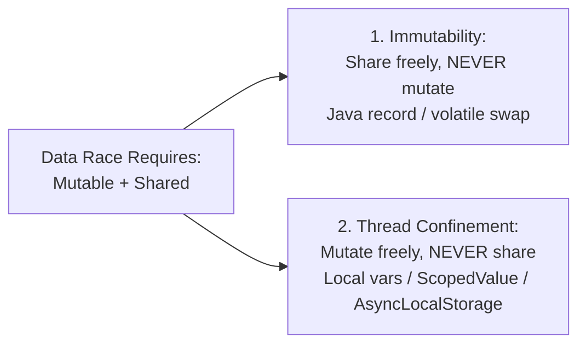

# Immutability & Thread Confinement

> **One-line summary:** The fastest, safest synchronization is *no synchronization at all*—either make shared objects deeply immutable (`record` / `frozen=True`) or confine mutable state strictly to a single owning thread (`Stack Confinement`, `ScopedValue` / `ThreadLocal`).

| Attribute | Specification |
|---|---|
| **Level** | Core / Concurrency |
| **Prerequisites** | [07-immutability-and-value-objects.md](../01-foundations/07-immutability-and-value-objects.md), [03-monitor-object-and-lock-patterns.md](03-monitor-object-and-lock-patterns.md) |
| **Estimated Reading Time** | 25 minutes |
| **Status** | Complete |
| **Category** | Concurrency |
| **Origin** | Brian Goetz (*Java Concurrency in Practice* Ch. 3) / JEP 487 (`ScopedValue`) |
| **Also Known As** | Share-Nothing Concurrency, Stack Confinement, `ScopedValue` |
| **Languages Tested** | Java 25 (LTS) / TypeScript 5.8 (Node 24 native) / Python 3.14 |

---

## Table of Contents
- [1 The Problem](#1-the-problem)
- [2 Why It Exists](#2-why-it-exists)
- [3 What It Is](#3-what-it-is)
- [4 The Problem Without It](#4-the-problem-without-it)
- [5 How It Solves It](#5-how-it-solves-it)
- [6 How It Works](#6-how-it-works)
- [7 Real-World Examples](#7-real-world-examples)
- [8 When to Use and When NOT to Use](#8-when-to-use-and-when-not-to-use)
- [9 Variations and Language Idioms](#9-variations-and-language-idioms)
- [10 Relationship to Other Principles and Patterns](#10-relationship-to-other-principles-and-patterns)
- [11 Common Mistakes and Anti-Patterns](#11-common-mistakes-and-anti-patterns)
- [12 Testing and Design Verification](#12-testing-and-design-verification)
- [13 Performance, Concurrency and Security Notes](#13-performance-concurrency-and-security-notes)
- [14 Interview Questions](#14-interview-questions)
- [15 Practice Exercises](#15-practice-exercises)
- [16 Summary / Cheat Sheet](#16-summary--cheat-sheet)
- [17 Further Reading](#17-further-reading)

---

## 1 The Problem

A team builds a multi-threaded request processor sharing a `UserSession` or `SimpleDateFormat` instance across threads. Adding `synchronized` everywhere introduces lock contention and ABBA deadlocks; forgetting a single `synchronized` causes silent data corruption (`SimpleDateFormat` famously scrambles dates under concurrency!).

---

## 2 Why It Exists

In *Java Concurrency in Practice*, **Brian Goetz** highlights that data races *only* happen when **mutable state is shared across threads**. Eliminate *either* mutability (**Immutability**) *or* sharing (**Thread Confinement**), and race conditions become **mathematically impossible**—with zero lock overhead!

---

## 3 What It Is



---

## 4 The Problem Without It

```java
// Classic Bug: Sharing non-thread-safe SimpleDateFormat across threads!
// Fix: Use immutable java.time.format.DateTimeFormatter instead!
```

---

## 5 How It Solves It

### Java Implementation (Java 25 LTS — Immutable `record` + `ScopedValue`)

```java
package com.design.patterns.concurrency.confinement;

import java.time.format.DateTimeFormatter;
import java.util.List;

// 1. Deeply Immutable Value Object: Safe across unlimited threads with zero locks!
record PricingSnapshot(String tier, List<String> rules) {
    public PricingSnapshot {
        rules = List.copyOf(rules);
    }
}

// 2. Stack Confinement: Local variables inside a method NEVER escape the thread stack!
class TaxCalculator {
    // DateTimeFormatter is immutable & thread-safe (unlike legacy SimpleDateFormat!)
    public static final DateTimeFormatter ISO = DateTimeFormatter.ISO_LOCAL_DATE;

    public double sumLocal(List<Double> prices) {
        double localTotal = 0.0; // Confined strictly to current thread's stack!
        for (double p : prices) localTotal += p;
        return localTotal;
    }
}
```

### TypeScript Implementation (Node 24 Native — `AsyncLocalStorage` Context Confinement)

```typescript
import { AsyncLocalStorage } from "node:async_hooks";

// Confines requestId cleanly per async request chain without global leaks!
const requestContext = new AsyncLocalStorage<{ requestId: string }>();

function logWithContext(msg: string) {
    const store = requestContext.getStore();
    console.log(`[req=${store?.requestId ?? "none"}] ${msg}`);
}

requestContext.run({ requestId: "REQ-42" }, () => {
    logWithContext("TS Thread/Async Confinement");
});
```

### Python Implementation (Python 3.14 — `contextvars.ContextVar` & `frozen=True`)

```python
from contextvars import ContextVar
from dataclasses import dataclass

request_id_var: ContextVar[str] = ContextVar("request_id", default="none")

@dataclass(frozen=True)
class ImmutableConfig:
    max_retries: int
    regions: tuple[str, ...]  # tuple instead of mutable list!
```

---

## 6 How It Works: `ThreadLocal` Leaks vs. Java 25 `ScopedValue`

- **Legacy `ThreadLocal` Hazards:** In thread pools, forgetting `threadLocal.remove()` leaks memory permanently and bleeds User A's auth context to User B! With millions of Virtual Threads, `ThreadLocal` also wastes memory per virtual thread.
- **Java 25 `ScopedValue` (JEP 487 / 506):** Automatically binds an immutable value for the exact lexical lifetime of `ScopedValue.where(KEY, val).run(...)` and unbinds it automatically on exit—zero memory leaks and cheap inheritance into `StructuredTaskScope` child threads!

---

## 7 Real-World Examples

1. **Java `java.time.LocalDate` / `DateTimeFormatter` / `String` / `BigDecimal`**: Immutable thread-safe standard types.
2. **Node.js `AsyncLocalStorage`** & **Python `contextvars.ContextVar`**: Async-safe request-context confinement (OpenTelemetry trace IDs!).
3. **Go / Rust Ownership**: Rust enforces Thread Confinement (`!Send`/`!Sync`) at compile time!

---

## 8 When to Use and When NOT to Use

- **Always default to Immutability & Stack Confinement** first before reaching for locks!
- **Use `ScopedValue` / `AsyncLocalStorage` / `ContextVar`** strictly for cross-cutting metadata (trace IDs, locale)—never hide core domain parameters in implicit thread-locals.

---

## 9 Variations and Language Idioms

- **Copy-on-Write (`CopyOnWriteArrayList` / `volatile` snapshot swap):** Combine Immutability with `volatile` reference swapping for read-mostly shared state.

---

## 10 Relationship to Other Principles and Patterns

- **Immutability & Value Objects (Module 01):** Foundational building block.
- **Active Object & Actor Model:** Both confine mutable state to a single execution thread/actor.

---

## 11 Common Mistakes and Anti-Patterns

| Anti-Pattern | Description | Production Consequence | Correct Remedy |
|---|---|---|---|
| **`ThreadLocal` Without `.remove()` in Pool** | Storing user context in `ThreadLocal` without `finally { remove(); }`. | Memory leak + cross-user data leak! | Use `ScopedValue` or `try/finally remove()`. |
| **Escaping Reference from Stack Confinement** | Returning a mutable `List` created locally while keeping an internal copy. | Breaks confinement! | Return `List.copyOf(...)`. |
| **Sharing `SimpleDateFormat` / `Random` Across Threads** | Putting `static SimpleDateFormat` on a utility class. | Silent garbled dates! | Use immutable `DateTimeFormatter` / `ThreadLocalRandom`. |
| **Shallow Immutability (`final List`)** | Making outer object `final` while holding mutable inner collections. | Race condition! | Deep immutability (`List.copyOf`, `tuple`). |
| **Using `threading.local()` in Python `asyncio`** | `threading.local()` is per-OS-thread, NOT per-coroutine! | Coroutines overwrite each other's context! | Always use `contextvars.ContextVar` in `asyncio`! |
| **Hiding Business Arguments in `ThreadLocal`** | Passing `orderId` via `ThreadLocal` instead of method parameter. | Hidden coupling and hard testing. | Reserve context vars for tracing/logging metadata. |

---

## 12 Testing and Design Verification

Test `AsyncLocalStorage` / `ContextVar` isolation by running two concurrent tasks (`Promise.all` / `asyncio.gather`) with different `requestId`s and asserting zero cross-contamination.

---

## 13 Performance, Concurrency and Security Notes

- **Security:** `ThreadLocal` leaks across pooled threads are a well-known source of **cross-tenant authorization bypasses**—always prefer `ScopedValue` or explicit `finally { remove(); }`.

---

## 14 Interview Questions

<details>
<summary><strong>1. Why do Immutability and Thread Confinement eliminate data races without locks?</strong></summary>

A data race only occurs when two threads access the same memory location concurrently and at least one mutates it. **Immutability** removes mutation; **Thread Confinement** removes sharing. Both make data races impossible without any lock contention.
</details>

<details>
<summary><strong>2. What is "Stack Confinement"?</strong></summary>

Keeping local variables strictly inside a method's execution stack without letting references escape to shared fields or other threads—every thread gets its own private stack automatically.
</details>

<details>
<summary><strong>3. Why is `java.lang.ThreadLocal` dangerous in Thread Pools, and how does Java's `ScopedValue` fix it?</strong></summary>

Pooled threads are reused indefinitely, so forgetting `threadLocal.remove()` leaks memory and leaks one user's data to the next request. `ScopedValue` binds an immutable value strictly for a lexical block (`where(...).run(...)`) and cleans up automatically on exit.
</details>

<details>
<summary><strong>4. Why does `threading.local()` fail in Python `asyncio` (and what replaces it)?</strong></summary>

`asyncio` runs thousands of coroutines on **one OS thread**, so `threading.local()` is shared across all concurrent coroutines! Use `contextvars.ContextVar`, which is coroutine-aware.
</details>

<details>
<summary><strong>5. How does Node.js `AsyncLocalStorage` solve request context tracking without ThreadLocal?</strong></summary>

Node's `AsyncLocalStorage` automatically propagates an isolated store across `async/await` continuations and timers belonging to the same async execution chain.
</details>

<details>
<summary><strong>6. Why is `SimpleDateFormat` a classic Java concurrency bug, and what replaces it?</strong></summary>

`SimpleDateFormat` mutates an internal `Calendar` field during `format()`/`parse()`, corrupting dates under concurrent threads. Replace it with immutable, thread-safe `java.time.format.DateTimeFormatter`.
</details>

<details>
<summary><strong>7. What is "Safe Publication" of an immutable object in Java?</strong></summary>

An object whose fields are all `final` (and pointing only to deeply immutable data) is safely published by the Java Memory Model—any thread seeing its reference after constructor completion sees fully initialized `final` fields without extra locks.
</details>

<details>
<summary><strong>8. When should you NOT use `ScopedValue` / `AsyncLocalStorage`?</strong></summary>

Never use them as global shortcuts to avoid passing explicit domain parameters (`userId`, `cart`) into business functions—reserve them for cross-cutting observability (trace IDs, request IDs).
</details>

---

## 15 Practice Exercises

### Exercise 1: Spot the `SimpleDateFormat` Bug (Easy)
`private static final SimpleDateFormat FMT = new SimpleDateFormat("yyyy-MM-dd");` — fix this in Java 25.

<details>
<summary><strong>Solution</strong></summary>

`private static final DateTimeFormatter FMT = DateTimeFormatter.ISO_LOCAL_DATE;`
</details>

---

### Exercise 2: Make `PricingSnapshot` Deeply Immutable in Python (Medium)
Convert `@dataclass class PricingSnapshot: rules: list[str]` into a deeply immutable thread-safe class.

<details>
<summary><strong>Solution</strong></summary>

`@dataclass(frozen=True) class PricingSnapshot: rules: tuple[str, ...]`
</details>

---

### Exercise 3: Async Context Isolation Test in TypeScript (Hard)
Run two concurrent `requestContext.run({ requestId: "A" }, ...)` and `"B"` async tasks with `await setTimeout(10)` and verify each logs its own ID without interference.

<details>
<summary><strong>Solution</strong></summary>

`await Promise.all([requestContext.run({ requestId: "A" }, asyncWork), requestContext.run({ requestId: "B" }, asyncWork)])`.
</details>

---

## 16 Summary / Cheat Sheet

```
+--------------------------------------------------------------------------+
|                 IMMUTABILITY & THREAD CONFINEMENT                        |
+--------------------------------------------------------------------------+
| IMMUTABILITY : Deeply immutable objects (`record`, `frozen=True`) need 0 |
|                locks across any number of threads.                       |
| CONFINEMENT  : Java `ScopedValue` | Node `AsyncLocalStorage` | Py `ContextVar`|
| AVOID        : `ThreadLocal` without `.remove()`, `SimpleDateFormat`.    |
+--------------------------------------------------------------------------+
```

---

## 17 Further Reading

- Brian Goetz et al., *Java Concurrency in Practice* (Chapter 3: Sharing Objects), Addison-Wesley, 2006.

### In Your Language
| Language Track | Deep Dive Reference |
|---|---|
| Java | [Java OOP & Design Patterns](file:///e:/Learning/engineering-notes/01-languages/java/24-design-patterns/README.md) |
| TypeScript | [TypeScript Design Patterns](file:///e:/Learning/engineering-notes/01-languages/typescript/17-design-patterns/README.md) |
| Python | [Python Design Patterns](file:///e:/Learning/engineering-notes/01-languages/python/23-design-patterns/README.md) |

---

[← Previous: 07 - Reactor & Proactor](file:///e:/Learning/engineering-notes/08-solid-design-patterns/08-concurrency-patterns/07-reactor-and-proactor.md) | [Module 08 Index](file:///e:/Learning/engineering-notes/08-solid-design-patterns/08-concurrency-patterns/README.md) | [Next: 09 - Actor Model →](file:///e:/Learning/engineering-notes/08-solid-design-patterns/08-concurrency-patterns/09-actor-model.md)
