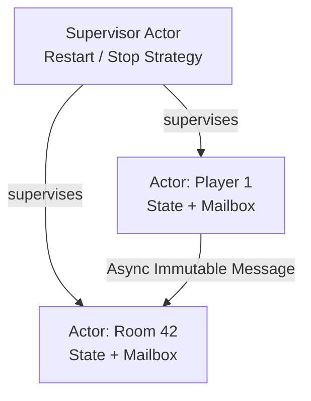

# Actor Model Pattern

> **One-line summary:** Isolate every unit of concurrent state inside an autonomous Actor that communicates exclusively via asynchronous immutable messages in a private mailbox—scaling seamlessly from multi-core CPUs to distributed clusters with "Let It Crash" supervision.

| Attribute | Specification |
|---|---|
| **Level** | Intermediate / Distributed & Concurrency |
| **Prerequisites** | [05-active-object.md](05-active-object.md), [08-immutability-and-thread-confinement.md](08-immutability-and-thread-confinement.md) |
| **Estimated Reading Time** | 30 minutes |
| **Status** | Complete |
| **Category** | Concurrency |
| **Origin** | Carl Hewitt, Peter Bishop, Richard Steiger (1973) / Erlang OTP / Akka |
| **Also Known As** | Message-Passing Concurrency, Supervision Trees |
| **Languages Tested** | Java 25 (LTS) / TypeScript 5.8 (Node 24 native) / Python 3.14 |

---

## Table of Contents
- [1 The Problem](#1-the-problem)
- [2 Why It Exists](#2-why-it-exists)
- [3 What It Is](#3-what-it-is)
- [4 The Problem Without It](#4-the-problem-without-it)
- [5 How It Solves It](#5-how-it-solves-it)
- [6 How It Works](#6-how-it-works)
- [7 Real-World Examples](#7-real-world-examples)
- [8 When to Use and When NOT to Use](#8-when-to-use-and-when-not-to-use)
- [9 Variations and Language Idioms](#9-variations-and-language-idioms)
- [10 Relationship to Other Principles and Patterns](#10-relationship-to-other-principles-and-patterns)
- [11 Common Mistakes and Anti-Patterns](#11-common-mistakes-and-anti-patterns)
- [12 Testing and Design Verification](#12-testing-and-design-verification)
- [13 Performance, Concurrency and Security Notes](#13-performance-concurrency-and-security-notes)
- [14 Interview Questions](#14-interview-questions)
- [15 Practice Exercises](#15-practice-exercises)
- [16 Summary / Cheat Sheet](#16-summary--cheat-sheet)
- [17 Further Reading](#17-further-reading)

---

## 1 The Problem

Imagine building a real-time multiplayer game server, IoT telemetry hub, or telecom switch managing **500,000 stateful entities** simultaneously.
- Protecting 500,000 entities with shared locks causes deadlocks and contention nightmares.
- Creating 500,000 dedicated OS threads crashes the machine.
- When one entity's state gets corrupted by an unexpected packet, shared-memory threads can crash the whole server!

---

## 2 Why It Exists

Formulated by **Carl Hewitt** (1973) and battle-tested in **Erlang/OTP** (achieving 99.9999999% availability in telecom switches) and **Akka / Pekko / Orleans**:
An **Actor** is a lightweight entity combining **Private State + Behavior + Mailbox**. Actors never share memory; they only exchange asynchronous immutable messages, and parent **Supervisors** restart crashed child actors cleanly ("Let It Crash").

---

## 3 What It Is



In response to a message, an Actor can do three things:
1. Send finite messages to other Actors it knows (`tell`).
2. Spawn new child Actors.
3. Change its own internal state/behavior for the *next* message.

---

## 4 The Problem Without It

Shared mutable state across 500k game sessions requires complex lock hierarchies and fails catastrophically on partial corruption.

---

## 5 How It Solves It

### Java Implementation (Java 25 LTS — Lightweight Virtual-Thread Actor Sketch)

```java
package com.design.patterns.concurrency.actor;

import java.util.concurrent.*;

sealed interface AccountMsg permits Deposit, GetBalance {}
record Deposit(double amount) implements AccountMsg {}
record GetBalance(CompletableFuture<Double> replyTo) implements AccountMsg {}

class AccountActor implements AutoCloseable {
    private double balance = 0.0; // Strictly private!
    private final BlockingQueue<AccountMsg> mailbox = new ArrayBlockingQueue<>(64);
    private volatile boolean running = true;
    private final Thread loop;

    public AccountActor() {
        this.loop = Thread.ofVirtual().start(() -> {
            while (running || !mailbox.isEmpty()) {
                try {
                    AccountMsg msg = mailbox.poll(50, TimeUnit.MILLISECONDS);
                    if (msg == null) continue;
                    switch (msg) {
                        case Deposit d -> balance += d.amount();
                        case GetBalance g -> g.replyTo().complete(balance);
                    }
                } catch (InterruptedException e) {
                    Thread.currentThread().interrupt();
                    break;
                }
            }
        });
    }

    public void tell(AccountMsg msg) { mailbox.offer(msg); }

    @Override
    public void close() throws InterruptedException {
        running = false;
        loop.join();
    }
}
```

### TypeScript Implementation (Node 24 Native)

```typescript
type Msg = { kind: "deposit"; amount: number } | { kind: "get"; resolve: (b: number) => void };

export class AccountActor {
    private balance = 0;
    private queue: Msg[] = [];
    private processing = false;

    tell(msg: Msg): void {
        this.queue.push(msg);
        if (!this.processing) this.drain();
    }

    private drain(): void {
        this.processing = true;
        queueMicrotask(() => {
            while (this.queue.length > 0) {
                const m = this.queue.shift()!;
                if (m.kind === "deposit") this.balance += m.amount;
                else m.resolve(this.balance);
            }
            this.processing = false;
        });
    }
}
```

### Python Implementation (Python 3.14 — `asyncio` Actor)

```python
import asyncio
from dataclasses import dataclass

@dataclass(frozen=True)
class Deposit:
    amount: float

class AccountActor:
    def __init__(self) -> None:
        self._balance = 0.0
        self._mailbox: asyncio.Queue = asyncio.Queue(maxsize=64)

    async def run(self) -> None:
        while True:
            msg = await self._mailbox.get()
            if msg is None:
                break
            if isinstance(msg, Deposit):
                self._balance += msg.amount

    async def tell(self, msg) -> None:
        await self._mailbox.put(msg)
```

---

## 6 How It Works: "Let It Crash" Supervision

In Erlang/Akka, Actors **do not** try to defensively catch and limp past corrupt internal state. Instead, if an unexpected error occurs, the child Actor crashes immediately, and its **Supervisor** applies a clean recovery strategy:
- **One-for-One:** Restart only the failed child Actor cleanly from a known initial state.
- **One-for-All:** Restart all sibling Actors together if their states are interdependent.

---

## 7 Real-World Examples

1. **Erlang / Elixir OTP** (WhatsApp, Discord real-time chat routing).
2. **Akka / Apache Pekko (JVM)** & **Microsoft Orleans** (Halo game backend, Virtual Actors).
3. **Web Workers / Cloudflare Durable Objects** (Single-threaded stateful edge actors!).

---

## 8 When to Use and When NOT to Use

| Context | Use Actor Model? | Rationale |
|---|---|---|
| **Millions of stateful independent entities (IoT, Chat, Games, Edge)** | **Yes** | Scales seamlessly with zero lock deadlocks. |
| **Simple synchronous CRUD with SQL transactions** | **NO (Overkill!)** | Request/Response + ACID SQL is vastly simpler. |

---

## 9 Variations and Language Idioms

- **Virtual Actors (Microsoft Orleans / Cloudflare Durable Objects):** Actors don't need explicit `spawn`/`stop`—they activate on demand by ID (`actorSystem.get("room-42")`) and passivate automatically when idle!

---

## 10 Relationship to Other Principles and Patterns

- **Active Object:** Single-object OOP precursor to Actors.
- **Immutability:** Messages sent between Actors *must* be immutable so ownership transfers safely.

---

## 11 Common Mistakes and Anti-Patterns

| Anti-Pattern | Description | Production Consequence | Correct Remedy |
|---|---|---|---|
| **Sending Mutable Messages Between Actors** | Passing a mutable `List` in `tell(msg)` and mutating it afterward. | Shared-memory data race returns! | Send strictly immutable records/tuples! |
| **Blocking Inside an Actor's Mailbox** | Performing synchronous 500ms HTTP/DB calls inside `receive()`. | Starves the actor's mailbox and shared dispatcher threads! | Run async I/O or offload blocking work to a separate pool. |
| **Overusing Synchronous `ask` Instead of `tell`** | Blocking on `ask()` everywhere across 5 actors. | Recreates synchronous RPC bottlenecks and deadlocks! | Prefer asynchronous `tell` message flow. |
| **Unbounded Actor Mailboxes** | Letting mailboxes grow infinitely under load. | OOM crash! | Bound mailbox size (`maxsize`) + drop/backpressure. |
| **Swallowing Exceptions Inside Actor** | Catching everything instead of letting Supervisor restart corrupt state. | Zombie actor with corrupted state! | Let it crash cleanly so Supervisor restarts it. |
| **Using Actors for Simple Stateless Services** | Wrapping stateless REST handlers in Akka Actors. | Unnecessary async complexity. | Use plain stateless services / Virtual Threads. |

---

## 12 Testing and Design Verification

Use a **TestProbe / Synchronous TestKit** verifying that sending `Deposit(50)` followed by `GetBalance` produces `50.0` and supervision restarts a crashed child cleanly.

---

## 13 Performance, Concurrency and Security Notes

- **Location Transparency:** Because Actors communicate purely by immutable async messages, an Actor can run locally in RAM or across the network on another cluster node without changing caller code (though network failure/timeouts still differ!).

---

## 14 Interview Questions

<details>
<summary><strong>1. Define an Actor and the 3 actions it can take upon receiving a message.</strong></summary>

An Actor is an isolated unit combining **Private State + Behavior + Mailbox** that processes one message at a time. On receiving a message, it can: (1) send async messages to other actors, (2) spawn child actors, and (3) update its internal state/behavior for the *next* message.
</details>

<details>
<summary><strong>2. Why MUST messages passed between Actors be immutable?</strong></summary>

Because Actors share no mutable memory by design; if two Actors hold a reference to the same mutable message object, concurrent modifications reintroduce data races.
</details>

<details>
<summary><strong>3. Explain the "Let It Crash" supervision philosophy.</strong></summary>

Instead of writing fragile defensive `try/catch` blocks inside an Actor that leave its state half-corrupted, let unexpected errors crash the Actor immediately—allowing its parent **Supervisor** to restart it cleanly from a known good initial state.
</details>

<details>
<summary><strong>4. Compare `tell` (fire-and-forget) vs `ask` (request-reply Future) in Actor systems.</strong></summary>

`tell` is purely asynchronous and non-blocking (maximizing throughput and preventing deadlocks). `ask` creates a temporary reply-target `Future`, which incurs overhead and can cause timeouts/deadlocks if overused symmetrically between two actors.
</details>

<details>
<summary><strong>5. What is a "Virtual Actor" (Microsoft Orleans / Cloudflare Durable Objects)?</strong></summary>

Virtual Actors always conceptually exist—you never manually `create()` or `destroy()` them. Calling an actor by ID automatically activates it in memory on a cluster node if needed and passivates it to storage when idle.
</details>

<details>
<summary><strong>6. Compare Actor Model vs CSP (Go Channels).</strong></summary>

Actors are *named entities* with private mailboxes (you send directly to an Actor address). CSP (Communicating Sequential Processes, e.g., Go goroutines + channels) uses *anonymous processes* communicating through *named channels* (usually synchronous/rendezvous by default).
</details>

<details>
<summary><strong>7. Why is blocking I/O inside an Actor dangerous?</strong></summary>

Actors typically share a small dispatcher thread pool; blocking an Actor on synchronous network I/O stalls both that Actor's mailbox and starves sibling Actors sharing the dispatcher.
</details>

<details>
<summary><strong>8. Give 2 massive production systems built on the Actor Model.</strong></summary>

**WhatsApp / Discord** (Erlang/Elixir OTP) and **Halo Multiplayer / PayPal / LinkedIn** (Microsoft Orleans / Akka).
</details>

---

## 15 Practice Exercises

### Exercise 1: Spot the Shared-State Violation (Easy)
`actorA.tell(new Msg(sharedMutableList)); sharedMutableList.add("x");` — why does this break the Actor Model?

<details>
<summary><strong>Solution</strong></summary>

`sharedMutableList` is shared mutable state across threads! Wrap in `List.copyOf(sharedMutableList)` inside `record Msg`.
</details>

---

### Exercise 2: Add `Withdraw` Message to `AccountActor` in Java (Medium)
Add `record Withdraw(double amount, CompletableFuture<Boolean> ok) implements AccountMsg {}` returning `false` if `balance < amount`.

<details>
<summary><strong>Solution</strong></summary>

`case Withdraw w -> { if (balance >= w.amount()) { balance -= w.amount(); w.ok().complete(true); } else w.ok().complete(false); }`
</details>

---

### Exercise 3: Supervised Restart Wrapper in Python (Hard)
Write a supervisor loop around `AccountActor.run()` that catches unexpected exceptions, resets `_balance = 0.0`, and restarts `run()` up to 3 times.

<details>
<summary><strong>Solution</strong></summary>

`for attempt in range(3): try: await actor.run(); break; except Exception: actor = AccountActor()`
</details>

---

## 16 Summary / Cheat Sheet

```
+--------------------------------------------------------------------------+
|                           ACTOR MODEL PATTERN                            |
+--------------------------------------------------------------------------+
| FORMULA    : Private State + Mailbox + Async Immutable Messages.         |
| RESILIENCE : "Let It Crash" Supervision Trees (One-for-One / One-for-All)|
| RULE       : Never share mutable objects & never block mailbox threads!  |
+--------------------------------------------------------------------------+
```

---

## 17 Further Reading

- Carl Hewitt, *A Universal Modular ACTOR Formalism for Artificial Intelligence*, IJCAI, 1973.
- Joe Armstrong, *Programming Erlang*, Pragmatic Bookshelf, 2013.

### In Your Language
| Language Track | Deep Dive Reference |
|---|---|
| Java | [Java OOP & Design Patterns](file:///e:/Learning/engineering-notes/01-languages/java/24-design-patterns/README.md) |
| TypeScript | [TypeScript Design Patterns](file:///e:/Learning/engineering-notes/01-languages/typescript/17-design-patterns/README.md) |
| Python | [Python Design Patterns](file:///e:/Learning/engineering-notes/01-languages/python/23-design-patterns/README.md) |

---

[← Previous: 08 - Immutability & Thread Confinement](file:///e:/Learning/engineering-notes/08-solid-design-patterns/08-concurrency-patterns/08-immutability-and-thread-confinement.md) | [Module 08 Index](file:///e:/Learning/engineering-notes/08-solid-design-patterns/08-concurrency-patterns/README.md) | [Next: 10 - Double-Checked Locking & Why It Fails →](file:///e:/Learning/engineering-notes/08-solid-design-patterns/08-concurrency-patterns/10-double-checked-locking-and-why-it-fails.md)
