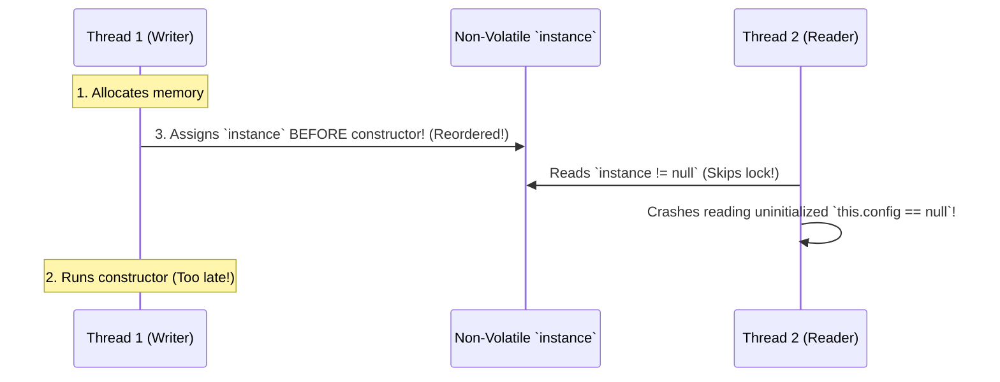

# Double-Checked Locking & Why It Fails

> **One-line summary:** Double-Checked Locking (DCL) without `volatile` (or C++11 memory barriers) is silently broken by CPU/JIT instruction reordering—prefer the Bill Pugh Holder idiom, `enum`, or `volatile` DCL with local caching.

| Attribute | Specification |
|---|---|
| **Level** | Advanced / Memory Models & Concurrency |
| **Prerequisites** | [01-singleton.md](../05-creational-patterns/01-singleton.md), [08-lazy-initialisation-and-holder.md](../05-creational-patterns/08-lazy-initialisation-and-holder.md) |
| **Estimated Reading Time** | 25 minutes |
| **Status** | Complete |
| **Category** | Concurrency |
| **Origin** | JSR-133 Java Memory Model / Brian Goetz |
| **Also Known As** | DCL Anti-Pattern, Partial Publication Bug |
| **Languages Tested** | Java 25 (LTS) / TypeScript 5.8 (Node 24 native) / Python 3.14 |

---

## Table of Contents
- [1 The Problem](#1-the-problem)
- [2 Why It Exists](#2-why-it-exists)
- [3 What It Is](#3-what-it-is)
- [4 The Problem Without It](#4-the-problem-without-it)
- [5 How It Solves It](#5-how-it-solves-it)
- [6 How It Works](#6-how-it-works)
- [7 Real-World Examples](#7-real-world-examples)
- [8 When to Use and When NOT to Use](#8-when-to-use-and-when-not-to-use)
- [9 Variations and Language Idioms](#9-variations-and-language-idioms)
- [10 Relationship to Other Principles and Patterns](#10-relationship-to-other-principles-and-patterns)
- [11 Common Mistakes and Anti-Patterns](#11-common-mistakes-and-anti-patterns)
- [12 Testing and Design Verification](#12-testing-and-design-verification)
- [13 Performance, Concurrency and Security Notes](#13-performance-concurrency-and-security-notes)
- [14 Interview Questions](#14-interview-questions)
- [15 Practice Exercises](#15-practice-exercises)
- [16 Summary / Cheat Sheet](#16-summary--cheat-sheet)
- [17 Further Reading](#17-further-reading)

---

## 1 The Problem

To avoid acquiring a `synchronized` lock on every `getInstance()` call, developers write:
```java
if (instance == null) {
    synchronized (Singleton.class) {
        if (instance == null) instance = new Singleton();
    }
}
return instance;
```
It passes every local unit test—then fails mysteriously once a month in production with `NullPointerException` inside a fully initialized object!

---

## 2 Why It Exists

Why does DCL without `volatile` fail? Because `instance = new Singleton()` is **three CPU operations**:
1. Allocate memory for `Singleton`.
2. Run constructor (`this.config = loadConfig()`).
3. Assign memory address to `instance`.

**The JIT compiler and CPU are legally allowed to reorder Steps 2 and 3!** If Step 3 runs before Step 2, Thread B reads `instance != null` at the outer `if` *outside* the lock, skips `synchronized`, and uses an object whose fields are still `null`!

---

## 3 What It Is



---

## 4 The Problem Without It

```java
// BROKEN: Missing `volatile` allows out-of-order partial publication!
class BrokenDcl {
    private static BrokenDcl instance; // BUG: Not volatile!
    private final String config;
    private BrokenDcl() { this.config = "loaded"; }
    public static BrokenDcl get() {
        if (instance == null) {
            synchronized (BrokenDcl.class) {
                if (instance == null) instance = new BrokenDcl();
            }
        }
        return instance;
    }
}
```

---

## 5 How It Solves It

### Java Implementation (Java 25 LTS — Fixed `volatile` DCL vs Preferred Holder)

```java
package com.design.patterns.concurrency.dcl;

// Option A: Preferred for static singletons (zero volatile/sync boilerplate!)
class HolderSingleton {
    private HolderSingleton() {}
    private static class Holder {
        static final HolderSingleton INSTANCE = new HolderSingleton();
    }
    public static HolderSingleton get() { return Holder.INSTANCE; }
}

// Option B: Valid JSR-133 DCL (for instance-level lazy fields)
class ValidDcl {
    private volatile String heavyField; // `volatile` establishes happens-before!

    public String getHeavyField() {
        String local = heavyField; // Single volatile read on fast path
        if (local == null) {
            synchronized (this) {
                local = heavyField;
                if (local == null) {
                    heavyField = local = "computed";
                }
            }
        }
        return local;
    }
}
```

### TypeScript / Python Notes

- **TypeScript (Node.js):** Single-threaded JS event loop has no shared-memory CPU reordering between JS threads; export module-level constants directly!
- **Python 3.14:** Use `threading.Lock` cleanly (especially with free-threaded Python PEP 703 builds where GIL is optional!)—prefer `with self._lock:` or module-level initialization.

---

## 6 How It Works: JSR-133 Happens-Before

Adding `volatile` in Java 5+ (JSR-133) inserts memory barriers preventing writes inside the constructor from reordering *after* the `volatile` write to `instance`—guaranteeing any thread reading `volatile` sees all initialized fields.

---

## 7 Real-World Examples

1. **Java `String.hashCode()`** (benign data race on `int hash`, safe only for primitives—never for object references!).
2. **Guava `Suppliers.memoize`** (uses `volatile boolean initialized` + `synchronized`).
3. **C++11 Magic Statics (`static Singleton instance;`)** (thread-safe by C++11 standard without manual DCL).

---

## 8 When to Use and When NOT to Use

- **Static lazy singleton:** Always use **Bill Pugh Holder** or **`enum`**, never DCL!
- **Instance lazy field:** Use `volatile` DCL with a local variable—only if profiling proves synchronization overhead matters.

---

## 9 Variations and Language Idioms

- **Immutable Fields:** Even with `final` fields, a non-volatile `instance` reference can still allow unsafe publication if the object isn't purely `final` or has complex constructors; always use `volatile` for DCL.

---

## 10 Relationship to Other Principles and Patterns

- **Singleton & Lazy Initialization:** DCL is an optimization for lazy initialization—superseded by `Holder` for static fields.

---

## 11 Common Mistakes and Anti-Patterns

| Anti-Pattern | Description | Production Consequence | Correct Remedy |
|---|---|---|---|
| **DCL Without `volatile`** | Omitting `volatile` on `instance`. | Rare, catastrophic NPE in prod! | Add `volatile` or use `Holder`! |
| **Using DCL for Static Singletons** | Writing 15 lines of DCL instead of 4-line Bill Pugh `Holder`. | Error-prone boilerplate. | Use `Holder` or `enum`. |
| **Reading `volatile` Twice on Fast Path** | `if (v == null) ... return v;` | Extra memory barrier read. | Cache in `local` variable. |
| **Assuming `final` Alone Fixes Broken DCL** | Mixing `final` and non-`final` fields without `volatile`. | Non-final fields still visible uninitialized! | Always use `volatile`. |
| **Using DCL in Single-Threaded JS** | Translating Java DCL into TypeScript. | Pointless ceremony. | Export module `const`. |
| **Trying to Test Memory Reordering with Unit Tests** | Assuming passing a 10-thread test proves non-volatile DCL is safe. | CPU reordering only triggers under specific JIT/ARM/x86 conditions! | Rely on JMM happens-before rules, not luck. |

---

## 12 Testing and Design Verification

Use static analysis (SpotBugs / SonarQube rule `S2168`: *"Double-checked locking should not be used without volatile"*) and JCStress for concurrency memory-model verification.

---

## 13 Performance, Concurrency and Security Notes

On ARM64 servers (AWS Graviton / Apple Silicon), weak memory ordering makes non-volatile DCL bugs trigger far more frequently than on x86!

---

## 14 Interview Questions

<details>
<summary><strong>1. Why does Double-Checked Locking fail in Java without `volatile`?</strong></summary>

`instance = new Singleton()` involves allocating memory, running the constructor, and assigning the reference. Without `volatile`, the JIT/CPU can reorder the assignment *before* the constructor finishes—causing another thread at the outer `if (instance == null)` check to see a non-null reference to a half-constructed object!
</details>

<details>
<summary><strong>2. How did JSR-133 (Java 5) fix Double-Checked Locking?</strong></summary>

JSR-133 strengthened `volatile` semantics with a **happens-before** guarantee: writes inside the constructor cannot be reordered past the `volatile` write to `instance`, ensuring full visibility to any reader.
</details>

<details>
<summary><strong>3. Why is the Bill Pugh Holder idiom preferred over `volatile` DCL for static singletons?</strong></summary>

The Holder idiom (`private static class Holder { static final T INSTANCE = new T(); }`) is shorter, impossible to get wrong, lazily loaded on first access, and synchronized automatically by the JVM classloader with zero runtime lock/volatile overhead.
</details>

<details>
<summary><strong>4. Why do ARM64 servers (like AWS Graviton) expose non-volatile DCL bugs more often than x86?</strong></summary>

x86 has a relatively strong memory model (TSO), whereas ARM64 has a weak memory model that aggressively reorders stores/loads unless explicit memory barriers (`volatile`) are emitted.
</details>

<details>
<summary><strong>5. Why does `ValidDcl` assign `String local = heavyField;` inside `getHeavyField()`?</strong></summary>

It avoids reading the `volatile` field twice on the already-initialized fast path (once for `if (local == null)` and once for `return`), improving throughput.
</details>

<details>
<summary><strong>6. Does TypeScript/Node.js need Double-Checked Locking?</strong></summary>

No—JavaScript executes on a single-threaded event loop without shared-memory CPU thread reordering. Use module-level exports or simple lazy checks.
</details>

<details>
<summary><strong>7. Why can't unit tests reliably catch a missing `volatile` in DCL?</strong></summary>

JIT optimization and hardware store-buffer reordering depend on runtime CPU architecture, load, and compiler tiers—a bug might never appear in local tests and only strike under production load on ARM64.
</details>

<details>
<summary><strong>8. What SonarQube/SpotBugs rule catches broken DCL automatically?</strong></summary>

Rule `S2168` (*"Double-checked locking should not be used"* / missing `volatile`).
</details>

---

## 15 Practice Exercises

### Exercise 1: Fix Broken DCL (Easy)
Given `private static Config cfg;` in DCL, fix it using (a) `volatile` and (b) Bill Pugh `Holder`.

<details>
<summary><strong>Solution</strong></summary>

(a) `private static volatile Config cfg;` (b) `private static class Holder { static final Config CFG = new Config(); }`.
</details>

---

### Exercise 2: Optimize Fast-Path Read (Medium)
Rewrite `if (cache == null) { synchronized(this) { ... } } return cache;` to perform only 1 `volatile` read on the hot path.

<details>
<summary><strong>Solution</strong></summary>

`T local = cache; if (local == null) { ... } return local;`
</details>

---

### Exercise 3: Thread-Safe Python Lazy Init (Hard)
Implement `LazyResource` in Python 3.14 using `threading.Lock` cleanly (safe even under free-threaded PEP 703 Python).

<details>
<summary><strong>Solution</strong></summary>

Check `if self._val is None: with self._lock: if self._val is None: self._val = self._build()`.
</details>

---

## 16 Summary / Cheat Sheet

```
+--------------------------------------------------------------------------+
|                 DOUBLE-CHECKED LOCKING & WHY IT FAILS                    |
+--------------------------------------------------------------------------+
| BUG        : Without `volatile`, JIT/CPU can publish half-built object!  |
| STATIC     : Prefer Bill Pugh `Holder` or `enum` (no DCL needed!).       |
| INSTANCE   : Use `volatile` + local variable read on fast path.          |
+--------------------------------------------------------------------------+
```

---

## 17 Further Reading

- Brian Goetz et al., *Java Concurrency in Practice* (Chapter 16: The Java Memory Model), Addison-Wesley, 2006.

### In Your Language
| Language Track | Deep Dive Reference |
|---|---|
| Java | [Java OOP & Design Patterns](file:///e:/Learning/engineering-notes/01-languages/java/24-design-patterns/README.md) |
| TypeScript | [TypeScript Design Patterns](file:///e:/Learning/engineering-notes/01-languages/typescript/17-design-patterns/README.md) |
| Python | [Python Design Patterns](file:///e:/Learning/engineering-notes/01-languages/python/23-design-patterns/README.md) |

---

[← Previous: 09 - Actor Model](file:///e:/Learning/engineering-notes/08-solid-design-patterns/08-concurrency-patterns/09-actor-model.md) | [Module 08 Index](file:///e:/Learning/engineering-notes/08-solid-design-patterns/08-concurrency-patterns/README.md) | [Next: 11 - Async/Await Patterns →](file:///e:/Learning/engineering-notes/08-solid-design-patterns/08-concurrency-patterns/11-async-await-patterns.md)
