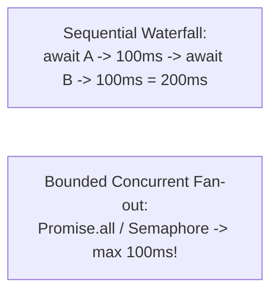

# Async/Await Patterns & Anti-Patterns

> **One-line summary:** Write readable, non-blocking asynchronous code without callback hell—while avoiding sequential `await` waterfalls, unbounded fan-out storms, and fire-and-forget unhandled rejections.

| Attribute | Specification |
|---|---|
| **Level** | Core / Modern Concurrency |
| **Prerequisites** | [06-future-and-promise.md](06-future-and-promise.md), [07-reactor-and-proactor.md](07-reactor-and-proactor.md) |
| **Estimated Reading Time** | 30 minutes |
| **Status** | Complete |
| **Category** | Concurrency |
| **Origin** | C# 5.0 (2012) $\to$ Python 3.5 / ES2017 / Java Virtual Threads |
| **Also Known As** | Coroutine Suspension, Async Composition |
| **Languages Tested** | Java 25 (LTS) / TypeScript 5.8 (Node 24 native) / Python 3.14 |

---

## Table of Contents
- [1 The Problem](#1-the-problem)
- [2 Why It Exists](#2-why-it-exists)
- [3 What It Is](#3-what-it-is)
- [4 The Problem Without It](#4-the-problem-without-it)
- [5 How It Solves It](#5-how-it-solves-it)
- [6 How It Works](#6-how-it-works)
- [7 Real-World Examples](#7-real-world-examples)
- [8 When to Use and When NOT to Use](#8-when-to-use-and-when-not-to-use)
- [9 Variations and Language Idioms](#9-variations-and-language-idioms)
- [10 Relationship to Other Principles and Patterns](#10-relationship-to-other-principles-and-patterns)
- [11 Common Mistakes and Anti-Patterns](#11-common-mistakes-and-anti-patterns)
- [12 Testing and Design Verification](#12-testing-and-design-verification)
- [13 Performance, Concurrency and Security Notes](#13-performance-concurrency-and-security-notes)
- [14 Interview Questions](#14-interview-questions)
- [15 Practice Exercises](#15-practice-exercises)
- [16 Summary / Cheat Sheet](#16-summary--cheat-sheet)
- [17 Further Reading](#17-further-reading)

---

## 1 The Problem

`async/await` makes asynchronous code look synchronous—which creates three pervasive production traps:
1. **The Sequential `await` Waterfall:** Writing `const a = await getA(); const b = await getB();` when `A` and `B` are independent, doubling response latency!
2. **Unbounded `Promise.all` Storm:** Firing `await Promise.all(users.map(u => fetchOrders(u)))` across 10,000 users simultaneously, DDoS-ing your own database!
3. **`await` Inside `Array.forEach`:** In TypeScript/JS, `items.forEach(async item => await save(item))` fires all promises **without waiting**—returning `200 OK` before any DB write finishes!

---

## 2 Why It Exists

Introduced in C# 5.0 and adopted by TypeScript/JS and Python (`asyncio`), `async/await` compiles sequential-looking functions into state machines over Futures/Promises—eliminating nested `.then()` callback pyramids. (In **Java 25**, **Virtual Threads** solve the exact same problem directly at the JVM stack level *without* "colored" `async` functions!).

---

## 3 What It Is



---

## 4 The Problem Without It

```typescript
// Trap 1: Sequential Waterfall (2x latency)
// const user = await fetchUser();
// const orders = await fetchOrders();

// Trap 2: forEach(async ...) does NOT await anything!
// items.forEach(async item => await save(item)); // Returns BEFORE saves complete!
```

---

## 5 How It Solves It

### TypeScript Implementation (Node 24 Native — Concurrent + `for...of` + Bounded Semaphore)

```typescript
// 1. Concurrent independent awaits:
async function loadDashboard() {
    const [user, orders] = await Promise.all([
        Promise.resolve("Alice"),
        Promise.resolve(["ORD-1", "ORD-2"])
    ]);
    return { user, orders };
}

// 2. Sequential ordered loop: ALWAYS use `for...of`, NEVER `.forEach(async ...)`!
async function saveSequential(items: string[]) {
    for (const item of items) {
        await Promise.resolve(item);
    }
}
```

### Python Implementation (Python 3.14 — `asyncio.Semaphore` Bounded Concurrency)

```python
import asyncio

async def fetch_one(sem: asyncio.Semaphore, item_id: int) -> int:
    async with sem:
        await asyncio.sleep(0)
        return item_id * 2

async def fetch_bounded(ids: list[int], limit: int = 5) -> list[int]:
    sem = asyncio.Semaphore(limit)
    return await asyncio.gather(*(fetch_one(sem, i) for i in ids))
```

### Java Implementation (Java 25 LTS — Virtual Threads + `Semaphore`)

Java 25 avoids "function coloring" (`async`/`await`传染) altogether using Virtual Threads:

```java
package com.design.patterns.concurrency.async;

import java.util.concurrent.*;

public class VirtualThreadLimiter {
    public static String callRateLimited(Semaphore limit, Callable<String> ioTask) throws Exception {
        limit.acquire();
        try {
            return ioTask.call(); // Virtual thread parks cheaply on blocking I/O!
        } finally {
            limit.release();
        }
    }
}
```

---

## 6 How It Works: The "Function Coloring" Problem

In TypeScript and Python, `async` functions are "red" functions: they can only be awaited inside another `async` function—forcing `async` to propagate all the way up the call stack. Java 25 Virtual Threads avoid function coloring by making standard blocking calls automatically park/unpark virtual threads transparently!

---

## 7 Real-World Examples

1. **TypeScript/Node Backend Aggregators (`Promise.all` + `p-limit`)**.
2. **Python FastAPI / `httpx` Async Clients (`asyncio.Semaphore` + `TaskGroup`)**.
3. **Java 25 Spring Boot (`spring.threads.virtual.enabled=true`)**.

---

## 8 When to Use and When NOT to Use

- **Always parallelize independent I/O** (`Promise.all` / `asyncio.gather` / `TaskGroup`).
- **Always bound large fan-outs** (`Semaphore` / `p-limit`) so 10,000 items don't open 10,000 simultaneous DB sockets.

---

## 9 Variations and Language Idioms

- **Async Iterators (`for await...of` / `async for`):** Stream paginated responses cleanly without buffering everything in RAM.

---

## 10 Relationship to Other Principles and Patterns

- **Structured Concurrency:** Fixes `Promise.all` / `asyncio.gather` orphan-task leaks.
- **Reactor & Future/Promise:** Underlying runtime primitives powering `async/await`.

---

## 11 Common Mistakes and Anti-Patterns

| Anti-Pattern | Description | Production Consequence | Correct Remedy |
|---|---|---|---|
| **Sequential `await` Waterfall** | Awaiting independent calls one after another. | $2\times$–$5\times$ slower API latency! | Use `Promise.all` / `TaskGroup`. |
| **`items.forEach(async ...)` (JS/TS)** | `.forEach` ignores returned Promises! | Endpoint returns `200 OK` before DB writes finish; silent unhandled errors! | Use `for...of` (sequential) or `Promise.all(items.map(...))` (parallel). |
| **Unbounded `Promise.all(10000Items)`** | Opening 10,000 concurrent connections at once. | Exhausts DB pool / triggers rate-limit `429`! | Bound concurrency with `Semaphore` / `p-limit`. |
| **Blocking Sync Calls Inside `async def`** | Calling Python `requests.get()` or `time.sleep()` inside `async def`! | Freezes entire `asyncio` event loop! | Use `httpx.AsyncClient` / `asyncio.sleep()` / `asyncio.to_thread()`. |
| **Redundant `return await fn()` vs `try/catch`** | Omitting `await` inside `try { return fn(); } catch (e) {}`! | `try/catch` **misses** async rejection because Promise returned before settling! | Always `return await fn()` inside `try/catch`! |
| **Fire-and-Forget Without `.catch()`** | Calling `sendAuditEmail()` without `await` or `.catch()`. | Crashes Node process on rejection! | Attach `.catch()` or use a background queue. |

---

## 12 Testing and Design Verification

Test concurrency limits (verify max simultaneous in-flight tasks never exceeds `Semaphore` limit) and error handling inside `try { return await ... }`.

---

## 13 Performance, Concurrency and Security Notes

Always pass cancellation signals (`AbortSignal.timeout(3000)` in TS, `asyncio.timeout(3.0)` in Python) so hung downstream sockets abort cleanly.

---

## 14 Interview Questions

<details>
<summary><strong>1. Why does `array.forEach(async item => await work(item))` fail in JavaScript/TypeScript?</strong></summary>

`Array.prototype.forEach` invokes the callback synchronously and discards its returned `Promise`. The outer function continues immediately without waiting for any `work(item)` to finish, and errors inside the callback become unhandled rejections. Use `for...of` (sequential) or `Promise.all(array.map(...))` (parallel).
</details>

<details>
<summary><strong>2. Why is `return await fn()` REQUIRED inside a `try/catch` block in JS/TS?</strong></summary>

If you write `try { return fn(); } catch (e) {}`, the `Promise` is returned *immediately* before it rejects, so the `catch` block never executes! Writing `return await fn()` suspends inside `try`, catching rejections properly.
</details>

<details>
<summary><strong>3. What is the "Sequential `await` Waterfall" anti-pattern?</strong></summary>

Awaiting independent async operations one after another (`await a(); await b();`) instead of launching them concurrently (`await Promise.all([a(), b()])`), unnecessarily summing their latencies.
</details>

<details>
<summary><strong>4. Why is unbounded `Promise.all(10000Items.map(...))` dangerous?</strong></summary>

It launches 10,000 concurrent network/DB requests simultaneously, exhausting local file descriptors, connection pools, and triggering downstream `429` rate limits. Bound concurrency with a Semaphore or worker pool.
</details>

<details>
<summary><strong>5. What happens if you call Python's synchronous `requests.get()` inside an `async def` FastAPI route?</strong></summary>

It blocks the entire `asyncio` event loop thread until the HTTP response returns, stalling all other concurrent FastAPI requests! Use an async HTTP client (`httpx.AsyncClient`) or `await asyncio.to_thread(...)`.
</details>

<details>
<summary><strong>6. What is the "Function Coloring" problem?</strong></summary>

In `async/await` languages, calling an `async` ("red") function requires the caller itself to become `async`, propagating `async` viral annotations up the call stack. Java 25 Virtual Threads avoid function coloring by letting normal synchronous methods park cheaply on I/O.
</details>

<details>
<summary><strong>7. How do you enforce a timeout on an `async` operation in Python 3.11+ and Node 24?</strong></summary>

Python 3.11+: `async with asyncio.timeout(2.0): ...`. Node 24: pass `AbortSignal.timeout(2000)` to `fetch` or race with a timer.
</details>

<details>
<summary><strong>8. When is sequential `for...of` with `await` actually preferred over `Promise.all`?</strong></summary>

When order of execution matters (e.g., applying ordered ledger transactions) or when you intentionally want strict 1-at-a-time rate limiting.
</details>

---

## 15 Practice Exercises

### Exercise 1: Fix `forEach(async ...)` Bug (Easy)
Fix `async function saveAll(ids: string[]) { ids.forEach(async id => await db.save(id)); }`.

<details>
<summary><strong>Solution</strong></summary>

`await Promise.all(ids.map(id => db.save(id)));` (or `for (const id of ids) await db.save(id);` if sequential).
</details>

---

### Exercise 2: Fix `try/catch` Missing `await` (Medium)
Fix `async function safeFetch() { try { return fetchRisky(); } catch (e) { return "fallback"; } }`.

<details>
<summary><strong>Solution</strong></summary>

Change `return fetchRisky();` to `return await fetchRisky();`.
</details>

---

### Exercise 3: Bounded Concurrent Fetcher in Python (Hard)
Write `fetch_all(urls, max_concurrent=3)` using `asyncio.Semaphore(3)` and `asyncio.timeout(5.0)`.

<details>
<summary><strong>Solution</strong></summary>

Wrap `asyncio.gather(*(fetch_one(sem, u) for u in urls))` inside `async with asyncio.timeout(5.0):`.
</details>

---

## 16 Summary / Cheat Sheet

```
+--------------------------------------------------------------------------+
|                      ASYNC/AWAIT PATTERNS CHEAT SHEET                    |
+--------------------------------------------------------------------------+
| PARALLEL   : Promise.all / asyncio.gather (+ Semaphore bound!).          |
| SEQUENTIAL : `for...of` (NEVER `array.forEach(async ...)`!).             |
| TRY/CATCH  : Always `return await fn()` inside `try/catch`!              |
+--------------------------------------------------------------------------+
```

---

## 17 Further Reading

- Bob Nystrom, *What Color is Your Function?*, journal.stuffwithstuff.com, 2015.

### In Your Language
| Language Track | Deep Dive Reference |
|---|---|
| Java | [Java OOP & Design Patterns](file:///e:/Learning/engineering-notes/01-languages/java/24-design-patterns/README.md) |
| TypeScript | [TypeScript Design Patterns](file:///e:/Learning/engineering-notes/01-languages/typescript/17-design-patterns/README.md) |
| Python | [Python Design Patterns](file:///e:/Learning/engineering-notes/01-languages/python/23-design-patterns/README.md) |

---

[← Previous: 10 - Double-Checked Locking](file:///e:/Learning/engineering-notes/08-solid-design-patterns/08-concurrency-patterns/10-double-checked-locking-and-why-it-fails.md) | [Module 08 Index](file:///e:/Learning/engineering-notes/08-solid-design-patterns/08-concurrency-patterns/README.md) | [Next: 12 - Structured Concurrency Pattern →](file:///e:/Learning/engineering-notes/08-solid-design-patterns/08-concurrency-patterns/12-structured-concurrency-pattern.md)
