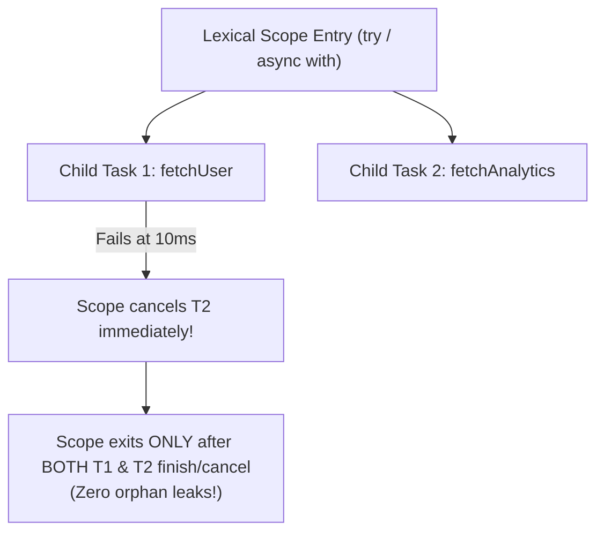

# Structured Concurrency Pattern

> **One-line summary:** Bind the lifetime of concurrent child tasks strictly to the lexical scope that spawned them—guaranteeing automatic cancellation of siblings on failure, zero orphan thread/task leaks, and clear hierarchical stack traces.

| Attribute | Specification |
|---|---|
| **Level** | Intermediate / Modern Concurrency |
| **Prerequisites** | [06-future-and-promise.md](06-future-and-promise.md), [11-async-await-patterns.md](11-async-await-patterns.md) |
| **Estimated Reading Time** | 30 minutes |
| **Status** | Complete |
| **Category** | Concurrency |
| **Origin** | Nathaniel J. Smith (*Notes on structured concurrency*, 2018) / Java `StructuredTaskScope` / Python `TaskGroup` |
| **Also Known As** | Lexical Task Scoping, `TaskGroup`, `Nursery`, `StructuredTaskScope` |
| **Languages Tested** | Java 25 (LTS) / TypeScript 5.8 (Node 24 native) / Python 3.14 |

---

## Table of Contents
- [1 The Problem](#1-the-problem)
- [2 Why It Exists](#2-why-it-exists)
- [3 What It Is](#3-what-it-is)
- [4 The Problem Without It](#4-the-problem-without-it)
- [5 How It Solves It](#5-how-it-solves-it)
- [6 How It Works](#6-how-it-works)
- [7 Real-World Examples](#7-real-world-examples)
- [8 When to Use and When NOT to Use](#8-when-to-use-and-when-not-to-use)
- [9 Variations and Language Idioms](#9-variations-and-language-idioms)
- [10 Relationship to Other Principles and Patterns](#10-relationship-to-other-principles-and-patterns)
- [11 Common Mistakes and Anti-Patterns](#11-common-mistakes-and-anti-patterns)
- [12 Testing and Design Verification](#12-testing-and-design-verification)
- [13 Performance, Concurrency and Security Notes](#13-performance-concurrency-and-security-notes)
- [14 Interview Questions](#14-interview-questions)
- [15 Practice Exercises](#15-practice-exercises)
- [16 Summary / Cheat Sheet](#16-summary--cheat-sheet)
- [17 Further Reading](#17-further-reading)

---

## 1 The Problem

Imagine an endpoint spawning two parallel child tasks: `fetchUser()` (fails in 10ms!) and `fetchHeavyAnalytics()` (takes 10 seconds).

With unstructured concurrency (`executor.submit()`, `Promise.all()`, `asyncio.create_task()`):
1. `fetchUser()` fails in 10ms and throws an exception immediately to the caller.
2. **Orphan Task Leak:** `fetchHeavyAnalytics()` is **still running in the background** for 10 seconds, holding database connections and CPU even though its parent request already returned HTTP `500`!
3. Under heavy load, thousands of leaked orphan background tasks exhaust thread pools and DB connections!

---

## 2 Why It Exists

Formulated by **Nathaniel J. Smith** (*Notes on structured concurrency, or: Go statement considered harmful*, 2018) and implemented natively in **Python 3.11+ (`asyncio.TaskGroup`)**, **Kotlin (`coroutineScope`)**, and **Java (`StructuredTaskScope`)**:
Just as `if`/`for` blocks eliminated `goto` spaghetti, **Structured Concurrency** requires that every concurrent task spawned inside a block **must finish (or be cancelled) before execution exits that block**.

---

## 3 What It Is



---

## 4 The Problem Without It

```python
# Unstructured Concurrency: Task 2 leaks in background if Task 1 fails!
# f1 = asyncio.create_task(fetch_user())
# f2 = asyncio.create_task(fetch_heavy_analytics())
# await f1  # Fails! f2 is now an unmanaged orphan task!
```

---

## 5 How It Solves It

### Python Implementation (Python 3.14 — Native `asyncio.TaskGroup`)

```python
import asyncio

async def fetch_user() -> str:
    await asyncio.sleep(0.01)
    return "Alice"

async def fetch_orders() -> list[str]:
    await asyncio.sleep(0.01)
    return ["ORD-1"]

async def load_dashboard() -> tuple[str, list[str]]:
    async with asyncio.TaskGroup() as tg:
        t1 = tg.create_task(fetch_user())
        t2 = tg.create_task(fetch_orders())
    # Guaranteed: BOTH t1 and t2 are finished (or cancelled on error) here!
    return t1.result(), t2.result()
```

### TypeScript Implementation (Node 24 Native — `AbortController` Scope Pattern)

JavaScript does not yet have built-in `TaskGroup`, so you emulate Structured Concurrency cleanly using an `AbortController` scope wrapper:

```typescript
async function withStructuredScope<T>(fn: (signal: AbortSignal) => Promise<T>): Promise<T> {
    const controller = new AbortController();
    try {
        return await fn(controller.signal);
    } finally {
        controller.abort(); // Guarantees all child tasks abort when scope exits!
    }
}
```

### Java Implementation (Java 25 LTS — `StructuredTaskScope` / Scoped Shutdown)

In Java (`StructuredTaskScope`, JEP preview/incubator line leading into Java 25), `try (var scope = new StructuredTaskScope.ShutdownOnFailure())` forks virtual-thread subtasks, automatically cancels siblings if any fails, and joins before leaving the `try` block. When using standard `ExecutorService` in `try-with-resources`, `try (var exec = Executors.newVirtualThreadPerTaskExecutor())` similarly waits for all submitted tasks before exiting the `try` block!

```java
package com.design.patterns.concurrency.structured;

import java.util.concurrent.*;

public class StructuredScopeExample {
    public static String loadDashboard() throws Exception {
        try (ExecutorService scope = Executors.newVirtualThreadPerTaskExecutor()) {
            Future<String> user = scope.submit(() -> "Alice");
            Future<Integer> score = scope.submit(() -> 750);
            return user.get() + ":" + score.get();
        } // Automatically awaits/closes all subtasks before returning!
    }
}
```

---

## 6 How It Works: Shutdown-on-Failure vs. Shutdown-on-Success

1. **Shutdown on Failure (`All`):** If *any* subtask fails, cancel all remaining siblings immediately and propagate the failure (like `TaskGroup` / `ShutdownOnFailure`).
2. **Shutdown on Success (`Race`):** Launch redundant hedged requests (e.g., primary + backup replica); as soon as the *first* succeeds, cancel all slower siblings immediately (`ShutdownOnSuccess`).

---

## 7 Real-World Examples

1. **Python 3.11+ `asyncio.TaskGroup` & `trio` Nurseries**.
2. **Kotlin Coroutines `coroutineScope { async { ... } }`**.
3. **Java `StructuredTaskScope` (Project Loom) & `ExecutorService.close()` (`try-with-resources`)**.

---

## 8 When to Use and When NOT to Use

- **Always use Structured Concurrency** for request-scoped fan-out/fan-in (`loadDashboard`, hedged reads).
- **Fire-and-Forget background jobs (email/metrics):** Must be handed off explicitly to an application-owned durable queue/worker rather than detached inside an HTTP request scope!

---

## 9 Variations and Language Idioms

- **Python `ExceptionGroup` (`except*`):** Because multiple tasks in a `TaskGroup` can fail concurrently, Python wraps concurrent errors in an `ExceptionGroup` handled cleanly by `except* ValueError as eg:`.

---

## 10 Relationship to Other Principles and Patterns

- **Future & Promise:** Structured Concurrency wraps Futures/Tasks inside a strict lexical lifetime boundary.
- **Immutability (`ScopedValue`):** Java `ScopedValue` propagates automatically into `StructuredTaskScope` child threads!

---

## 11 Common Mistakes and Anti-Patterns

| Anti-Pattern | Description | Production Consequence | Correct Remedy |
|---|---|---|---|
| **Fire-and-Forget Detached Tasks** | Calling `asyncio.create_task()` without storing/awaiting it! | Python GC destroys task silently & drops errors! | Always spawn tasks inside `asyncio.TaskGroup`. |
| **Swallowing `CancelledError` in Python** | Catching `except Exception:` or `except CancelledError:` and not re-raising! | Breaks TaskGroup sibling cancellation! | Never swallow `CancelledError`—always re-raise! |
| **Passing `AbortSignal` Without Checking/Forwarding It (TS)** | Creating `AbortController` but not passing `signal` to `fetch(url, { signal })`. | Cancelled tasks still finish network calls! | Pass `signal` down to every I/O call. |
| **`Promise.all` Without Cancellation** | Assuming `Promise.all` cancels siblings when one rejects. | Siblings keep running as orphans! | Pair `Promise.all` with `AbortController`. |
| **Leaking Task References Outside Scope** | Returning an unawaited child task handle out of `TaskGroup`. | Task already finished or cancelled on scope exit. | Return resolved values, not handles. |
| **Ignoring `ExceptionGroup` in Python** | Catching `except ValueError` instead of `except* ValueError` around `TaskGroup`. | Misses exceptions wrapped in `ExceptionGroup`! | Use `except*` (PEP 654). |

---

## 12 Testing and Design Verification

Test **cancellation propagation**: launch Task 1 (throws at 10ms) and Task 2 (sleeps 5s with a `finally: cancelled = True` flag) inside `TaskGroup` / `AbortController` scope, and assert Task 2 cancels in ~10ms rather than 5s!

---

## 13 Performance, Concurrency and Security Notes

- **Resource Safety:** Structured Concurrency eliminates the #1 source of production memory/socket leaks in async services (abandoned background tasks still holding DB connections after client disconnect).

---

## 14 Interview Questions

<details>
<summary><strong>1. What is Structured Concurrency and what problem does it solve?</strong></summary>

Structured Concurrency enforces that the lifetime of any spawned concurrent child task is strictly bounded by the lexical block (`try` / `async with`) that created it. It prevents **orphan task leaks**, automatically cancels siblings when one fails, and preserves clear parent-child error propagation.
</details>

<details>
<summary><strong>2. Why is `Promise.all()` or `asyncio.gather()` NOT true Structured Concurrency?</strong></summary>

In `Promise.all` (without `AbortController`), if Task 1 rejects early, `Promise.all` rejects to the caller immediately while Task 2 **keeps running unmanaged in the background** as an orphan. True Structured Concurrency (`TaskGroup`, `StructuredTaskScope`) cancels Task 2 and waits for it to clean up before exiting the scope.
</details>

<details>
<summary><strong>3. What happens in Python if you call `asyncio.create_task(coro())` without keeping a reference to the task?</strong></summary>

Python's asyncio loop only holds **weak references** to tasks—an unreferenced fire-and-forget task can be garbage-collected mid-execution and disappear silently!
</details>

<details>
<summary><strong>4. Why must you NEVER swallow `asyncio.CancelledError` in Python?</strong></summary>

`TaskGroup` relies on `CancelledError` to unwind and shut down sibling tasks when another task fails or a timeout triggers. Catching and suppressing `CancelledError` hangs the entire `TaskGroup`.
</details>

<details>
<summary><strong>5. How does Python 3.11+ `except*` (`ExceptionGroup`) work with `TaskGroup`?</strong></summary>

If two tasks inside a `TaskGroup` fail simultaneously, `TaskGroup` raises an `ExceptionGroup` containing both errors; `except* ValueError as eg:` cleanly matches and handles each exception type.
</details>

<details>
<summary><strong>6. Compare `ShutdownOnFailure` vs `ShutdownOnSuccess` in Java's `StructuredTaskScope`.</strong></summary>

- `ShutdownOnFailure`: Cancels all siblings if *any* fails (for aggregating required results).
- `ShutdownOnSuccess`: Cancels all slower siblings as soon as the *first* succeeds (for hedged/redundant requests).
</details>

<details>
<summary><strong>7. How do you emulate Structured Concurrency in Node.js/TypeScript?</strong></summary>

Wrap concurrent operations in a helper managing an `AbortController`, passing `controller.signal` to every child `fetch`/async operation, and calling `controller.abort()` inside `finally`.
</details>

<details>
<summary><strong>8. How does Java's `try (var exec = Executors.newVirtualThreadPerTaskExecutor())` enforce scope completion?</strong></summary>

`ExecutorService.close()` (added in Java 19) invokes `shutdown()` and blocks via `awaitTermination()` until all submitted tasks finish before exiting the `try` block.
</details>

---

## 15 Practice Exercises

### Exercise 1: Spot the Orphan Task Bug (Easy)
In Python `asyncio`, `asyncio.create_task(send_webhook())` is called inside a route handler without awaiting. Identify two bugs.

<details>
<summary><strong>Solution</strong></summary>

1. Event loop holds only weak refs—GC may destroy the task mid-flight! 2. Exceptions inside `send_webhook()` are lost or logged only on GC, with no backpressure.
</details>

---

### Exercise 2: Abort-Aware Parallel Fetch in TypeScript (Medium)
Use `withStructuredScope` + `Promise.all` passing `signal` to two mock tasks where Task 1 rejects at 10ms and Task 2 listens to `signal.addEventListener("abort", ...)`.

<details>
<summary><strong>Solution</strong></summary>

Rejecting Task 1 exits `try`, triggers `finally { controller.abort(); }`, firing `abort` on Task 2 immediately.
</details>

---

### Exercise 3: `asyncio.TaskGroup` with `except*` in Python 3.14 (Hard)
Run two tasks in `asyncio.TaskGroup()`: one raises `ValueError`, one sleeps 5s. Catch with `except* ValueError` and assert elapsed time $< 0.1\text{s}$.

<details>
<summary><strong>Solution</strong></summary>

`try: async with asyncio.TaskGroup() as tg: ... except* ValueError: ...` cancels the 5s task immediately.
</details>

---

## 16 Summary / Cheat Sheet

```
+--------------------------------------------------------------------------+
|                      STRUCTURED CONCURRENCY PATTERN                      |
+--------------------------------------------------------------------------+
| CORE RULE  : Child tasks NEVER outlive the lexical block that spawned them|
| PYTHON     : `async with asyncio.TaskGroup() as tg:` + `except*`.        |
| JAVA / TS  : `StructuredTaskScope` / `try (exec)` | `AbortController`.   |
+--------------------------------------------------------------------------+
```

---

## 17 Further Reading

- Nathaniel J. Smith, *Notes on structured concurrency, or: Go statement considered harmful*, vorpus.org, 2018.

### In Your Language
| Language Track | Deep Dive Reference |
|---|---|
| Java | [Java OOP & Design Patterns](file:///e:/Learning/engineering-notes/01-languages/java/24-design-patterns/README.md) |
| TypeScript | [TypeScript Design Patterns](file:///e:/Learning/engineering-notes/01-languages/typescript/17-design-patterns/README.md) |
| Python | [Python Design Patterns](file:///e:/Learning/engineering-notes/01-languages/python/23-design-patterns/README.md) |

---

[← Previous: 11 - Async/Await Patterns](file:///e:/Learning/engineering-notes/08-solid-design-patterns/08-concurrency-patterns/11-async-await-patterns.md) | [Module 08 Index](file:///e:/Learning/engineering-notes/08-solid-design-patterns/08-concurrency-patterns/README.md) | [Next: 13 - Backpressure & Flow Control →](file:///e:/Learning/engineering-notes/08-solid-design-patterns/08-concurrency-patterns/13-backpressure-and-flow-control.md)
