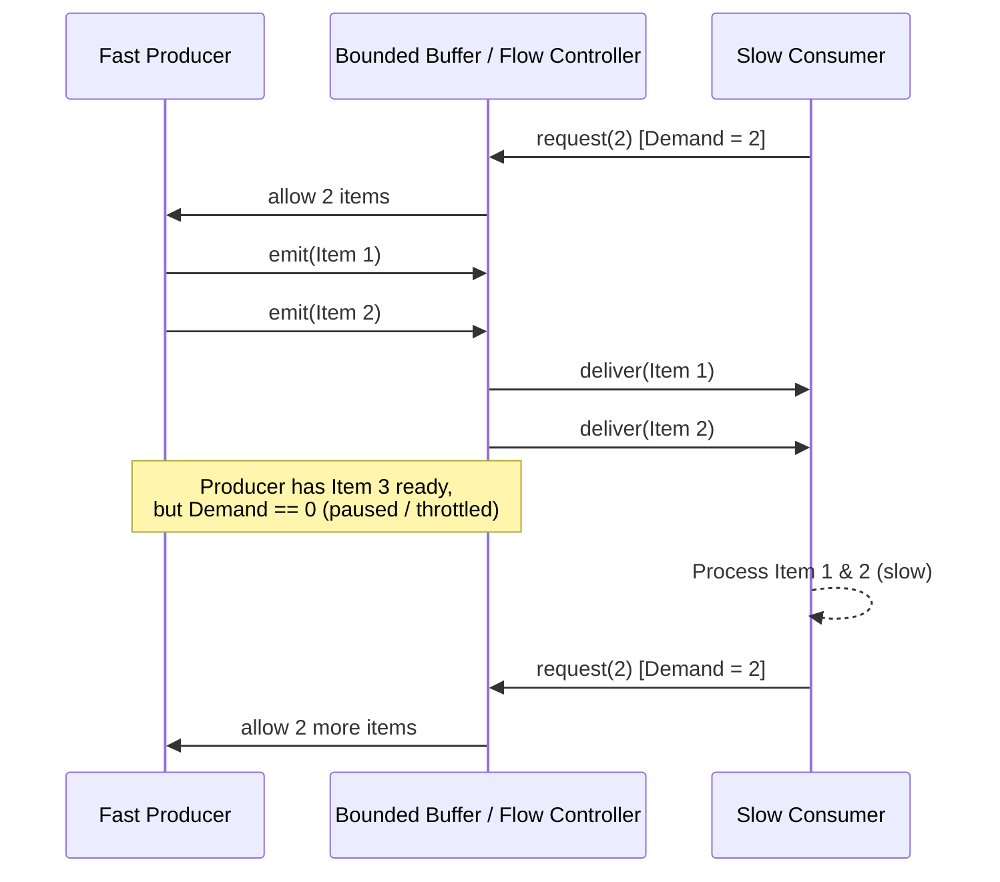

# Backpressure & Flow Control

| Field | Value |
| :--- | :--- |
| **Category** | Concurrency & Reactive Flow Control |
| **Origin** | Reactive Streams Specification / Networking (TCP Flow Control) |
| **Difficulty** | Intermediate → Advanced |
| **Prerequisite(s)** | [Producer–Consumer](file:///E:/Learning/engineering-notes/08-solid-design-patterns/08-concurrency-patterns/02-producer-consumer.md), [Future & Promise](file:///E:/Learning/engineering-notes/08-solid-design-patterns/08-concurrency-patterns/06-future-and-promise.md) |
| **Status** | Complete |

> **TL;DR**: Backpressure is a pull-based or bounded feedback mechanism that lets a slower downstream consumer signal a faster upstream producer to slow down, buffer, or drop work—preventing unbounded memory growth, thread starvation, and cascading `OutOfMemoryError` crashes.

---

## 1. The Problem: Why Does Backpressure Exist?

Suppose you build a real-time log ingestion pipeline: an HTTP endpoint receives 50,000 events/second from edge devices, and a downstream database writer can only persist 2,000 events/second.

If the producer blindly pushes events into an **unbounded queue** or fires-and-forgets async tasks:

1. **Unbounded Memory Growth**: Every second, 48,000 extra events pile up in RAM. Within minutes, the JVM throws `OutOfMemoryError`, Node.js hits its heap limit, or Python exhausts memory and gets OOM-killed by the OS.
2. **Latency Collapse (Queueing Delay)**: Even before crashing, events sit in a 10-million-item queue for hours before being processed. By the time an alert is written, it is stale.
3. **Retry Storms**: Upstream clients time out waiting for slow responses and retry, doubling or tripling the incoming load on an already drowning consumer.

You cannot make a slow database magically 25x faster in code. Instead, you must **control the flow** at the boundary between producer and consumer.

---

## 2. What Is Backpressure?

**Backpressure** (borrowed from fluid dynamics and TCP flow control) is any mechanism by which a downstream consumer communicates its remaining capacity to an upstream producer, forcing the producer to adapt its emission rate.

Instead of **pure push** (*"take whatever I send as fast as I can send it"*), backpressure introduces **bounded buffering or pull-based demand** (*"send me at most `N` items; I will ask for more when I am ready"*).

### Four Core Backpressure Strategies

| Strategy | Behavior When Downstream Is Full | Best For | Trade-off |
| :--- | :--- | :--- | :--- |
| **Block / Throttle (Push-back)** | Producer blocks (`put()`) or awaits capacity until space frees up | Internal bounded queues, ETL batch jobs | Propagates slowdown upstream; can stall callers if timeouts are missing |
| **Demand-Driven Pull (`request(n)`)** | Consumer explicitly requests `n` items (Reactive Streams) | Streaming pipelines, async iterators | Requires reactive/pull-aware producers |
| **Drop (Oldest / Newest)** | Discards excess items (`DROP_OLDEST` or `DROP_LATEST`) | Live metrics, video frames, sensor telemetry | Data loss; unacceptable for financial/audit events |
| **Rate Limit / Shed Load (HTTP 429)** | Rejects excess requests immediately at the edge with `429 Too Many Requests` + `Retry-After` | Public APIs, microservices | Caller must handle retries with backoff |

---

## 3. How It Works (Architecture & Flow)



1. **Demand Tracking**: The consumer advertises capacity `n` (via Reactive Streams `Subscription.request(n)`, a bounded `BlockingQueue` capacity, or TCP receive window).
2. **Flow Enforcement**: The boundary only emits up to `n` items (or blocks/drops when the buffer reaches capacity).
3. **Feedback Loop**: As the consumer finishes processing, it replenishes demand, keeping memory **O(buffer_size)** instead of **O(unbounded_time)**.

---

## 4. What Goes Wrong Without It (Broken Example)

Without a capacity bound or flow control, a fast producer overwhelms a slow consumer:

```java
// ❌ BROKEN: Unbounded queue + fire-and-forget producer
BlockingQueue<String> unbounded = new LinkedBlockingQueue<>(); // Integer.MAX_VALUE capacity!

// Fast producer: 100,000 items/sec
for (int i = 0; i < 1_000_000; i++) {
    unbounded.add("event-" + i); // Never blocks, never rejects!
}
// Slow consumer drains at 1,000 items/sec -> Heap fills up -> OutOfMemoryError
```

In Node.js / TypeScript, the classic mistake is ignoring `stream.write()` returning `false`:

```ts
// ❌ BROKEN: Ignoring stream.write() backpressure signal
for (let i = 0; i < 1_000_000; i++) {
  writableStream.write(`event-${i}\n`); // Buffers everything in RAM if false is ignored!
}
```

---

## 5. How Backpressure Fixes It (Multi-Language Examples)

### Java 25 LTS — Reactive Streams (`java.util.concurrent.Flow`)

Java's standard `Flow.Publisher` / `Flow.Subscriber` / `Flow.Subscription` implements demand-driven pull backpressure natively (`request(n)`):

```java
import java.util.concurrent.*;
import java.util.concurrent.atomic.AtomicInteger;

public class BackpressureFlowDemo {
    static class SlowSubscriber implements Flow.Subscriber<Integer> {
        private Flow.Subscription subscription;
        private final int batchSize = 2;
        private int processedInBatch = 0;
        final CountDownLatch done = new CountDownLatch(1);

        @Override
        public void onSubscribe(Flow.Subscription subscription) {
            this.subscription = subscription;
            System.out.println("[Subscriber] Requesting initial batch of " + batchSize);
            subscription.request(batchSize);
        }

        @Override
        public void onNext(Integer item) {
            try { Thread.sleep(30); } catch (InterruptedException ignored) {}
            System.out.println("[Subscriber] Processed: " + item);
            processedInBatch++;
            if (processedInBatch >= batchSize) {
                processedInBatch = 0;
                subscription.request(batchSize);
            }
        }

        @Override public void onError(Throwable t) { t.printStackTrace(); done.countDown(); }
        @Override public void onComplete() { System.out.println("[Subscriber] Complete"); done.countDown(); }
    }

    public static void main(String[] args) throws InterruptedException {
        // Bounded buffer of 4 items; publisher blocks when buffer is full
        try (var publisher = new SubmissionPublisher<Integer>(ForkJoinPool.commonPool(), 4)) {
            var subscriber = new SlowSubscriber();
            publisher.subscribe(subscriber);

            for (int i = 1; i <= 6; i++) {
                publisher.submit(i); // Applies backpressure if buffer fills!
                System.out.println("[Publisher] Submitted: " + i);
            }
            publisher.close();
            subscriber.done.await();
        }
    }
}
```

### TypeScript 5.8 (Node 24) — Async Generator Pull + Bounded Semaphore

In TypeScript/Node.js, `async function*` generators are naturally **pull-based** (the consumer's `for await` loop pulls one item at a time), and a bounded async queue enforces capacity for push sources:

```ts
class BoundedAsyncQueue<T> {
  private readonly buffer: T[] = [];
  private readonly waiters: Array<() => void> = [];
  private readonly takers: Array<(val: IteratorResult<T>) => void> = [];
  private closed = false;
  private readonly capacity: number;

  constructor(capacity: number) {
    this.capacity = capacity;
  }

  async push(item: T): Promise<void> {
    while (this.buffer.length >= this.capacity && !this.closed) {
      await new Promise<void>((resolve) => this.waiters.push(resolve));
    }
    if (this.closed) return;
    const taker = this.takers.shift();
    if (taker) {
      taker({ value: item, done: false });
    } else {
      this.buffer.push(item);
    }
  }

  close(): void {
    this.closed = true;
    while (this.takers.length > 0) {
      this.takers.shift()!({ value: undefined as unknown as T, done: true });
    }
    while (this.waiters.length > 0) this.waiters.shift()!();
  }

  async *[Symbol.asyncIterator](): AsyncIterator<T> {
    while (true) {
      if (this.buffer.length > 0) {
        const item = this.buffer.shift()!;
        const waiter = this.waiters.shift();
        if (waiter) waiter();
        yield item;
      } else if (this.closed) {
        return;
      } else {
        const res = await new Promise<IteratorResult<T>>((resolve) => this.takers.push(resolve));
        if (res.done) return;
        yield res.value;
      }
    }
  }
}

async function main() {
  const queue = new BoundedAsyncQueue<number>(2);

  const producer = (async () => {
    for (let i = 1; i <= 5; i++) {
      await queue.push(i); // Awaits when buffer has 2 items
      console.log(`[Producer] Pushed ${i}`);
    }
    queue.close();
  })();

  const consumer = (async () => {
    for await (const item of queue) {
      await new Promise((r) => setTimeout(r, 20));
      console.log(`[Consumer] Processed ${item}`);
    }
  })();

  await Promise.all([producer, consumer]);
}

main();
```

### Python 3.14 — `asyncio.Queue(maxsize=N)` + Load-Shedding Drop Policy

Python's `asyncio.Queue(maxsize=N)` provides built-in blocking backpressure via `await queue.put(item)` and non-blocking load shedding via `queue.put_nowait(item)`:

```python
import asyncio

async def producer(queue: asyncio.Queue[int], total: int) -> None:
    for i in range(1, total + 1):
        # Blocks automatically when queue reaches maxsize=2
        await queue.put(i)
        print(f"[Producer] Enqueued {i} (qsize={queue.qsize()})")
    await queue.put(-1)  # Sentinel

async def consumer(queue: asyncio.Queue[int]) -> None:
    while True:
        item = await queue.get()
        if item == -1:
            queue.task_done()
            break
        await asyncio.sleep(0.02)  # Simulate slower downstream DB write
        print(f"[Consumer] Persisted {item}")
        queue.task_done()

async def main() -> None:
    queue: asyncio.Queue[int] = asyncio.Queue(maxsize=2)
    await asyncio.gather(producer(queue, 5), consumer(queue))

asyncio.run(main())
```

---

## 6. Real-World Examples

1. **TCP Windowing (RFC 793 / RFC 9293)**: Every TCP packet carries a `Window Size` header advertising how many bytes the receiver's kernel buffer can still accept. If the receiver app stops reading, the window shrinks to `0` (`ZeroWindow`), forcing the sender to pause.
2. **Node.js Streams (`highWaterMark` & `drain`)**: `Writable.write(chunk)` returns `false` once the internal buffer hits `highWaterMark` (default 16 KiB). Properly written pipelines (or `stream.pipeline()`) pause the `Readable` source until the `'drain'` event fires.
3. **Kafka Consumer `max.poll.records` & Reactive Streams (Project Reactor / RxJava)**: Reactor's `Flux` uses `onBackpressureBuffer`, `onBackpressureDrop`, and `onBackpressureLatest` operators alongside `Subscription.request(n)` so downstream HTTP or DB sinks never get flooded.

---

## 7. Variants & Related Patterns

- **Pull-Based Backpressure**: Reactive Streams (`Flow.Subscription.request(n)`), Python/TS Async Generators.
- **Bounded Blocking Queue**: `ArrayBlockingQueue` (Java), `asyncio.Queue(maxsize=N)` (Python), bounded channels (Go `make(chan T, N)`).
- **Token Bucket / Leaky Bucket**: Shapes bursty traffic into a steady rate before it reaches downstream services.
- **Related Patterns**:
  - [Producer–Consumer](file:///E:/Learning/engineering-notes/08-solid-design-patterns/08-concurrency-patterns/02-producer-consumer.md): Backpressure is what makes a Producer–Consumer queue safe in production.
  - [Reactor & Proactor](file:///E:/Learning/engineering-notes/08-solid-design-patterns/08-concurrency-patterns/07-reactor-and-proactor.md): Event loops must pause socket read interest when write buffers fill.
  - **Rate Limiter / Load Shedding**: Covered in [Module 11 — Distributed & Cloud Patterns](file:///E:/Learning/engineering-notes/08-solid-design-patterns/11-distributed-and-cloud-patterns/README.md).

---

## 8. Advantages

- **Predictable Memory**: Memory usage is strictly bounded by `capacity * item_size`, eliminating `OutOfMemoryError` under traffic spikes.
- **Stable Tail Latency**: Keeps queues shallow so items are processed fresh rather than timing out after minutes in a backlog.
- **Graceful Degradation**: Slowdowns propagate cleanly or shed excess load instead of crashing the entire process.

---

## 9. Limitations & When NOT to Use

- **Cascading Blocking**: If a synchronous producer blocks on a full queue while holding a database connection or HTTP worker thread, it can exhaust upstream thread pools. Use timeouts (`offer(item, timeout)`), async suspension, or load shedding (`429`) at service boundaries.
- **Not a Substitute for Scaling**: Backpressure protects stability during bursts; if average arrival rate permanently exceeds service capacity, you must scale consumers or drop/sample data.
- **Hot-Producer Push Sources**: Physical sensors, UDP packets, or WebSocket tickers cannot always pause—for those, you must pair backpressure with **Drop** or **Conflation (Latest)** policies.

---

## 10. Anti-Patterns & Common Mistakes

| Mistake | Why It Fails | Fix |
| :--- | :--- | :--- |
| Using `new LinkedBlockingQueue<>()` without capacity | Default capacity is `Integer.MAX_VALUE` (~2.14B), causing OOM before blocking | Always pass an explicit bound: `new ArrayBlockingQueue<>(1024)` |
| Ignoring `stream.write()` returning `false` in Node.js | Buffers unbounded chunks in V8 heap | Use `stream.pipeline()` or await `'drain'` when `write()` returns `false` |
| `asyncio.Queue()` with default `maxsize=0` | `maxsize=0` in Python means **infinite** capacity | Always set `maxsize=N` on queues fed by external/fast producers |
| Blocking inside an event loop thread | Calling a blocking `put()` inside Node.js or Python `asyncio` freezes all coroutines | Use `await queue.put()` / async backpressure, never blocking I/O |
| Buffering everything with `onBackpressureBuffer()` unbounded | Defeats backpressure by moving the OOM into the operator | Specify a max buffer size + overflow strategy (`DROP_OLDEST` / error) |
| Missing timeouts on upstream retries | Retries pile onto blocked producers and amplify load 5x | Return `429 Too Many Requests` + `Retry-After` and use exponential backoff + jitter |

---

## 11. Comparison with Related Concepts

| Mechanism | Direction | What Happens on Overload | Primary Scope |
| :--- | :--- | :--- | :--- |
| **Backpressure** | Downstream → Upstream | Producer slows down or pauses | In-process pipelines, streams, TCP |
| **Rate Limiting** | Edge / Gateway | Rejects excess calls (`429`) | Public APIs, per-tenant quotas |
| **Circuit Breaker** | Caller-side | Fails fast when downstream errors/timeouts spike | Microservice RPCs |
| **Load Shedding** | Server-side | Drops low-priority requests when CPU/queue saturates | Overload protection |

---

## 12. Design Checklist

- [ ] Does every in-memory queue between a producer and consumer have an explicit upper bound (`capacity` / `maxsize`)?
- [ ] Have you chosen an explicit overflow policy (**Block**, **Drop Oldest**, **Drop Newest**, or **Reject / 429**)?
- [ ] Do upstream producers honor timeouts so blocked queues don't exhaust caller thread pools?
- [ ] In Node.js/Python/Java reactive streams, are you using `pipeline()` / `Flow.Subscription.request(n)` instead of fire-and-forget loops?
- [ ] Are queue depth and dropped-item counts exported as metrics for alerting?

---

## 13. Interview Questions

<details>
<summary>1. What is backpressure, and why is an unbounded queue an anti-pattern?</summary>

Backpressure is a feedback mechanism where a slower consumer controls the rate of a faster producer. An unbounded queue hides overload temporarily by buffering everything in RAM, which causes queueing latency to spike toward infinity and eventually crashes the process with `OutOfMemoryError`.

</details>

<details>
<summary>2. Compare Push-based vs Pull-based backpressure.</summary>

In **Push-based** systems, the producer emits as fast as possible and relies on a bounded buffer blocking or rejecting (`offer` returning `false`, HTTP `429`). In **Pull-based** systems (like Reactive Streams `request(n)` or async generators), the consumer explicitly asks for `n` items only when it has capacity to process them.

</details>

<details>
<summary>3. When would you choose `DROP_OLDEST` vs `BLOCK` as an overflow strategy?</summary>

Use `DROP_OLDEST` (conflation) for real-time telemetry, live stock prices, or GPS coordinates where only the freshest state matters. Use `BLOCK` (or persistent disk/broker buffering) for financial transactions or audit logs where losing an event is unacceptable.

</details>

<details>
<summary>4. How does Node.js `stream.pipeline()` handle backpressure automatically?</summary>

`stream.pipeline()` listens to the return value of `writable.write(chunk)`. When it returns `false` (buffer exceeds `highWaterMark`), `pipeline()` calls `readable.pause()`, and resumes reading only when the `writable` emits `'drain'`.

</details>

<details>
<summary>5. What does `maxsize=0` mean in Python's `asyncio.Queue`, and how do you fix it?</summary>

In Python's `queue.Queue` and `asyncio.Queue`, `maxsize=0` (the default) means **infinite** size—no backpressure at all. Always pass a positive integer like `asyncio.Queue(maxsize=100)`.

</details>

<details>
<summary>6. How does TCP implement backpressure at the transport layer?</summary>

TCP uses a sliding receive window (`rwnd`). The receiver advertises available kernel buffer space in every ACK packet. When the application reads slowly, `rwnd` shrinks to `0`, and the sender stops transmitting until the receiver sends a window update.

</details>

<details>
<summary>7. What is the danger of blocking backpressure in a synchronous web server?</summary>

If request-handling threads block on a full internal queue without a timeout, all worker threads become stuck, health checks fail, and the entire server becomes unresponsive. Always use bounded waits (`offer(item, timeout)`) and return `503` / `429` if capacity isn't freed in time.

</details>

<details>
<summary>8. How does Java's `SubmissionPublisher` behave when a subscriber is slower than the publisher?</summary>

`SubmissionPublisher` allocates a per-subscriber ring buffer of size `maxBufferCapacity` (default `Flow.defaultBufferSize()`, 256). `submit()` blocks the calling thread once any subscriber's buffer is full until that subscriber calls `Subscription.request(n)` and drains space. For non-blocking drop semantics, use `offer()` with a drop handler.

</details>

---

## 14. Practice Exercises

<details>
<summary>Exercise 1: Non-Blocking Drop-Oldest Ring Buffer (All Languages)</summary>

Implement a thread-safe / async-safe `RingBuffer<T>(capacity)` where `offer(item)` never blocks: if the buffer is full, it overwrites/drops the oldest item and increments a `droppedCount` counter. Print `droppedCount` after a fast producer pushes 20 items while a consumer reads every 50 ms.

</details>

<details>
<summary>Exercise 2: Fix a Broken Node.js File Copy Script</summary>

Take a naive script that reads a 500 MB file in chunks and calls `res.write(chunk)` inside a loop without checking the return value. Refactor it first manually using `'drain'`, then using `stream/promises.pipeline()`, and verify RSS memory stays flat.

</details>

<details>
<summary>Exercise 3: Adaptive Batching Consumer</summary>

Using `asyncio.Queue(maxsize=10)` or Java `BlockingQueue`, build a consumer that drains up to 5 items at once (`get_nowait()` / `drainTo()`) when load is high, but processes single items immediately when idle.

</details>

---

## 15. Cheat Sheet

- **Golden Rule**: Never create an unbounded queue in production (`LinkedBlockingQueue()` without arg, `asyncio.Queue()` without `maxsize`).
- **4 Responses to Overload**:
  1. **Block / Throttle** (`put()`, `SubmissionPublisher.submit()`)
  2. **Pull on Demand** (`Subscription.request(n)`, `for await`)
  3. **Drop** (`DROP_OLDEST` for live telemetry, `offer()` drop handler)
  4. **Shed Load** (`429 Too Many Requests` + `Retry-After`)
- **Memory Guarantee**: `O(capacity)` instead of `O(arrival_rate * downtime)`.

---

## 16. In Your Language

| Track | Relevant Deep-Dive |
| :--- | :--- |
| **Java** | [Concurrency & Executors](file:///E:/Learning/engineering-notes/01-languages/java/16-concurrency/README.md) |
| **TypeScript** | [Async & Streams Patterns](file:///E:/Learning/engineering-notes/01-languages/typescript/12-async-programming/README.md) |
| **Python** | [Concurrency & Asyncio](file:///E:/Learning/engineering-notes/01-languages/python/12-concurrency/README.md) |
| **Node.js** | [Streams & Backpressure](file:///E:/Learning/engineering-notes/03-backend/nodejs/README.md) |

---

## 17. Navigation

| Previous | Up | Next |
| :--- | :--- | :--- |
| [Structured Concurrency Pattern](file:///E:/Learning/engineering-notes/08-solid-design-patterns/08-concurrency-patterns/12-structured-concurrency-pattern.md) | [Module 08 Overview](file:///E:/Learning/engineering-notes/08-solid-design-patterns/08-concurrency-patterns/README.md) | [Module 09: Enterprise Application Patterns](file:///E:/Learning/engineering-notes/08-solid-design-patterns/09-enterprise-application-patterns/README.md) |
