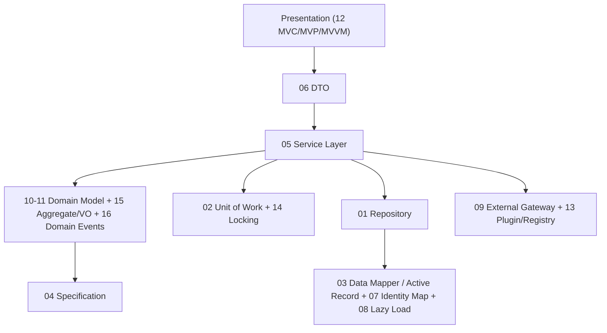

# Module 09 Overview: Enterprise Application Patterns

## Why Enterprise Patterns Exist

Small scripts can read a database row, run an `if` statement, and print HTML in 30 lines. Enterprise applications fail when that style scales to 200 tables, 50 endpoints, concurrent users, and 3 external payment/shipping APIs:
- **SQL leaks into controllers**, making business rules untestable without a live database.
- **Concurrent updates overwrite each other** silently (lost updates).
- **Entity schemas leak into public JSON APIs**, breaking clients whenever a column is renamed.
- **Business logic scatters across services**, leaving "anemic" entities that are just getter/setter bags.

---

## The Enterprise Pattern Map

---

## Suggested Reading Order

1. **Persistence & Transactions (`01`–`04`, `07`–`08`, `14`)**: Repository, Unit of Work, Data Mapper vs Active Record, Specification, Identity Map, Lazy Loading, Locking.
2. **Application & Domain Modeling (`05`–`06`, `10`–`11`, `15`–`16`)**: Service Layer, DTOs, Transaction Script vs Domain Model, Anemic vs Rich Domain, Aggregates, Domain Events.
3. **Boundaries & UI (`09`, `12`–`13`)**: External Gateways, MVC/MVP/MVVM, Plugin & Registry.
