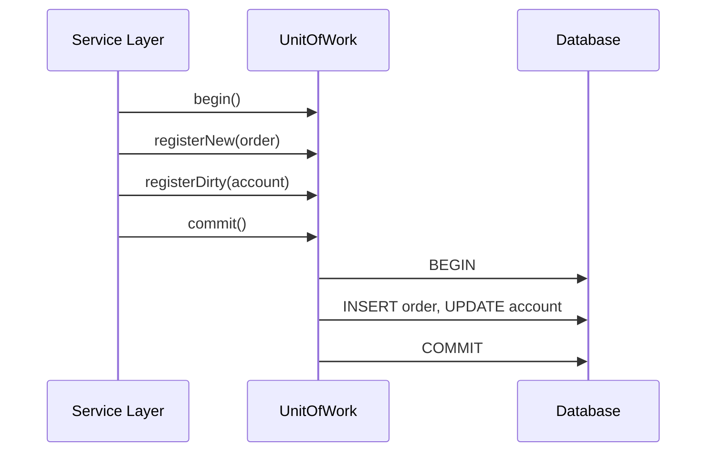

# Unit of Work

| Field | Value |
| :--- | :--- |
| **Category** | Enterprise Application Patterns (Transactions) |
| **Origin** | Martin Fowler (*PoEAA*, 2002) |
| **Difficulty** | Intermediate |
| **Prerequisite(s)** | [Repository](file:///E:/Learning/engineering-notes/08-solid-design-patterns/09-enterprise-application-patterns/01-repository.md) |
| **Status** | Complete |

> **TL;DR**: Unit of Work maintains a list of objects affected by a business transaction and coordinates writing out all changes (inserts, updates, deletes) in **one atomic commit**—rolling back everything if any step fails.

---

## 1. The Problem: Why Does Unit of Work Exist?

In a money transfer or order checkout, a single business operation touches multiple aggregates:
1. Debit `Account A`
2. Credit `Account B`
3. Insert `LedgerEntry`

If each Repository commits immediately on `.save()`, a crash or validation failure after step 1 leaves **Account A debited and Account B uncredited**—corrupting financial data! Plus, firing 50 separate `UPDATE` statements on every setter call destroys DB throughput.

---

## 2. What Is Unit of Work?

A **Unit of Work** tracks every object read, created, modified, or deleted during a business transaction, and at `commit()` time:
1. Opens (or joins) a single database transaction.
2. Flushes all changes in dependency order (respecting foreign keys).
3. Commits atomically—or rolls back everything on error.

---

## 3. How It Works



---

## 4. What Goes Wrong Without It

```ts
// ❌ BROKEN: Partial write if credit() throws!
await accountRepo.save(debitAccount);   // Committed!
await accountRepo.save(creditAccount);  // Throws DB error -> money vanished!
```

---

## 5. Multi-Language Examples

### Java 25 LTS (`AutoCloseable` Unit of Work)

```java
import java.util.*;

public class UnitOfWorkDemo {
    static class UnitOfWork implements AutoCloseable {
        private final List<String> ops = new ArrayList<>();
        private boolean committed = false;

        void registerNew(String entity) { ops.add("INSERT " + entity); }
        void registerDirty(String entity) { ops.add("UPDATE " + entity); }

        void commit() {
            System.out.println("BEGIN TX -> " + ops + " -> COMMIT");
            committed = true;
            ops.clear();
        }

        @Override
        public void close() {
            if (!committed && !ops.isEmpty()) {
                System.out.println("ROLLBACK " + ops);
                ops.clear();
            }
        }
    }

    public static void main(String[] args) {
        try (var uow = new UnitOfWork()) {
            uow.registerDirty("Account(A)");
            uow.registerNew("Order(o-1)");
            uow.commit();
        }
    }
}
```

### TypeScript 5.8 (`async` Transaction Runner)

```ts
class UnitOfWork {
  private readonly ops: string[] = [];
  registerNew(entity: string) { this.ops.push('INSERT ' + entity); }
  registerDirty(entity: string) { this.ops.push('UPDATE ' + entity); }

  async run<T>(work: (uow: UnitOfWork) => Promise<T>): Promise<T> {
    try {
      const result = await work(this);
      console.log('COMMIT:', this.ops);
      return result;
    } catch (err) {
      console.log('ROLLBACK:', this.ops);
      throw err;
    }
  }
}

new UnitOfWork().run(async (uow) => {
  uow.registerDirty('Account(A)');
  uow.registerNew('Order(o-1)');
});
```

### Python 3.14 (`with` Context Manager)

```python
class UnitOfWork:
    def __init__(self) -> None:
        self.ops: list[str] = []
        self.committed = False

    def __enter__(self) -> "UnitOfWork":
        return self

    def register_new(self, entity: str) -> None:
        self.ops.append(f"INSERT {entity}")

    def commit(self) -> None:
        print("COMMIT:", self.ops)
        self.committed = True

    def __exit__(self, exc_type, exc, tb) -> None:
        if exc_type or not self.committed:
            print("ROLLBACK:", self.ops)

with UnitOfWork() as uow:
    uow.register_new("Order(o-1)")
    uow.commit()
```

---

## 6. Real-World Examples

1. **Hibernate / JPA `EntityManager` & `@Transactional`**: Tracks dirty entities automatically in a persistence context and flushes on transaction commit.
2. **SQLAlchemy `Session` (`with Session(engine) as session:`)**: Built-in Unit of Work + Identity Map.
3. **EF Core `DbContext.SaveChanges()` / MikroORM `em.flush()`**: Explicit Unit of Work flush.

---

## 7. Variants & Related Patterns

- **Explicit Registration** (`uow.registerDirty(x)`): Simple, zero reflection magic.
- **Automatic Dirty-Checking** (Hibernate/SQLAlchemy): Snapshots loaded entities and diffs on commit.
- **Related**: [Repository](file:///E:/Learning/engineering-notes/08-solid-design-patterns/09-enterprise-application-patterns/01-repository.md), [Identity Map](file:///E:/Learning/engineering-notes/08-solid-design-patterns/09-enterprise-application-patterns/07-identity-map.md), [Service Layer](file:///E:/Learning/engineering-notes/08-solid-design-patterns/09-enterprise-application-patterns/05-service-layer.md).

---

## 8. Advantages

- **Atomic Consistency**: All-or-nothing database writes across multiple Repositories.
- **Batched Writes**: Coalesces multiple mutations to the same row into one `UPDATE`.
- **Clean Rollbacks**: Context managers (`try-with-resources`, `with`) guarantee rollback on exceptions.

---

## 9. Limitations & When NOT to Use

- **Cross-Service / Distributed Writes**: A DB Unit of Work cannot span two separate microservices—use **Saga** + **Outbox** ([Module 11](file:///E:/Learning/engineering-notes/08-solid-design-patterns/11-distributed-and-cloud-patterns/README.md)).
- **Long-Running Transactions**: Never hold a DB Unit of Work open while waiting on user input or slow external HTTP calls (locks DB connections/rows).

---

## 10. Anti-Patterns & Common Mistakes

| Mistake | Why It Fails | Fix |
| :--- | :--- | :--- |
| Making external HTTP calls *inside* a DB transaction | Holds DB connections/locks during network timeouts | Call external APIs outside TX or use **Outbox Pattern** |
| Sharing one Unit of Work across concurrent threads | Corrupts session state and transaction boundaries | Scope 1 Unit of Work per request/use-case |
| Swallowing exceptions inside `with uow:` before `commit()` | Silently skips commit or commits partial state | Let exceptions propagate so `__exit__` rolls back |
| Calling `commit()` inside nested helper methods | Prematurely commits an outer transaction | Only the outermost Service Layer / UoW commits |
| Keeping a Unit of Work open for bulk 1M-row ETL | Identity Map grows until OOM | Batch in chunks of 500–1,000 and clear session |
| Confusing `flush()` with `commit()` | `flush` sends SQL to DB TX, but changes still roll back until `commit()` | Understand both lifecycle stages |

---

## 11. Comparison: UoW vs Auto-Commit per Repo

| Aspect | Unit of Work | Auto-Commit per Repo |
| :--- | :--- | :--- |
| **Multi-Repo Atomicity** | Guaranteed (`COMMIT`/`ROLLBACK`) | Broken (partial writes on failure) |
| **DB Round Trips** | Batched on commit | 1 TX per `save()` |

---

## 12. Design Checklist

- [ ] Is every Unit of Work scoped to a single request/use-case?
- [ ] Are slow external HTTP calls kept *outside* the active DB transaction?
- [ ] Does failure automatically trigger rollback (`AutoCloseable` / `with` / `@Transactional`)?

---

## 13. Interview Questions

<details>
<summary>1. What problem does Unit of Work solve alongside Repository?</summary>

Repository abstracts persistence per Aggregate, while Unit of Work coordinates atomic transactions and change tracking across multiple Repositories.

</details>

<details>
<summary>2. Why shouldn't you make external HTTP calls inside a Unit of Work transaction?</summary>

Holding a DB transaction open during slow network I/O exhausts the DB connection pool and holds row locks, causing timeouts across unrelated requests.

</details>

<details>
<summary>3. How do SQLAlchemy `Session` and JPA `EntityManager` implement Unit of Work?</summary>

Both track loaded entities in an Identity Map, detect dirty fields automatically, order SQL inserts/updates/deletes to satisfy foreign keys, and execute them in one transaction on commit.

</details>

<details>
<summary>4. What happens if you process 1,000,000 rows in a single Unit of Work?</summary>

The internal change-tracking map / Identity Map retains all 1M objects in RAM, causing `OutOfMemoryError`. Flush and clear in small batches (e.g., every 500 rows).

</details>

<details>
<summary>5. What is the difference between `flush()` and `commit()`?</summary>

`flush()` sends pending SQL statements to the database within the open transaction (making them visible to subsequent queries in that same TX), while `commit()` permanently finalizes the transaction.

</details>

<details>
<summary>6. Can a Unit of Work span two different databases or microservices?</summary>

No (unless using slow 2PC/XA). Use the Saga pattern + Outbox pattern for cross-service consistency.

</details>

<details>
<summary>7. Where should `uow.commit()` be called?</summary>

At the Service Layer / use-case boundary, never inside individual Repositories.

</details>

<details>
<summary>8. How do Python `with` and Java `try-with-resources` help Unit of Work?</summary>

They guarantee `rollback()` / cleanup executes automatically even if an exception is thrown mid-use-case.

</details>

---

## 14. Practice Exercises

<details>
<summary>Exercise 1: Bank Transfer with Rollback</summary>

Implement `transfer(fromId, toId, amount)` using `UnitOfWork` where an exception during `credit` rolls back `debit`.

</details>

<details>
<summary>Exercise 2: Dirty-Tracking Wrapper</summary>

Extend the Python `UnitOfWork` to track `new`, `dirty`, and `removed` sets and print them in `INSERT -> UPDATE -> DELETE` order on `commit()`.

</details>

<details>
<summary>Exercise 3: Batch Clear</summary>

Demonstrate batching 1,000 inserts in chunks of 100 with `flush()` + `clear()`.

</details>

---

## 15. Cheat Sheet

- **Role**: Atomic transaction coordinator + change tracker.
- **Scope**: 1 per request/use-case, never shared across threads.
- **Rule**: No slow HTTP calls inside the TX; commit at Service Layer.

---

## 16. In Your Language

| Track | Relevant Deep-Dive |
| :--- | :--- |
| **Java** | [Spring Transactions](file:///E:/Learning/engineering-notes/03-backend/spring-boot/README.md) |
| **TypeScript** | [Node/NestJS Transactions](file:///E:/Learning/engineering-notes/03-backend/nestjs/README.md) |
| **Python** | [SQLAlchemy Sessions](file:///E:/Learning/engineering-notes/01-languages/python/19-database-access/README.md) |

---

## 17. Navigation

| Previous | Up | Next |
| :--- | :--- | :--- |
| [Repository](file:///E:/Learning/engineering-notes/08-solid-design-patterns/09-enterprise-application-patterns/01-repository.md) | [Module 09](file:///E:/Learning/engineering-notes/08-solid-design-patterns/09-enterprise-application-patterns/README.md) | [Data Mapper vs Active Record](file:///E:/Learning/engineering-notes/08-solid-design-patterns/09-enterprise-application-patterns/03-data-mapper-vs-active-record.md) |
