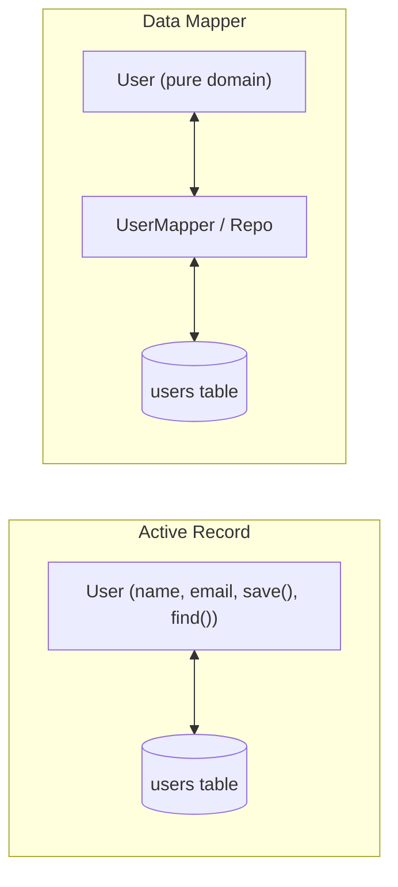

# Data Mapper vs Active Record

| Field | Value |
| :--- | :--- |
| **Category** | Enterprise Application Patterns (Persistence) |
| **Origin** | Martin Fowler (*PoEAA*, 2002) |
| **Difficulty** | Intermediate |
| **Prerequisite(s)** | [Repository](file:///E:/Learning/engineering-notes/08-solid-design-patterns/09-enterprise-application-patterns/01-repository.md), [Single Responsibility Principle](file:///E:/Learning/engineering-notes/08-solid-design-patterns/02-solid-principles/01-single-responsibility.md) |
| **Status** | Complete |

> **TL;DR**: **Active Record** puts persistence methods (`user.save()`, `User.find()`) directly on the domain object (fast for CRUD, couples domain to DB). **Data Mapper** keeps domain objects 100% persistence-ignorant and delegates all SQL/table mapping to a separate Mapper/Repository layer.

---

## 1. The Problem: Why Does This Choice Matter?

Every application using a relational database faces the **Object-Relational Impedance Mismatch**: objects have inheritance, encapsulation, and value types (`Money`), while tables have flat columns and foreign keys. You must decide whether your domain objects **know about the database** (Active Record) or **stay completely ignorant of it** (Data Mapper).

---

## 2. Definitions

- **Active Record**: An object wraps a single database row, holds its columns as fields, and includes `save()`, `delete()`, and `find()` methods (e.g., Django ORM, Rails ActiveRecord, Mongoose).
- **Data Mapper**: A separate mapper/ORM layer (e.g., Hibernate/JPA, SQLAlchemy Data Mapper, MikroORM) transfers data between **plain domain objects** and database tables so neither knows the other's internal structure.

---

## 3. Architecture Comparison



---

## 4. What Goes Wrong With the Wrong Choice

```python
# ❌ Active Record in complex DDD: Unit-testing Order.apply_discount() hits SQLite/Postgres!
class Order(Model):
    def apply_discount(self, code: str):
        self.total *= 0.9
        self.save()  # Coupled directly to DB connection!
```

---

## 5. Multi-Language Examples

### Java 25 LTS (Data Mapper — Pure Domain + Separate Mapper)

```java
public class DataMapperDemo {
    // Pure domain object (zero SQL/ORM imports)
    static class User {
        final String id;
        String email;
        User(String id, String email) { this.id = id; this.email = email; }
        void changeEmail(String next) {
            if (!next.contains("@")) throw new IllegalArgumentException("Bad email");
            this.email = next;
        }
    }

    // Separate row representation & mapper
    record UserRow(String id, String email_addr) {}
    static User toDomain(UserRow row) { return new User(row.id(), row.email_addr()); }
    static UserRow toRow(User u) { return new UserRow(u.id, u.email); }

    public static void main(String[] args) {
        var u = toDomain(new UserRow("u1", "a@b.com"));
        u.changeEmail("new@b.com");
        System.out.println(toRow(u));
    }
}
```

### TypeScript 5.8 (Active Record vs Data Mapper)

```ts
// Active Record style (simple CRUD)
class ActiveUser {
  id: string;
  email: string;
  constructor(id: string, email: string) { this.id = id; this.email = email; }
  async save(): Promise<void> { console.log('SQL UPSERT active_users', this.id); }
}

// Data Mapper style (decoupled domain)
class DomainUser {
  readonly id: string;
  email: string;
  constructor(id: string, email: string) { this.id = id; this.email = email; }
}
const UserMapper = {
  toPersistence: (u: DomainUser) => ({ user_id: u.id, email_address: u.email }),
  toDomain: (row: { user_id: string; email_address: string }) => new DomainUser(row.user_id, row.email_address),
};

console.log(UserMapper.toPersistence(new DomainUser('u1', 'a@b.com')));
```

### Python 3.14 (Pure Domain + Separate Mapper)

```python
from dataclasses import dataclass

@dataclass
class User:
    id: str
    email: str

class UserMapper:
    @staticmethod
    def to_domain(row: dict[str, str]) -> User:
        return User(id=row["user_id"], email=row["email_addr"])

    @staticmethod
    def to_row(user: User) -> dict[str, str]:
        return {"user_id": user.id, "email_addr": user.email}

u = UserMapper.to_domain({"user_id": "u1", "email_addr": "a@b.com"})
print("Mapped row:", UserMapper.to_row(u))
```

---

## 6. Real-World Examples

1. **Active Record**: Ruby on Rails `ActiveRecord::Base`, Django `models.Model`, Laravel Eloquent, TypeORM `BaseEntity`.
2. **Data Mapper**: Java Hibernate / JPA (with separate domain/entity mapping), Python SQLAlchemy `registry.map_imperatively()`, Doctrine ORM (PHP), MikroORM.

---

## 7. Related Patterns

- [Repository](file:///E:/Learning/engineering-notes/08-solid-design-patterns/09-enterprise-application-patterns/01-repository.md), [Unit of Work](file:///E:/Learning/engineering-notes/08-solid-design-patterns/09-enterprise-application-patterns/02-unit-of-work.md), [Domain Model vs Transaction Script](file:///E:/Learning/engineering-notes/08-solid-design-patterns/09-enterprise-application-patterns/10-domain-model-vs-transaction-script.md).

---

## 8. Advantages & Trade-offs

- **Active Record**: Minimal boilerplate; 1 class = 1 table; fastest time-to-market for CRUD.
- **Data Mapper**: Domain stays 100% testable without DB; domain shape can differ from normalized DB tables (e.g., splitting `Money` value objects across columns).

---

## 9. When to Choose Which

- Choose **Active Record** for CRUD-heavy admin panels, MVPs, and simple 1-to-1 table-to-model apps.
- Choose **Data Mapper** for rich DDD domains, complex invariants, or when DB schema and domain model evolve independently.

---

## 10. Anti-Patterns & Common Mistakes

| Mistake | Why It Fails | Fix |
| :--- | :--- | :--- |
| Putting `@Entity` / `@Table` JPA annotations on rich DDD aggregates and calling it "pure domain" | Still couples domain design to ORM proxy/no-arg-constructor rules | Map between JPA `@Entity` persistence models and pure domain entities when needed |
| Calling `model.save()` inside domain business methods in Active Record | Breaks unit testing and transaction boundaries | Keep `.save()` in controllers/services |
| Writing manual Data Mappers for 50 trivial CRUD tables | Massive mapping boilerplate | Use Active Record or thin Prisma/jOOQ for CRUD modules |
| Exposing Active Record models directly to JSON serializers | Leaks internal DB columns and triggers accidental lazy-load queries | Map to explicit DTOs |
| Mixing Active Record and Data Mapper on the same table | Confuses ownership of writes | Pick one per module/bounded context |
| Ignoring SQL N+1 queries in either pattern | ORM convenience hides extra round-trips | Profile SQL logs; use `join fetch` / eager loading |

---

## 11. Comparison Table

| Dimension | Active Record | Data Mapper |
| :--- | :--- | :--- |
| **Domain–DB Coupling** | High (1-to-1 with table) | Zero (persistence-ignorant) |
| **Unit Testing** | Needs DB or heavy mocking | Pure in-memory tests |
| **Boilerplate** | Very low | Moderate (mappers + repos) |
| **Best For** | CRUD, MVPs, Rails/Django apps | Rich Domain Model, Hexagonal/Clean Arch |

---

## 12. Design Checklist

- [ ] Does the module have complex domain invariants? If yes, prefer Data Mapper.
- [ ] Is it simple CRUD? If yes, Active Record saves significant boilerplate.
- [ ] Are domain tests runnable without booting a database?

---

## 13. Interview Questions

<details>
<summary>1. What is the core difference between Active Record and Data Mapper?</summary>

In Active Record, the domain object itself owns `save()`/`delete()`/`find()` persistence logic and mirrors a DB row. In Data Mapper, a separate mapper/repository layer translates between persistence-ignorant domain objects and DB tables.

</details>

<details>
<summary>2. Why does Active Record violate the Single Responsibility Principle?</summary>

One class holds both business logic/validation and database persistence/SQL concerns.

</details>

<details>
<summary>3. When is Active Record the *better* engineering choice?</summary>

For CRUD-heavy services, internal admin tools, and early-stage MVPs where domain objects map 1-to-1 to tables and speed of delivery matters most.

</details>

<details>
<summary>4. How does Data Mapper support Hexagonal / Clean Architecture?</summary>

It allows the inner domain core to have zero dependencies on SQL, ORMs, or frameworks.

</details>

<details>
<summary>5. What is "Object-Relational Impedance Mismatch"?</summary>

The structural friction between OOP concepts (inheritance, object graphs, value objects, polymorphism) and relational tables (flat rows, foreign keys, joins).

</details>

<details>
<summary>6. Name two frameworks that use Active Record and two that use Data Mapper.</summary>

Active Record: Rails ActiveRecord, Django ORM, Eloquent. Data Mapper: SQLAlchemy (imperative/mapper), Doctrine, Hibernate (when separated from domain), MikroORM.

</details>

<details>
<summary>7. Can an app use Active Record in one module and Data Mapper in another?</summary>

Yes—in a Modular Monolith, simple admin/settings modules can use Active Record while the core billing/order engine uses Data Mapper.

</details>

<details>
<summary>8. How does Data Mapper handle Value Objects like `Money(amount, currency)`?</summary>

It maps the single `Money` value object in the domain cleanly onto two flat columns (`amount_cents`, `currency_code`) in the `orders` table.

</details>

---

## 14. Practice Exercises

<details>
<summary>Exercise 1: Map a `Money` Value Object</summary>

Write a Data Mapper converting `{ price_cents: 1999, currency: "USD" }` into an `Order` with a `Money` value object.

</details>

<details>
<summary>Exercise 2: Decouple an Active Record Method</summary>

Refactor a Django/ActiveRecord-style `Invoice.mark_paid()` that calls `self.save()` into a pure domain method + `InvoiceRepository.save()`.

</details>

<details>
<summary>Exercise 3: Trade-off Memo</summary>

Write a 5-line ADR justifying Active Record vs Data Mapper for a URL-shortener microservice vs a multi-currency ledger.

</details>

---

## 15. Cheat Sheet

- **Active Record**: Object = DB Row + `save()`. Fast CRUD, coupled to DB.
- **Data Mapper**: Pure Domain ↔ Separate Mapper ↔ DB. Decoupled, testable, more code.

---

## 16. In Your Language

| Track | Relevant Deep-Dive |
| :--- | :--- |
| **Java** | [Spring Data & JPA](file:///E:/Learning/engineering-notes/03-backend/spring-boot/README.md) |
| **TypeScript** | [TypeORM / Prisma in NestJS](file:///E:/Learning/engineering-notes/03-backend/nestjs/README.md) |
| **Python** | [Python Database Access](file:///E:/Learning/engineering-notes/01-languages/python/19-database-access/README.md) |

---

## 17. Navigation

| Previous | Up | Next |
| :--- | :--- | :--- |
| [Unit of Work](file:///E:/Learning/engineering-notes/08-solid-design-patterns/09-enterprise-application-patterns/02-unit-of-work.md) | [Module 09](file:///E:/Learning/engineering-notes/08-solid-design-patterns/09-enterprise-application-patterns/README.md) | [Specification](file:///E:/Learning/engineering-notes/08-solid-design-patterns/09-enterprise-application-patterns/04-specification.md) |
