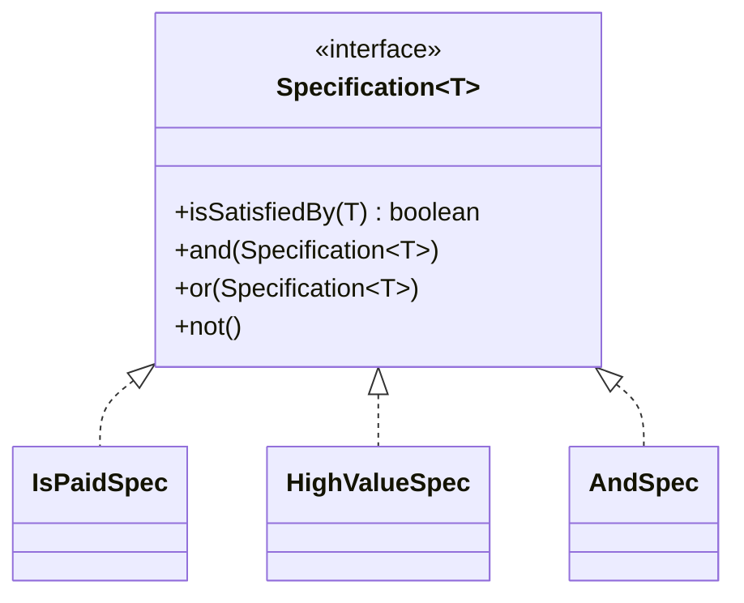

# Specification Pattern

| Field | Value |
| :--- | :--- |
| **Category** | Enterprise Application Patterns (Domain & Querying) |
| **Origin** | Eric Evans & Martin Fowler (1997 / *DDD* 2003) |
| **Difficulty** | Intermediate |
| **Prerequisite(s)** | [Repository](file:///E:/Learning/engineering-notes/08-solid-design-patterns/09-enterprise-application-patterns/01-repository.md), [Composite](file:///E:/Learning/engineering-notes/08-solid-design-patterns/06-structural-patterns/03-composite.md) |
| **Status** | Complete |

> **TL;DR**: Specification encapsulates a boolean business rule (`isSatisfiedBy(item)`) as a composable object (`and`, `or`, `not`), eliminating `findByXAndYAndZ` repository method explosion and unifying validation + querying.

---

## 1. The Problem: Why Does Specification Exist?

As search and eligibility rules grow, repositories suffer from **method explosion**:
- `findActiveUsers()`
- `findActivePremiumUsers()`
- `findActivePremiumUsersInRegion(region)`
- `findActivePremiumUsersNotSuspendedInRegion(region)`

Meanwhile, the *exact same rule* ("is eligible for discount?") is often duplicated once in SQL (`WHERE active = true AND total > 100`) and again in Python/Java (`if user.active and order.total > 100`).

---

## 2. What Is the Specification Pattern?

A **Specification** is a predicate object with `isSatisfiedBy(T candidate): boolean` and boolean combinators (`and`, `or`, `not`). Because specifications are first-class objects, you can combine them dynamically at runtime and pass them to `repo.findAll(spec)` or `order.isEligible(spec)`.

---

## 3. How It Works



---

## 4. What Goes Wrong Without It

```java
// ❌ BROKEN: Combinatorial explosion of repository methods
List<Order> findByPaidTrue();
List<Order> findByPaidTrueAndTotalGreaterThan(long min);
List<Order> findByPaidTrueAndTotalGreaterThanAndRegion(long min, String region);
```

---

## 5. Multi-Language Examples

### Java 25 LTS

```java
import java.util.List;

public class SpecificationDemo {
    record Order(String id, long cents, boolean paid) {}

    @FunctionalInterface
    interface Spec<T> {
        boolean isSatisfiedBy(T item);
        default Spec<T> and(Spec<T> other) { return x -> this.isSatisfiedBy(x) && other.isSatisfiedBy(x); }
        default Spec<T> or(Spec<T> other) { return x -> this.isSatisfiedBy(x) || other.isSatisfiedBy(x); }
        default Spec<T> not() { return x -> !this.isSatisfiedBy(x); }
    }

    public static void main(String[] args) {
        var orders = List.of(new Order("o1", 5000, true), new Order("o2", 1200, false));
        Spec<Order> isPaid = Order::paid;
        Spec<Order> highValue = o -> o.cents() >= 2000;
        Spec<Order> eligible = isPaid.and(highValue);

        System.out.println("Matches: " + orders.stream().filter(eligible::isSatisfiedBy).toList());
    }
}
```

### TypeScript 5.8

```ts
type Spec<T> = (item: T) => boolean;
const andSpec = <T>(a: Spec<T>, b: Spec<T>): Spec<T> => (x) => a(x) && b(x);
const notSpec = <T>(a: Spec<T>): Spec<T> => (x) => !a(x);

interface Order { id: string; cents: number; paid: boolean; }
const orders: Order[] = [
  { id: 'o1', cents: 5000, paid: true },
  { id: 'o2', cents: 1200, paid: false },
];
const isPaid: Spec<Order> = (o) => o.paid;
const highValue: Spec<Order> = (o) => o.cents >= 2000;
console.log('Matches:', orders.filter(andSpec(isPaid, highValue)));
```

### Python 3.14

```python
from dataclasses import dataclass

@dataclass(frozen=True)
class Order:
    id: str
    cents: int
    paid: bool

class Spec[T]:
    def is_satisfied_by(self, item: T) -> bool: ...
    def __and__(self, other: "Spec[T]") -> "Spec[T]": return AndSpec(self, other)

class AndSpec[T](Spec[T]):
    def __init__(self, a: Spec[T], b: Spec[T]) -> None:
        self.a, self.b = a, b
    def is_satisfied_by(self, item: T) -> bool:
        return self.a.is_satisfied_by(item) and self.b.is_satisfied_by(item)

class PaidSpec(Spec[Order]):
    def is_satisfied_by(self, item: Order) -> bool: return item.paid

class MinCentsSpec(Spec[Order]):
    def __init__(self, min_cents: int) -> None: self.min_cents = min_cents
    def is_satisfied_by(self, item: Order) -> bool: return item.cents >= self.min_cents

orders = [Order("o1", 5000, True), Order("o2", 1200, False)]
spec = PaidSpec() & MinCentsSpec(2000)
print("Matches:", [o.id for o in orders if spec.is_satisfied_by(o)])
```

---

## 6. Real-World Examples

1. **Spring Data JPA `Specification<T>`**: Composes type-safe SQL `CriteriaBuilder` predicates (`repo.findAll(isPaid().and(minTotal(2000)))`).
2. **E-Commerce Rule Engines**: Coupon eligibility (`MinSpendSpec & FirstOrderSpec & ~ExcludedCategorySpec`).
3. **Access Control / Feature Flags**: Composable user-targeting rules (`IsBetaUser & CountryIn(["US", "CA"])`).

---

## 7. Related Patterns

- [Composite](file:///E:/Learning/engineering-notes/08-solid-design-patterns/06-structural-patterns/03-composite.md), [Repository](file:///E:/Learning/engineering-notes/08-solid-design-patterns/09-enterprise-application-patterns/01-repository.md), [Strategy](file:///E:/Learning/engineering-notes/08-solid-design-patterns/07-behavioral-patterns/01-strategy.md).

---

## 8. Advantages

- **Zero Method Explosion**: Combine arbitrary filters without adding new Repository methods.
- **Reusable Across Contexts**: Use the same rule for validation, selection, and querying.
- **Self-Documenting Domain Rules**: `IsOverdueSpec` reads better than `o.dueDate < now && !o.paid`.

---

## 9. Limitations & When NOT to Use

- **In-Memory vs SQL Translation**: Pure lambda predicates (`o -> o.cents() > 100`) work in memory, but translating them to SQL requires an expression tree (JPA `CriteriaBuilder`, LINQ `Expression<Func<T, bool>>`). Loading 1M rows into memory to filter with a lambda is catastrophic!

---

## 10. Anti-Patterns & Common Mistakes

| Mistake | Why It Fails | Fix |
| :--- | :--- | :--- |
| Loading entire DB table into RAM and filtering with `Spec` | OOM and huge network transfer | Translate `Spec` to SQL `WHERE` clauses (`CriteriaBuilder` / query AST) |
| Putting DB/HTTP calls inside `isSatisfiedBy()` | Causes N+1 queries per candidate | Pass already-loaded data or translate to SQL |
| Over-using Specification for a single static query | Unnecessary abstraction | Use a named repo method for 1-off queries |
| Mutating candidate objects inside `isSatisfiedBy()` | Side effects in predicates break composition | Keep specifications strictly pure |
| Ignoring SQL index usage in dynamic `OR` specs | Full table scans | Profile generated SQL for composite specs |
| Mixing UI pagination/sorting into `Spec` | Violates SRP | Keep `Spec` for filtering; pass `Pageable`/`Sort` separately |

---

## 11. Comparison: Specification vs Strategy

| Aspect | Specification | Strategy |
| :--- | :--- | :--- |
| **Output** | Always `boolean` (predicate) | Any behavior/computation |
| **Composition** | `and`, `or`, `not` (Composite) | Usually single active strategy |

---

## 12. Design Checklist

- [ ] Does `repo.findAll(spec)` execute the filter in SQL rather than loading all rows into memory?
- [ ] Are specifications pure and free of side effects?
- [ ] Are individual specs given clear domain names?

---

## 13. Interview Questions

<details>
<summary>1. What problem does Specification solve?</summary>

It prevents combinatorial explosion of repository query methods and lets developers compose reusable boolean business rules using `and`, `or`, and `not`.

</details>

<details>
<summary>2. What is the biggest pitfall when using Specification with a database?</summary>

Running an in-memory predicate by fetching all rows from the database first. Production SQL repositories must translate Specifications into SQL `WHERE` clauses (e.g., JPA `Specification` / `CriteriaBuilder`).

</details>

<details>
<summary>3. Which GoF patterns does Specification combine?</summary>

Strategy (pluggable predicate) + Composite (`AndSpec`, `OrSpec`, `NotSpec` tree).

</details>

<details>
<summary>4. What are the three main uses of a Specification?</summary>

1) **Validation** (does an object meet criteria?), 2) **Selection** (querying matching objects from a collection/DB), 3) **Construction-by-specification** (describing what to build).

</details>

<details>
<summary>5. How does Java 25 `Predicate<T>` relate to Specification?</summary>

`java.util.function.Predicate<T>` already has `.and()`, `.or()`, and `.negate()`, making it a built-in in-memory Specification.

</details>

<details>
<summary>6. Should sorting and pagination live inside Specification?</summary>

No—Specification answers *which* items match; pagination/sorting belong in a separate `Pageable`/`Sort` parameter.

</details>

<details>
<summary>7. When is Specification overkill?</summary>

When you have 2–3 fixed queries that never combine dynamically.

</details>

<details>
<summary>8. How can Python overload `&` and `|` for Specifications?</summary>

By implementing `__and__`, `__or__`, and `__invert__` (`~`) on the base `Spec` class.

</details>

---

## 14. Practice Exercises

<details>
<summary>Exercise 1: Coupon Eligibility Rules</summary>

Build `MinOrderSpec`, `NewCustomerSpec`, and `CategorySpec`, and compose `MinOrderSpec(50) & (NewCustomerSpec() | CategorySpec("BOOKS"))`.

</details>

<details>
<summary>Exercise 2: SQL `WHERE` Translator</summary>

Add a `toSql(): [string, unknown[]]` method to a TypeScript `Spec` AST (`Eq`, `Gt`, `And`) that outputs parameterized SQL safely.

</details>

<details>
<summary>Exercise 3: `NotSpec` Combinator</summary>

Extend the Java `SpecificationDemo` with `isPaid.not()` and verify it matches unpaid orders.

</details>

---

## 15. Cheat Sheet

- **Contract**: `isSatisfiedBy(T) -> bool` + `and`, `or`, `not`.
- **Warning**: Translate to SQL `WHERE` for DB queries; never filter 1M rows in RAM.

---

## 16. In Your Language

| Track | Relevant Deep-Dive |
| :--- | :--- |
| **Java** | [Spring Data Specifications](file:///E:/Learning/engineering-notes/03-backend/spring-boot/README.md) |
| **TypeScript** | [TypeScript Predicates](file:///E:/Learning/engineering-notes/01-languages/typescript/04-functions/README.md) |
| **Python** | [Python Functional & Dunder Methods](file:///E:/Learning/engineering-notes/01-languages/python/05-oop/README.md) |

---

## 17. Navigation

| Previous | Up | Next |
| :--- | :--- | :--- |
| [Data Mapper vs Active Record](file:///E:/Learning/engineering-notes/08-solid-design-patterns/09-enterprise-application-patterns/03-data-mapper-vs-active-record.md) | [Module 09](file:///E:/Learning/engineering-notes/08-solid-design-patterns/09-enterprise-application-patterns/README.md) | [Service Layer](file:///E:/Learning/engineering-notes/08-solid-design-patterns/09-enterprise-application-patterns/05-service-layer.md) |
