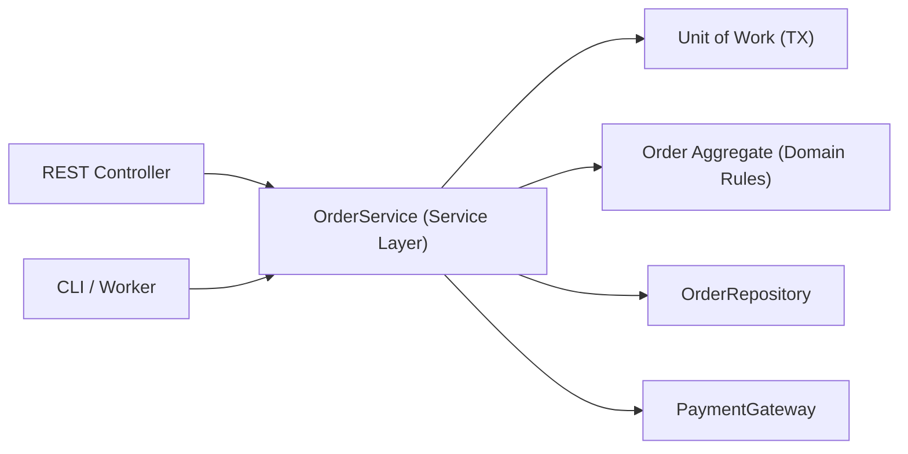

# Service Layer (Application Service)

| Field | Value |
| :--- | :--- |
| **Category** | Enterprise Application Patterns (Application Boundary) |
| **Origin** | Martin Fowler (*PoEAA*, 2002) |
| **Difficulty** | Beginner → Intermediate |
| **Prerequisite(s)** | [Facade](file:///E:/Learning/engineering-notes/08-solid-design-patterns/06-structural-patterns/05-facade.md), [Unit of Work](file:///E:/Learning/engineering-notes/08-solid-design-patterns/09-enterprise-application-patterns/02-unit-of-work.md) |
| **Status** | Complete |

> **TL;DR**: The Service Layer defines the application's boundary and available use cases (`placeOrder`, `refundPayment`), coordinating Repositories, Unit of Work transactions, authorization, and Domain objects—without containing HTTP logic or duplicating core domain invariants.

---

## 1. The Problem: Why Does a Service Layer Exist?

When business orchestration lives directly inside REST Controllers, GraphQL resolvers, or CLI commands:
1. **Duplicated Use-Case Logic**: Triggering `placeOrder` from both REST and a Kafka consumer duplicates validation, transaction setup, and event publishing.
2. **Fat Controllers**: HTTP controllers know about SQL transactions, inventory locking, and email gateways.
3. **Unclear Transaction Boundaries**: No single place owns "start TX → load aggregate → invoke domain method → save → commit".

---

## 2. What Is the Service Layer?

A **Service Layer** (or **Application Service / Use Case Handler**) is a thin orchestration layer sitting between transport adapters (HTTP/CLI/Queue) and the Domain + Persistence layers. Each public method represents one **application use case** and owns:
- Input DTO validation / translation
- Loading aggregates via Repositories
- Opening/committing the **Unit of Work**
- Invoking domain methods and publishing **Domain Events**

---

## 3. How It Works



---

## 4. What Goes Wrong Without It

```ts
// ❌ FAT CONTROLLER: HTTP status codes mixed with DB transactions & domain rules
app.post('/orders', async (req, res) => {
  await db.begin();
  // 80 lines of inventory checks, tax math, SQL inserts...
  await db.commit();
  res.status(201).json({ ok: true });
});
```

---

## 5. Multi-Language Examples

### Java 25 LTS

```java
public class ServiceLayerDemo {
    record PlaceOrderCmd(String userId, long cents) {}
    interface OrderRepo { void save(String id, long cents); }
    interface Tx { void runInTx(Runnable r); }

    static class OrderService {
        private final OrderRepo repo;
        private final Tx tx;
        OrderService(OrderRepo repo, Tx tx) { this.repo = repo; this.tx = tx; }

        public String placeOrder(PlaceOrderCmd cmd) {
            if (cmd.cents() <= 0) throw new IllegalArgumentException("Invalid amount");
            String id = "ord-101";
            tx.runInTx(() -> repo.save(id, cmd.cents()));
            return id;
        }
    }

    public static void main(String[] args) {
        var svc = new OrderService((id, c) -> System.out.println("Saved " + id + " $" + c), Runnable::run);
        System.out.println("Created: " + svc.placeOrder(new PlaceOrderCmd("u1", 2500)));
    }
}
```

### TypeScript 5.8

```ts
interface OrderRepo { save(id: string, cents: number): Promise<void>; }

class OrderService {
  private readonly repo: OrderRepo;
  constructor(repo: OrderRepo) { this.repo = repo; }

  async placeOrder(userId: string, cents: number): Promise<string> {
    if (cents <= 0) throw new Error('Invalid amount');
    const id = 'ord-' + userId;
    await this.repo.save(id, cents);
    return id;
  }
}

new OrderService({ save: async (id, c) => console.log('Saved', id, c) })
  .placeOrder('u1', 2500)
  .then((id) => console.log('Created:', id));
```

### Python 3.14

```python
from typing import Protocol

class OrderRepo(Protocol):
    def save(self, order_id: str, cents: int) -> None: ...

class OrderService:
    def __init__(self, repo: OrderRepo) -> None:
        self._repo = repo

    def place_order(self, user_id: str, cents: int) -> str:
        if cents <= 0:
            raise ValueError("Invalid amount")
        order_id = f"ord-{user_id}"
        self._repo.save(order_id, cents)
        return order_id

class PrintRepo:
    def save(self, order_id: str, cents: int) -> None:
        print("Saved:", order_id, cents)

print("Created:", OrderService(PrintRepo()).place_order("u1", 2500))
```

---

## 6. Real-World Examples

1. **Spring Boot `@Service` + `@Transactional`**: Coordinates `JpaRepository` calls inside a single transaction boundary.
2. **NestJS `@Injectable()` Services**: Separates transport `@Controller()` decorators from business orchestration.
3. **MediatR / CQRS Command Handlers**: One handler class per use case (`PlaceOrderHandler`) instead of a 2,000-line `OrderService`.

---

## 7. Related Patterns

- [Facade](file:///E:/Learning/engineering-notes/08-solid-design-patterns/06-structural-patterns/05-facade.md), [DTO](file:///E:/Learning/engineering-notes/08-solid-design-patterns/09-enterprise-application-patterns/06-data-transfer-object.md), [Anemic vs Rich Domain Model](file:///E:/Learning/engineering-notes/08-solid-design-patterns/09-enterprise-application-patterns/11-anemic-vs-rich-domain-model.md).

---

## 8. Advantages

- **Reusable Across Channels**: Same service serves REST, gRPC, CLI, and background jobs.
- **Clear Transaction Boundary**: One place owns `@Transactional` / `UnitOfWork`.
- **Clean Controllers**: Controllers become 5-line HTTP adapters.

---

## 9. Limitations & When NOT to Use

- **God Service Anti-Pattern**: A `UserService` with 45 methods and 3,000 lines violates SRP—split into focused Use-Case Services (`RegisterUserUseCase`) or push rules into Rich Domain Entities.
- **Pass-Through Services**: If `UserService.getById(id)` only forwards to `userRepo.findById(id)` with zero logic, don't wrap it blindly for reads.

---

## 10. Anti-Patterns & Common Mistakes

| Mistake | Why It Fails | Fix |
| :--- | :--- | :--- |
| Importing HTTP `Request`/`Response` inside a Service | Couples business logic to Express/FastAPI/Servlet | Accept plain DTOs/commands and return DTOs/Results |
| Putting all domain invariants in Service Layer ("Anemic Domain") | Entities become dumb data bags; rules duplicate across services | Keep entity invariants inside the Domain Entity |
| Calling `ServiceA` → `ServiceB` → `ServiceA` (circular deps) | Tightly coupled tangle | Coordinate via Domain Events or a higher-level orchestrator |
| Putting `@Transactional` on private methods (Spring proxy trap) | Proxy doesn't intercept self-calls; TX never starts! | Put `@Transactional` on public Service Layer entrypoints |
| Creating a 3,000-line `OrderService` | Hard to test and maintain | Split by use case or bounded sub-service |
| Returning ORM entities directly from Service | Leaks lazy proxies / internal columns | Return DTOs or immutable view models |

---

## 11. Comparison: Application Service vs Domain Service

| Aspect | Application Service (Service Layer) | Domain Service |
| :--- | :--- | :--- |
| **Knows About Infra/TX?** | Yes (Repositories, UoW, Gateways) | **No** (pure domain logic) |
| **Role** | Orchestrate use case & transactions | Stateless domain operation spanning 2+ entities (e.g., `TransferService`) |

---

## 12. Design Checklist

- [ ] Is the Service Layer free of HTTP/CLI/UI types (`Req`, `Res`, `HttpStatus`)?
- [ ] Does each Service method represent a coherent use case with clear transaction boundaries?
- [ ] Are entity invariants kept inside Domain Entities rather than leaked into Services?

---

## 13. Interview Questions

<details>
<summary>1. What is the difference between an Application Service and a Domain Service?</summary>

An Application Service (Service Layer) coordinates repositories, transactions, and external gateways for a use case. A Domain Service holds pure business logic that doesn't naturally belong to a single Entity (like currency conversion or inter-account transfers) and has zero infrastructure dependencies.

</details>

<details>
<summary>2. Why shouldn't a Service Layer take `HttpServletRequest` or Express `Request`?</summary>

Because then the service cannot be invoked from a background job, CLI, or message consumer without faking HTTP objects.

</details>

<details>
<summary>3. What is the "Anemic Domain Model" trap in Service Layers?</summary>

When all business rules live in procedural Services while Entities only have getters and setters.

</details>

<details>
<summary>4. How do you prevent a Service class from becoming a God Object?</summary>

Use vertical-slice Use Case classes (`PlaceOrderHandler`, `CancelOrderHandler`) or CQRS commands instead of one giant `OrderService`.

</details>

<details>
<summary>5. Where should `@Transactional` or `UnitOfWork` live?</summary>

At the Service Layer boundary, wrapping the entire use case.

</details>

<details>
<summary>6. Why does Spring `@Transactional` fail on self-invocation (`this.helper()`)?</summary>

Spring uses a dynamic Proxy around the Service bean; internal `this.helper()` calls bypass the proxy.

</details>

<details>
<summary>7. Should read-only queries always go through a Service Layer?</summary>

Simple read queries can use a thin Query Service / CQRS read repository directly without heavy domain service ceremony.

</details>

<details>
<summary>8. What should a Service Layer accept and return?</summary>

Input Commands/DTOs and output DTOs or `Result<T, E>` values—never raw ORM entities.

</details>

---

## 14. Practice Exercises

<details>
<summary>Exercise 1: Extract Fat Controller to Service Layer</summary>

Move validation, transaction management, and repo calls out of a sample HTTP POST handler into `CreateInvoiceService`.

</details>

<details>
<summary>Exercise 2: Vertical-Slice Use Case</summary>

Split a 4-method `UserService` into focused `RegisterUser` and `ResetPassword` use-case handlers.

</details>

<details>
<summary>Exercise 3: Application vs Domain Service</summary>

Separate `MoneyTransferDomainService.transfer(from, to, money)` (pure) from `TransferApplicationService.execute(cmd)` (loads repos + commits UoW).

</details>

---

## 15. Cheat Sheet

- **Role**: Orchestrate use case (load → domain logic → save → commit → publish events).
- **No HTTP types** in, **no ORM entities** out.
- **Avoid God Services**: Prefer focused use-case handlers.

---

## 16. In Your Language

| Track | Relevant Deep-Dive |
| :--- | :--- |
| **Java** | [Spring Boot Services](file:///E:/Learning/engineering-notes/03-backend/spring-boot/README.md) |
| **TypeScript** | [NestJS Providers & Services](file:///E:/Learning/engineering-notes/03-backend/nestjs/README.md) |
| **Python** | [FastAPI Service Layer](file:///E:/Learning/engineering-notes/03-backend/fastapi/README.md) |

---

## 17. Navigation

| Previous | Up | Next |
| :--- | :--- | :--- |
| [Specification](file:///E:/Learning/engineering-notes/08-solid-design-patterns/09-enterprise-application-patterns/04-specification.md) | [Module 09](file:///E:/Learning/engineering-notes/08-solid-design-patterns/09-enterprise-application-patterns/README.md) | [Data Transfer Object (DTO)](file:///E:/Learning/engineering-notes/08-solid-design-patterns/09-enterprise-application-patterns/06-data-transfer-object.md) |
