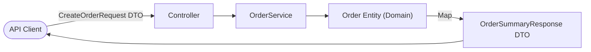

# Data Transfer Object (DTO)

| Field | Value |
| :--- | :--- |
| **Category** | Enterprise Application Patterns (Boundaries & Contracts) |
| **Origin** | Martin Fowler (*PoEAA*, 2002) |
| **Difficulty** | Beginner |
| **Prerequisite(s)** | [Service Layer](file:///E:/Learning/engineering-notes/08-solid-design-patterns/09-enterprise-application-patterns/05-service-layer.md) |
| **Status** | Complete |

> **TL;DR**: A DTO is a plain, behavior-free data structure (`record`, `interface`, Pydantic `BaseModel`) used to carry data across process, network, or layer boundaries—preventing internal domain/ORM models from leaking into public APIs.

---

## 1. The Problem: Why Do DTOs Exist?

Returning your internal ORM/Domain `User` entity directly from an API endpoint causes three serious bugs:
1. **Security Leaks**: Accidental serialization of `passwordHash`, `internalNotes`, or `salt` to JSON.
2. **Breaking API Changes**: Renaming a database column or refactoring a domain class immediately breaks mobile/frontend clients.
3. **Lazy-Loading / Circular-Reference Crashes**: JSON serializers walk `user.orders[].user.orders[]` into `StackOverflowError` or fire 50 unintended lazy SQL queries.

---

## 2. What Is a DTO?

A **Data Transfer Object** is a flat, serializable contract object containing **only data fields** (and optionally input validation schemas) tailored for a specific API request or response. It has **no business logic**.

---

## 3. How It Works



---

## 4. What Goes Wrong Without It

```java
// ❌ BROKEN: Returning JPA @Entity directly leaks passwordHash & triggers lazy-load JSON crash
@GetMapping("/users/{id}")
public User getUser(@PathVariable String id) {
    return userRepo.findById(id).orElseThrow();
}
```

---

## 5. Multi-Language Examples

### Java 25 LTS (`record` DTO + Static Factory Mapper)

```java
public class DtoDemo {
    // Internal domain entity (has sensitive fields & behavior)
    static class UserEntity {
        final String id, email, passwordHash;
        UserEntity(String id, String email, String hash) {
            this.id = id; this.email = email; this.passwordHash = hash;
        }
    }

    // Public Response DTO (immutable record, safe fields only)
    record UserResponseDto(String id, String email) {
        static UserResponseDto from(UserEntity u) {
            return new UserResponseDto(u.id, u.email);
        }
    }

    public static void main(String[] args) {
        var entity = new UserEntity("u1", "alice@example.com", "$2b$secret");
        System.out.println(UserResponseDto.from(entity));
    }
}
```

### TypeScript 5.8

```ts
interface UserEntity { id: string; email: string; passwordHash: string; }
interface UserResponseDto { readonly id: string; readonly email: string; }

const toUserDto = (u: UserEntity): UserResponseDto => ({ id: u.id, email: u.email });
console.log(toUserDto({ id: 'u1', email: 'alice@example.com', passwordHash: 'secret' }));
```

### Python 3.14

```python
from dataclasses import dataclass

@dataclass
class UserEntity:
    id: str
    email: str
    password_hash: str

@dataclass(frozen=True)
class UserResponseDto:
    id: str
    email: str

    @classmethod
    def from_entity(cls, u: UserEntity) -> "UserResponseDto":
        return cls(id=u.id, email=u.email)

print(UserResponseDto.from_entity(UserEntity("u1", "alice@example.com", "secret")))
```

---

## 6. Real-World Examples

1. **FastAPI + Pydantic `BaseModel`**: Separate `UserCreate` (input), `UserOut` (output, excludes `hashed_password`), and SQLAlchemy `User` (DB).
2. **NestJS `class-validator` DTOs**: `CreateOrderDto` validates incoming JSON before reaching services.
3. **Spring Boot Java `record` DTOs**: Zero-boilerplate immutable API contracts.

---

## 7. Related Patterns

- [Service Layer](file:///E:/Learning/engineering-notes/08-solid-design-patterns/09-enterprise-application-patterns/05-service-layer.md), [Value Object](file:///E:/Learning/engineering-notes/08-solid-design-patterns/09-enterprise-application-patterns/15-value-object-entity-aggregate.md).

---

## 8. Advantages

- **Security**: Explicit allow-list of exposed fields.
- **API Stability**: Refactor internal DB/domain models without breaking external JSON contracts.
- **Payload Optimization**: Shape responses for the exact UI screen (no over-fetching).

---

## 9. Limitations & When NOT to Use

- **Internal Method-to-Method Mapping**: Don't create separate DTOs between every internal class in the same module—use DTOs at **architectural/network boundaries**.
- **Mapping Boilerplate**: Creating 5 identical DTOs for a 2-field internal CRUD service adds noise.

---

## 10. Anti-Patterns & Common Mistakes

| Mistake | Why It Fails | Fix |
| :--- | :--- | :--- |
| Reusing `CreateUserDto` for `UpdateUser` and `UserResponse` | Leaks sensitive fields or makes required fields optional | Separate Request/Response DTOs per boundary |
| Putting business logic inside a DTO | Blurs boundary contracts with domain behavior | Keep DTOs pure data (+ schema validation) |
| Returning ORM `@Entity` directly from REST controllers | Leaks fields & breaks API on DB refactor | Always map to Response DTOs |
| Mass-assignment vulnerability (`Object.assign(user, req.body)`) | Attacker sends `{ "role": "ADMIN" }` | Explicitly pick allowed fields from validated Request DTO |
| Sharing DTOs across independent microservices via a common jar/npm | Tightly couples service deployments | Duplicate small contracts per service boundary |
| Using reflection-heavy auto-mappers silently dropping fields | Silent `null` bugs when a field is renamed | Prefer explicit compile-time mappers (`Dto.from(entity)`) |

---

## 11. Comparison: DTO vs Value Object

| Aspect | DTO | Value Object |
| :--- | :--- | :--- |
| **Purpose** | Carry data across boundaries | Model domain concepts with invariants (`Money`, `Email`) |
| **Behavior** | None (data only) | Domain methods & validation (`money.add(other)`) |

---

## 12. Design Checklist

- [ ] Are sensitive fields (`passwordHash`, internal IDs) excluded from Response DTOs?
- [ ] Are Request DTOs validated at the boundary?
- [ ] Are DTOs immutable (`record`, `readonly`, `frozen=True`)?

---

## 13. Interview Questions

<details>
<summary>1. Why shouldn't you return database entities directly from REST endpoints?</summary>

It risks leaking sensitive fields, couples your public API contract to internal DB schema changes, and can trigger lazy-loading N+1 queries or circular JSON serialization errors.

</details>

<details>
<summary>2. What is the difference between a DTO and a Value Object?</summary>

A DTO is a behavior-free transport container for crossing boundaries; a Value Object is a domain concept (`Money`, `DateRange`) that enforces invariants and carries domain methods.

</details>

<details>
<summary>3. How do DTOs prevent mass-assignment vulnerabilities?</summary>

By explicitly declaring only the fields a client is allowed to set (e.g., `name`, `email`), ignoring extra fields like `isAdmin` in the JSON payload.

</details>

<details>
<summary>4. Why are Java `record`s ideal for DTOs?</summary>

They are concise, immutable by default, and work natively with Jackson and Spring Boot serialization.

</details>

<details>
<summary>5. When are DTOs unnecessary?</summary>

Between internal helper functions inside the same module/bounded context—only use them across layer, module, or network boundaries.

</details>

<details>
<summary>6. Explicit mapping vs AutoMapper/MapStruct?</summary>

Explicit mapping (`Dto.from(entity)`) is compile-time safe and easy to debug; MapStruct is compile-time generated in Java; runtime reflection mappers hide missing-field bugs.

</details>

<details>
<summary>7. Should Request and Response DTOs be separate?</summary>

Yes—a `CreateUserRequest` needs `password`, whereas `UserResponse` must exclude `password` and include `id` and `createdAt`.

</details>

<details>
<summary>8. What is an over-fetching / under-fetching problem and how do DTOs help?</summary>

Returning a whole entity sends unused fields (over-fetching) or omits joined summaries (under-fetching). Tailored Response DTOs project only what the view needs.

</details>

---

## 14. Practice Exercises

<details>
<summary>Exercise 1: Separate Input & Output DTOs</summary>

Define `RegisterUserRequest` and `UserProfileResponse` in TypeScript or Python, ensuring `passwordHash` is never present on the response.

</details>

<details>
<summary>Exercise 2: Java `record` Mapper</summary>

Write `OrderSummaryDto.from(OrderEntity)` flattening `order.customer().name()` into a single `customerName` field.

</details>

<details>
<summary>Exercise 3: Spot the Mass-Assignment Bug</summary>

Fix a Python/TS endpoint that passes `**request.json()` directly into `User(**data)`.

</details>

---

## 15. Cheat Sheet

- **DTO = Data only**, no business logic, lives at boundaries.
- **Separate** Request DTOs from Response DTOs.
- **Never** expose ORM entities directly as JSON.

---

## 16. In Your Language

| Track | Relevant Deep-Dive |
| :--- | :--- |
| **Java** | [Records & Spring DTOs](file:///E:/Learning/engineering-notes/03-backend/spring-boot/README.md) |
| **TypeScript** | [NestJS Validation & DTOs](file:///E:/Learning/engineering-notes/03-backend/nestjs/README.md) |
| **Python** | [FastAPI Pydantic Models](file:///E:/Learning/engineering-notes/03-backend/fastapi/README.md) |

---

## 17. Navigation

| Previous | Up | Next |
| :--- | :--- | :--- |
| [Service Layer](file:///E:/Learning/engineering-notes/08-solid-design-patterns/09-enterprise-application-patterns/05-service-layer.md) | [Module 09](file:///E:/Learning/engineering-notes/08-solid-design-patterns/09-enterprise-application-patterns/README.md) | [Identity Map](file:///E:/Learning/engineering-notes/08-solid-design-patterns/09-enterprise-application-patterns/07-identity-map.md) |
