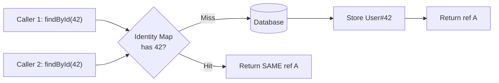

# Identity Map

| Field | Value |
| :--- | :--- |
| **Category** | Enterprise Application Patterns (Persistence & Caching) |
| **Origin** | Martin Fowler (*PoEAA*, 2002) |
| **Difficulty** | Intermediate |
| **Prerequisite(s)** | [Unit of Work](file:///E:/Learning/engineering-notes/08-solid-design-patterns/09-enterprise-application-patterns/02-unit-of-work.md), [Flyweight](file:///E:/Learning/engineering-notes/08-solid-design-patterns/06-structural-patterns/06-flyweight.md) |
| **Status** | Complete |

> **TL;DR**: Identity Map ensures each database row is loaded into **at most one in-memory object per Unit of Work/session**, preventing duplicate SQL reads and guaranteeing that two references to the same entity see each other's changes.

---

## 1. The Problem: Why Does Identity Map Exist?

Suppose within a single request:
1. `OrderService` loads `User(id=42)` and updates `user.credit -= 10`.
2. `LoyaltyService` (in the same request) also calls `userRepo.findById(42)`.

Without an Identity Map, the second call hits the database again and returns a **second distinct `User` instance** in memory with the *old* `credit` value! When the transaction commits, one instance overwrites the other, or business logic sees inconsistent state.

---

## 2. What Is an Identity Map?

An **Identity Map** is a per-session / per-request `Map<EntityKey, Entity>` maintained by the Unit of Work. Before querying the database by primary key, the mapper checks the map:
- **Hit**: Return the exact same in-memory object reference.
- **Miss**: Query the DB, store the object in the map, and return it.

---

## 3. How It Works



---

## 4. What Goes Wrong Without It

```python
# ❌ BROKEN: Two separate instances for row 42 in the same request
u1 = repo.find_by_id(42)
u1.balance = 50
u2 = repo.find_by_id(42)  # Queries DB again -> u2.balance is still 100!
```

---

## 5. Multi-Language Examples

### Java 25 LTS

```java
import java.util.*;

public class IdentityMapDemo {
    static class User {
        final String id; String name;
        User(String id, String name) { this.id = id; this.name = name; }
    }

    static class UserSession {
        private final Map<String, User> identityMap = new HashMap<>();
        User findById(String id) {
            return identityMap.computeIfAbsent(id, k -> {
                System.out.println("DB SELECT user " + k);
                return new User(k, "Alice");
            });
        }
    }

    public static void main(String[] args) {
        var session = new UserSession();
        var u1 = session.findById("42");
        var u2 = session.findById("42");
        System.out.println("Same instance? " + (u1 == u2)); // true, only 1 DB SELECT
    }
}
```

### TypeScript 5.8

```ts
class IdentityMap<K, V> {
  private readonly cache = new Map<K, V>();
  getOrLoad(key: K, loader: (k: K) => V): V {
    if (!this.cache.has(key)) this.cache.set(key, loader(key));
    return this.cache.get(key)!;
  }
}

const map = new IdentityMap<string, { id: string; balance: number }>();
const a = map.getOrLoad('42', (id) => ({ id, balance: 100 }));
a.balance = 50;
const b = map.getOrLoad('42', () => { throw new Error('Should not hit DB!'); });
console.log('Same ref?', a === b, 'b.balance=', b.balance);
```

### Python 3.14

```python
class IdentityMap:
    def __init__(self) -> None:
        self._items: dict[tuple[type, str], object] = {}

    def get_or_load[T](self, cls: type[T], key: str, loader) -> T:
        composite = (cls, key)
        if composite not in self._items:
            self._items[composite] = loader(key)
        return self._items[composite]  # type: ignore

imap = IdentityMap()
u1 = imap.get_or_load(dict, "42", lambda k: {"id": k, "balance": 100})
u1["balance"] = 50
u2 = imap.get_or_load(dict, "42", lambda k: {"id": k, "balance": 999})
print("Same object?", u1 is u2, u2["balance"])
```

---

## 6. Real-World Examples

1. **Hibernate / JPA Persistence Context (L1 Cache)**: Guarantees `em.find(User.class, 42) == em.find(User.class, 42)` within a transaction.
2. **SQLAlchemy `Session` (`identity_map`)**: Weak-value/strong-dirty map tracking every loaded ORM object.
3. **DataLoader (GraphQL)**: Request-scoped batching + identity caching to solve N+1 queries.

---

## 7. Related Patterns

- [Unit of Work](file:///E:/Learning/engineering-notes/08-solid-design-patterns/09-enterprise-application-patterns/02-unit-of-work.md), [Lazy Loading](file:///E:/Learning/engineering-notes/08-solid-design-patterns/09-enterprise-application-patterns/08-lazy-loading.md), [Flyweight](file:///E:/Learning/engineering-notes/08-solid-design-patterns/06-structural-patterns/06-flyweight.md).

---

## 8. Advantages

- **Identity Consistency**: Two code paths referencing ID `42` share the exact same object.
- **Free L1 Read Cache**: Avoids duplicate `SELECT ... WHERE id = ?` in the same request.

---

## 9. Limitations & When NOT to Use

- **Stale Reads Across Long Sessions**: Never make an Identity Map **global/cross-request**—other processes update the DB, leaving a global Identity Map stale and non-thread-safe!
- **Memory Bloat in Bulk Jobs**: Loading 500k rows into one session's Identity Map causes OOM unless cleared periodically.

---

## 10. Anti-Patterns & Common Mistakes

| Mistake | Why It Fails | Fix |
| :--- | :--- | :--- |
| Making the Identity Map a global singleton | Serves stale data across requests & causes race conditions | Scope strictly to 1 request / Unit of Work |
| Never clearing Identity Map during batch jobs | Heap fills up until OOM | `session.clear()` / `em.clear()` every N batches |
| Expecting `SELECT * FROM users WHERE age > 20` to skip DB | Identity Map only accelerates **primary-key** lookups | Use query caches carefully or accept DB query for predicates |
| Assuming Identity Map prevents concurrent DB writes from *other* users | It's in-process per request, not a DB lock | Combine with **Optimistic/Pessimistic Locking** |

---

## 11. Comparison: Identity Map vs L2 Distributed Cache

| Aspect | Identity Map (L1) | Distributed Cache (Redis / L2) |
| :--- | :--- | :--- |
| **Lifetime** | Single request / Unit of Work | Cross-request, TTL-based |
| **Goal** | Object identity consistency | Throughput & latency reduction |

---

## 12. Design Checklist

- [ ] Is the Identity Map scoped strictly to a single Unit of Work / request?
- [ ] Are batch jobs clearing the map periodically?

---

## 13. Interview Questions

<details>
<summary>1. What two problems does Identity Map solve?</summary>

1) Guarantees object identity consistency (two lookups of ID 42 in one transaction return the same reference), and 2) acts as a per-request L1 cache avoiding duplicate PK queries.

</details>

<details>
<summary>2. Why must an Identity Map be request-scoped, never application-global?</summary>

A global map would hold mutable objects across concurrent threads and serve stale data updated by other servers or transactions.

</details>

<details>
<summary>3. How does Identity Map interact with Unit of Work?</summary>

Unit of Work owns the Identity Map for the duration of the transaction, using it to track dirty objects and flush changes once.

</details>

<details>
<summary>4. Can Identity Map speed up non-primary-key queries like `findByStatus("PAID")`?</summary>

Not directly—the DB still executes the `WHERE` query, though the Identity Map can return existing tracked instances for matching PKs.

</details>

<details>
<summary>5. What happens in Hibernate/SQLAlchemy if you load 1M entities in one session?</summary>

The Identity Map retains references to all 1M objects, causing `OutOfMemoryError` unless you flush and `clear()` in chunks.

</details>

<details>
<summary>6. Does Identity Map prevent lost updates between two concurrent HTTP requests?</summary>

No—each request has its own Identity Map. Use Optimistic (`version`) or Pessimistic (`SELECT FOR UPDATE`) locking.

</details>

<details>
<summary>7. How is Identity Map different from Flyweight?</summary>

Flyweight shares immutable value objects globally to save RAM; Identity Map caches mutable per-session entities by primary key.

</details>

<details>
<summary>8. How does GraphQL DataLoader use Identity Map?</summary>

DataLoader caches loaded records per request by key while batching multiple `.load(id)` calls into a single `WHERE id IN (...)` query.

</details>

---

## 14. Practice Exercises

<details>
<summary>Exercise 1: Request-Scoped Identity Map</summary>

Wrap an in-memory `UserRepo` with a per-request `IdentityMap` and verify a counter shows only 1 DB fetch for 3 `findById("42")` calls.

</details>

<details>
<summary>Exercise 2: Composite Key `(Type, ID)`</summary>

Support multiple entity types (`User`, `Order`) in one `IdentityMap` keyed by `${type}:${id}`.

</details>

<details>
<summary>Exercise 3: Batch Clear Simulation</summary>

Simulate processing 1,000 items with `clear()` every 100 items, asserting max map size never exceeds 100.

</details>

---

## 15. Cheat Sheet

- **1 object per row per session** (`u1 == u2`).
- **Scope**: Request / Unit of Work only.
- **Batch jobs**: `clear()` periodically to avoid OOM.

---

## 16. In Your Language

| Track | Relevant Deep-Dive |
| :--- | :--- |
| **Java** | [JPA Persistence Context](file:///E:/Learning/engineering-notes/03-backend/spring-boot/README.md) |
| **TypeScript** | [GraphQL / ORM Caching](file:///E:/Learning/engineering-notes/03-backend/nestjs/README.md) |
| **Python** | [SQLAlchemy Identity Map](file:///E:/Learning/engineering-notes/01-languages/python/19-database-access/README.md) |

---

## 17. Navigation

| Previous | Up | Next |
| :--- | :--- | :--- |
| [Data Transfer Object (DTO)](file:///E:/Learning/engineering-notes/08-solid-design-patterns/09-enterprise-application-patterns/06-data-transfer-object.md) | [Module 09](file:///E:/Learning/engineering-notes/08-solid-design-patterns/09-enterprise-application-patterns/README.md) | [Lazy Loading](file:///E:/Learning/engineering-notes/08-solid-design-patterns/09-enterprise-application-patterns/08-lazy-loading.md) |
