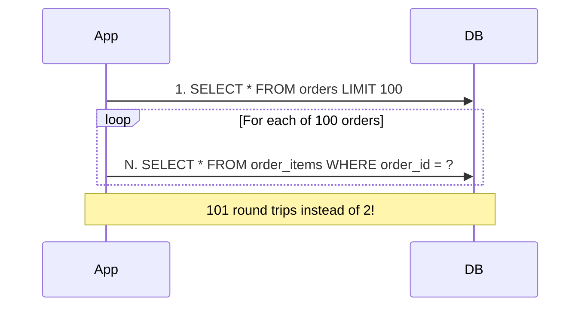

# Lazy Loading (and the N+1 Trap)

| Field | Value |
| :--- | :--- |
| **Category** | Enterprise Application Patterns (Persistence & Performance) |
| **Origin** | Martin Fowler (*PoEAA*, 2002) |
| **Difficulty** | Intermediate |
| **Prerequisite(s)** | [Proxy](file:///E:/Learning/engineering-notes/08-solid-design-patterns/06-structural-patterns/07-proxy.md), [Repository](file:///E:/Learning/engineering-notes/08-solid-design-patterns/09-enterprise-application-patterns/01-repository.md) |
| **Status** | Complete |

> **TL;DR**: Lazy Loading defers fetching heavy related data (like `order.items` or `user.avatarBytes`) until first access—saving memory and query cost when unused, **but** causing catastrophic **N+1 query storms** when iterated in loops without eager fetching.

---

## 1. The Problem: Why Does Lazy Loading Exist?

Loading a `User` object for a login check shouldn't automatically `JOIN` and deserialize their 10,000 `AuditLog` entries and 500 `Orders` into memory. Eagerly loading the entire object graph on every query wastes DB CPU, network bandwidth, and RAM.

---

## 2. What Is Lazy Loading?

**Lazy Loading** leaves an expensive field/relation unloaded when the parent object is constructed, and fetches it on demand the first time the caller accesses it.

### Four Implementation Forms
1. **Lazy Initialization**: `if (this.items == null) this.items = loadItems();`
2. **Virtual Proxy**: A generated subclass/proxy intercepts `getItems()` and runs SQL transparently (Hibernate, SQLAlchemy).
3. **Value Holder**: `Lazy<List<Item>>` / `Supplier<List<Item>>`—explicitly makes laziness visible in the type.
4. **Ghost**: Loads only the entity's ID initially, hydrating fields on first property read.

---

## 3. The N+1 Query Trap



---

## 4. What Goes Wrong Without Care

```java
// ❌ N+1 DISASTER: 1 query for 500 orders + 500 lazy queries for order.getItems()!
List<Order> orders = orderRepo.findRecent(500);
for (Order o : orders) {
    System.out.println(o.getItems().size()); // Fires SQL on EVERY iteration!
}
```

---

## 5. Multi-Language Examples (Value Holder + Safe Batching)

### Java 25 LTS (`Lazy<T>` Value Holder)

```java
import java.util.function.Supplier;

public class LazyLoadDemo {
    static class Lazy<T> {
        private Supplier<T> loader;
        private T value;
        Lazy(Supplier<T> loader) { this.loader = loader; }
        synchronized T get() {
            if (loader != null) {
                value = loader.get();
                loader = null;
            }
            return value;
        }
    }

    public static void main(String[] args) {
        var heavyItems = new Lazy<>(() -> {
            System.out.println("Fetching items from DB...");
            return java.util.List.of("Book", "Pen");
        });
        System.out.println("Order created (items not loaded yet)");
        System.out.println("Items: " + heavyItems.get());
        System.out.println("Items again: " + heavyItems.get()); // Cached!
    }
}
```

### TypeScript 5.8

```ts
class Lazy<T> {
  private value?: T;
  private loaded = false;
  private readonly loader: () => Promise<T>;
  constructor(loader: () => Promise<T>) { this.loader = loader; }

  async get(): Promise<T> {
    if (!this.loaded) {
      this.value = await this.loader();
      this.loaded = true;
    }
    return this.value!;
  }
}

const lazyItems = new Lazy(async () => {
  console.log('DB query executed');
  return ['Book', 'Pen'];
});
lazyItems.get().then((x) => console.log(x));
```

### Python 3.14 (`functools.cached_property`)

```python
from functools import cached_property

class Order:
    def __init__(self, order_id: str) -> None:
        self.order_id = order_id

    @cached_property
    def items(self) -> list[str]:
        print(f"Fetching items for {self.order_id}...")
        return ["Book", "Pen"]

o = Order("o1")
print("Order ready")
print(o.items)
print(o.items)  # Second access uses cached attribute
```

---

## 6. Real-World Examples

1. **Hibernate `@OneToMany(fetch = FetchType.LAZY)`**: Virtual Proxy loads collections on first access—unless the `EntityManager` is closed (`LazyInitializationException`).
2. **SQLAlchemy `selectinload()` / `joinedload()`**: Explicitly switches a lazy relationship to eager batch loading for list endpoints.
3. **GraphQL `DataLoader`**: Batches per-item lazy resolvers into `WHERE id IN (...)`.

---

## 7. Related Patterns

- [Proxy](file:///E:/Learning/engineering-notes/08-solid-design-patterns/06-structural-patterns/07-proxy.md), [Identity Map](file:///E:/Learning/engineering-notes/08-solid-design-patterns/09-enterprise-application-patterns/07-identity-map.md).

---

## 8. Advantages

- **Faster Single-Item Reads**: Avoids loading unused blobs/relations.
- **Lower Memory Footprint**: Only hydrates what the use case actually touches.

---

## 9. Limitations & When NOT to Use

- **Detached Session Crashes**: Accessing a lazy Hibernate proxy outside `@Transactional` throws `LazyInitializationException`.
- **Async Frameworks (FastAPI / Node)**: Implicit synchronous DB queries on property access (`order.items`) **block the event loop** or fail in `asyncio` (`MissingGreenlet` in SQLAlchemy async)! Always use explicit eager loading (`selectinload`) or explicit async methods.

---

## 10. Anti-Patterns & Common Mistakes

| Mistake | Why It Fails | Fix |
| :--- | :--- | :--- |
| Iterating a list of entities and reading a lazy relation | Triggers N+1 SQL queries | Use `JOIN FETCH`, `selectinload`, or DTO projection |
| Using implicit lazy proxies in `async` Python/TS | Synchronous property getter cannot `await` | Load eagerly per use case or use explicit `await getItems()` |
| Turning on "Open Session in View" (OSIV) to hide `LazyInitializationException` | Holds DB connections open during view rendering & hides N+1s | Fetch what you need inside the Service Layer and map to DTOs |
| Setting `FetchType.EAGER` globally on all relations | Loads half the database on every `findById` | Keep relations `LAZY` by default; opt into eager per query |
| Serializing lazy-proxied entities to JSON | Triggers unexpected queries across the whole object graph | Map to explicit Response DTOs |
| Not logging SQL query counts in integration tests | N+1 regressions slip into production | Assert query count in CI tests |

---

## 11. Comparison: Lazy vs Eager vs DTO Projection

| Strategy | Best For | Risk |
| :--- | :--- | :--- |
| **Lazy (default on relations)** | Single-entity views not needing children | N+1 if iterated |
| **Explicit Eager (`JOIN FETCH` / `selectinload`)** | List views needing children | Over-fetching if used globally |
| **DTO Projection (`SELECT id, name`)** | Read-heavy dashboards/APIs | Separate read model |

---

## 12. Design Checklist

- [ ] Are ORM relations lazy by default, with explicit `JOIN FETCH` / `selectinload` on list queries?
- [ ] Are entities mapped to DTOs *before* leaving the transaction/Service Layer?
- [ ] Are N+1 queries checked in tests or SQL logs?

---

## 13. Interview Questions

<details>
<summary>1. What is the N+1 query problem and how do you fix it?</summary>

Executing 1 query for N parent rows and then N separate queries for each parent's child collection. Fix it with `JOIN FETCH`, `selectinload` (`WHERE parent_id IN (...)`), or a DTO projection.

</details>

<details>
<summary>2. Why is `LazyInitializationException` common in Hibernate/JPA?</summary>

A lazy proxy is accessed (often by JSON serialization) after the `@Transactional` Hibernate `Session` has already closed.

</details>

<details>
<summary>3. Why is Open Session in View (OSIV) considered an anti-pattern by many teams?</summary>

It keeps database connections checked out during HTTP response serialization and masks N+1 queries happening in controllers/templates.

</details>

<details>
<summary>4. Why does implicit lazy loading break in `asyncio` (e.g., async SQLAlchemy)?</summary>

Property access (`order.items`) is synchronous and cannot `await` an async DB driver without special greenlet tricks; explicit `selectinload()` or async queries are safer.

</details>

<details>
<summary>5. What is a Value Holder vs a Virtual Proxy?</summary>

A Value Holder (`Lazy<T>.get()`) makes laziness explicit in the type signature; a Virtual Proxy disguises laziness behind the normal entity/collection interface.

</details>

<details>
<summary>6. Why shouldn't you set `FetchType.EAGER` on `@OneToMany` associations?</summary>

Every query for the parent—even ones that only need its ID or name—is forced to join and load all children.

</details>

<details>
<summary>7. How does `selectinload` differ from `joinedload`?</summary>

`joinedload` uses 1 SQL `LEFT OUTER JOIN` (which duplicates parent columns across child rows); `selectinload` runs 2 clean queries (`SELECT parents` + `SELECT children WHERE parent_id IN (...)`).

</details>

<details>
<summary>8. How does `cached_property` in Python implement lazy initialization?</summary>

It computes the property value on first attribute access and stores it directly on `self.__dict__`, so subsequent reads bypass the descriptor.

</details>

---

## 14. Practice Exercises

<details>
<summary>Exercise 1: Fix an N+1 Loop</summary>

Given `getOrders()` + `getItemsForOrder(id)`, add a `getItemsForOrders(ids[])` batch loader and verify query count drops from `N+1` to `2`.

</details>

<details>
<summary>Exercise 2: Thread-Safe `Lazy<T>`</summary>

Test the Java `Lazy<T>` class with 10 virtual threads calling `.get()` concurrently and verify the loader runs **exactly once**.

</details>

<details>
<summary>Exercise 3: DTO Projection</summary>

Replace an entity-graph load with a flat `OrderListRow(id, itemCount, totalCents)` projection.

</details>

---

## 15. Cheat Sheet

- **Default**: Relations `LAZY`, opt into `JOIN FETCH` / `selectinload` per query.
- **Boundary**: Materialize DTOs inside the Service Layer transaction.
- **Watch out**: N+1 loops and `async` implicit lazy reads.

---

## 16. In Your Language

| Track | Relevant Deep-Dive |
| :--- | :--- |
| **Java** | [JPA Fetching & N+1](file:///E:/Learning/engineering-notes/03-backend/spring-boot/README.md) |
| **TypeScript** | [TypeORM / Prisma Relations](file:///E:/Learning/engineering-notes/03-backend/nestjs/README.md) |
| **Python** | [SQLAlchemy Loading](file:///E:/Learning/engineering-notes/01-languages/python/19-database-access/README.md) |

---

## 17. Navigation

| Previous | Up | Next |
| :--- | :--- | :--- |
| [Identity Map](file:///E:/Learning/engineering-notes/08-solid-design-patterns/09-enterprise-application-patterns/07-identity-map.md) | [Module 09](file:///E:/Learning/engineering-notes/08-solid-design-patterns/09-enterprise-application-patterns/README.md) | [Gateway & Adapter for External Systems](file:///E:/Learning/engineering-notes/08-solid-design-patterns/09-enterprise-application-patterns/09-gateway-and-adapter-for-external-systems.md) |
