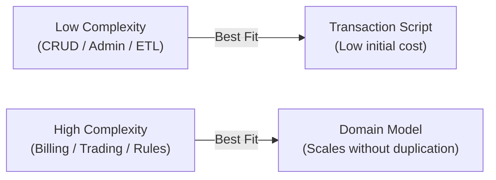

# Domain Model vs Transaction Script

| Field | Value |
| :--- | :--- |
| **Category** | Enterprise Application Patterns (Domain Logic Organization) |
| **Origin** | Martin Fowler (*PoEAA*, 2002) |
| **Difficulty** | Intermediate |
| **Prerequisite(s)** | [Service Layer](file:///E:/Learning/engineering-notes/08-solid-design-patterns/09-enterprise-application-patterns/05-service-layer.md) |
| **Status** | Complete |

> **TL;DR**: A **Transaction Script** organizes business logic as one procedural function per user action (simple, ideal for CRUD); a **Domain Model** organizes complex, interconnected rules into stateful objects (`Order`, `Subscription`, `Money`) that enforce their own invariants.

---

## 1. The Problem: Why Does This Choice Matter?

Not every application needs full Domain-Driven Design, and not every application survives as a pile of procedural scripts. Choosing a **Domain Model** for a simple CRUD app wastes weeks on abstractions; choosing **Transaction Scripts** for complex billing/scheduling rules leads to duplicated `if/else` spaghetti across 20 endpoints.

---

## 2. Definitions

- **Transaction Script**: A single procedure/function that takes input, reads from the DB, executes step-by-step validation/math, updates the DB, and returns. Each request maps 1-to-1 to a script.
- **Domain Model**: A network of interconnected domain objects (Entities, Value Objects, Aggregates) that encapsulate both **data** and **behavior/invariants** (`order.applyCoupon(coupon)`, `account.withdraw(money)`).

---

## 3. Complexity vs Cost Curve



---

## 4. What Goes Wrong With the Wrong Choice

```python
# ❌ Transaction Script scaling collapse:
# Same pro-rata refund & tax rule copy-pasted into cancel_order(), partial_refund(), and upgrade_plan()!
```

---

## 5. Multi-Language Examples (Comparing Both Styles)

### Java 25 LTS

```java
public class DomainVsScriptDemo {
    // Transaction Script: procedural, direct
    static double calcDiscountScript(double total, boolean vip) {
        return vip && total > 100 ? total * 0.85 : total;
    }

    // Domain Model: behavior lives on the domain object with invariants
    static class Order {
        private double total;
        private boolean finalized = false;
        Order(double total) { this.total = total; }

        void applyVipDiscount() {
            if (finalized) throw new IllegalStateException("Cannot discount finalized order");
            if (total > 100) total *= 0.85;
        }
        void finalizeOrder() { finalized = true; }
        double total() { return total; }
    }

    public static void main(String[] args) {
        System.out.println("Script: " + calcDiscountScript(200, true));
        var order = new Order(200);
        order.applyVipDiscount();
        order.finalizeOrder();
        System.out.println("Domain: " + order.total());
    }
}
```

### TypeScript 5.8

```ts
// Transaction Script
function renewSubscriptionScript(daysLeft: number, planPrice: number): number {
  return daysLeft > 0 ? planPrice * 0.9 : planPrice;
}

// Domain Model
class Subscription {
  private daysLeft: number;
  constructor(daysLeft: number) { this.daysLeft = daysLeft; }
  renew(planPrice: number): number {
    const price = this.daysLeft > 0 ? planPrice * 0.9 : planPrice;
    this.daysLeft += 30;
    return price;
  }
}

console.log(renewSubscriptionScript(5, 100), new Subscription(5).renew(100));
```

### Python 3.14

```python
# Transaction Script
def transfer_script(src_bal: int, dst_bal: int, amount: int) -> tuple[int, int]:
    if amount <= 0 or src_bal < amount:
        raise ValueError("Invalid transfer")
    return src_bal - amount, dst_bal + amount

# Domain Model
class Account:
    def __init__(self, balance: int) -> None:
        self.balance = balance
    def transfer_to(self, other: "Account", amount: int) -> None:
        if amount <= 0 or self.balance < amount:
            raise ValueError("Invalid transfer")
        self.balance -= amount
        other.balance += amount

a, b = Account(100), Account(20)
a.transfer_to(b, 40)
print(a.balance, b.balance)
```

---

## 6. Real-World Examples

1. **Transaction Script**: URL shorteners, webhook forwarders, CRUD admin dashboards, serverless Lambdas.
2. **Domain Model**: Stripe billing/invoicing, airline booking engines, insurance underwriting, multi-warehouse inventory allocation.

---

## 7. Related Patterns

- [Anemic vs Rich Domain Model](file:///E:/Learning/engineering-notes/08-solid-design-patterns/09-enterprise-application-patterns/11-anemic-vs-rich-domain-model.md), [Service Layer](file:///E:/Learning/engineering-notes/08-solid-design-patterns/09-enterprise-application-patterns/05-service-layer.md), [Table Module](file:///E:/Learning/engineering-notes/08-solid-design-patterns/09-enterprise-application-patterns/03-data-mapper-vs-active-record.md).

---

## 8. Advantages & Trade-offs

- **Transaction Script**: Zero learning curve, fast to ship, ideal when rules are linear and isolated.
- **Domain Model**: Eliminates duplicated business rules, enforces invariants at one place, models complex state machines cleanly.

---

## 9. When NOT to Use Domain Model

- Don't force a full DDD Domain Model onto a 5-table CRUD microservice—the mapping and repository overhead won't pay off.

---

## 10. Anti-Patterns & Common Mistakes

| Mistake | Why It Fails | Fix |
| :--- | :--- | :--- |
| Using Transaction Scripts for complex state machines | Business rules duplicate & diverge across scripts | Migrate core bounded context to a Domain Model |
| Building a heavy Domain Model for simple CRUD | Adds 3x boilerplate for zero domain complexity | Use Transaction Scripts / Active Record |
| Letting Transaction Scripts share mutable global helpers | Turns into unmaintainable procedural soup | Keep scripts focused or refactor to Domain Model |
| Half-baked Domain Model (all logic stays in scripts) | Worst of both worlds: boilerplate + anemic entities | Move invariants into the entities |

---

## 11. Comparison Table

| Dimension | Transaction Script | Domain Model |
| :--- | :--- | :--- |
| **Structure** | Procedural per use case | Object/functional domain graph |
| **Duplication Risk** | High as rules grow | Low (rules live on entities) |
| **Initial Setup Cost** | Minimal | Moderate |

---

## 12. Design Checklist

- [ ] Does the module have rich invariants/state transitions? (Domain Model) or simple step-by-step CRUD? (Transaction Script)
- [ ] Are business rules duplicated across 3+ scripts? Time to extract a Domain Model.

---

## 13. Interview Questions

<details>
<summary>1. What is the difference between Transaction Script and Domain Model?</summary>

Transaction Script organizes logic procedurally per action/request; Domain Model encapsulates data and invariants inside domain objects (Entities, Value Objects, Aggregates).

</details>

<details>
<summary>2. When is Transaction Script the superior choice?</summary>

When business logic is simple, linear, or CRUD-oriented (forms, admin tools, small serverless handlers) where Domain Model abstractions would be over-engineering.

</details>

<details>
<summary>3. What signal tells you to refactor from Transaction Script to Domain Model?</summary>

When the same validation/calculation rules are duplicated across multiple scripts and subtle invariant bugs appear when one script forgets a check.

</details>

<details>
<summary>4. Can both patterns coexist in the same application?</summary>

Yes—reporting/admin modules can use Transaction Scripts while the core billing/fulfillment module uses a Domain Model.

</details>

<details>
<summary>5. How does CQRS relate to Transaction Script?</summary>

In CQRS, the **Write side** often uses a Domain Model to protect invariants, while the **Read side** uses fast Transaction Script-style SQL projections.

</details>

<details>
<summary>6. Why does Transaction Script pair well with Active Record?</summary>

Both optimize for simplicity and 1-to-1 mapping between requests, procedures, and database tables.

</details>

<details>
<summary>7. Why does Domain Model pair well with Data Mapper & Repository?</summary>

Because Data Mapper keeps complex domain objects free of database/SQL concerns.

</details>

<details>
<summary>8. What is the middle ground between Transaction Script and OOP Domain Model?</summary>

A **Functional Domain Model** (immutable `record`s/`sealed` ADTs + pure domain functions).

</details>

---

## 14. Practice Exercises

<details>
<summary>Exercise 1: Refactor Duplicated Scripts</summary>

Take two scripts (`ship_order`, `cancel_order`) that both manually check `order.status` and mutate `order.items`, and encapsulate those invariants into an `Order` domain class.

</details>

<details>
<summary>Exercise 2: Classify 4 Features</summary>

Decide whether each feature fits Transaction Script or Domain Model: (a) Healthcheck endpoint, (b) Dynamic airline seat pricing, (c) CSV export, (d) Multi-currency escrow ledger.

</details>

<details>
<summary>Exercise 3: Hybrid CQRS Sketch</summary>

Write a read query script alongside a domain-model write command for an `Invoice`.

</details>

---

## 15. Cheat Sheet

- **Transaction Script**: 1 function per use case. Fast for CRUD.
- **Domain Model**: Entities + Value Objects own invariants. Scales for complex rules.

---

## 16. In Your Language

| Track | Relevant Deep-Dive |
| :--- | :--- |
| **Java** | [Spring Boot Architecture](file:///E:/Learning/engineering-notes/03-backend/spring-boot/15-architecture-and-patterns/README.md) |
| **TypeScript** | [NestJS Architecture](file:///E:/Learning/engineering-notes/03-backend/nestjs/08-architecture-and-patterns/README.md) |
| **Python** | [FastAPI Architecture](file:///E:/Learning/engineering-notes/03-backend/fastapi/12-architecture-and-patterns/README.md) |

---

## 17. Navigation

| Previous | Up | Next |
| :--- | :--- | :--- |
| [Gateway & Adapter for External Systems](file:///E:/Learning/engineering-notes/08-solid-design-patterns/09-enterprise-application-patterns/09-gateway-and-adapter-for-external-systems.md) | [Module 09](file:///E:/Learning/engineering-notes/08-solid-design-patterns/09-enterprise-application-patterns/README.md) | [Anemic vs Rich Domain Model](file:///E:/Learning/engineering-notes/08-solid-design-patterns/09-enterprise-application-patterns/11-anemic-vs-rich-domain-model.md) |
