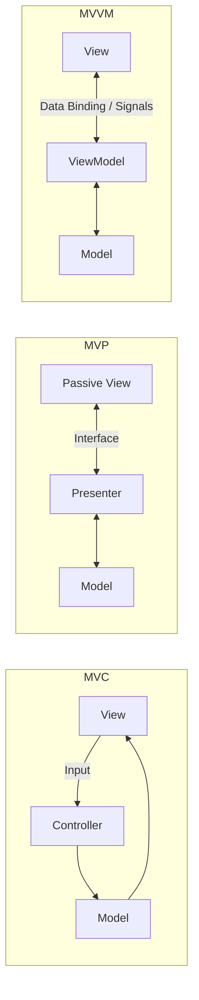

# MVC, MVP & MVVM

| Field | Value |
| :--- | :--- |
| **Category** | Enterprise Application Patterns (Presentation Layer) |
| **Origin** | Trygve Reenskaug (MVC, 1979) / Taligent (MVP) / Microsoft (MVVM, 2005) |
| **Difficulty** | Beginner → Intermediate |
| **Prerequisite(s)** | [Observer](file:///E:/Learning/engineering-notes/08-solid-design-patterns/07-behavioral-patterns/02-observer.md), [Service Layer](file:///E:/Learning/engineering-notes/08-solid-design-patterns/09-enterprise-application-patterns/05-service-layer.md) |
| **Status** | Complete |

> **TL;DR**: MVC, MVP, and MVVM all separate **Model** (data/domain), **View** (UI rendering), and **coordination logic**—differing in how the View and Model communicate (Controller routes input in MVC; Presenter drives a passive View in MVP; ViewModel exposes reactive/bound state in MVVM).

---

## 1. The Problem: Why Do Presentation Patterns Exist?

When UI widgets, event handlers, formatting, and SQL/API calls live in one file ("Smart UI" / spaghetti components):
1. You cannot unit-test presentation logic without launching a browser or mobile emulator.
2. Changing a UI framework (Swing → Web, UIKit → SwiftUI) forces rewriting business state logic.

---

## 2. The Three Patterns Compared

- **MVC (Model–View–Controller)**: User input hits the **Controller**, which updates the **Model** and selects/updates the **View** (classic server-side web: Spring MVC, Rails, Django).
- **MVP (Model–View–Presenter)**: The **View** is passive (`interface LoginView { showError(msg); }`). The **Presenter** mediates everything between Model and View, making UI logic 100% unit-testable with a mock View.
- **MVVM (Model–View–ViewModel)**: The **ViewModel** exposes observable state & commands (`count`, `increment()`). The **View** declaratively binds to the ViewModel (React hooks/stores, Vue, SwiftUI, WPF, Angular Signals)—the ViewModel has **zero reference to the View**.

---

## 3. Architecture Flows



---

## 4. What Goes Wrong Without Separation

```ts
// ❌ SMART UI: Business math, fetch, and DOM manipulation in one click handler
button.onclick = async () => {
  const res = await fetch('/api/cart');
  const data = await res.json();
  document.getElementById('total')!.textContent = `$${(data.cents * 1.1 / 100).toFixed(2)}`;
};
```

---

## 5. Multi-Language Examples (MVVM / MVP)

### Java 25 LTS (MVP — Testable Presenter + Passive View)

```java
public class MvpDemo {
    interface CounterView { void renderCount(int value); }
    static class CounterModel { int count = 0; }

    static class CounterPresenter {
        private final CounterView view;
        private final CounterModel model;
        CounterPresenter(CounterView view, CounterModel model) {
            this.view = view; this.model = model;
        }
        void onIncrementClicked() {
            model.count++;
            view.renderCount(model.count);
        }
    }

    public static void main(String[] args) {
        var presenter = new CounterPresenter(v -> System.out.println("UI renders: " + v), new CounterModel());
        presenter.onIncrementClicked();
        presenter.onIncrementClicked();
    }
}
```

### TypeScript 5.8 (MVVM — Observable ViewModel)

```ts
class CounterViewModel {
  private count = 0;
  private readonly listeners = new Set<(c: number) => void>();

  subscribe(fn: (c: number) => void) { this.listeners.add(fn); fn(this.count); }
  increment() {
    this.count++;
    this.listeners.forEach((fn) => fn(this.count));
  }
}

const vm = new CounterViewModel();
vm.subscribe((c) => console.log('View bound to count:', c));
vm.increment();
```

### Python 3.14 (MVC — Controller Routing to Model & View)

```python
class TodoModel:
    def __init__(self) -> None:
        self.items: list[str] = []
    def add(self, text: str) -> None:
        self.items.append(text)

class TodoView:
    def render(self, items: list[str]) -> str:
        return f"<ul>{''.join(f'<li>{i}</li>' for i in items)}</ul>"

class TodoController:
    def __init__(self, model: TodoModel, view: TodoView) -> None:
        self.model, self.view = model, view
    def post_todo(self, text: str) -> str:
        self.model.add(text)
        return self.view.render(self.model.items)

ctrl = TodoController(TodoModel(), TodoView())
print(ctrl.post_todo("Learn Patterns"))
```

---

## 6. Real-World Examples

1. **Spring MVC / Django / Ruby on Rails**: Server-side **MVC** (Controller handles HTTP, queries Model, renders HTML/JSON View).
2. **React Custom Hooks / Zustand / Vue / Jetpack Compose / SwiftUI**: Modern **MVVM** (View binds declaratively to ViewModel state).
3. **Desktop / Legacy Android**: **MVP** with `Contract.View` interfaces.

---

## 7. Related Patterns

- [Observer](file:///E:/Learning/engineering-notes/08-solid-design-patterns/07-behavioral-patterns/02-observer.md), [Service Layer](file:///E:/Learning/engineering-notes/08-solid-design-patterns/09-enterprise-application-patterns/05-service-layer.md).

---

## 8. Advantages

- **Testability**: Test Presenters and ViewModels as plain classes/functions without DOM/UI rendering.
- **Parallel Work**: Designers/frontend devs work on Views while logic devs build ViewModels/Controllers.

---

## 9. Limitations & When NOT to Use

- **Over-Engineering Tiny Components**: A static button doesn't need a 3-file MVP triad.
- **Two-Way Binding Spaghetti**: Uncontrolled two-way MVVM bindings can make state mutations hard to trace—prefer unidirectional data flow.

---

## 10. Anti-Patterns & Common Mistakes

| Mistake | Why It Fails | Fix |
| :--- | :--- | :--- |
| "Massive View Controller" (putting DB/business logic in Controller) | Untestable, violates SRP | Delegate business logic to Service Layer / Model |
| Importing DOM/UI toolkit classes inside a `ViewModel` | Breaks unit testing and couples VM to UI framework | Keep `ViewModel` pure state + commands |
| Putting `if/else` business rules inside HTML templates / JSX | Hard to test and reuse | Compute display flags in ViewModel / Presenter |
| Creating 1-to-1 ViewModel wrappers for static read-only views | Boilerplate noise | Use ViewModels where interactive state exists |

---

## 11. Comparison Table

| Dimension | MVC | MVP | MVVM |
| :--- | :--- | :--- | :--- |
| **View–Mediator Link** | Controller selects View | 1-to-1 via `View` interface | Data binding / Observer (VM has no View ref) |
| **Testability** | Moderate | High | Very High |
| **Best For** | Server-rendered / REST APIs | Passive UIs (desktop/legacy mobile) | Reactive UIs (React, Vue, SwiftUI, Compose) |

---

## 12. Design Checklist

- [ ] Is business/domain logic kept out of Views and Controllers?
- [ ] Can the Presenter / ViewModel be unit-tested without launching a browser/UI?

---

## 13. Interview Questions

<details>
<summary>1. What is the key difference between MVP and MVVM?</summary>

In MVP, the Presenter holds a reference to a `View` interface and explicitly calls `view.showLoading()`. In MVVM, the ViewModel has **no reference to the View**—it exposes observable state that the View subscribes/binds to.

</details>

<details>
<summary>2. How does server-side web MVC differ from classic desktop MVC?</summary>

In classic Smalltalk MVC, the View observed the Model directly. In web MVC (Spring/Rails), HTTP is stateless, so the Controller mediates between Model and View per request.

</details>

<details>
<summary>3. Where do React hooks / Redux / Vue Composables fit?</summary>

They follow the **MVVM** (or Unidirectional Data Flow) model: the component is the View, and the custom hook/store is the ViewModel.

</details>

<details>
<summary>4. What is the "Massive View Controller" anti-pattern?</summary>

Stuffing networking, validation, caching, and formatting into Controllers instead of delegating to Services and Models.

</details>

<details>
<summary>5. Why is MVP easy to unit test?</summary>

Because the View is behind an interface (`LoginView`), so tests pass a simple mock/spy implementing `LoginView`.

</details>

<details>
<summary>6. What is unidirectional data flow?</summary>

State flows down from ViewModel/Store to View, and user actions flow up as commands/events—avoiding cyclic two-way binding bugs.

</details>

<details>
<summary>7. Which GoF pattern powers MVVM bindings?</summary>

**Observer** (reactive signals, observables, or `PropertyChangeListener`).

</details>

<details>
<summary>8. Should Model classes contain UI formatting (like `$1,234.50` colors)?</summary>

No—formatting for display belongs in the ViewModel / Presenter / View, not the core Domain Model.

</details>

---

## 14. Practice Exercises

<details>
<summary>Exercise 1: Test a Presenter Without UI</summary>

Write a `LoginPresenter` test using an in-memory `FakeLoginView` verifying `showError("Invalid email")` is called for bad input.

</details>

<details>
<summary>Exercise 2: Reactive ViewModel</summary>

Add `decrement()` and `reset()` commands to the TypeScript `CounterViewModel`.

</details>

<details>
<summary>Exercise 3: Refactor Smart UI</summary>

Split a mixed fetch-and-DOM-render function into a Model, View, and Controller.

</details>

---

## 15. Cheat Sheet

- **MVC**: Input → Controller → Model → View (Web APIs/SSR).
- **MVP**: Presenter ↔ `View` interface (Passive View).
- **MVVM**: View binds to observable ViewModel (VM knows nothing about View).

---

## 16. In Your Language

| Track | Relevant Deep-Dive |
| :--- | :--- |
| **Java** | [Spring MVC](file:///E:/Learning/engineering-notes/03-backend/spring-boot/README.md) |
| **TypeScript** | [React State & Hooks](file:///E:/Learning/engineering-notes/02-frontend/reactjs/README.md) |
| **Python** | [FastAPI Controllers](file:///E:/Learning/engineering-notes/03-backend/fastapi/README.md) |

---

## 17. Navigation

| Previous | Up | Next |
| :--- | :--- | :--- |
| [Anemic vs Rich Domain Model](file:///E:/Learning/engineering-notes/08-solid-design-patterns/09-enterprise-application-patterns/11-anemic-vs-rich-domain-model.md) | [Module 09](file:///E:/Learning/engineering-notes/08-solid-design-patterns/09-enterprise-application-patterns/README.md) | [Plugin & Registry](file:///E:/Learning/engineering-notes/08-solid-design-patterns/09-enterprise-application-patterns/13-plugin-and-registry.md) |
