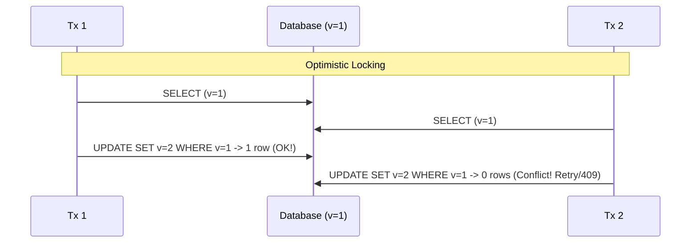

# Optimistic & Pessimistic Locking Patterns

| Field | Value |
| :--- | :--- |
| **Category** | Enterprise Application Patterns (Concurrency & Persistence) |
| **Origin** | Martin Fowler (*PoEAA*, 2002) |
| **Difficulty** | Intermediate |
| **Prerequisite(s)** | [Unit of Work](file:///E:/Learning/engineering-notes/08-solid-design-patterns/09-enterprise-application-patterns/02-unit-of-work.md), [Monitor Object & Locks](file:///E:/Learning/engineering-notes/08-solid-design-patterns/08-concurrency-patterns/03-monitor-object-and-lock-patterns.md) |
| **Status** | Complete |

> **TL;DR**: **Optimistic Locking** lets multiple readers proceed without locks and checks a `version` column at `UPDATE` time (`WHERE id = ? AND version = ?`)—ideal for low contention. **Pessimistic Locking** acquires an exclusive DB row lock upfront (`SELECT ... FOR UPDATE`)—ideal for high contention like seat reservations or hot inventory.

---

## 1. The Problem: The Lost Update Anomaly

Suppose `Inventory(sku="A", stock=10)`:
1. User 1 reads `stock = 10` (wants to buy 2).
2. User 2 reads `stock = 10` (wants to buy 3).
3. User 1 writes `stock = 8`.
4. User 2 writes `stock = 7`—**silently overwriting User 1's deduction!** Total sold = 5, but stock shows 7 instead of 5.

---

## 2. The Two Strategies

- **Optimistic Offline Lock**: Add a `version` integer (or timestamp/ETag) to every row. Read `(data, version=3)`. When saving, execute `UPDATE ... SET ..., version = version + 1 WHERE id = ? AND version = 3`. If `rowsAffected == 0`, someone else updated first → throw `OptimisticLockException` and retry or return `409 Conflict`.
- **Pessimistic Offline Lock**: Acquire an exclusive lock before reading (`SELECT * FROM inventory WHERE id = ? FOR UPDATE`). Other writers block until the transaction commits/rolls back.

---

## 3. Sequence Comparison



---

## 4. What Goes Wrong Without Locking

```sql
-- ❌ LOST UPDATE: Blindly overwriting based on stale read
UPDATE accounts SET balance = 900 WHERE id = 42; -- Ignores concurrent withdrawal!
```

---

## 5. Multi-Language Examples (Optimistic Lock with `version`)

### Java 25 LTS

```java
import java.util.concurrent.ConcurrentHashMap;

public class OptimisticLockDemo {
    record Row(String id, int stock, long version) {}

    static class Store {
        private final ConcurrentHashMap<String, Row> db = new ConcurrentHashMap<>();
        void put(Row r) { db.put(r.id(), r); }
        Row get(String id) { return db.get(id); }

        boolean updateStock(String id, int newStock, long expectedVersion) {
            return db.compute(id, (k, cur) -> {
                if (cur == null || cur.version() != expectedVersion) return cur;
                return new Row(id, newStock, expectedVersion + 1);
            }).version() == expectedVersion + 1;
        }
    }

    public static void main(String[] args) {
        var store = new Store();
        store.put(new Row("sku-1", 10, 1));
        var r1 = store.get("sku-1");
        var r2 = store.get("sku-1");

        System.out.println("T1 ok? " + store.updateStock("sku-1", r1.stock() - 2, r1.version()));
        System.out.println("T2 ok? " + store.updateStock("sku-1", r2.stock() - 3, r2.version())); // false!
    }
}
```

### TypeScript 5.8

```ts
interface Row { id: string; stock: number; version: number; }
const db = new Map<string, Row>([['sku-1', { id: 'sku-1', stock: 10, version: 1 }]]);

function updateWithVersion(id: string, newStock: number, expectedVersion: number): boolean {
  const cur = db.get(id);
  if (!cur || cur.version !== expectedVersion) return false;
  db.set(id, { id, stock: newStock, version: expectedVersion + 1 });
  return true;
}

const r1 = { ...db.get('sku-1')! };
const r2 = { ...db.get('sku-1')! };
console.log('T1:', updateWithVersion('sku-1', r1.stock - 2, r1.version));
console.log('T2:', updateWithVersion('sku-1', r2.stock - 3, r2.version));
```

### Python 3.14

```python
from dataclasses import dataclass

@dataclass
class Row:
    id: str
    stock: int
    version: int

db = {"sku-1": Row("sku-1", 10, 1)}

def update_optimistic(row_id: str, new_stock: int, expected_version: int) -> bool:
    cur = db[row_id]
    if cur.version != expected_version:
        return False
    db[row_id] = Row(row_id, new_stock, expected_version + 1)
    return True

r1 = Row(**db["sku-1"].__dict__)
r2 = Row(**db["sku-1"].__dict__)
print("T1:", update_optimistic("sku-1", r1.stock - 2, r1.version))
print("T2:", update_optimistic("sku-1", r2.stock - 3, r2.version))
```

---

## 6. Real-World Examples

1. **JPA `@Version`**: Hibernate automatically appends `AND version = ?` to `UPDATE` statements and throws `OptimisticLockException` if 0 rows match.
2. **HTTP `ETag` + `If-Match` Header**: Optimistic locking for REST APIs (`412 Precondition Failed` on stale update).
3. **PostgreSQL `SELECT ... FOR UPDATE SKIP LOCKED`**: Pessimistic locking for job queues and flash-sale inventory.

---

## 7. Related Patterns

- [Unit of Work](file:///E:/Learning/engineering-notes/08-solid-design-patterns/09-enterprise-application-patterns/02-unit-of-work.md), [Idempotency](file:///E:/Learning/engineering-notes/08-solid-design-patterns/03-design-principles/17-idempotency-principle.md).

---

## 8. Advantages & Trade-offs

- **Optimistic**: Zero lock overhead during reads, no deadlocks, works across HTTP requests (`ETag`); retries needed on conflict.
- **Pessimistic**: Prevents wasted work when conflicts are frequent; risks **deadlocks** and connection-pool exhaustion if transactions stay open too long.

---

## 9. When to Choose Which

- **Optimistic**: 90% of web/CRUD apps where concurrent edits to the exact same row are rare.
- **Pessimistic (`FOR UPDATE`)**: Hot rows with high contention (concert tickets, last item in stock, ledger balances) where optimistic retries would thrash.

---

## 10. Anti-Patterns & Common Mistakes

| Mistake | Why It Fails | Fix |
| :--- | :--- | :--- |
| Using `SELECT ... FOR UPDATE` across multi-second user think-time | Locks row & DB connection while user edits a form | Use **Optimistic (`ETag` / `version`)** across HTTP requests |
| Acquiring pessimistic locks in inconsistent order (`A->B` vs `B->A`) | Causes DB **deadlocks** | Always lock rows in deterministic sorted ID order |
| Retrying optimistic lock conflicts without a max retry cap | Infinite retry storm under heavy contention | Cap retries (e.g., 3 attempts with jitter) or switch to pessimistic |
| Updating `version` in application code before checking DB | Race condition between read and check | Check `WHERE version = expected` atomically inside SQL `UPDATE` |

---

## 11. Comparison Table

| Dimension | Optimistic Locking | Pessimistic Locking |
| :--- | :--- | :--- |
| **Mechanism** | `version` / `ETag` check at commit | `SELECT ... FOR UPDATE` at read |
| **Contention Fit** | Low–Moderate | High (hot rows) |
| **Deadlock Risk** | None | Yes (requires lock ordering + timeouts) |
| **Works Across HTTP Requests?** | Yes (`If-Match: "v3"`) | No (never hold DB locks across HTTP!) |

---

## 12. Design Checklist

- [ ] Are concurrent-write entities protected by `@Version` / `version` or `FOR UPDATE`?
- [ ] Do pessimistic locks acquire rows in consistent sorted ID order with `lock_timeout`?
- [ ] Are optimistic retries bounded with backoff?

---

## 13. Interview Questions

<details>
<summary>1. Compare Optimistic vs Pessimistic locking.</summary>

Optimistic assumes conflicts are rare and checks a `version`/`ETag` at write time; Pessimistic assumes conflicts are likely and locks the row upfront with `SELECT ... FOR UPDATE`.

</details>

<details>
<summary>2. How does HTTP `ETag` + `If-Match` implement Optimistic Locking?</summary>

GET returns `ETag: "v3"`. PUT/PATCH sends `If-Match: "v3"`. If the server's current version is `"v4"`, it rejects with `412 Precondition Failed`.

</details>

<details>
<summary>3. Why must you never hold a DB pessimistic lock across user think-time?</summary>

Holding a DB transaction open for seconds/minutes blocks other users and exhausts the database connection pool.

</details>

<details>
<summary>4. How do you prevent deadlocks with `SELECT ... FOR UPDATE`?</summary>

Acquire locks in a consistent canonical order (e.g., sort account IDs ascending before locking) and set `lock_timeout`.

</details>

<details>
<summary>5. What happens when Optimistic Locking has 90% contention (e.g., flash sale)?</summary>

Most transactions fail at commit and retry repeatedly ("livelock"/thrashing). Switch to pessimistic locking (`FOR UPDATE`) or atomic SQL (`UPDATE ... SET stock = stock - 1 WHERE stock >= 1`).

</details>

<details>
<summary>6. What does `SKIP LOCKED` do in PostgreSQL?</summary>

`SELECT ... FOR UPDATE SKIP LOCKED` skips rows already locked by other workers, making it ideal for SQL-backed job queues.

</details>

<details>
<summary>7. How does JPA `@Version` work?</summary>

JPA includes `WHERE id = ? AND version = ?` in the SQL `UPDATE` and checks that `rowCount == 1`, throwing `OptimisticLockException` otherwise.

</details>

<details>
<summary>8. What HTTP status code is idiomatic for an optimistic lock conflict?</summary>

`409 Conflict` (or `412 Precondition Failed` when using `If-Match`).

</details>

---

## 14. Practice Exercises

<details>
<summary>Exercise 1: Retry Loop on Optimistic Conflict</summary>

Wrap `updateOptimistic` in a bounded 3-attempt retry helper that re-reads the latest row on conflict.

</details>

<details>
<summary>Exercise 2: Canonical Lock Ordering</summary>

Write `transfer(fromId, toId, amount)` that always locks `min(fromId, toId)` before `max(fromId, toId)`.

</details>

<details>
<summary>Exercise 3: `If-Match` Endpoint Sketch</summary>

Design a `PATCH /documents/{id}` handler checking `If-Match` against `doc.version`.

</details>

---

## 15. Cheat Sheet

- **Low contention / cross-HTTP** → **Optimistic** (`version` / `ETag`).
- **High contention / hot rows** → **Pessimistic** (`FOR UPDATE` in sorted ID order).

---

## 16. In Your Language

| Track | Relevant Deep-Dive |
| :--- | :--- |
| **Java** | [JPA Locking](file:///E:/Learning/engineering-notes/03-backend/spring-boot/README.md) |
| **TypeScript** | [PostgreSQL & Prisma Transactions](file:///E:/Learning/engineering-notes/01-languages/sql/README.md) |
| **Python** | [SQLAlchemy Locking](file:///E:/Learning/engineering-notes/01-languages/python/19-database-access/README.md) |

---

## 17. Navigation

| Previous | Up | Next |
| :--- | :--- | :--- |
| [Plugin & Registry](file:///E:/Learning/engineering-notes/08-solid-design-patterns/09-enterprise-application-patterns/13-plugin-and-registry.md) | [Module 09](file:///E:/Learning/engineering-notes/08-solid-design-patterns/09-enterprise-application-patterns/README.md) | [Value Object, Entity & Aggregate](file:///E:/Learning/engineering-notes/08-solid-design-patterns/09-enterprise-application-patterns/15-value-object-entity-aggregate.md) |
